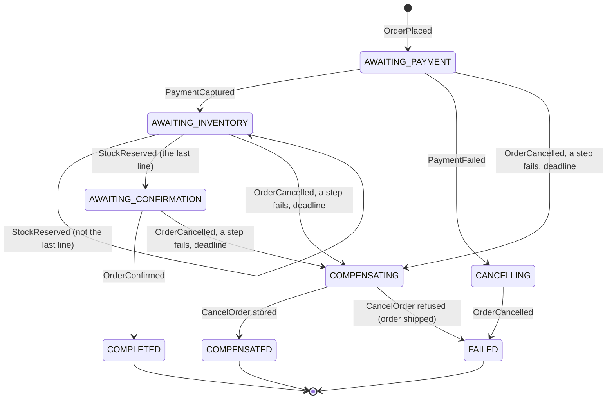

# Chapter 11 — Payment Aggregate & Saga

> **What you'll learn:**
> - What a saga is and why multi-aggregate coordination requires one
> - How to model a `Payment` aggregate with `PaymentCommand`, `PaymentEvent`, `PaymentState`, and `PaymentDecider`
> - How `SagaOrchestrator` separates business process logic from aggregate logic
> - How `OrderFulfillmentSaga` drives payment, inventory, and order confirmation in sequence
> - How `compensate()` cancels the order, and how every cancellation of an order releases its stock and voids or refunds its payment
> - How `PostgresSagaStore`, `SagaRunner`, and `SagaStatus` wire the process into the running application
> - How the saga survives poison events, redelivered commands, and concurrent writers: `SagaDeadLetterStore`, the command inbox, and optimistic-concurrency CAS

---

## What We're Building and Why

Most domain operations touch a single aggregate: place an order, update a price, register a customer. A single command reaches a single stream, produces events, and the world moves on. Payment fulfillment is different. It coordinates three aggregates in order: the payment must be captured before stock is reserved, and stock must be reserved before the order is confirmed. If any step fails, all earlier steps must be undone. You cannot wrap this in a database transaction — each aggregate lives in its own stream, and the gateway is external.

This is the problem sagas solve.

A **saga** is a sequence of steps that span multiple aggregates, where each step is a command and each transition is triggered by an event. When a step fails, the saga issues compensating commands to undo whatever succeeded. The saga itself is stateful: it knows which step it is on and what information it needs to proceed or to compensate.

The order fulfillment flow the saga drives — what its `evolve()`/`handle()`/`compensate()` code reacts to, and what the assembled demo actually runs end-to-end — follows five steps:

1. `OrderPlaced` arrives — the saga starts, issues `InitiatePayment`
2. `PaymentCaptured` arrives — saga advances and issues one `ReserveStock` per order line against the inventory aggregate (Step 1b)
3. One `StockReserved` per line arrives — the one that completes the order's lines makes the saga issue `ConfirmOrder`
4. `OrderConfirmed` arrives — saga completes (`COMPLETED`)
5. Any failure — on `PaymentFailed` the saga moves to a non-terminal `CANCELLING` step, dispatches `CancelOrder`, and `OrderCancelled` then closes it out to `FAILED` (a terminal `evolve()` would end the saga before `handle()` ever ran, so the cancel needs that intermediate step — see [Step 3](#step-3--implement-orderfulfillmentsaga)); if a later step's command fails, or the fulfillment's deadline passes, `compensate()` cancels the order. A cancellation of the order by its customer or an `ADMIN` while the saga runs ends the fulfillment too: the saga moves to `COMPENSATING`, and its compensation cancels the order once more



The saga never releases stock or refunds a payment itself. Every cancellation of an order is an `OrderCancelled` event — the customer's, an `ADMIN`'s, the saga's own compensation — and every `OrderCancelled` is undone by the `OrderCancellationProcessManager`: it releases the order's stock at every product of its lines and voids the payment, or refunds it once captured. Each of those commands is safe whether or not the step it undoes ran, so the undo does not need to know how far the fulfillment got.

This chapter builds the `Payment` aggregate, the `OrderFulfillmentSaga`, the `PaymentProcessManager` that drives the capture leg, and the two process managers that undo a cancelled order and commit the stock of a shipped one. The saga reserves stock from the `Inventory` aggregate, and the undo of a cancelled order releases it there, so this chapter builds that aggregate as well: its commands, events and state, its decider (Step 1b) and the route that receives stock (Step 1c). Chapter 13 adds its read model.

> **What makes the saga complete in the assembled demo.** When you place an order end-to-end, the saga does not stall — it runs all the way to `COMPLETED`. Two pieces make that work:
>
> - **The framework routes the saga's own replies; the saga routes one outside event.** With every event of a command a saga dispatched, the command bus stores that saga's *origin* (saga type, saga id, hop count) in the event's metadata, and `SagaRunner` hands such an event to the saga its origin names. `PaymentInitiated`, `StockReserved` and the saga's own `OrderConfirmed` come back this way, with no routing code in the saga. An `OrderCancelled` that a request of the order's customer or an `ADMIN` causes carries no origin; for it `OrderFulfillmentSaga.correlateByEventData()` reads the `orderId` in the event and answers `fulfillment-<orderId>`, the saga of that order. No correlation id takes part (Step 3 says why).
> - **A `PaymentProcessManager` drives the capture leg.** It is an `EventListener` (fed by its own `PollingEventSubscription`) that reacts to `PaymentInitiated`, calls `PaymentGatewaySimulator.processPayment(...)`, and dispatches `CapturePayment` when the gateway takes the money or `FailPayment` when it declines — inside `StreamRuneContext.continuing(event)`, so `PaymentCaptured`/`PaymentFailed` carry the origin of the saga that caused `PaymentInitiated` and reach that saga. A call that gets no answer decides nothing: the manager asks the gateway whether it took the money and otherwise lets the event be delivered again, and a command it cannot dispatch is delivered again too, never turned into a failed payment.
>
> You build the `PaymentProcessManager` in Step 5b, with the circuit breaker around its gateway call that Chapter 12 explains, and wire it in Step 6.

---

## Domain Model: Payment Types

The payment domain is clean and focused. A payment moves through five statuses: `PENDING` after initiation, `CAPTURED` after the gateway confirms it, `REFUNDED` when the money goes back to the customer, `VOIDED` when a pending payment is cancelled before the gateway took anything, and `FAILED` if the gateway rejects it. Every payment has one id, `PaymentIds.forOrder(orderId)`, which is `"pay-" + orderId`; the saga and every other piece of code that addresses an order's payment build the id with this class, so the convention lives in one place.

### PaymentStatus

Create `domain/src/main/java/org/streamrune/ecommerce/domain/payment/PaymentStatus.java`:

```java
package org.streamrune.ecommerce.domain.payment;

public enum PaymentStatus {
  PENDING,
  CAPTURED,
  REFUNDED,
  VOIDED,
  FAILED
}
```

### PaymentCommand

Create `domain/src/main/java/org/streamrune/ecommerce/domain/payment/PaymentCommand.java`:

```java
package org.streamrune.ecommerce.domain.payment;

import org.streamrune.core.Command;
import org.streamrune.ecommerce.domain.common.Money;

public sealed interface PaymentCommand extends Command {
  record InitiatePayment(String paymentId, String orderId, Money amount)
      implements PaymentCommand {}

  record CapturePayment(String paymentId) implements PaymentCommand {}

  record FailPayment(String paymentId, String reason) implements PaymentCommand {}

  /** Voids a pending payment, refunds a captured one in full, and does nothing otherwise. */
  record CancelPayment(String paymentId, String reason) implements PaymentCommand {}
}
```

`InitiatePayment` carries the full amount so the `PaymentDecider` can record it in state without needing to look up the order. `FailPayment` and `CancelPayment` carry a `reason` so the event stream explains what happened — important for audit and projection consumers. `CancelPayment` is the undo that does not need to know what happened to the payment: it voids a pending payment, refunds a captured one in full, and does nothing otherwise, so the cancellation of an order can send it whether or not the payment ever got that far. It is the only command that refunds: the `OrderCancellationProcessManager` (Step 5c) sends it for every cancelled order.

### PaymentEvent

Create `domain/src/main/java/org/streamrune/ecommerce/domain/payment/PaymentEvent.java`:

```java
package org.streamrune.ecommerce.domain.payment;

import org.streamrune.core.DomainEvent;
import org.streamrune.ecommerce.domain.common.Money;

public sealed interface PaymentEvent extends DomainEvent {
  record PaymentInitiated(String paymentId, String orderId, Money amount) implements PaymentEvent {}

  record PaymentCaptured(String paymentId, String orderId) implements PaymentEvent {}

  record PaymentRefunded(String paymentId, String orderId, Money amount, String reason)
      implements PaymentEvent {}

  record PaymentFailed(String paymentId, String orderId, String reason) implements PaymentEvent {}

  record PaymentVoided(String paymentId, String orderId, String reason) implements PaymentEvent {}
}
```

Every payment event carries `orderId`, so consumers can relate the event to its order without querying state; the saga compares the payment id with the one it derives from its order (`PaymentIds.forOrder`) before it reacts (Step 3). `PaymentRefunded` carries the refunded `amount` (always the full captured amount), and `PaymentVoided` and `PaymentFailed` carry the `reason`.

### PaymentState

Create `domain/src/main/java/org/streamrune/ecommerce/domain/payment/PaymentState.java`:

```java
package org.streamrune.ecommerce.domain.payment;

import org.streamrune.core.AggregateState;
import org.streamrune.core.types.AggregateType;
import org.streamrune.ecommerce.domain.common.Money;

public record PaymentState(String paymentId, String orderId, Money amount, PaymentStatus status)
    implements AggregateState {
  /**
   * The aggregate type the payment decider is registered under: streams are payment:<paymentId>.
   */
  public static final AggregateType TYPE = AggregateType.of("payment");

  public PaymentState() {
    this(null, null, null, PaymentStatus.PENDING);
  }

  public PaymentState withStatus(PaymentStatus newStatus) {
    return new PaymentState(paymentId, orderId, amount, newStatus);
  }
}
```

`withStatus` copies the state with another status, the way `evolve` moves a payment on. The no-arg constructor initialises status to `PENDING`, with no payment id: a payment id of `null` is how `decide` tells an id nobody initiated from a pending payment. StreamRune calls this constructor to create a blank state before replaying the event stream for an aggregate that has never been seen before. `TYPE` is the aggregate type the payment decider registers under (Step 6); a payment's stream is `payment:<paymentId>`.


### PaymentIds

Create `domain/src/main/java/org/streamrune/ecommerce/domain/payment/PaymentIds.java`, the one place that knows the id of an order's payment:

```java
package org.streamrune.ecommerce.domain.payment;

/** The payment of an order: one per order, named after it. */
public final class PaymentIds {

  /** The prefix of an order's payment id. */
  public static final String PREFIX = "pay-";

  private PaymentIds() {}

  /** The id of the payment that pays for {@code orderId}: {@code "pay-" + orderId}. */
  public static String forOrder(String orderId) {
    return PREFIX + orderId;
  }
}
```

## Domain Model: Inventory Types

The saga reserves the stock of every line of the order, and the two process managers of Step 5c release and commit it: they dispatch the inventory's commands and react to its events. Those types come first, so the saga compiles, and the inventory's decider follows in Step 1b: the command bus refuses a command it has no decider for, so without one no order could reserve its stock and no cancelled order could release it.

Inventory tracks stock for a single product across three pools:

- **available** — units that can be sold right now.
- **reserved** — units held for an order between its payment and its shipment, per order: each order has its own reservation at the product.
- **committed** — units confirmed for fulfillment; they leave the warehouse when the order ships.

The lifecycle of a unit flows: available → reserved (on `ReserveStock`) → committed (on `ConfirmReservation`) → gone. Cancellations reverse the first step: reserved → available again (on `ReleaseStock`). New stock arrives via `ReceiveShipment`. The lifecycle is per order: a release or a confirmation acts on the reservation of the order it names, at the product it names, and stores nothing when that order holds none. So a release that runs twice releases once, a release after the shipment committed the stock changes nothing, and two orders at one product are released and confirmed apart. The fulfillment saga sends `ReserveStock` for every line of an order; the order cancellation process manager sends `ReleaseStock` for every line of a cancelled order, and the order shipment process manager sends `ConfirmReservation` for every line of a shipped one (Step 5c).

### InventoryCommand

Create `domain/src/main/java/org/streamrune/ecommerce/domain/inventory/InventoryCommand.java`:

```java
package org.streamrune.ecommerce.domain.inventory;

import org.streamrune.core.Command;

public sealed interface InventoryCommand extends Command {
  record ReserveStock(String productId, String orderId, int quantity) implements InventoryCommand {}

  record ReleaseStock(String productId, String orderId) implements InventoryCommand {}

  record ConfirmReservation(String productId, String orderId) implements InventoryCommand {}

  record ReceiveShipment(String productId, int quantity) implements InventoryCommand {}
}
```

### InventoryEvent

Create `domain/src/main/java/org/streamrune/ecommerce/domain/inventory/InventoryEvent.java`:

```java
package org.streamrune.ecommerce.domain.inventory;

import org.streamrune.core.DomainEvent;

public sealed interface InventoryEvent extends DomainEvent {
  record StockReserved(String productId, String orderId, int quantity, int availableAfter)
      implements InventoryEvent {}

  record StockReleased(String productId, String orderId, int quantity, int availableAfter)
      implements InventoryEvent {}

  record ReservationConfirmed(String productId, String orderId, int quantity)
      implements InventoryEvent {}

  record ShipmentReceived(String productId, int quantity, int availableAfter)
      implements InventoryEvent {}
}
```

`ReleaseStock` and `ConfirmReservation` name the order and no quantity: the quantity is the one the order reserved, which the aggregate knows. Each event records the `availableAfter` pool size at the time of the transition. This makes the event self-describing: a consumer can reconstruct the current availability without replaying the entire stream.

### InventoryState

Create `domain/src/main/java/org/streamrune/ecommerce/domain/inventory/InventoryState.java`:

```java
package org.streamrune.ecommerce.domain.inventory;

import com.fasterxml.jackson.annotation.JsonCreator;
import com.fasterxml.jackson.annotation.JsonProperty;
import java.util.Map;
import java.util.OptionalInt;
import org.streamrune.core.AggregateState;
import org.streamrune.core.types.AggregateType;

public record InventoryState(
    String productId, int available, int reserved, int committed, Map<String, Integer> reservations)
    implements AggregateState {
  /**
   * The aggregate type the inventory decider is registered under: streams are
   * inventory:<productId>.
   */
  public static final AggregateType TYPE = AggregateType.of("inventory");

  /**
   * {@code reservations} holds the open reservation of each order at this product, by order id: an
   * entry is added by {@code StockReserved} and removed by {@code StockReleased} or {@code
   * ReservationConfirmed}. The state is snapshotted with the map.
   */
  @JsonCreator
  public InventoryState(
      @JsonProperty("productId") String productId,
      @JsonProperty("available") int available,
      @JsonProperty("reserved") int reserved,
      @JsonProperty("committed") int committed,
      @JsonProperty("reservations") Map<String, Integer> reservations) {
    this.productId = productId;
    this.available = available;
    this.reserved = reserved;
    this.committed = committed;
    this.reservations = reservations == null ? Map.of() : Map.copyOf(reservations);
  }

  public InventoryState() {
    this(null, 0, 0, 0, Map.of());
  }

  /** The quantity the order holds reserved at this product, or none. */
  public OptionalInt reservationOf(String orderId) {
    Integer quantity = reservations.get(orderId);
    return quantity == null ? OptionalInt.empty() : OptionalInt.of(quantity);
  }
}
```

The zero-argument constructor satisfies `AggregateState`; StreamRune calls it when no prior events exist for the stream.

`reservations` holds the open reservation of each order at this product, by order id. `StockReserved` adds an entry; `StockReleased` and `ReservationConfirmed` remove it, so the map holds only the orders in flight for the product. The bus snapshots the state with the map (chapter 8): the canonical constructor is the one Jackson uses (`@JsonCreator`, one `@JsonProperty` per component), and it reads a state written without `reservations` as an empty map. A snapshot that lost the map would make every release and confirmation after it store nothing, with no error, and strand the stock. `reservationOf(orderId)` is the quantity an order holds, or none.

---

## Step by Step

### Step 1 — Test and implement PaymentDecider

Start with the test. Create `commands/src/test/java/org/streamrune/ecommerce/commands/payment/PaymentDeciderTest.java`:

```java
package org.streamrune.ecommerce.commands.payment;

import static org.assertj.core.api.Assertions.assertThat;

import java.math.BigDecimal;
import org.junit.jupiter.api.Test;
import org.junit.jupiter.params.ParameterizedTest;
import org.junit.jupiter.params.provider.EnumSource;
import org.junit.jupiter.params.provider.EnumSource.Mode;
import org.streamrune.core.DomainException;
import org.streamrune.ecommerce.domain.common.Money;
import org.streamrune.ecommerce.domain.payment.*;
import org.streamrune.test.DeciderFixture;

class PaymentDeciderTest {

  private final DeciderFixture<PaymentCommand, PaymentState, PaymentEvent> fixture =
      DeciderFixture.of(new PaymentDecider());

  private static final Money HUNDRED = new Money(BigDecimal.valueOf(100), "USD");

  private static PaymentEvent.PaymentInitiated initiated() {
    return new PaymentEvent.PaymentInitiated("pay-1", "o-1", HUNDRED);
  }

  private static PaymentEvent.PaymentCaptured captured() {
    return new PaymentEvent.PaymentCaptured("pay-1", "o-1");
  }

  private static PaymentEvent.PaymentRefunded refunded() {
    return new PaymentEvent.PaymentRefunded("pay-1", "o-1", HUNDRED, "earlier");
  }

  /** The events of a payment that stands in {@code status}. */
  private static PaymentEvent[] historyOf(PaymentStatus status) {
    return switch (status) {
      case PENDING -> new PaymentEvent[] {initiated()};
      case CAPTURED -> new PaymentEvent[] {initiated(), captured()};
      case REFUNDED -> new PaymentEvent[] {initiated(), captured(), refunded()};
      case VOIDED ->
          new PaymentEvent[] {
            initiated(), new PaymentEvent.PaymentVoided("pay-1", "o-1", "earlier")
          };
      case FAILED ->
          new PaymentEvent[] {
            initiated(), new PaymentEvent.PaymentFailed("pay-1", "o-1", "earlier")
          };
    };
  }

  // InitiatePayment

  @Test
  void initiatePayment_onANewStream_initiatesIt() {
    fixture
        .given()
        .when(new PaymentCommand.InitiatePayment("pay-1", "o-1", HUNDRED))
        .expectEvents(initiated())
        .expectState(s -> assertThat(s.status()).isEqualTo(PaymentStatus.PENDING));
  }

  @ParameterizedTest
  @EnumSource(PaymentStatus.class)
  void initiatePayment_onAnExistingPayment_isRefused(PaymentStatus status) {
    fixture
        .given(historyOf(status))
        .when(new PaymentCommand.InitiatePayment("pay-1", "o-1", HUNDRED))
        .expectException(DomainException.class);
  }

  // CapturePayment

  @Test
  void capturePayment_withoutAStream_isRefused() {
    fixture
        .given()
        .when(new PaymentCommand.CapturePayment("pay-1"))
        .expectException(DomainException.class);
  }

  @Test
  void capturePayment_pending_capturesIt() {
    fixture
        .given(historyOf(PaymentStatus.PENDING))
        .when(new PaymentCommand.CapturePayment("pay-1"))
        .expectEvents(captured())
        .expectState(s -> assertThat(s.status()).isEqualTo(PaymentStatus.CAPTURED));
  }

  @ParameterizedTest
  @EnumSource(
      value = PaymentStatus.class,
      names = {"CAPTURED", "REFUNDED"})
  void capturePayment_capturedOrRefunded_storesNothing(PaymentStatus status) {
    fixture
        .given(historyOf(status))
        .when(new PaymentCommand.CapturePayment("pay-1"))
        .expectNoEvents();
  }

  @ParameterizedTest
  @EnumSource(
      value = PaymentStatus.class,
      names = {"VOIDED", "FAILED"})
  void capturePayment_voidedOrFailed_recordsTheCaptureAndRefundsItInOneAppend(
      PaymentStatus status) {
    fixture
        .given(historyOf(status))
        .when(new PaymentCommand.CapturePayment("pay-1"))
        .expectEvents(
            captured(),
            new PaymentEvent.PaymentRefunded(
                "pay-1", "o-1", HUNDRED, PaymentDecider.LATE_CAPTURE_REASON))
        .expectState(s -> assertThat(s.status()).isEqualTo(PaymentStatus.REFUNDED));
  }

  // FailPayment

  @Test
  void failPayment_withoutAStream_isRefused() {
    fixture
        .given()
        .when(new PaymentCommand.FailPayment("pay-1", "Gateway timeout"))
        .expectException(DomainException.class);
  }

  @Test
  void failPayment_pending_failsIt() {
    fixture
        .given(historyOf(PaymentStatus.PENDING))
        .when(new PaymentCommand.FailPayment("pay-1", "Gateway timeout"))
        .expectEvents(new PaymentEvent.PaymentFailed("pay-1", "o-1", "Gateway timeout"))
        .expectState(s -> assertThat(s.status()).isEqualTo(PaymentStatus.FAILED));
  }

  @ParameterizedTest
  @EnumSource(
      value = PaymentStatus.class,
      mode = Mode.EXCLUDE,
      names = {"PENDING"})
  void failPayment_notPending_storesNothing(PaymentStatus status) {
    fixture
        .given(historyOf(status))
        .when(new PaymentCommand.FailPayment("pay-1", "Gateway timeout"))
        .expectNoEvents();
  }

  // CancelPayment

  @Test
  void cancelPayment_withoutAStream_storesNothing() {
    fixture.given().when(new PaymentCommand.CancelPayment("pay-1", "why")).expectNoEvents();
  }

  @Test
  void cancelPayment_pending_voidsIt() {
    fixture
        .given(historyOf(PaymentStatus.PENDING))
        .when(new PaymentCommand.CancelPayment("pay-1", "why"))
        .expectEvents(new PaymentEvent.PaymentVoided("pay-1", "o-1", "why"))
        .expectState(s -> assertThat(s.status()).isEqualTo(PaymentStatus.VOIDED));
  }

  @Test
  void cancelPayment_captured_refundsTheFullAmount() {
    fixture
        .given(historyOf(PaymentStatus.CAPTURED))
        .when(new PaymentCommand.CancelPayment("pay-1", "why"))
        .expectEvents(new PaymentEvent.PaymentRefunded("pay-1", "o-1", HUNDRED, "why"))
        .expectState(s -> assertThat(s.status()).isEqualTo(PaymentStatus.REFUNDED));
  }

  @ParameterizedTest
  @EnumSource(
      value = PaymentStatus.class,
      names = {"REFUNDED", "VOIDED", "FAILED"})
  void cancelPayment_settledOtherwise_storesNothing(PaymentStatus status) {
    fixture
        .given(historyOf(status))
        .when(new PaymentCommand.CancelPayment("pay-1", "why"))
        .expectNoEvents();
  }
}
```

Run the tests — they will fail. Now write the implementation. Create `commands/src/main/java/org/streamrune/ecommerce/commands/payment/PaymentDecider.java`:

```java
package org.streamrune.ecommerce.commands.payment;

import java.util.List;
import org.streamrune.core.Decider;
import org.streamrune.core.DomainException;
import org.streamrune.ecommerce.domain.payment.*;

public class PaymentDecider implements Decider<PaymentCommand, PaymentState, PaymentEvent> {

  /** The reason of the refund recorded with a capture of a payment that was voided or failed. */
  public static final String LATE_CAPTURE_REASON = "captured after the payment was cancelled";

  @Override
  public PaymentState initialState() {
    return new PaymentState();
  }

  /**
   * {@code CapturePayment} is sent only after the gateway took the money, so it is never refused
   * for a status the money cannot undo: on a voided or failed payment the capture is recorded and
   * refunded in one append. {@code FailPayment} and {@code CancelPayment} store nothing for a
   * payment they do not apply to, so a redelivered or late command settles nothing twice.
   */
  @Override
  public List<PaymentEvent> decide(PaymentCommand cmd, PaymentState state) {
    return switch (cmd) {
      case PaymentCommand.InitiatePayment c -> {
        if (exists(state)) throw new DomainException("Payment already exists: " + c.paymentId());
        yield List.of(new PaymentEvent.PaymentInitiated(c.paymentId(), c.orderId(), c.amount()));
      }

      case PaymentCommand.CapturePayment c -> {
        requireExists(state, c.paymentId());
        yield switch (state.status()) {
          case PENDING -> List.of(new PaymentEvent.PaymentCaptured(c.paymentId(), state.orderId()));
          case CAPTURED, REFUNDED -> List.of();
          case VOIDED, FAILED ->
              List.of(
                  new PaymentEvent.PaymentCaptured(c.paymentId(), state.orderId()),
                  new PaymentEvent.PaymentRefunded(
                      c.paymentId(), state.orderId(), state.amount(), LATE_CAPTURE_REASON));
        };
      }

      case PaymentCommand.FailPayment c -> {
        requireExists(state, c.paymentId());
        yield state.status() == PaymentStatus.PENDING
            ? List.of(new PaymentEvent.PaymentFailed(c.paymentId(), state.orderId(), c.reason()))
            : List.of();
      }

      case PaymentCommand.CancelPayment c -> {
        if (!exists(state)) yield List.of();
        yield switch (state.status()) {
          case PENDING ->
              List.of(new PaymentEvent.PaymentVoided(c.paymentId(), state.orderId(), c.reason()));
          case CAPTURED ->
              List.of(
                  new PaymentEvent.PaymentRefunded(
                      c.paymentId(), state.orderId(), state.amount(), c.reason()));
          case REFUNDED, VOIDED, FAILED -> List.of();
        };
      }
    };
  }

  /** A payment that was never initiated has no id: its empty state reads {@code PENDING}. */
  private static boolean exists(PaymentState state) {
    return state.paymentId() != null;
  }

  private static void requireExists(PaymentState state, String paymentId) {
    if (!exists(state)) throw new DomainException("Payment not found: " + paymentId);
  }

  @Override
  public PaymentState evolve(PaymentState state, PaymentEvent evt) {
    return switch (evt) {
      case PaymentEvent.PaymentInitiated e ->
          new PaymentState(e.paymentId(), e.orderId(), e.amount(), PaymentStatus.PENDING);
      case PaymentEvent.PaymentCaptured e -> state.withStatus(PaymentStatus.CAPTURED);
      case PaymentEvent.PaymentRefunded e -> state.withStatus(PaymentStatus.REFUNDED);
      case PaymentEvent.PaymentFailed e -> state.withStatus(PaymentStatus.FAILED);
      case PaymentEvent.PaymentVoided e -> state.withStatus(PaymentStatus.VOIDED);
    };
  }
}
```

The `decide()` method is a table of command against status (`[]` means no event and no exception):

| Command \ status | no stream | `PENDING` | `CAPTURED` | `REFUNDED` | `VOIDED` | `FAILED` |
|---|---|---|---|---|---|---|
| `InitiatePayment` | `PaymentInitiated` | refused | refused | refused | refused | refused |
| `CapturePayment` | refused | `PaymentCaptured` | `[]` | `[]` | `PaymentCaptured`, `PaymentRefunded` | `PaymentCaptured`, `PaymentRefunded` |
| `FailPayment` | refused | `PaymentFailed` | `[]` | `[]` | `[]` | `[]` |
| `CancelPayment` | `[]` | `PaymentVoided` | `PaymentRefunded` | `[]` | `[]` | `[]` |

- **`InitiatePayment`** opens a payment once. A second initiation of an existing payment would reset it, so it is refused.
- **`CapturePayment`** is sent only after the gateway took the money, so it is never refused for a status the money cannot undo. A capture of a payment that was voided or failed in the meantime is recorded and refunded in the same append (`PaymentDecider.LATE_CAPTURE_REASON`), in one transaction: the books show the capture and its reversal, and no step has to find the payment later. A capture of a captured or refunded payment is a redelivery and stores nothing.
- **`FailPayment`** fails a pending payment. On any other status it stores nothing, so a gateway's decline that arrives after a void, or a redelivered failure, never leaves the process that sent it with a refusal to retry.
- **`CancelPayment`** voids a pending payment, refunds a captured one for its full amount, and stores nothing for a payment that does not exist or is already settled, so it can run twice or run before the payment ever started.

The `evolve()` method is a pure function — no branches beyond the exhaustive sealed-interface pattern match.

Run the tests again: they should all pass.

### Step 1a — Show the payment on the order

The order's row in the read model shows the status of its payment, so the Orders page (Chapter 16) can show it beside the order's own status. Give `OrderView` from Chapter 8 a `paymentStatus` component. Replace `queries/src/main/java/org/streamrune/ecommerce/queries/dto/OrderView.java`:

```java
package org.streamrune.ecommerce.queries.dto;

import java.time.Instant;
import java.util.List;
import org.streamrune.ecommerce.domain.common.Money;
import org.streamrune.ecommerce.domain.order.OrderStatus;
import org.streamrune.ecommerce.domain.payment.PaymentStatus;

/**
 * An order as the read model holds it. {@code paymentStatus} is the status of the order's payment,
 * {@code null} until the payment is initiated.
 */
public record OrderView(
    String orderId,
    String customerId,
    List<OrderLineView> lines,
    Money total,
    OrderStatus status,
    PaymentStatus paymentStatus,
    Instant createdAt,
    Instant updatedAt) {
  public record OrderLineView(String productId, int quantity, Money unitPrice) {}
}
```

`OrderProjection` sets it from the payment events, which name the order they belong to: `PENDING` on `PaymentInitiated`, `CAPTURED`, `FAILED`, `VOIDED` and `REFUNDED` on the four that follow. A payment of an order the read model does not hold changes nothing, and an order event leaves the payment status as it is. A capture recorded after the payment was cancelled is stored together with its refund (Step 1), so the row ends `REFUNDED`. Replace `projections/src/main/java/org/streamrune/ecommerce/projections/OrderProjection.java`:

```java
package org.streamrune.ecommerce.projections;

import java.time.Instant;
import java.util.List;
import org.streamrune.core.EventEnvelope;
import org.streamrune.core.projection.BaseProjection;
import org.streamrune.core.projection.ProjectionDeliveryMode;
import org.streamrune.core.projection.ProjectionRepository;
import org.streamrune.ecommerce.domain.order.*;
import org.streamrune.ecommerce.domain.payment.PaymentEvent;
import org.streamrune.ecommerce.domain.payment.PaymentStatus;
import org.streamrune.ecommerce.queries.dto.OrderView;

@org.streamrune.core.ProjectionConfig(
    name = "orders",
    deliveryMode = ProjectionDeliveryMode.TRANSACTIONAL_LOCAL)
public class OrderProjection extends BaseProjection {

  public OrderProjection(ProjectionRepository repository) {
    super(repository, "orders");
  }

  @Override
  public void process(List<EventEnvelope> events) {
    for (var envelope : events) {
      Instant at = envelope.metadata().timestamp();
      switch (envelope.event()) {
        case OrderEvent evt -> applyOrderEvent(evt, at);
        case PaymentEvent.PaymentInitiated e ->
            updatePayment(e.orderId(), PaymentStatus.PENDING, at);
        case PaymentEvent.PaymentCaptured e ->
            updatePayment(e.orderId(), PaymentStatus.CAPTURED, at);
        case PaymentEvent.PaymentFailed e -> updatePayment(e.orderId(), PaymentStatus.FAILED, at);
        case PaymentEvent.PaymentVoided e -> updatePayment(e.orderId(), PaymentStatus.VOIDED, at);
        case PaymentEvent.PaymentRefunded e ->
            updatePayment(e.orderId(), PaymentStatus.REFUNDED, at);
        default -> {}
      }
    }
  }

  private void applyOrderEvent(OrderEvent evt, Instant at) {
    switch (evt) {
      case OrderEvent.OrderPlaced e ->
          save(
              e.orderId(),
              new OrderView(
                  e.orderId(),
                  e.customerId(),
                  e.lines().stream()
                      .map(
                          l ->
                              new OrderView.OrderLineView(
                                  l.productId(), l.quantity(), l.unitPrice()))
                      .toList(),
                  e.total(),
                  OrderStatus.CREATED,
                  null,
                  at,
                  at));
      case OrderEvent.OrderConfirmed e -> updateStatus(e.orderId(), OrderStatus.CONFIRMED, at);
      case OrderEvent.OrderShipped e -> updateStatus(e.orderId(), OrderStatus.SHIPPED, at);
      case OrderEvent.OrderDelivered e -> updateStatus(e.orderId(), OrderStatus.DELIVERED, at);
      case OrderEvent.OrderCancelled e -> updateStatus(e.orderId(), OrderStatus.CANCELLED, at);
    }
  }

  /** The status of the order's row; its payment status stays as it is. */
  private void updateStatus(String id, OrderStatus status, Instant timestamp) {
    findById(id, OrderView.class)
        .ifPresent(
            existing ->
                save(
                    id,
                    new OrderView(
                        existing.orderId(),
                        existing.customerId(),
                        existing.lines(),
                        existing.total(),
                        status,
                        existing.paymentStatus(),
                        existing.createdAt(),
                        timestamp)));
  }

  /**
   * The payment status of the order's row; a payment of an order the read model does not hold
   * changes nothing.
   */
  private void updatePayment(String orderId, PaymentStatus paymentStatus, Instant timestamp) {
    findById(orderId, OrderView.class)
        .ifPresent(
            existing ->
                save(
                    orderId,
                    new OrderView(
                        existing.orderId(),
                        existing.customerId(),
                        existing.lines(),
                        existing.total(),
                        existing.status(),
                        paymentStatus,
                        existing.createdAt(),
                        timestamp)));
  }

  public OrderView get(String orderId) {
    return findById(orderId, OrderView.class).orElse(null);
  }

  public List<OrderView> listAll() {
    return repository.findAll(projectionName(), OrderView.class);
  }

  public List<OrderView> listByCustomer(String customerId) {
    return repository.findAll(projectionName(), OrderView.class).stream()
        .filter(o -> customerId.equals(o.customerId()))
        .toList();
  }
}
```

The projection runs transactionally with its checkpoint (Chapter 5), so a redelivered batch is rejected before it writes, and each payment event sets the status it names: the row follows the payment's last event. `OrderProjectionPaymentStatusTest` in the `projections` module drives the projection through each payment event, a late capture and an order event in between.

### Step 1b — Test and implement InventoryDecider

The saga's `ReserveStock`, and the `ReleaseStock` and `ConfirmReservation` of the two process managers, need a decider on the command bus: a command without one is refused at once, and the process manager that sends it would stop on it. Start with the test.

Create `commands/src/test/java/org/streamrune/ecommerce/commands/inventory/InventoryDeciderTest.java`. `DeciderFixture` from `streamrune-test` removes all boilerplate: `given` supplies prior events, `when` issues a command, and `expectEvents` / `expectState` / `expectException` assert the outcome.

```java
package org.streamrune.ecommerce.commands.inventory;

import static org.assertj.core.api.Assertions.assertThat;

import java.util.OptionalInt;
import org.junit.jupiter.api.Test;
import org.junit.jupiter.params.ParameterizedTest;
import org.junit.jupiter.params.provider.ValueSource;
import org.streamrune.core.DomainException;
import org.streamrune.ecommerce.domain.inventory.*;
import org.streamrune.test.DeciderFixture;

class InventoryDeciderTest {

  private final DeciderFixture<InventoryCommand, InventoryState, InventoryEvent> fixture =
      DeciderFixture.of(new InventoryDecider());

  private InventoryEvent.ShipmentReceived received() {
    return new InventoryEvent.ShipmentReceived("p-1", 10, 10);
  }

  @Test
  void receiveShipment() {
    fixture
        .given()
        .when(new InventoryCommand.ReceiveShipment("p-1", 100))
        .expectEvents(new InventoryEvent.ShipmentReceived("p-1", 100, 100))
        .expectState(
            s -> {
              assertThat(s.available()).isEqualTo(100);
              assertThat(s.reserved()).isEqualTo(0);
            });
  }

  @Test
  void reserveStock_recordsTheOrdersReservation() {
    fixture
        .given(received())
        .when(new InventoryCommand.ReserveStock("p-1", "o-1", 3))
        .expectEvents(new InventoryEvent.StockReserved("p-1", "o-1", 3, 7))
        .expectState(
            s -> {
              assertThat(s.available()).isEqualTo(7);
              assertThat(s.reserved()).isEqualTo(3);
              assertThat(s.reservationOf("o-1")).isEqualTo(OptionalInt.of(3));
            });
  }

  @Test
  void reserveStock_twiceForOneOrder_storesNothingTheSecondTime() {
    fixture
        .given(received(), new InventoryEvent.StockReserved("p-1", "o-1", 3, 7))
        .when(new InventoryCommand.ReserveStock("p-1", "o-1", 3))
        .expectNoEvents();
  }

  @ParameterizedTest
  @ValueSource(ints = {0, -1})
  void reserveStock_aNonPositiveQuantity_isRefused(int quantity) {
    fixture
        .given(received())
        .when(new InventoryCommand.ReserveStock("p-1", "o-1", quantity))
        .expectException(DomainException.class);
  }

  @Test
  void reserveStock_insufficient_throws() {
    fixture
        .given(received())
        .when(new InventoryCommand.ReserveStock("p-1", "o-1", 200))
        .expectException(DomainException.class);
  }

  @Test
  void releaseStock_releasesWhatTheOrderHolds() {
    fixture
        .given(received(), new InventoryEvent.StockReserved("p-1", "o-1", 3, 7))
        .when(new InventoryCommand.ReleaseStock("p-1", "o-1"))
        .expectEvents(new InventoryEvent.StockReleased("p-1", "o-1", 3, 10))
        .expectState(
            s -> {
              assertThat(s.available()).isEqualTo(10);
              assertThat(s.reserved()).isEqualTo(0);
              assertThat(s.reservations()).isEmpty();
            });
  }

  @Test
  void releaseStock_withoutAReservation_storesNothing() {
    fixture
        .given(received())
        .when(new InventoryCommand.ReleaseStock("p-1", "o-1"))
        .expectNoEvents();
  }

  @Test
  void releaseStock_afterTheReservationWasConfirmed_storesNothing() {
    fixture
        .given(
            received(),
            new InventoryEvent.StockReserved("p-1", "o-1", 3, 7),
            new InventoryEvent.ReservationConfirmed("p-1", "o-1", 3))
        .when(new InventoryCommand.ReleaseStock("p-1", "o-1"))
        .expectNoEvents();
  }

  @Test
  void releaseStock_twice_releasesOnce() {
    fixture
        .given(
            received(),
            new InventoryEvent.StockReserved("p-1", "o-1", 3, 7),
            new InventoryEvent.StockReleased("p-1", "o-1", 3, 10))
        .when(new InventoryCommand.ReleaseStock("p-1", "o-1"))
        .expectNoEvents();
  }

  @Test
  void confirmReservation_afterTheReservationWasReleased_storesNothing() {
    fixture
        .given(
            received(),
            new InventoryEvent.StockReserved("p-1", "o-1", 3, 7),
            new InventoryEvent.StockReleased("p-1", "o-1", 3, 10))
        .when(new InventoryCommand.ConfirmReservation("p-1", "o-1"))
        .expectNoEvents();
  }

  @Test
  void reserveStock_afterTheOrdersReservationWasReleased_reservesAgain() {
    fixture
        .given(
            received(),
            new InventoryEvent.StockReserved("p-1", "o-1", 3, 7),
            new InventoryEvent.StockReleased("p-1", "o-1", 3, 10))
        .when(new InventoryCommand.ReserveStock("p-1", "o-1", 3))
        .expectEvents(new InventoryEvent.StockReserved("p-1", "o-1", 3, 7))
        .expectState(
            s -> {
              assertThat(s.reserved()).isEqualTo(3);
              assertThat(s.reservationOf("o-1")).isEqualTo(OptionalInt.of(3));
            });
  }

  @Test
  void confirmReservation_commitsTheOrdersQuantity() {
    fixture
        .given(
            new InventoryEvent.ShipmentReceived("p-1", 20, 20),
            new InventoryEvent.StockReserved("p-1", "o-1", 3, 17),
            new InventoryEvent.StockReserved("p-1", "o-2", 5, 12))
        .when(new InventoryCommand.ConfirmReservation("p-1", "o-1"))
        .expectEvents(new InventoryEvent.ReservationConfirmed("p-1", "o-1", 3))
        .expectState(
            s -> {
              assertThat(s.reserved()).isEqualTo(5);
              assertThat(s.committed()).isEqualTo(3);
            });
  }

  @Test
  void confirmReservation_withoutAReservation_storesNothing() {
    fixture
        .given(received())
        .when(new InventoryCommand.ConfirmReservation("p-1", "o-1"))
        .expectNoEvents();
  }

  @Test
  void twoOrdersAtOneProduct_areReleasedAndConfirmedApart() {
    fixture
        .given(
            new InventoryEvent.ShipmentReceived("p-1", 20, 20),
            new InventoryEvent.StockReserved("p-1", "o-1", 3, 17),
            new InventoryEvent.StockReserved("p-1", "o-2", 5, 12))
        .when(new InventoryCommand.ReleaseStock("p-1", "o-2"))
        .expectEvents(new InventoryEvent.StockReleased("p-1", "o-2", 5, 17))
        .expectState(
            s -> {
              assertThat(s.reserved()).isEqualTo(3);
              assertThat(s.reservationOf("o-1")).isEqualTo(OptionalInt.of(3));
              assertThat(s.reservationOf("o-2")).isEqualTo(OptionalInt.empty());
            });
  }
}
```

Run the tests. They will all fail because `InventoryDecider` does not exist yet. That is expected.

Then the decider.

Create `commands/src/main/java/org/streamrune/ecommerce/commands/inventory/InventoryDecider.java`:

```java
package org.streamrune.ecommerce.commands.inventory;

import java.util.HashMap;
import java.util.List;
import java.util.Map;
import java.util.OptionalInt;
import org.streamrune.core.Decider;
import org.streamrune.core.DomainException;
import org.streamrune.ecommerce.domain.inventory.*;

public class InventoryDecider implements Decider<InventoryCommand, InventoryState, InventoryEvent> {

  @Override
  public InventoryState initialState() {
    return new InventoryState();
  }

  /**
   * Stock is held per order: a second reservation of one order at one product stores nothing, and a
   * release or a confirmation acts on this order's reservation alone — nothing when it holds none.
   */
  @Override
  public List<InventoryEvent> decide(InventoryCommand cmd, InventoryState state) {
    return switch (cmd) {
      case InventoryCommand.ReserveStock c -> {
        if (c.quantity() <= 0)
          throw new DomainException("Reservation quantity must be positive, got " + c.quantity());
        if (state.reservationOf(c.orderId()).isPresent()) yield List.of();
        if (state.available() < c.quantity())
          throw new DomainException(
              "Insufficient stock for "
                  + c.productId()
                  + ": available="
                  + state.available()
                  + ", requested="
                  + c.quantity());
        yield List.of(
            new InventoryEvent.StockReserved(
                c.productId(), c.orderId(), c.quantity(), state.available() - c.quantity()));
      }

      case InventoryCommand.ReleaseStock c -> {
        OptionalInt held = state.reservationOf(c.orderId());
        if (held.isEmpty()) yield List.of();
        yield List.of(
            new InventoryEvent.StockReleased(
                c.productId(), c.orderId(), held.getAsInt(), state.available() + held.getAsInt()));
      }

      case InventoryCommand.ConfirmReservation c -> {
        OptionalInt held = state.reservationOf(c.orderId());
        if (held.isEmpty()) yield List.of();
        yield List.of(
            new InventoryEvent.ReservationConfirmed(c.productId(), c.orderId(), held.getAsInt()));
      }

      case InventoryCommand.ReceiveShipment c ->
          List.of(
              new InventoryEvent.ShipmentReceived(
                  c.productId(), c.quantity(), state.available() + c.quantity()));
    };
  }

  @Override
  public InventoryState evolve(InventoryState state, InventoryEvent evt) {
    return switch (evt) {
      case InventoryEvent.StockReserved e ->
          new InventoryState(
              e.productId(),
              e.availableAfter(),
              state.reserved() + e.quantity(),
              state.committed(),
              with(state.reservations(), e.orderId(), e.quantity()));
      case InventoryEvent.StockReleased e ->
          new InventoryState(
              e.productId(),
              e.availableAfter(),
              state.reserved() - e.quantity(),
              state.committed(),
              without(state.reservations(), e.orderId()));
      case InventoryEvent.ReservationConfirmed e ->
          new InventoryState(
              state.productId(),
              state.available(),
              state.reserved() - e.quantity(),
              state.committed() + e.quantity(),
              without(state.reservations(), e.orderId()));
      case InventoryEvent.ShipmentReceived e ->
          new InventoryState(
              e.productId(),
              e.availableAfter(),
              state.reserved(),
              state.committed(),
              state.reservations());
    };
  }

  private static Map<String, Integer> with(
      Map<String, Integer> reservations, String orderId, int quantity) {
    var next = new HashMap<>(reservations);
    next.put(orderId, quantity);
    return next;
  }

  private static Map<String, Integer> without(Map<String, Integer> reservations, String orderId) {
    var next = new HashMap<>(reservations);
    next.remove(orderId);
    return next;
  }
}
```

A few things worth noting. `ReserveStock` is the only command that can fail: it refuses a quantity that is not positive and checks `state.available()` before emitting an event. A second reservation of one order at one product stores nothing, so a redelivered `ReserveStock` reserves once. `ReleaseStock` and `ConfirmReservation` act on `state.reservationOf(orderId)`, the quantity this order reserved at this product: they never take a quantity from the command and never read the pool-wide `reserved` counter, so one order cannot release or commit the units another order holds. Both store nothing when the order holds no reservation, which is what makes them safe to send whether or not the reservation step ran, and safe to send twice.

Run the tests. They should all pass.

### Step 1c — Receive stock: InventoryCommandController

Create `spring-app/src/main/java/org/streamrune/ecommerce/spring/controller/InventoryCommandController.java`. This is the REST entry point for the only inventory command that operators trigger directly — receiving a new shipment. Stock reservations and releases are driven by the saga, not by direct HTTP calls.

```java
package org.streamrune.ecommerce.spring.controller;

import jakarta.validation.Valid;
import jakarta.validation.constraints.Positive;
import org.springframework.http.ResponseEntity;
import org.springframework.web.bind.annotation.*;
import org.streamrune.ecommerce.domain.inventory.InventoryCommand;
import org.streamrune.ecommerce.queries.access.OwnerOrAdminAccess;
import org.streamrune.runtime.VirtualThreadCommandBus;

/** Receiving a shipment changes the stock every order reserves from: for an {@code ADMIN} only. */
@RestController
@RequestMapping("/api/inventory")
public class InventoryCommandController {
  private final VirtualThreadCommandBus commandBus;

  public InventoryCommandController(VirtualThreadCommandBus commandBus) {
    this.commandBus = commandBus;
  }

  @PostMapping("/{productId}/receive")
  public ResponseEntity<Void> receiveShipment(
      @PathVariable String productId, @Valid @RequestBody ReceiveShipmentRequest req) {
    OwnerOrAdminAccess.requireAdmin(RequestCaller.current());
    commandBus.execute(new InventoryCommand.ReceiveShipment(productId, req.quantity()));
    return ResponseEntity.ok().build();
  }

  public record ReceiveShipmentRequest(@Positive int quantity) {}
}
```

The handler's first line is the guard Chapter 9 gave the product writes: `OwnerOrAdminAccess.requireAdmin` answers `403` to everyone but an `ADMIN`, the role together with an identity. The stock a shipment adds is the stock every customer's order reserves from, so the route is an operator's:

```bash
curl -i -X POST http://localhost:8080/api/inventory/p-1/receive \
  -H 'Content-Type: application/json' -H 'X-User-Id: admin-1' -H 'X-User-Role: ADMIN' \
  -d '{"quantity": 50}'
# → 200 OK; 403 without the two headers
```

`ReceiveShipment` itself carries no `@RequireRole`: the seed data of Chapter 17 and a dead-letter replay (Chapter 14) dispatch it through the command bus without a request. Step 7 sends the request once the application runs, so that `p-1` has stock to reserve.

### Step 2 — Saga state types

The saga needs its own status enum separate from `PaymentStatus`. Add `OrderFulfillmentStatus` to the domain module so both commands and domain code can reference it. Create `domain/src/main/java/org/streamrune/ecommerce/domain/saga/OrderFulfillmentStatus.java`:

```java
package org.streamrune.ecommerce.domain.saga;

public enum OrderFulfillmentStatus {
  AWAITING_PAYMENT,
  AWAITING_INVENTORY,
  AWAITING_CONFIRMATION,
  // Non-terminal intermediate: PaymentFailed evolves here (not directly to FAILED) so the
  // framework's SagaRunner still calls handle() — a terminal evolve short-circuits handle,
  // which would make the CancelOrder dispatch unreachable. See OrderFulfillmentSaga.
  CANCELLING,
  COMPLETED,
  COMPENSATING,
  FAILED
}
```

Now create the saga state record. Create `commands/src/main/java/org/streamrune/ecommerce/commands/saga/OrderFulfillmentState.java`:

```java
package org.streamrune.ecommerce.commands.saga;

import com.fasterxml.jackson.annotation.JsonCreator;
import com.fasterxml.jackson.annotation.JsonProperty;
import java.util.List;
import org.streamrune.core.saga.SagaId;
import org.streamrune.core.saga.SagaState;
import org.streamrune.core.saga.SagaStatus;
import org.streamrune.ecommerce.domain.common.Money;
import org.streamrune.ecommerce.domain.order.OrderEvent;
import org.streamrune.ecommerce.domain.saga.OrderFulfillmentStatus;

/**
 * What the fulfillment saga keeps of its order: the ids, the total, the lines, and the products
 * whose stock is reserved so far, once each, in the order of the lines.
 */
public record OrderFulfillmentState(
    SagaId sagaId,
    String orderId,
    String customerId,
    String paymentId,
    Money orderTotal,
    List<OrderEvent.OrderLine> lines,
    List<String> reservedProductIds,
    OrderFulfillmentStatus fulfillmentStatus)
    implements SagaState {

  @JsonCreator
  public OrderFulfillmentState(
      @JsonProperty("sagaId") SagaId sagaId,
      @JsonProperty("orderId") String orderId,
      @JsonProperty("customerId") String customerId,
      @JsonProperty("paymentId") String paymentId,
      @JsonProperty("orderTotal") Money orderTotal,
      @JsonProperty("lines") List<OrderEvent.OrderLine> lines,
      @JsonProperty("reservedProductIds") List<String> reservedProductIds,
      @JsonProperty("fulfillmentStatus") OrderFulfillmentStatus fulfillmentStatus) {
    this.sagaId = sagaId;
    this.orderId = orderId;
    this.customerId = customerId;
    this.paymentId = paymentId;
    this.orderTotal = orderTotal;
    this.lines = lines == null ? List.of() : List.copyOf(lines);
    this.reservedProductIds =
        reservedProductIds == null ? List.of() : List.copyOf(reservedProductIds);
    this.fulfillmentStatus = fulfillmentStatus;
  }

  @Override
  public SagaStatus status() {
    return switch (fulfillmentStatus) {
      case COMPLETED -> SagaStatus.COMPLETED;
      case FAILED -> SagaStatus.FAILED;
      case COMPENSATING -> SagaStatus.COMPENSATING;
      case AWAITING_PAYMENT -> SagaStatus.STARTED;
      // CANCELLING is intentionally non-terminal (SagaStatus.RUNNING): the framework's
      // SagaRunner skips handle() once evolve() reaches a terminal status, so PaymentFailed
      // must land here first to let handle() dispatch CancelOrder before the saga ends.
      default -> SagaStatus.RUNNING;
    };
  }

  OrderFulfillmentState withStatus(OrderFulfillmentStatus status) {
    return new OrderFulfillmentState(
        sagaId, orderId, customerId, paymentId, orderTotal, lines, reservedProductIds, status);
  }

  /** The products reserved so far plus {@code productId}, once each, in the order of the lines. */
  OrderFulfillmentState withReservedProduct(String productId) {
    List<String> reserved =
        lines.stream()
            .map(OrderEvent.OrderLine::productId)
            .filter(p -> p.equals(productId) || reservedProductIds.contains(p))
            .distinct()
            .toList();
    return new OrderFulfillmentState(
        sagaId, orderId, customerId, paymentId, orderTotal, lines, reserved, fulfillmentStatus);
  }

  boolean hasLineFor(String productId) {
    return lines.stream().anyMatch(l -> l.productId().equals(productId));
  }

  boolean everyLineReserved() {
    return lines.stream()
        .map(OrderEvent.OrderLine::productId)
        .allMatch(reservedProductIds::contains);
  }
}
```

The `@JsonCreator` / `@JsonProperty` annotations are required because `PostgresSagaStore` serialises saga state to JSON. Java records do not have a no-arg constructor, so Jackson needs explicit constructor mapping. The state carries the order `lines` so that when payment is captured the saga knows which products and quantities to reserve — it does not need to re-load the order aggregate. `reservedProductIds` holds the products whose `StockReserved` the saga has seen, once each and in the order of the lines; the saga moves on to the confirmation when it holds every line's product. The constructor copies both lists defensively and treats `null` as empty so a saga that has not yet seen `OrderPlaced` still has usable (empty) lists. The four package-private helpers — `withStatus`, `withReservedProduct`, `hasLineFor` and `everyLineReserved` — are the saga's only way to build the next state; none of them is a getter, so none ends up in the stored JSON. The `status()` method translates domain-specific `OrderFulfillmentStatus` values to the framework's `SagaStatus` enum on the forward path (a fresh, non-terminal `state.status()` is what gets persisted alongside a successful `handle()`); once a saga reaches a framework-classified outcome — `COMPENSATED`, `FAILED` via compensation, or `FAULTED` via poison-event quarantine — the *stored* status can diverge from what this method would compute, which is exactly why `SagaRunner` and `LoadedSaga` treat the store's persisted status, not this method, as authoritative (see [What We Learned](#what-we-learned)).

### Step 3 — Implement OrderFulfillmentSaga

Create `commands/src/main/java/org/streamrune/ecommerce/commands/saga/OrderFulfillmentSaga.java`:

```java
package org.streamrune.ecommerce.commands.saga;

import java.time.Duration;
import java.util.List;
import java.util.Objects;
import java.util.Optional;
import org.streamrune.core.DomainEvent;
import org.streamrune.core.EventEnvelope;
import org.streamrune.core.saga.SagaCommand;
import org.streamrune.core.saga.SagaDecider;
import org.streamrune.core.saga.SagaId;
import org.streamrune.core.saga.SagaOrchestrator;
import org.streamrune.core.types.AggregateId;
import org.streamrune.core.types.StreamId;
import org.streamrune.ecommerce.domain.inventory.InventoryCommand;
import org.streamrune.ecommerce.domain.inventory.InventoryEvent;
import org.streamrune.ecommerce.domain.order.OrderCommand;
import org.streamrune.ecommerce.domain.order.OrderEvent;
import org.streamrune.ecommerce.domain.payment.PaymentCommand;
import org.streamrune.ecommerce.domain.payment.PaymentEvent;
import org.streamrune.ecommerce.domain.payment.PaymentIds;
import org.streamrune.ecommerce.domain.saga.OrderFulfillmentStatus;

/**
 * OrderFulfillment saga: OrderPlaced → InitiatePayment → PaymentCaptured → one ReserveStock per
 * line → one StockReserved per line → ConfirmOrder → COMPLETED. The saga records each product whose
 * stock is reserved; the {@code StockReserved} that completes the set of the order's lines moves it
 * on to the confirmation, and every other one waits for the rest.
 *
 * <p>On PaymentFailed → CANCELLING → CancelOrder → OrderCancelled → FAILED. The CANCELLING step is
 * a non-terminal intermediate (not a direct evolve to FAILED): {@code SagaRunner} skips {@link
 * #handle} once {@code evolve} reaches a terminal {@code SagaStatus}, so a final command can only
 * be dispatched from a state that is still running.
 *
 * <p><b>A cancellation the saga did not ask for.</b> The order's customer or an {@code ADMIN} can
 * cancel the order while the saga runs. Its {@code OrderCancelled} moves the saga to {@code
 * COMPENSATING}: the step's row write opens the compensation episode, and the forward fence refuses
 * every forward command of the saga from then on. The compensation sweeper, the timeout runner or
 * the saga's next event resumes the episode.
 *
 * <p><b>Compensation.</b> In every state the compensation is one command, {@code CancelOrder} with
 * {@link #COMPENSATION_REASON} (see {@link #compensate}). The order's {@code OrderCancelled} is
 * what undoes the money and the stock: {@code OrderCancellationProcessManager} releases the order's
 * stock line by line and voids or refunds its payment for every {@code OrderCancelled}, whoever
 * cancelled the order. The release and the refund are not in the compensation, because the
 * framework dispatches every compensation command even after one of them is refused: a cancellation
 * of a shipped order is refused, and a release and a refund dispatched next to it would undo an
 * order that is shipped. Through the cancellation's event, a refused cancellation undoes nothing.
 *
 * <p>Correlation: an event reaches this saga in one of two ways, and neither reads the event's
 * correlation id.
 *
 * <ul>
 *   <li><b>An event this saga caused.</b> The command bus stores, with every event of a command a
 *       saga dispatched, the saga's origin: the saga type, the saga id and a hop count ({@code
 *       EventMetadata.sagaOrigin()}). {@code SagaRunner} hands such an event to the saga its origin
 *       names and asks this class nothing. {@code PaymentInitiated}, {@code StockReserved} and the
 *       saga's own {@code OrderConfirmed} and {@code OrderCancelled} arrive this way; so do {@code
 *       PaymentCaptured} and {@code PaymentFailed}, which the payment process manager causes by
 *       continuing {@code PaymentInitiated}, and the {@code StockReleased}, {@code PaymentVoided}
 *       and {@code PaymentRefunded} the cancellation process manager causes by continuing the
 *       saga's own {@code OrderCancelled} (each one hop further from the saga, the same origin).
 *   <li><b>An event somebody else caused.</b> A request of the order's customer or an {@code ADMIN}
 *       cancels an order too. Its event carries no origin, so the runner asks {@link
 *       #correlateByEventData}, which answers from the order id in the event.
 * </ul>
 *
 * <p>A correlation id is tracing data. An HTTP request's is whatever the client put in {@code
 * X-Correlation-Id}; if it addressed a saga, a caller cancelling their own order could have that
 * {@code OrderCancelled} evolved by another order's saga. An origin has one writer, the command
 * bus, and no request header reaches it; {@link #correlateByEventData} receives the stream id and
 * the payload and nothing of the metadata. Saga dispatch binds a correlation id of its own, {@code
 * streamrune:saga:<sagaId>}, so one fulfillment reads as one flow in the log and in the audit
 * trail; a request that sends an id with the {@code streamrune:} prefix is answered {@code 400}.
 *
 * <p>{@link #evolve} and {@link #handle} check from the other side, against the order id and the
 * payment id the saga stores in its own state: an event that is not about this saga's order changes
 * nothing and dispatches nothing, whichever way it arrived.
 *
 * <p>A {@code SagaId} holds 255 characters at most, so {@code OrderCommand.PlaceOrder} refuses an
 * order id longer than 255 minus the prefix ({@code SAGA_ID_PREFIX}, which this class uses to build
 * the id) when the order is placed; an order id that got past it would make {@link #extractSagaId}
 * throw on {@code OrderPlaced}, and the order would stay {@code CREATED} with no saga. For a
 * cancellation of such an order {@link #correlateByEventData} answers "no saga", which is the
 * truth.
 *
 * <p>The capture leg is driven by a payment process manager (in the runtime app), which reacts to
 * {@code PaymentInitiated} by calling the payment gateway and dispatching {@code CapturePayment}
 * (captured) or {@code FailPayment} (declined); a call without an answer decides nothing, and the
 * saga waits for its payment.
 *
 * <p>Command targets are built with the {@code AggregateId} constructor, never {@code
 * AggregateId.of}. Every target comes from the saga's stored state — the order, payment and product
 * ids recorded from {@code OrderPlaced} — so it is data already in the log, and the constructor is
 * the decode door for it. {@code AggregateId.of} is the ingress factory: it refuses a control
 * character or an id longer than 255 characters, so inside {@link #handle} or {@link #compensate}
 * it would make the framework quarantine the event as poison (payment captured, never refunded).
 * The order endpoints never record such a product id: {@code OrderCommand.OrderLine} refuses one
 * that carries a control character, or is longer than 255 characters, when the order is placed, so
 * the client gets a {@code 400} and nothing is written. Built with the constructor, the command
 * still reaches the bus, whose id extractor applies {@code AggregateId.of}: a product id that
 * reached the log without crossing that check (an {@code OrderPlaced} event an application appended
 * itself, say) is refused there with an {@code IllegalArgumentException}, and the framework
 * compensates the step (the order is cancelled, and its cancellation refunds the payment).
 *
 * <p>A saga command's target is only an id: the bus resolves the aggregate type from the command's
 * registration. {@code ReserveStock} and {@code ReleaseStock} are registered under {@code
 * inventory}, so the stock streams are {@code inventory:<productId>} — the product id is the
 * inventory id, with no hand-made prefix.
 *
 * <p><b>Deadline.</b> The saga is a {@link SagaDecider} as well as a {@link SagaOrchestrator}: the
 * two interfaces share {@code stateType}, {@code initialState}, {@code evolve}, {@code handle} and
 * {@code compensate}, and {@link #timeout()} exists only on the decider. A fulfillment that has not
 * reached {@code COMPLETED}, {@code COMPENSATED} or {@code FAILED} within its timeout, measured
 * from the saga's start, is compensated by the application's {@code SagaTimeoutRunner} with the
 * same {@link #compensate} the event path uses: the order is cancelled. The runner is built from
 * the saga's {@code SagaRunner}, whose forward fence is on: a forward command of a step still in
 * flight when the deadline claims the saga is stored before the claim, or is refused at its commit.
 * A forward command stored before the claim is covered: the compensation's cancellation starts the
 * undo of whatever the streams hold. The deadline holds until the saga applies {@code
 * OrderConfirmed}, not until the order is confirmed: when the saga's runner applies that event late
 * (a backlog, a lease moving to another backend), the deadline can claim a saga whose order the
 * read model already shows {@code CONFIRMED}, and the cancellation refunds the paid order and
 * releases its stock. It also bounds a payment the gateway gives no answer for, which the saga
 * waits for until then. The timeout is {@link #DEFAULT_TIMEOUT} unless the application passes one
 * ({@code app.saga.fulfillment-timeout} in the three apps).
 */
public class OrderFulfillmentSaga
    implements SagaOrchestrator<OrderFulfillmentState>, SagaDecider<OrderFulfillmentState> {

  /** The reason of the cancellation every compensation of this saga dispatches. */
  public static final String COMPENSATION_REASON = "Order fulfillment did not complete";

  /** The deadline of a fulfillment when the application names none: fifteen minutes. */
  public static final Duration DEFAULT_TIMEOUT = Duration.ofMinutes(15);

  private final Duration timeout;

  /** A saga whose deadline is {@link #DEFAULT_TIMEOUT}. */
  public OrderFulfillmentSaga() {
    this(DEFAULT_TIMEOUT);
  }

  /**
   * A saga whose deadline is the given duration.
   *
   * @param timeout how long a fulfillment may stay non-terminal, measured from its start; positive
   * @throws NullPointerException when {@code timeout} is {@code null}
   * @throws IllegalArgumentException when {@code timeout} is zero or negative
   */
  public OrderFulfillmentSaga(Duration timeout) {
    Objects.requireNonNull(timeout, "timeout is required");
    if (timeout.isZero() || timeout.isNegative()) {
      throw new IllegalArgumentException("timeout must be positive, got " + timeout);
    }
    this.timeout = timeout;
  }

  /** The fulfillment's deadline, measured from the saga's start. */
  @Override
  public Optional<Duration> timeout() {
    return Optional.of(timeout);
  }

  @Override
  public Class<OrderFulfillmentState> stateType() {
    return OrderFulfillmentState.class;
  }

  @Override
  public OrderFulfillmentState initialState(SagaId sagaId) {
    return new OrderFulfillmentState(
        sagaId,
        null,
        null,
        null,
        null,
        List.of(),
        List.of(),
        OrderFulfillmentStatus.AWAITING_PAYMENT);
  }

  @Override
  public boolean isStartEvent(EventEnvelope event) {
    return event.event() instanceof OrderEvent.OrderPlaced;
  }

  @Override
  public SagaId extractSagaId(EventEnvelope event) {
    if (event.event() instanceof OrderEvent.OrderPlaced placed) {
      return new SagaId(OrderCommand.PlaceOrder.SAGA_ID_PREFIX + placed.orderId());
    }
    throw new IllegalArgumentException("Not a start event: " + event.eventType().name());
  }

  /**
   * The saga of an event no fulfillment caused. A request writes one of the events this saga reacts
   * to: {@code OrderCancelled}, by the order's customer or an {@code ADMIN}. It belongs to the saga
   * of the order it names. {@code OrderConfirmed} is written by this saga's own command only, and
   * arrives by its origin. Every other event, and one whose order no saga id can hold, belongs to
   * no saga.
   *
   * <p>The payment and inventory events are not listed: only this saga's commands and the process
   * managers that continue its events write them for a fulfillment, and those events carry the
   * saga's origin, by which {@code SagaRunner} routes them without calling this method.
   */
  @Override
  public Optional<SagaId> correlateByEventData(StreamId streamId, DomainEvent event) {
    return event instanceof OrderEvent.OrderCancelled e
        ? sagaOfOrder(e.orderId())
        : Optional.empty();
  }

  /** The saga that fulfils the given order, or none for an id no saga id can hold. */
  private static Optional<SagaId> sagaOfOrder(String orderId) {
    if (orderId == null
        || orderId.isEmpty()
        || orderId.length() > OrderCommand.PlaceOrder.MAX_ORDER_ID_LENGTH) {
      return Optional.empty();
    }
    return Optional.of(new SagaId(OrderCommand.PlaceOrder.SAGA_ID_PREFIX + orderId));
  }

  /**
   * Whether the event is about this saga's order, answered from what the saga itself stores and not
   * from how the event was routed: the {@code OrderPlaced} that starts this saga names the order
   * the saga id is built from, and every later event names the order id or the payment id the saga
   * recorded from that {@code OrderPlaced}. The answer holds whichever way the event arrived.
   */
  private static boolean isAboutThisSaga(OrderFulfillmentState state, EventEnvelope event) {
    return switch (event.event()) {
      case OrderEvent.OrderPlaced e ->
          sagaOfOrder(e.orderId()).filter(state.sagaId()::equals).isPresent();
      case OrderEvent.OrderConfirmed e -> isTheSagasOwn(state.orderId(), e.orderId());
      case OrderEvent.OrderCancelled e -> isTheSagasOwn(state.orderId(), e.orderId());
      case PaymentEvent.PaymentInitiated e -> isTheSagasOwn(state.orderId(), e.orderId());
      case PaymentEvent.PaymentCaptured e -> isTheSagasOwn(state.orderId(), e.orderId());
      case PaymentEvent.PaymentFailed e -> isTheSagasOwn(state.paymentId(), e.paymentId());
      case PaymentEvent.PaymentRefunded e -> isTheSagasOwn(state.paymentId(), e.paymentId());
      case InventoryEvent.StockReserved e -> isTheSagasOwn(state.orderId(), e.orderId());
      case InventoryEvent.StockReleased e -> isTheSagasOwn(state.orderId(), e.orderId());
      default -> false;
    };
  }

  /**
   * Whether an id an event carries is the id this saga recorded; a saga that recorded none has
   * none.
   */
  private static boolean isTheSagasOwn(String recorded, String inTheEvent) {
    return recorded != null && recorded.equals(inTheEvent);
  }

  @Override
  public OrderFulfillmentState evolve(OrderFulfillmentState state, EventEnvelope event) {
    if (!isAboutThisSaga(state, event)) {
      return state;
    }
    OrderFulfillmentStatus status = state.fulfillmentStatus();
    return switch (event.event()) {
      case OrderEvent.OrderPlaced e ->
          new OrderFulfillmentState(
              state.sagaId(),
              e.orderId(),
              e.customerId(),
              PaymentIds.forOrder(e.orderId()),
              e.total(),
              e.lines(),
              List.of(),
              OrderFulfillmentStatus.AWAITING_PAYMENT);

      // The payment decides once, while the saga waits for it. A capture recorded after the
      // payment failed (the gateway took the money after all) is refunded by the payment itself
      // and does not move a cancelling saga back to the stock.
      case PaymentEvent.PaymentCaptured e ->
          status == OrderFulfillmentStatus.AWAITING_PAYMENT
              ? state.withStatus(OrderFulfillmentStatus.AWAITING_INVENTORY)
              : state;

      // CANCELLING, not FAILED: the runner skips handle() once evolve() reaches a terminal status,
      // and handle() has to dispatch the CancelOrder.
      case PaymentEvent.PaymentFailed e ->
          status == OrderFulfillmentStatus.AWAITING_PAYMENT
              ? state.withStatus(OrderFulfillmentStatus.CANCELLING)
              : state;

      // A cancellation the saga did not ask for — the customer's or an ADMIN's — ends the
      // fulfillment: the step's row write opens the compensation episode, and the forward fence
      // refuses every forward command of the saga from then on. The saga's own cancellation after a
      // failed payment closes the saga FAILED.
      case OrderEvent.OrderCancelled e ->
          switch (status) {
            case AWAITING_PAYMENT, AWAITING_INVENTORY, AWAITING_CONFIRMATION ->
                state.withStatus(OrderFulfillmentStatus.COMPENSATING);
            case CANCELLING -> state.withStatus(OrderFulfillmentStatus.FAILED);
            default -> state;
          };

      // One StockReserved per line; the one that completes the set moves on to the confirmation. A
      // product the order does not hold, or one already counted, changes nothing.
      case InventoryEvent.StockReserved e -> {
        if (status != OrderFulfillmentStatus.AWAITING_INVENTORY
            || !state.hasLineFor(e.productId())
            || state.reservedProductIds().contains(e.productId())) {
          yield state;
        }
        OrderFulfillmentState reserved = state.withReservedProduct(e.productId());
        yield reserved.everyLineReserved()
            ? reserved.withStatus(OrderFulfillmentStatus.AWAITING_CONFIRMATION)
            : reserved;
      }

      case OrderEvent.OrderConfirmed e ->
          status == OrderFulfillmentStatus.AWAITING_CONFIRMATION
              ? state.withStatus(OrderFulfillmentStatus.COMPLETED)
              : state;

      default -> state;
    };
  }

  @Override
  public List<SagaCommand> handle(OrderFulfillmentState state, EventEnvelope event) {
    if (!isAboutThisSaga(state, event)) {
      return List.of();
    }
    return switch (state.fulfillmentStatus()) {
      case AWAITING_PAYMENT ->
          event.event() instanceof OrderEvent.OrderPlaced
              ? List.of(
                  new SagaCommand(
                      new PaymentCommand.InitiatePayment(
                          state.paymentId(), state.orderId(), state.orderTotal()),
                      new AggregateId(state.paymentId())))
              : List.of();

      // Every line is reserved once the payment is captured, in the order of the lines.
      case AWAITING_INVENTORY ->
          event.event() instanceof PaymentEvent.PaymentCaptured
              ? state.lines().stream()
                  .map(
                      line ->
                          new SagaCommand(
                              new InventoryCommand.ReserveStock(
                                  line.productId(), state.orderId(), line.quantity()),
                              new AggregateId(line.productId())))
                  .toList()
              : List.of();

      // The StockReserved that completed the set asks for the confirmation: one of a product the
      // order holds, which evolve() counted last. A StockReserved of a product the order does not
      // hold changes nothing and asks for nothing.
      case AWAITING_CONFIRMATION ->
          event.event() instanceof InventoryEvent.StockReserved e && state.hasLineFor(e.productId())
              ? List.of(
                  new SagaCommand(
                      new OrderCommand.ConfirmOrder(state.orderId()),
                      new AggregateId(state.orderId())))
              : List.of();

      case CANCELLING ->
          event.event() instanceof PaymentEvent.PaymentFailed
              ? List.of(
                  new SagaCommand(
                      new OrderCommand.CancelOrder(state.orderId(), "Payment failed"),
                      new AggregateId(state.orderId())))
              : List.of();

      default -> List.of();
    };
  }

  /**
   * The compensation in every state: cancel the order. A pure function of the state, the same list
   * on every resume, with a constant reason. The cancellation is the order's {@code
   * OrderCancelled}, and {@code OrderCancellationProcessManager} releases the order's stock and
   * voids or refunds its payment for every {@code OrderCancelled}, this one included — so the undo
   * covers every forward command stored before the claim, whatever the row recorded of it. When the
   * order has shipped meanwhile, the cancellation is refused, the episode ends {@code FAILED}, and
   * nothing is undone: the order is shipped and paid for.
   */
  @Override
  public List<SagaCommand> compensate(
      OrderFulfillmentState state, Throwable failure, SagaCommand failedCommand) {
    return List.of(
        new SagaCommand(
            new OrderCommand.CancelOrder(state.orderId(), COMPENSATION_REASON),
            new AggregateId(state.orderId())));
  }
}
```

The methods that carry the weight here:

- `isStartEvent` tells `SagaRunner` which event creates a new saga instance. Only `OrderPlaced` qualifies.
- `extractSagaId` derives the saga's stable identity from the start event. The pattern `"fulfillment-" + orderId` is predictable and unique per order. The prefix is `OrderCommand.PlaceOrder.SAGA_ID_PREFIX`, the constant that also fixes the longest order id `PlaceOrder` accepts (243 characters, chapter 8), so the id this method builds always fits the 255 characters of a `SagaId`.
- `correlateByEventData` routes an event that no fulfillment caused. `SagaRunner` calls it only for a non-start event whose metadata carries no origin of this saga type, and hands it the stream id and the payload, nothing of the metadata. A request writes one of the events the saga reacts to — `OrderCancelled`, by the order's customer or an `ADMIN` (Chapter 9) — and it belongs to the saga of the order it names. `OrderConfirmed` is written by the saga's own `ConfirmOrder` and arrives by its origin. Every other event belongs to no saga, and so does an event whose order id no `SagaId` can hold: the method answers `Optional.empty()` for it and does not throw, because a routing method that throws turns the event into a poison event (Step 6). The payment and inventory events are not listed: only the saga's commands and the process managers that continue its events write them for a fulfillment, and those events carry the saga's origin, by which `SagaRunner` routes them without calling this method.
- `handle` advances the process. `AWAITING_INVENTORY` is gated on `PaymentEvent.PaymentCaptured` — the same `instanceof` discipline as every other branch — and dispatches one `ReserveStock` per order line, in the order of the lines (each targets the inventory stream `inventory:<productId>` — the bus resolves the `inventory` type from `ReserveStock`'s registration). Without that gate a redelivered or unrelated event of the same order would re-issue the reservations while the saga sat in `AWAITING_INVENTORY`. Each line's `StockReserved` adds its product to `reservedProductIds`; the one that completes the set moves the saga to `AWAITING_CONFIRMATION`, and `handle` answers that `StockReserved` with `ConfirmOrder`. A `StockReserved` that leaves a line unreserved dispatches nothing, and so does one of a product the order does not hold, in any state. `CANCELLING` mirrors that same gating discipline: it dispatches `CancelOrder` only for the `PaymentEvent.PaymentFailed` that put the saga there.
- `evolve` moves on only from the step an event belongs to. `PaymentCaptured` and `PaymentFailed` count only while the saga waits for its payment: the gateway may take the money for a call it reported as failed, and the payment then records the capture and refunds it in one append (Step 1) — that late `PaymentCaptured` reaches a `CANCELLING` saga and changes nothing, so the saga does not reserve stock for an order it is cancelling. `StockReserved` counts in `AWAITING_INVENTORY`, for a product of the order's lines not counted yet; `OrderConfirmed` completes the saga in `AWAITING_CONFIRMATION`. An `OrderCancelled` while the saga waits for its payment, its stock or its confirmation is a cancellation the saga did not ask for, by the order's customer or an `ADMIN` (Chapter 9): the saga moves to `COMPENSATING`. That row write opens the saga's compensation episode, and from then on the forward fence ([Reliability under failure](#reliability-under-failure)) refuses every forward command of the saga at its commit. Nothing is dispatched at that moment: the compensation runs when the saga's next event arrives, its deadline passes, or the compensation retry sweeper (every 10 seconds in the demo, Step 6) takes the row. In `CANCELLING`, the `OrderCancelled` of the saga's own cancellation closes the saga `FAILED`. Nobody but the saga confirms an order: the order decider's `guard` refuses a `ConfirmOrder` that no saga dispatched (Chapter 8, Step 2), and the order endpoints have no confirm route, so every `OrderConfirmed` is the saga's own.
- `evolve` and `handle` both start with `isAboutThisSaga`: an event that is not about this saga's order changes nothing and dispatches nothing. It does not depend on how the event was routed. It compares the event with what the saga stores: the order id and the payment id recorded from `OrderPlaced`, and for `OrderPlaced` itself the order the saga id is built from. Routing answers another question. An origin says which saga's command caused an event, and that is not by itself a statement about which order the event names; `correlateByEventData` could answer wrongly. The check keeps the rule true in both cases, and for a caller that feeds the saga by another path, a dead-letter replay under an explicit saga id (Chapter 14) for one.
- `compensate` is called by `SagaRunner` when a dispatched `SagaCommand` fails for good, by the timeout runner when the deadline passes, and to resume a saga a foreign cancellation moved to `COMPENSATING`. In every state it returns the same list: one `CancelOrder` with the constant reason `COMPENSATION_REASON` ("Order fulfillment did not complete"). It is a pure function of the state, so every resume of an episode dispatches the same command under the same key. The release of the stock and the refund are not in the list, and that is the design: every `OrderCancelled` is undone by the `OrderCancellationProcessManager` (Step 5c), the compensation's too, and its undo reads what the streams hold — so a reservation or a capture stored before the claim, which the row does not record yet, is released or refunded all the same. The framework dispatches every compensation command even after one of them is refused, and the decider refuses to cancel a shipped order. Picture a deadline that claims a saga whose `ConfirmOrder` has just committed, and an `ADMIN` who ships the order before the compensation's `CancelOrder` runs: a list `[CancelOrder, ReleaseStock…, CancelPayment]` would refund and release that shipped order. With `[CancelOrder]` alone the refused cancellation stores no `OrderCancelled`, nothing is undone, and the episode ends `FAILED`: the order is shipped and paid for. `SagaCommand` pairs each command with an `AggregateId`, not a bare string — the type carries the routing target through `SagaRunner`'s dispatch. The saga builds it with `new AggregateId(...)`, not the `AggregateId.of(...)` your id extractors use. `of` is the factory for ids a client sends, and it refuses control characters and ids longer than 255 characters (chapter 2). Every id here comes from the saga's stored state instead: the order, payment and product ids it recorded from `OrderPlaced`. Inside `handle()` or `compensate()`, `of` would throw on such a value, and the framework would quarantine the event as poison, with the payment captured and never refunded. The order endpoints never record a product id that `of` would refuse here: the `OrderCommand.OrderLine` constructor (chapter 8) refuses one that carries a control character, or is longer than 255 characters, when the order is placed. The client gets a `400`, and no payment is taken. With the constructor, the command still reaches the bus, and the id extractor applies `AggregateId.of` there. A product id that reached the log without crossing the order-line check, such as one in an `OrderPlaced` event an application appended itself, is refused at that point with an `IllegalArgumentException`. The saga treats that like a business rejection: it compensates the step, and the order's cancellation refunds the payment.
- `timeout` is the saga's deadline. The class implements `SagaDecider` as well as `SagaOrchestrator`: the two interfaces share `stateType`, `initialState`, `evolve`, `handle` and `compensate`, and `timeout()` exists only on the decider, which is what a `SagaTimeoutRunner` takes (Step 6). A fulfillment that has not reached `COMPLETED`, `COMPENSATED` or `FAILED` within the timeout, measured from the saga's start and not reset by its later events, is compensated with the same `compensate()`: the order is cancelled, and the cancellation's undo covers whatever a step in flight stored before the claim ([Reliability under failure](#reliability-under-failure)). `new OrderFulfillmentSaga()` takes `DEFAULT_TIMEOUT`, fifteen minutes; `new OrderFulfillmentSaga(Duration)` takes another, and refuses `null` and a zero or negative duration. The three apps pass `app.saga.fulfillment-timeout`.

**Who routes what.** An event that is not a start event reaches a saga in one of two ways.

- **The framework routes the events a saga caused.** Every command a saga dispatches runs with the saga's origin bound, and the command bus copies it into the metadata of each event the command produces: `sagaOrigin`, holding the saga type, the saga id and a hop count (0 for the saga's own command). `SagaRunner` routes an event whose origin names its saga type to the saga the origin names, and asks the orchestrator nothing. An origin has two writers, both framework code: saga dispatch, and `StreamRuneContext.continuing(event)`, which carries the origin of an event onto the commands a listener dispatches in reaction to it (Step 5b). No request header, baggage entry or dead-letter row sets it.
- **The application routes the events somebody else caused**, in `correlateByEventData(streamId, event)`, from the event's own data. Whoever may write such an event may address the saga it names, so what protects the saga is the access rule of the command that writes the event: Chapter 9 lets only the order's customer or an `ADMIN` cancel an order, and the `orderId` in the event is the id of the stream the decider wrote to. A caller reaches the saga of an order they may act on and no other, and `evolve` decides by the saga's state what the event means there.

When both could apply, the origin decides and `correlateByEventData` is not called.

**What a correlation id is for.** It ties the commands and events of one flow together for whoever reads the log or the audit trail, and it is the client's to choose: the request filter binds whatever arrives in `X-Correlation-Id` and generates an id only when the header is missing or blank. Nothing routes by it, and the reason is what such routing would allow. A customer who cancels their own order with `X-Correlation-Id: fulfillment-<somebody else's order>` would have *their* `OrderCancelled` handed to *that* saga. A saga that took it for a cancellation of its own order would start compensating, and its compensation cancels that order: somebody else's purchase cancelled, its stock released and its payment refunded, by a customer who may not even read it. `correlateByEventData` cannot make that mistake, because it never sees the metadata.

Saga dispatch binds a correlation id of its own, `streamrune:saga:<sagaId>` — `streamrune:saga:fulfillment-o-100` for order `o-100` — so one fulfillment reads as one flow: its events and the audit rows of its commands carry that id. The `streamrune:` prefix is reserved for ids the framework binds. A request that sends one is answered `400` by the request filter before any command runs (Chapter 9), and the command bus refuses a command that runs under a reserved id without the saga origin that belongs to it (`ReservedCorrelationIdException`). A client keeps `X-Correlation-Id` for tracing its own requests, under any id that does not start with `streamrune:`; it has no value that addresses a saga.

`FulfillmentSagaRoutingIT` in each of the three apps places two orders of two customers whose sagas wait for their payment. One customer cancels their own order with the other saga's id in `X-Correlation-Id`: the request succeeds, and the stored `OrderCancelled` carries that correlation id and no origin. The cancellation names the caller's order, so it reaches the caller's saga, which moves to `COMPENSATING`; the other saga's row is the row that was stored — still `AWAITING_PAYMENT`, at its first version, with no event applied to it. The same request with `X-Correlation-Id: streamrune:saga:fulfillment-<the other order>` is answered `400` with a plain-text body; no event is stored and both rows stay as they were.

### Step 4 — Saga tests

Create `commands/src/test/java/org/streamrune/ecommerce/commands/saga/OrderFulfillmentSagaTest.java`:

```java
package org.streamrune.ecommerce.commands.saga;

import static org.assertj.core.api.Assertions.assertThat;
import static org.assertj.core.api.Assertions.assertThatThrownBy;

import java.math.BigDecimal;
import java.time.Duration;
import java.time.Instant;
import java.util.Arrays;
import java.util.LinkedHashMap;
import java.util.List;
import java.util.Map;
import java.util.Optional;
import java.util.UUID;
import org.junit.jupiter.api.Test;
import org.junit.jupiter.params.ParameterizedTest;
import org.junit.jupiter.params.provider.EnumSource;
import org.streamrune.core.DomainEvent;
import org.streamrune.core.EventEnvelope;
import org.streamrune.core.EventMetadata;
import org.streamrune.core.saga.SagaCommand;
import org.streamrune.core.saga.SagaId;
import org.streamrune.core.saga.SagaStatus;
import org.streamrune.core.types.AggregateId;
import org.streamrune.core.types.AggregateType;
import org.streamrune.core.types.CommandId;
import org.streamrune.core.types.CorrelationId;
import org.streamrune.core.types.EventId;
import org.streamrune.core.types.EventType;
import org.streamrune.core.types.GlobalOffset;
import org.streamrune.core.types.StreamId;
import org.streamrune.core.types.Version;
import org.streamrune.ecommerce.domain.common.Money;
import org.streamrune.ecommerce.domain.inventory.InventoryCommand;
import org.streamrune.ecommerce.domain.inventory.InventoryEvent;
import org.streamrune.ecommerce.domain.inventory.InventoryState;
import org.streamrune.ecommerce.domain.order.OrderCommand;
import org.streamrune.ecommerce.domain.order.OrderEvent;
import org.streamrune.ecommerce.domain.order.OrderState;
import org.streamrune.ecommerce.domain.payment.PaymentCommand;
import org.streamrune.ecommerce.domain.payment.PaymentEvent;
import org.streamrune.ecommerce.domain.payment.PaymentState;
import org.streamrune.ecommerce.domain.saga.OrderFulfillmentStatus;
import org.streamrune.test.SagaEnvelopes;

class OrderFulfillmentSagaTest {

  private final OrderFulfillmentSaga saga = new OrderFulfillmentSaga();

  /**
   * An event a request caused: its metadata carries no saga origin, and its correlation id is
   * whatever the request carried.
   */
  private EventEnvelope envelope(
      DomainEvent event, AggregateType type, String id, String correlationId) {
    var metadata =
        new EventMetadata(
            new EventId(UUID.randomUUID().toString()),
            new CommandId(UUID.randomUUID().toString()),
            null,
            null,
            new CorrelationId(correlationId),
            null,
            null,
            Instant.now());
    return new EventEnvelope(
        GlobalOffset.initial(),
        StreamId.of(type, new AggregateId(id)),
        Version.initial(),
        new EventType(event.getClass().getSimpleName()),
        event,
        metadata);
  }

  /**
   * An event a command of the given order's saga caused: the command bus stores it with that saga's
   * origin, and {@code SagaRunner} hands it to that saga without asking the orchestrator.
   */
  private EventEnvelope causedBySagaOf(
      String orderId, DomainEvent event, AggregateType type, String id) {
    return SagaEnvelopes.causedBy(
        OrderFulfillmentState.class,
        new SagaId("fulfillment-" + orderId),
        StreamId.of(type, new AggregateId(id)),
        event);
  }

  // ---- Deadline: the saga is a SagaDecider too, and its timeout is the deadline a timeout runner
  // compensates it at. ----

  @Test
  void timeout_isTheConfiguredDeadline() {
    assertThat(saga.timeout()).contains(OrderFulfillmentSaga.DEFAULT_TIMEOUT);
    assertThat(OrderFulfillmentSaga.DEFAULT_TIMEOUT).isEqualTo(Duration.ofMinutes(15));
    assertThat(new OrderFulfillmentSaga(Duration.ofSeconds(2)).timeout())
        .contains(Duration.ofSeconds(2));
  }

  @Test
  void aNonPositiveTimeoutIsRefused() {
    assertThatThrownBy(() -> new OrderFulfillmentSaga(null))
        .isInstanceOf(NullPointerException.class)
        .hasMessage("timeout is required");
    assertThatThrownBy(() -> new OrderFulfillmentSaga(Duration.ZERO))
        .isInstanceOf(IllegalArgumentException.class)
        .hasMessageContaining("positive");
    assertThatThrownBy(() -> new OrderFulfillmentSaga(Duration.ofSeconds(-1)))
        .isInstanceOf(IllegalArgumentException.class)
        .hasMessageContaining("positive");
  }

  @Test
  void isStartEvent_orderPlaced() {
    var evt =
        envelope(
            new OrderEvent.OrderPlaced("o-1", "c-1", List.of(), new Money(BigDecimal.TEN, "USD")),
            OrderState.TYPE,
            "o-1",
            "corr-1");
    assertThat(saga.isStartEvent(evt)).isTrue();
  }

  @Test
  void isStartEvent_otherEvent_false() {
    var evt = envelope(new OrderEvent.OrderConfirmed("o-1"), OrderState.TYPE, "o-1", "corr-1");
    assertThat(saga.isStartEvent(evt)).isFalse();
  }

  @Test
  void extractSagaId() {
    var evt =
        envelope(
            new OrderEvent.OrderPlaced("o-1", "c-1", List.of(), new Money(BigDecimal.TEN, "USD")),
            OrderState.TYPE,
            "o-1",
            "corr-1");
    assertThat(saga.extractSagaId(evt)).isEqualTo(new SagaId("fulfillment-o-1"));
  }

  // ---- PlaceOrder refuses an order id longer than MAX_ORDER_ID_LENGTH, so that the saga id the
  // order starts always fits the 255 characters a SagaId holds. The bound is the saga's own: ----

  @Test
  void extractSagaId_orderIdAtThePlaceOrderBound_buildsTheSagaId() {
    var orderId = "o".repeat(OrderCommand.PlaceOrder.MAX_ORDER_ID_LENGTH);
    var evt =
        envelope(
            new OrderEvent.OrderPlaced(orderId, "c-1", List.of(), new Money(BigDecimal.TEN, "USD")),
            OrderState.TYPE,
            orderId,
            "corr-1");

    var sagaId = saga.extractSagaId(evt);

    assertThat(sagaId.value()).isEqualTo("fulfillment-" + orderId).hasSize(255);
  }

  @Test
  void extractSagaId_orderIdOneOverThePlaceOrderBound_isRefusedByTheSagaId() {
    var orderId = "o".repeat(OrderCommand.PlaceOrder.MAX_ORDER_ID_LENGTH + 1);
    var evt =
        envelope(
            new OrderEvent.OrderPlaced(orderId, "c-1", List.of(), new Money(BigDecimal.TEN, "USD")),
            OrderState.TYPE,
            orderId,
            "corr-1");

    assertThatThrownBy(() -> saga.extractSagaId(evt))
        .isInstanceOf(IllegalArgumentException.class)
        .hasMessageContaining("at most 255 characters");
  }

  @Test
  void happyPath_orderPlaced_initiatesPayment() {
    var placed =
        envelope(
            new OrderEvent.OrderPlaced("o-1", "c-1", List.of(), new Money(BigDecimal.TEN, "USD")),
            OrderState.TYPE,
            "o-1",
            "corr-1");
    var state = saga.initialState(new SagaId("fulfillment-o-1"));
    state = saga.evolve(state, placed);
    var commands = saga.handle(state, placed);

    assertThat(state.fulfillmentStatus()).isEqualTo(OrderFulfillmentStatus.AWAITING_PAYMENT);
    assertThat(commands).hasSize(1);
    assertThat(commands.get(0).command()).isInstanceOf(PaymentCommand.InitiatePayment.class);
  }

  @Test
  void happyPath_paymentCaptured_reservesStock() {
    var line = new OrderEvent.OrderLine("prod-1", 2, new Money(BigDecimal.TEN, "USD"));
    var state =
        new OrderFulfillmentState(
            new SagaId("fulfillment-o-1"),
            "o-1",
            "c-1",
            "pay-o-1",
            new Money(BigDecimal.TEN, "USD"),
            List.of(line),
            List.of(),
            OrderFulfillmentStatus.AWAITING_PAYMENT);
    var captured =
        causedBySagaOf(
            "o-1",
            new PaymentEvent.PaymentCaptured("pay-o-1", "o-1"),
            PaymentState.TYPE,
            "pay-o-1");

    state = saga.evolve(state, captured);
    var commands = saga.handle(state, captured);

    assertThat(state.fulfillmentStatus()).isEqualTo(OrderFulfillmentStatus.AWAITING_INVENTORY);
    assertThat(commands).hasSize(1);
    assertThat(commands.get(0).command()).isInstanceOf(InventoryCommand.ReserveStock.class);
    var reserve = (InventoryCommand.ReserveStock) commands.get(0).command();
    assertThat(reserve.productId()).isEqualTo("prod-1");
    assertThat(reserve.quantity()).isEqualTo(2);
  }

  // ---- SagaRunner routes the reply to a saga's own command by the origin the command bus stores
  // with the event, and asks the saga only about an event no fulfillment caused. A request writes
  // one of the events this saga reacts to, OrderCancelled; it belongs to the saga of the order it
  // names. The saga's own ConfirmOrder writes OrderConfirmed, which arrives by its origin. The
  // method receives the stream id and the payload, so nothing a request header carries can take
  // part in the answer. ----

  @Test
  void correlateByEventData_routesACancellationOnly() {
    var orderStream = StreamId.of(OrderState.TYPE, new AggregateId("o-1"));

    assertThat(saga.correlateByEventData(orderStream, new OrderEvent.OrderConfirmed("o-1")))
        .isEmpty();
    assertThat(
            saga.correlateByEventData(
                orderStream, new OrderEvent.OrderCancelled("o-1", "changed my mind", List.of())))
        .contains(new SagaId("fulfillment-o-1"));
  }

  @Test
  void correlateByEventData_anOrderIdNoSagaIdCanHold_belongsToNoSaga() {
    // PlaceOrder refuses such an id, so no saga exists for it; the answer is "no saga", not a
    // throw, which the framework would quarantine as a poison event.
    var orderId = "o".repeat(OrderCommand.PlaceOrder.MAX_ORDER_ID_LENGTH + 1);
    var orderStream = StreamId.of(OrderState.TYPE, new AggregateId(orderId));

    assertThat(
            saga.correlateByEventData(
                orderStream, new OrderEvent.OrderCancelled(orderId, "why", List.of())))
        .isEmpty();
    assertThat(saga.correlateByEventData(orderStream, new OrderEvent.OrderConfirmed(orderId)))
        .isEmpty();
    assertThat(saga.correlateByEventData(orderStream, new OrderEvent.OrderConfirmed(""))).isEmpty();
    assertThat(saga.correlateByEventData(orderStream, new OrderEvent.OrderConfirmed(null)))
        .isEmpty();
  }

  @Test
  void correlateByEventData_everyOtherEvent_belongsToNoSaga() {
    // The payment and inventory events of a fulfillment are written by the saga's commands and by
    // the payment process manager's, and reach the saga through their origin. One that carries no
    // origin was caused by no fulfillment. The rest are events the saga does not react to.
    var money = new Money(BigDecimal.TEN, "USD");
    var order = StreamId.of(OrderState.TYPE, new AggregateId("o-1"));
    var payment = StreamId.of(PaymentState.TYPE, new AggregateId("pay-o-1"));
    var stock = StreamId.of(InventoryState.TYPE, new AggregateId("prod-1"));
    Map<DomainEvent, StreamId> others = new LinkedHashMap<>();
    others.put(new OrderEvent.OrderPlaced("o-1", "c-1", List.of(), money), order);
    others.put(new OrderEvent.OrderShipped("o-1", List.of()), order);
    others.put(new OrderEvent.OrderDelivered("o-1"), order);
    others.put(new PaymentEvent.PaymentInitiated("pay-o-1", "o-1", money), payment);
    others.put(new PaymentEvent.PaymentCaptured("pay-o-1", "o-1"), payment);
    others.put(new PaymentEvent.PaymentFailed("pay-o-1", "o-1", "declined"), payment);
    others.put(new PaymentEvent.PaymentVoided("pay-o-1", "o-1", "changed my mind"), payment);
    others.put(
        new PaymentEvent.PaymentRefunded("pay-o-1", "o-1", new Money(BigDecimal.TEN, "USD"), "why"),
        payment);
    others.put(new InventoryEvent.StockReserved("prod-1", "o-1", 2, 8), stock);
    others.put(new InventoryEvent.StockReleased("prod-1", "o-1", 2, 10), stock);
    others.put(new InventoryEvent.ReservationConfirmed("prod-1", "o-1", 2), stock);
    others.put(new InventoryEvent.ShipmentReceived("prod-1", 5, 5), stock);

    others.forEach(
        (event, stream) ->
            assertThat(saga.correlateByEventData(stream, event))
                .as(event.getClass().getSimpleName())
                .isEmpty());
  }

  // ---- A saga that is handed an event of another order neither evolves nor dispatches. Routing
  // says which saga's command caused an event (its origin) or which saga an outside event names;
  // evolve and handle compare the event with the order id and the payment id in the saga's own
  // state, so the answer holds whichever of the two ways handed the event over. ----

  @Test
  void evolve_anotherOrdersConfirmation_leavesTheSagaWhereItIs() {
    // AWAITING_CONFIRMATION is the one state in which a confirmation completes the saga.
    var state = stateOfOrderTwo(OrderFulfillmentStatus.AWAITING_CONFIRMATION);
    var foreign =
        envelope(new OrderEvent.OrderConfirmed("o-1"), OrderState.TYPE, "o-1", "fulfillment-o-2");

    assertThat(saga.evolve(state, foreign)).isEqualTo(state);
    assertThat(saga.handle(state, foreign)).isEmpty();
  }

  @Test
  void evolve_anotherOrdersEvent_isIgnoredWhateverRoutedItHere() {
    // A saga that names the saga of order o-2 for every outside event: evolve and handle compare
    // the event with the ids the saga stores, so they do not depend on the routing being right.
    var misrouting =
        new OrderFulfillmentSaga() {
          @Override
          public Optional<SagaId> correlateByEventData(StreamId streamId, DomainEvent event) {
            return Optional.of(new SagaId("fulfillment-o-2"));
          }
        };
    var awaitingConfirmation = stateOfOrderTwo(OrderFulfillmentStatus.AWAITING_CONFIRMATION);
    var foreignConfirmation =
        envelope(new OrderEvent.OrderConfirmed("o-1"), OrderState.TYPE, "o-1", "fulfillment-o-2");
    assertThat(misrouting.evolve(awaitingConfirmation, foreignConfirmation))
        .isEqualTo(awaitingConfirmation);

    // An event that carries the origin of order o-2's saga is handed to that saga by the runner,
    // whatever order it names.
    var awaitingPayment = stateOfOrderTwo(OrderFulfillmentStatus.AWAITING_PAYMENT);
    var foreignFailure =
        causedBySagaOf(
            "o-2",
            new PaymentEvent.PaymentFailed("pay-o-1", "o-1", "declined"),
            PaymentState.TYPE,
            "pay-o-1");
    assertThat(misrouting.evolve(awaitingPayment, foreignFailure)).isEqualTo(awaitingPayment);
    assertThat(misrouting.handle(awaitingPayment, foreignFailure)).isEmpty();
  }

  @Test
  void evolve_anotherOrdersPaymentAndStock_leaveTheSagaWhereItIs() {
    // Each event below carries the origin of order o-2's saga and names order o-1.
    var awaitingPayment = stateOfOrderTwo(OrderFulfillmentStatus.AWAITING_PAYMENT);
    var foreignCapture =
        causedBySagaOf(
            "o-2",
            new PaymentEvent.PaymentCaptured("pay-o-1", "o-1"),
            PaymentState.TYPE,
            "pay-o-1");
    var foreignFailure =
        causedBySagaOf(
            "o-2",
            new PaymentEvent.PaymentFailed("pay-o-1", "o-1", "declined"),
            PaymentState.TYPE,
            "pay-o-1");
    assertThat(saga.evolve(awaitingPayment, foreignCapture)).isEqualTo(awaitingPayment);
    assertThat(saga.evolve(awaitingPayment, foreignFailure)).isEqualTo(awaitingPayment);

    // A capture of another order must not reserve this order's stock either.
    var awaitingInventory = stateOfOrderTwo(OrderFulfillmentStatus.AWAITING_INVENTORY);
    assertThat(saga.handle(awaitingInventory, foreignCapture)).isEmpty();

    var foreignReservation =
        causedBySagaOf(
            "o-2",
            new InventoryEvent.StockReserved("prod-1", "o-1", 2, 8),
            InventoryState.TYPE,
            "prod-1");
    assertThat(saga.evolve(awaitingInventory, foreignReservation)).isEqualTo(awaitingInventory);

    var cancelling = stateOfOrderTwo(OrderFulfillmentStatus.CANCELLING);
    var foreignCancel =
        envelope(
            new OrderEvent.OrderCancelled("o-1", "changed my mind", List.of()),
            OrderState.TYPE,
            "o-1",
            "fulfillment-o-2");
    assertThat(saga.evolve(cancelling, foreignCancel)).isEqualTo(cancelling);
  }

  @Test
  void evolve_anotherOrdersStartEvent_leavesTheSagaWhereItIs() {
    var state = saga.initialState(new SagaId("fulfillment-o-2"));
    var foreign =
        envelope(
            new OrderEvent.OrderPlaced("o-1", "c-1", List.of(), new Money(BigDecimal.TEN, "USD")),
            OrderState.TYPE,
            "o-1",
            "corr-1");

    assertThat(saga.evolve(state, foreign)).isEqualTo(state);
    assertThat(saga.handle(state, foreign)).isEmpty();
  }

  // ---- The order's own confirmation completes the saga only where the saga asked for it. The
  // saga is the only sender of ConfirmOrder (the order decider's guard refuses it from anybody
  // else); an OrderConfirmed reaching a saga that waits for its payment changes nothing. ----

  @Test
  void evolve_theOrdersOwnConfirmation_completesTheSagaOnlyWhileItAwaitsConfirmation() {
    var confirmed =
        envelope(new OrderEvent.OrderConfirmed("o-2"), OrderState.TYPE, "o-2", "corr-by-hand");

    var awaitingPayment = stateOfOrderTwo(OrderFulfillmentStatus.AWAITING_PAYMENT);
    assertThat(saga.evolve(awaitingPayment, confirmed)).isEqualTo(awaitingPayment);

    var awaitingConfirmation = stateOfOrderTwo(OrderFulfillmentStatus.AWAITING_CONFIRMATION);
    assertThat(saga.evolve(awaitingConfirmation, confirmed).fulfillmentStatus())
        .isEqualTo(OrderFulfillmentStatus.COMPLETED);
  }

  private static OrderFulfillmentState stateOfOrderTwo(OrderFulfillmentStatus status) {
    var line = new OrderEvent.OrderLine("prod-2", 1, new Money(BigDecimal.TEN, "USD"));
    return new OrderFulfillmentState(
        new SagaId("fulfillment-o-2"),
        "o-2",
        "c-2",
        "pay-o-2",
        new Money(BigDecimal.TEN, "USD"),
        List.of(line),
        List.of(),
        status);
  }

  // ---- AWAITING_INVENTORY must gate on PaymentCaptured, like its sibling branches ----

  @Test
  void awaitingInventory_unrelatedEvent_noCommands() {
    var line = new OrderEvent.OrderLine("prod-1", 2, new Money(BigDecimal.TEN, "USD"));
    var state =
        new OrderFulfillmentState(
            new SagaId("fulfillment-o-1"),
            "o-1",
            "c-1",
            "pay-o-1",
            new Money(BigDecimal.TEN, "USD"),
            List.of(line),
            List.of(),
            OrderFulfillmentStatus.AWAITING_INVENTORY);
    // A redelivered/unrelated event arrives while the saga sits in AWAITING_INVENTORY — must not
    // re-issue ReserveStock for anything other than the PaymentCaptured that drives this step.
    var unrelated =
        envelope(new OrderEvent.OrderConfirmed("o-1"), OrderState.TYPE, "o-1", "corr-by-hand");

    var commands = saga.handle(state, unrelated);

    assertThat(commands).isEmpty();
  }

  @Test
  void awaitingInventory_paymentCaptured_reservesEveryLineInTheOrderOfTheLines() {
    var state =
        stateOfOrderOne(
            OrderFulfillmentStatus.AWAITING_PAYMENT,
            List.of(),
            line("prod-1", 2),
            line("prod-2", 1),
            line("prod-3", 5));
    var captured =
        causedBySagaOf(
            "o-1",
            new PaymentEvent.PaymentCaptured("pay-o-1", "o-1"),
            PaymentState.TYPE,
            "pay-o-1");

    state = saga.evolve(state, captured);
    var commands = saga.handle(state, captured);

    assertThat(state.fulfillmentStatus()).isEqualTo(OrderFulfillmentStatus.AWAITING_INVENTORY);
    assertThat(commands)
        .containsExactly(
            new SagaCommand(
                new InventoryCommand.ReserveStock("prod-1", "o-1", 2), new AggregateId("prod-1")),
            new SagaCommand(
                new InventoryCommand.ReserveStock("prod-2", "o-1", 1), new AggregateId("prod-2")),
            new SagaCommand(
                new InventoryCommand.ReserveStock("prod-3", "o-1", 5), new AggregateId("prod-3")));
  }

  // ---- One StockReserved per line. The saga counts each product once and moves on to the
  // confirmation with the StockReserved that completes the set. ----

  @Test
  void stockReserved_ofTheLastLine_movesToAwaitingConfirmationAndAsksForTheConfirmation() {
    var state =
        stateOfOrderOne(
            OrderFulfillmentStatus.AWAITING_INVENTORY,
            List.of("prod-2"),
            line("prod-1", 2),
            line("prod-2", 1));
    var reserved = reservedBySagaOf("prod-1", 2);

    state = saga.evolve(state, reserved);

    assertThat(state.fulfillmentStatus()).isEqualTo(OrderFulfillmentStatus.AWAITING_CONFIRMATION);
    assertThat(state.reservedProductIds()).containsExactly("prod-1", "prod-2");
    assertThat(saga.handle(state, reserved))
        .containsExactly(
            new SagaCommand(new OrderCommand.ConfirmOrder("o-1"), new AggregateId("o-1")));
  }

  @Test
  void stockReserved_ofSomeLines_staysAwaitingInventoryAndDispatchesNothing() {
    var state =
        stateOfOrderOne(
            OrderFulfillmentStatus.AWAITING_INVENTORY,
            List.of(),
            line("prod-1", 2),
            line("prod-2", 1));
    var reserved = reservedBySagaOf("prod-1", 2);

    state = saga.evolve(state, reserved);

    assertThat(state.fulfillmentStatus()).isEqualTo(OrderFulfillmentStatus.AWAITING_INVENTORY);
    assertThat(state.reservedProductIds()).containsExactly("prod-1");
    assertThat(saga.handle(state, reserved)).isEmpty();
  }

  @Test
  void stockReserved_twiceForOneProduct_countsOnce() {
    var state =
        stateOfOrderOne(
            OrderFulfillmentStatus.AWAITING_INVENTORY,
            List.of(),
            line("prod-1", 2),
            line("prod-2", 1));
    var reserved = reservedBySagaOf("prod-1", 2);

    state = saga.evolve(saga.evolve(state, reserved), reserved);

    assertThat(state.reservedProductIds()).hasSize(1);
    assertThat(state.fulfillmentStatus()).isEqualTo(OrderFulfillmentStatus.AWAITING_INVENTORY);
  }

  @Test
  void awaitingConfirmation_aStockReservedOfAProductTheOrderDoesNotHold_asksForNoConfirmation() {
    var state =
        stateOfOrderOne(
            OrderFulfillmentStatus.AWAITING_CONFIRMATION, List.of("prod-1"), line("prod-1", 2));
    var foreign = reservedBySagaOf("prod-9", 2);

    var evolved = saga.evolve(state, foreign);

    assertThat(evolved).isEqualTo(state);
    assertThat(saga.handle(evolved, foreign)).isEmpty();
  }

  @Test
  void stockReserved_ofAProductTheOrderDoesNotHold_changesNothing() {
    var state =
        stateOfOrderOne(OrderFulfillmentStatus.AWAITING_INVENTORY, List.of(), line("prod-1", 2));

    assertThat(saga.evolve(state, reservedBySagaOf("prod-9", 2))).isEqualTo(state);
  }

  private EventEnvelope reservedBySagaOf(String productId, int quantity) {
    return causedBySagaOf(
        "o-1",
        new InventoryEvent.StockReserved(productId, "o-1", quantity, 10),
        InventoryState.TYPE,
        productId);
  }

  private static OrderEvent.OrderLine line(String productId, int quantity) {
    return new OrderEvent.OrderLine(productId, quantity, new Money(BigDecimal.TEN, "USD"));
  }

  private static OrderFulfillmentState stateOfOrderOne(
      OrderFulfillmentStatus status, List<String> reserved, OrderEvent.OrderLine... lines) {
    return new OrderFulfillmentState(
        new SagaId("fulfillment-o-1"),
        "o-1",
        "c-1",
        "pay-o-1",
        new Money(BigDecimal.TEN, "USD"),
        List.of(lines),
        reserved,
        status);
  }

  // ---- PaymentFailed must actually cancel the order. An evolve straight to FAILED would make
  // the CancelOrder dispatch unreachable, because SagaRunner skips handle() once evolve() lands
  // on a terminal SagaStatus. Hence the non-terminal CANCELLING intermediate:
  // evolve(PaymentFailed) -> CANCELLING (RUNNING), handle() dispatches CancelOrder, then
  // evolve(OrderCancelled) while CANCELLING -> FAILED (terminal, saga ends). ----

  @Test
  void paymentFailed_evolvesToCancelling_andHandleEmitsCancelOrder() {
    var state =
        new OrderFulfillmentState(
            new SagaId("fulfillment-o-1"),
            "o-1",
            "c-1",
            "pay-o-1",
            new Money(BigDecimal.TEN, "USD"),
            List.of(),
            List.of(),
            OrderFulfillmentStatus.AWAITING_PAYMENT);
    var failed =
        causedBySagaOf(
            "o-1",
            new PaymentEvent.PaymentFailed("pay-o-1", "o-1", "insufficient funds"),
            PaymentState.TYPE,
            "pay-o-1");

    state = saga.evolve(state, failed);
    assertThat(state.fulfillmentStatus()).isEqualTo(OrderFulfillmentStatus.CANCELLING);

    var commands = saga.handle(state, failed);

    assertThat(commands).hasSize(1);
    assertThat(commands.get(0).command()).isInstanceOf(OrderCommand.CancelOrder.class);
    var cancel = (OrderCommand.CancelOrder) commands.get(0).command();
    assertThat(cancel.orderId()).isEqualTo("o-1");
  }

  @Test
  void orderCancelled_whileCancelling_terminatesFailed() {
    var state =
        new OrderFulfillmentState(
            new SagaId("fulfillment-o-1"),
            "o-1",
            "c-1",
            "pay-o-1",
            new Money(BigDecimal.TEN, "USD"),
            List.of(),
            List.of(),
            OrderFulfillmentStatus.CANCELLING);
    var cancelled =
        causedBySagaOf(
            "o-1",
            new OrderEvent.OrderCancelled("o-1", "Payment failed", List.of()),
            OrderState.TYPE,
            "o-1");

    state = saga.evolve(state, cancelled);

    assertThat(state.fulfillmentStatus()).isEqualTo(OrderFulfillmentStatus.FAILED);
  }

  // ---- A cancellation the saga did not ask for ends the fulfillment: the saga moves to
  // COMPENSATING, the forward fence refuses its later forward commands, and the compensation
  // cancels the order once more. ----

  @ParameterizedTest
  @EnumSource(
      value = OrderFulfillmentStatus.class,
      names = {"AWAITING_PAYMENT", "AWAITING_INVENTORY", "AWAITING_CONFIRMATION"})
  void orderCancelled_whileAwaiting_movesToCompensatingAndDispatchesNothing(
      OrderFulfillmentStatus status) {
    var state = stateOfOrderOne(status, List.of(), line("prod-1", 2));
    var cancelled =
        envelope(
            new OrderEvent.OrderCancelled("o-1", "changed my mind", List.of(line("prod-1", 2))),
            OrderState.TYPE,
            "o-1",
            "corr-of-a-request");

    state = saga.evolve(state, cancelled);

    assertThat(state.fulfillmentStatus()).isEqualTo(OrderFulfillmentStatus.COMPENSATING);
    assertThat(state.status()).isEqualTo(SagaStatus.COMPENSATING);
    assertThat(saga.handle(state, cancelled)).isEmpty();
  }

  // ---- The payment decides once, while the saga waits for it. ----

  @Test
  void evolve_aCaptureRecordedAfterTheFailure_leavesTheSagaCancelling() {
    // The gateway took the money of a payment it reported as failed: the payment records the
    // capture and refunds it in one append. The saga is cancelling the order and stays so.
    var state = stateOfOrderOne(OrderFulfillmentStatus.CANCELLING, List.of(), line("prod-1", 2));
    var captured =
        causedBySagaOf(
            "o-1",
            new PaymentEvent.PaymentCaptured("pay-o-1", "o-1"),
            PaymentState.TYPE,
            "pay-o-1");

    state = saga.evolve(state, captured);

    assertThat(state.fulfillmentStatus()).isEqualTo(OrderFulfillmentStatus.CANCELLING);
    assertThat(saga.handle(state, captured)).isEmpty();
  }

  @Test
  void evolve_aFailureOutsideTheWaitForThePayment_changesNothing() {
    var state =
        stateOfOrderOne(OrderFulfillmentStatus.AWAITING_INVENTORY, List.of(), line("prod-1", 2));
    var failed =
        causedBySagaOf(
            "o-1",
            new PaymentEvent.PaymentFailed("pay-o-1", "o-1", "declined"),
            PaymentState.TYPE,
            "pay-o-1");

    assertThat(saga.evolve(state, failed)).isEqualTo(state);
    assertThat(saga.handle(state, failed)).isEmpty();
  }

  // ---- The compensation is the order's cancellation in every status, a pure function of the
  // state: the cancellation's OrderCancelled starts the undo of the order's stock and payment. ----

  @ParameterizedTest
  @EnumSource(OrderFulfillmentStatus.class)
  void compensate_isACancellationWithTheConstantReason_inEveryStatus(
      OrderFulfillmentStatus status) {
    var state = stateOfOrderOne(status, List.of("prod-1"), line("prod-1", 2));
    var reserve =
        new SagaCommand(
            new InventoryCommand.ReserveStock("prod-1", "o-1", 2), new AggregateId("prod-1"));
    var cancel =
        new SagaCommand(
            new OrderCommand.CancelOrder("o-1", OrderFulfillmentSaga.COMPENSATION_REASON),
            new AggregateId("o-1"));

    for (Throwable failure : Arrays.asList(null, new RuntimeException("reservation failed"))) {
      for (SagaCommand failed : Arrays.asList(null, reserve)) {
        assertThat(saga.compensate(state, failure, failed)).containsExactly(cancel);
      }
    }
  }

  @Test
  void compensate_isTheSameListOnEveryCall() {
    var state =
        stateOfOrderOne(OrderFulfillmentStatus.AWAITING_INVENTORY, List.of(), line("prod-1", 2));
    var failure = new RuntimeException("reservation failed");

    assertThat(saga.compensate(state, failure, null))
        .isEqualTo(saga.compensate(state, new RuntimeException("another failure"), null));
  }

  // ---- AggregateId.of is the INGRESS factory and refuses control characters
  // and ids longer than 255 characters. Every target this saga builds comes from its stored state
  // (the OrderPlaced lines it recorded) — data already in the log — so it uses the AggregateId
  // constructor, the decode door. Through of(), a product id carrying a control character, or one
  // longer than 255 characters, would throw inside handle(), and the framework
  // would quarantine the PaymentCaptured event as poison with the payment captured and never
  // refunded. With the constructor the ReserveStock reaches the bus, whose id extractor
  // (AggregateId.of) refuses it with an IllegalArgumentException, and the framework compensates the
  // forward step: the order is cancelled, and its cancellation releases the stock and refunds the
  // payment. ----

  @Test
  void awaitingInventory_storedProductIdWithAControlCharacter_stillYieldsReserveStock() {
    var raw = "prod\r\n-1";
    var line = new OrderEvent.OrderLine(raw, 2, new Money(BigDecimal.TEN, "USD"));
    var state =
        new OrderFulfillmentState(
            new SagaId("fulfillment-o-1"),
            "o-1",
            "c-1",
            "pay-o-1",
            new Money(BigDecimal.TEN, "USD"),
            List.of(line),
            List.of(),
            OrderFulfillmentStatus.AWAITING_INVENTORY);
    var captured =
        causedBySagaOf(
            "o-1",
            new PaymentEvent.PaymentCaptured("pay-o-1", "o-1"),
            PaymentState.TYPE,
            "pay-o-1");

    var commands = saga.handle(state, captured);

    assertThat(commands).hasSize(1);
    assertThat(commands.get(0).command()).isInstanceOf(InventoryCommand.ReserveStock.class);
    assertThat(commands.get(0).aggregateId().value()).isEqualTo(raw);
  }

  @Test
  void awaitingInventory_storedProductIdTooLongForTheIngressBound_stillYieldsReserveStock() {
    var raw = "p".repeat(256); // one over the 255-character bound
    var line = new OrderEvent.OrderLine(raw, 2, new Money(BigDecimal.TEN, "USD"));
    var state =
        new OrderFulfillmentState(
            new SagaId("fulfillment-o-1"),
            "o-1",
            "c-1",
            "pay-o-1",
            new Money(BigDecimal.TEN, "USD"),
            List.of(line),
            List.of(),
            OrderFulfillmentStatus.AWAITING_INVENTORY);
    var captured =
        causedBySagaOf(
            "o-1",
            new PaymentEvent.PaymentCaptured("pay-o-1", "o-1"),
            PaymentState.TYPE,
            "pay-o-1");

    var commands = saga.handle(state, captured);

    assertThat(commands).hasSize(1);
    assertThat(commands.get(0).command()).isInstanceOf(InventoryCommand.ReserveStock.class);
    assertThat(commands.get(0).aggregateId().value()).isEqualTo(raw);
  }
}
```

Two test scenarios are worth highlighting, plus the regression tests for the cancel, event-gate, reservation and compensation rules:

**Happy path:** `OrderPlaced` is consumed, `evolve()` populates the state with order data (including a derived `paymentId` of `"pay-" + orderId` and the order `lines`), and `handle()` returns a single `InitiatePayment` command. After `PaymentCaptured`, the saga transitions to `AWAITING_INVENTORY` and `handle()` returns one `ReserveStock` command per order line, in the order of the lines (`awaitingInventory_paymentCaptured_reservesEveryLineInTheOrderOfTheLines`). Each `StockReserved` records its product; the one that completes the set moves the saga to `AWAITING_CONFIRMATION` and `handle()` returns `ConfirmOrder` (`stockReserved_ofTheLastLine_movesToAwaitingConfirmationAndAsksForTheConfirmation`), one that leaves a line open dispatches nothing (`stockReserved_ofSomeLines_staysAwaitingInventoryAndDispatchesNothing`), and a second `StockReserved` of one product or one of a product the order does not hold changes nothing (`stockReserved_twiceForOneProduct_countsOnce`, `stockReserved_ofAProductTheOrderDoesNotHold_changesNothing`) — also once the saga awaits its confirmation, where it asks for no second `ConfirmOrder` (`awaitingConfirmation_aStockReservedOfAProductTheOrderDoesNotHold_asksForNoConfirmation`). `OrderConfirmed` then drives it to `COMPLETED`.

**Compensation path:** When `PaymentFailed` arrives, `evolve()` moves status to the non-terminal `CANCELLING` (not directly to `FAILED`) and `handle()` emits `CancelOrder`; `OrderCancelled` then drives `evolve()` to the terminal `FAILED`. The two-step detour matters: `SagaRunner` skips `handle()` entirely once `evolve()` reaches a terminal `SagaStatus`, so a direct `PaymentFailed` → `FAILED` evolve would make the `CancelOrder` dispatch unreachable — `CANCELLING` keeps the saga running long enough to actually dispatch the cancel. When a saga command fails for good mid-flight, or the deadline passes, `compensate()` returns the order's cancellation, whatever the state.

**`PaymentFailed` must actually cancel the order:** `paymentFailed_evolvesToCancelling_andHandleEmitsCancelOrder` proves the full two-step flow — `evolve()` lands on `CANCELLING`, then `handle()` on that same state dispatches exactly one `CancelOrder`. `orderCancelled_whileCancelling_terminatesFailed` proves the closing transition: `OrderCancelled` while `CANCELLING` evolves to `FAILED`. An `evolve(PaymentFailed)` that set the status directly to `FAILED` (terminal) would make `SagaRunner.persistStatusFor` return before ever calling `handle()` — the `handle()` branch for a payment failure would be dead code, and a failed payment would never cancel the order.

**`AWAITING_INVENTORY` event gate:** `awaitingInventory_unrelatedEvent_noCommands` proves `handle()` returns nothing for an event other than `PaymentEvent.PaymentCaptured` while the saga sits in `AWAITING_INVENTORY`. Without the gate the branch would dispatch `ReserveStock` for *any* correlated event reaching that state — including a redelivered or unrelated event — which could re-reserve stock.

**One compensation, the order's cancellation:** `compensate_isACancellationWithTheConstantReason_inEveryStatus` runs `compensate()` in every `OrderFulfillmentStatus`, with and without a failure and a failed command, and gets exactly `[CancelOrder("o-1", COMPENSATION_REASON)]` targeting the order each time; `compensate_isTheSameListOnEveryCall` shows two calls with different failures return equal lists, which is what lets a resumed episode dispatch under the keys of the first attempt. `orderCancelled_whileAwaiting_movesToCompensatingAndDispatchesNothing` hands the saga a request's `OrderCancelled` while it waits for its payment, its stock and its confirmation: each time the saga moves to `COMPENSATING`, its `status()` reads `SagaStatus.COMPENSATING`, and `handle()` returns nothing. `evolve_aCaptureRecordedAfterTheFailure_leavesTheSagaCancelling` and `evolve_aFailureOutsideTheWaitForThePayment_changesNothing` pin the payment events to the wait for the payment;

**Routing:** `correlateByEventData_routesACancellationOnly` pins the one event a request writes, `OrderCancelled`, to the saga of the order it names, and answers "no saga" for an `OrderConfirmed`, which only the saga's own command writes; `correlateByEventData_anOrderIdNoSagaIdCanHold_belongsToNoSaga` shows that an order id too long for a `SagaId`, an empty one and a missing one get "no saga" rather than an exception; `correlateByEventData_everyOtherEvent_belongsToNoSaga` runs the payment and inventory events through the method and gets "no saga" for each, since those reach the saga through their origin. The test builds two kinds of envelope. `envelope(...)` is an event a request caused: no origin, and whatever correlation id the request carried. `causedBySagaOf(...)` is the reply to a saga's own command, built with `SagaEnvelopes.causedBy` from `streamrune-test`, which gives it the metadata the command bus stores: the saga's origin at hop 0 and the saga's `streamrune:saga:` correlation id. The `evolve_anotherOrders*` tests hand the saga of order `o-2` events that name order `o-1` — some with `o-2`'s origin, as the runner would route them, some from a request — and the saga neither evolves nor dispatches.

**The saga id fits every order id `PlaceOrder` accepts:** `extractSagaId_orderIdAtThePlaceOrderBound_buildsTheSagaId` builds the saga id from an order id of `OrderCommand.PlaceOrder.MAX_ORDER_ID_LENGTH` characters (243) and gets a `fulfillment-` id of exactly 255, and `extractSagaId_orderIdOneOverThePlaceOrderBound_isRefusedByTheSagaId` shows that one character more is refused by `SagaId`. Together they pin the bound chapter 8 puts on `PlaceOrder` to the saga that depends on it: if the prefix or the bound ever changed on one side only, one of the two would fail. Without the check, an order id of 244 to 255 characters would be placed, `extractSagaId` would throw when the saga runner reads `OrderPlaced`, the runner would quarantine that event as poison, and the order would stay `CREATED` with no payment and no confirmation.

**Targets from stored state use the constructor:** `awaitingInventory_storedProductIdWithAControlCharacter_stillYieldsReserveStock` seeds the saga with an order line whose product id carries a control character, a value already in the log, and asserts that `handle()` still returns its `ReserveStock`, targeting that id verbatim. With `AggregateId.of` the method would throw `IllegalArgumentException`, and the framework would quarantine the event as poison. The refusal belongs to the bus's id extractor, which turns it into an ordinary failed dispatch that the saga compensates. `awaitingInventory_storedProductIdTooLongForTheIngressBound_stillYieldsReserveStock` does the same for a stored product id of 256 characters, one over the 255-character bound: `handle()` still returns `ReserveStock` for that target, built with the constructor, and the refusal is again left to the bus's extractor.

**Deadline:** `timeout_isTheConfiguredDeadline` reads the timeout of a saga built without one (`DEFAULT_TIMEOUT`, fifteen minutes) and of one built with two seconds; `aNonPositiveTimeoutIsRefused` shows that `null`, zero and a negative duration are refused when the saga is built, so an app with a mistyped `app.saga.fulfillment-timeout` fails at startup instead of compensating every order on the first poll.

### Step 5 — PaymentGatewaySimulator

The demo uses a simple simulator rather than a real payment gateway. It has two switches, which REST calls flip: one makes the gateway decline every payment, so you can watch the failure and compensation path, and the other makes it answer no call at all, an outage. Create `spring-app/src/main/java/org/streamrune/ecommerce/spring/config/PaymentGatewaySimulator.java`:

```java
package org.streamrune.ecommerce.spring.config;

import java.util.Set;
import java.util.concurrent.ConcurrentHashMap;
import java.util.concurrent.atomic.AtomicBoolean;
import org.slf4j.Logger;
import org.slf4j.LoggerFactory;
import org.streamrune.core.types.LogSanitizer;

/**
 * Stands in for an external payment gateway. {@link #processPayment} captures a payment, declines
 * it while failure injection is on, and answers nothing while an outage is on.
 *
 * <p><b>A decline is an answer; a failed call is not.</b> A decline ({@link
 * PaymentDeclinedException}) is the gateway's answer that it took no money: the payment fails. Any
 * other failure of the call — a timeout, a reset connection, a {@code 5xx} — says nothing about the
 * money, because a real gateway may have charged the payment before its answer was lost. This
 * simulator never charges a call that fails, which is a property of the simulator and not of a
 * gateway: the {@link PaymentProcessManager} asks {@link #hasCaptured} after a call without an
 * answer, as it would ask a real gateway for the payment's status by its idempotency key.
 *
 * <p>The payment id is the call's idempotency key, as it would be in the idempotency-key header of
 * a real gateway's API: a second call for a payment the gateway already captured returns without
 * charging again. The {@link PaymentProcessManager} relies on this when the same {@code
 * PaymentInitiated} reaches it twice — after a capture the app could not record, the gateway has
 * already taken the money. A real gateway keeps its keys for a limited time; this simulator keeps
 * them in memory until the app stops.
 *
 * <p>Refunds are idempotent by payment id too; each process keeps its own memory, so with two
 * backends a refund reaches the simulator of the backend that leads the payment process manager.
 */
public class PaymentGatewaySimulator {

  private static final Logger LOG = LoggerFactory.getLogger(PaymentGatewaySimulator.class);

  private final AtomicBoolean failureInjected = new AtomicBoolean(false);
  private final AtomicBoolean outage = new AtomicBoolean(false);
  private final Set<String> capturedPayments = ConcurrentHashMap.newKeySet();
  private final Set<String> refundedPayments = ConcurrentHashMap.newKeySet();

  /** Whether the gateway declines every payment it has not captured. */
  public boolean isFailureInjected() {
    return failureInjected.get();
  }

  public void setFailureInjected(boolean inject) {
    failureInjected.set(inject);
  }

  /** Whether the gateway answers no call: every call fails without an answer. */
  public boolean isOutage() {
    return outage.get();
  }

  public void setOutage(boolean down) {
    outage.set(down);
  }

  /**
   * Captures the payment. During an outage the call fails without an answer, and while failure
   * injection is on the gateway declines a payment it has not captured; a call for a payment this
   * gateway already captured returns without charging again.
   *
   * @throws PaymentDeclinedException when the gateway declines the payment: nothing was charged
   * @throws IllegalStateException when the gateway gives no answer; this simulator charged nothing
   */
  public void processPayment(String paymentId) {
    if (outage.get()) {
      throw new IllegalStateException(
          "Simulated payment gateway outage: no answer for payment " + paymentId);
    }
    if (capturedPayments.contains(paymentId)) {
      return;
    }
    if (failureInjected.get()) {
      throw new PaymentDeclinedException(paymentId);
    }
    capturedPayments.add(paymentId);
  }

  /** Whether this gateway has captured the payment: its status lookup by idempotency key. */
  public boolean hasCaptured(String paymentId) {
    return capturedPayments.contains(paymentId);
  }

  /**
   * Refunds a payment this gateway captured; a second refund of it refunds nothing. A refund of a
   * payment this gateway never captured records nothing and logs a warning. Failure injection and
   * the outage affect {@link #processPayment} only.
   */
  public void refund(String paymentId) {
    if (!capturedPayments.contains(paymentId)) {
      LOG.warn(
          "Refund of payment {}, which this gateway never captured: nothing refunded",
          LogSanitizer.sanitizeForLog(paymentId));
      return;
    }
    refundedPayments.add(paymentId);
  }

  /** Whether this gateway has refunded the payment. */
  public boolean hasRefunded(String paymentId) {
    return refundedPayments.contains(paymentId);
  }

  /** The gateway declined the payment: its answer, and no money was taken. */
  public static final class PaymentDeclinedException extends RuntimeException {

    public PaymentDeclinedException(String paymentId) {
      super("Simulated payment gateway declined payment " + paymentId);
    }
  }
}
```

The `AtomicBoolean`s make the switches thread-safe for concurrent requests. This `processPayment(paymentId)` method is the gateway call the `PaymentProcessManager` makes when it reacts to `PaymentInitiated` (Step 5b). It ends in one of three ways, and the manager tells them apart:

- **It returns: the gateway took the money.** The manager records the capture.
- **It throws `PaymentDeclinedException`: the gateway declined.** A decline is the gateway's answer, and no money was taken: the manager fails the payment, and the saga compensates. The failure switch (`failureInjected`) makes every payment a decline, so you can watch it.
- **It throws anything else: there is no answer.** A timeout, a reset connection or a `5xx` says nothing about the money, because a real gateway may have charged the payment before its answer was lost. The outage switch makes every call fail this way. This simulator never charges a call that fails; that is a property of the simulator and not of a gateway, so the manager does not rely on it: it asks `hasCaptured`, the status lookup a real gateway offers by idempotency key, before it decides anything (Step 5b). Chapter 12 (Circuit Breaker) wraps the call in a breaker that counts these calls, so an outage stops hammering the gateway.

The payment id doubles as the call's **idempotency key**, the way a real gateway's API takes an idempotency-key header: a second call for a payment the gateway already captured returns without charging again. Step 5b explains why the process manager needs that — it may call the gateway twice for the same payment.

`refund(paymentId)` refunds a payment the gateway captured, and is idempotent by payment id too: a second refund of the same payment refunds nothing. A refund of a payment the gateway never captured records nothing and logs a `WARN`. The two switches affect `processPayment` only, so a refund never fails and never holds up the subscription that also carries the captures. `hasCaptured` is the status lookup the manager asks after a call without an answer; `hasRefunded` is for tests. The simulator keeps its memory in the process: with two backends (Chapter 17) a refund reaches the simulator of the backend whose payment process manager leads. `PaymentGatewaySimulatorTest` covers the refund of a captured payment, of one the gateway never captured, and a refund while failure injection is on, a decline that charges nothing, and an outage that answers no call and charges nothing.

### Step 5b — PaymentProcessManager: drive the capture leg

`InitiatePayment` only records that a payment is `PENDING`. Something has to actually talk to the gateway and turn the outcome into a `CapturePayment` or `FailPayment` command — that is the **payment process manager**. It is an `EventListener` that reacts to `PaymentInitiated`, calls the gateway, and dispatches the follow-up command as a *continuation of that event*, inside `StreamRuneContext.continuing(event)`. The resulting `PaymentCaptured`/`PaymentFailed` then carries the origin of the saga that caused `PaymentInitiated`, and `SagaRunner` hands it to that saga.

The manager guards each gateway call with a small circuit breaker of its own, which Chapter 12 explains: after three consecutive calls without an answer it opens, and the manager calls the gateway no more until a cooldown admits a probe. A payment that meets the open breaker has no answer either, so it waits too; a decline is an answer from a gateway that works, and the breaker counts it as a success. Create `spring-app/src/main/java/org/streamrune/ecommerce/spring/config/PaymentGatewayCircuitBreaker.java`:

```java
package org.streamrune.ecommerce.spring.config;

import java.time.Duration;
import java.time.Instant;

/**
 * A small circuit breaker around the payment gateway call.
 *
 * <p>The demo also has a {@code CircuitBreakerCommandInterceptor} on the command bus, but that one
 * guards <em>commands</em> and resets on any successful command, and a gateway call is no command:
 * a call without an answer dispatches nothing, and the saga's own traffic — a <em>successful</em>
 * {@code FailPayment}/{@code CancelOrder} after a decline — would keep resetting it. The textbook
 * place for a breaker is around the flaky dependency itself: this breaker counts only gateway-call
 * outcomes, so consecutive gateway calls that got no answer open it regardless of what the saga
 * does on the command bus. A decline is an answer from a gateway that works: the {@link
 * PaymentProcessManager} records it as a success.
 *
 * <p>State machine: CLOSED → OPEN (after {@code failureThreshold} consecutive failures) → HALF_OPEN
 * (after {@code cooldown}) → CLOSED (probe success) or OPEN (probe failure). While OPEN the {@link
 * PaymentProcessManager} does not call the gateway: the payment has no answer, so it stays pending
 * and its event is delivered again, unless the gateway reports a capture of it.
 *
 * <p>Single-threaded use (driven by one polling subscription); methods are {@code synchronized} for
 * safe reads from the admin endpoint.
 */
public class PaymentGatewayCircuitBreaker {

  public enum State {
    CLOSED,
    OPEN,
    HALF_OPEN
  }

  private final int failureThreshold;
  private final Duration cooldown;

  private State state = State.CLOSED;
  private int consecutiveFailures = 0;
  private Instant openedAt = null;

  public PaymentGatewayCircuitBreaker(int failureThreshold, Duration cooldown) {
    this.failureThreshold = failureThreshold;
    this.cooldown = cooldown;
  }

  /**
   * Whether a gateway call may be attempted now. CLOSED always allows; OPEN allows a single probe
   * once the cooldown has elapsed (transitioning to HALF_OPEN); HALF_OPEN allows the probe.
   */
  public synchronized boolean allowRequest() {
    if (state == State.OPEN
        && openedAt != null
        && !Instant.now().isBefore(openedAt.plus(cooldown))) {
      state = State.HALF_OPEN;
    }
    return state != State.OPEN;
  }

  /** Records a successful gateway call: closes the breaker and clears the failure count. */
  public synchronized void recordSuccess() {
    consecutiveFailures = 0;
    state = State.CLOSED;
    openedAt = null;
  }

  /** Records a gateway call without an answer: opens the breaker once the threshold is reached. */
  public synchronized void recordFailure() {
    consecutiveFailures++;
    if (consecutiveFailures >= failureThreshold || state == State.HALF_OPEN) {
      state = State.OPEN;
      openedAt = Instant.now();
    }
  }

  /** Current state, applying the cooldown so a long-open breaker reports HALF_OPEN when due. */
  public synchronized State state() {
    if (state == State.OPEN
        && openedAt != null
        && !Instant.now().isBefore(openedAt.plus(cooldown))) {
      state = State.HALF_OPEN;
    }
    return state;
  }
}
```

Then create `spring-app/src/main/java/org/streamrune/ecommerce/spring/config/PaymentProcessManager.java`:

```java
package org.streamrune.ecommerce.spring.config;

import java.util.List;
import org.slf4j.Logger;
import org.slf4j.LoggerFactory;
import org.streamrune.core.CommandBus;
import org.streamrune.core.EventEnvelope;
import org.streamrune.core.EventStore;
import org.streamrune.core.StreamRuneContext;
import org.streamrune.core.subscription.EventListener;
import org.streamrune.core.types.IdempotencyKey;
import org.streamrune.core.types.LogSanitizer;
import org.streamrune.ecommerce.domain.payment.PaymentCommand;
import org.streamrune.ecommerce.domain.payment.PaymentEvent;

/**
 * Payment process manager: reacts to {@code PaymentInitiated} by calling the payment gateway and
 * turning the gateway's answer into a command, so the order-fulfillment saga can advance or
 * compensate.
 *
 * <ul>
 *   <li>gateway captures → {@code CapturePayment} → {@code PaymentCaptured} → saga reserves stock;
 *   <li>gateway declines → {@code FailPayment} → {@code PaymentFailed} → saga cancels the order;
 *   <li>gateway gives no answer → nothing is decided: the event is delivered again, unless the
 *       gateway reports that it took the money, which records the capture.
 * </ul>
 *
 * <p>It also reacts to {@code PaymentRefunded}, by refunding the payment at the gateway.
 *
 * <p><b>A decline is an answer; a call without one is not.</b> Only the gateway's decline ({@link
 * PaymentGatewaySimulator.PaymentDeclinedException}) fails the payment. Any other failure of the
 * call — a timeout, a reset connection, a {@code 5xx} — leaves the outcome unknown: a real gateway
 * may have taken the money before its answer was lost. The manager then asks the gateway whether it
 * holds a capture of the payment, by the payment id that is the call's idempotency key. If it does,
 * the capture is recorded. If it does not, {@link #onEvents} throws {@link
 * PaymentOutcomeUnknownException}: the payment stays {@code PENDING}, the subscription delivers
 * {@code PaymentInitiated} again after a backoff, and the gateway is asked again. The order's
 * deadline bounds the wait: its cancellation voids the pending payment, and a capture the gateway
 * reports after that is recorded and refunded (below). Failing the payment on an unknown outcome
 * would cancel an order whose money the gateway may hold, and nothing would ask the gateway again.
 *
 * <p>The gateway call is guarded by a {@link PaymentGatewayCircuitBreaker}, which counts the calls
 * that got no answer: after a few in a row it opens, and the manager does not call the gateway
 * until the cooldown lets a probe through. A payment that meets the open breaker has no answer
 * either, and is held the same way. A decline comes from a gateway that works, so the breaker
 * counts it as a success.
 *
 * <p><b>The command continues the event.</b> Each command is dispatched inside {@link
 * StreamRuneContext#continuing(EventEnvelope) StreamRuneContext.continuing(initiated)}. The command
 * bus then stores {@code PaymentCaptured}/{@code PaymentFailed} with what the helper takes from
 * {@code PaymentInitiated}: its correlation id and trace id, its id as the causation id, and its
 * saga origin one hop further. The fulfillment saga caused {@code PaymentInitiated}, so the reply
 * names that saga as its origin and {@code SagaRunner} hands it to that saga; neither this class
 * nor the saga routes it. The command runs with no user and no authority: the customer who placed
 * the order did not issue it.
 *
 * <p><b>Only the gateway decides the payment.</b> A failure to dispatch either command — the event
 * store unreachable, the command bus's own circuit breaker open, the bus shutting down — says
 * nothing about the payment, so it propagates out of {@link #onEvents}: the subscription keeps its
 * checkpoint before the event and delivers it again after a backoff. Treating it as a decline would
 * cancel an order whose money the gateway had already taken; swallowing it would leave the payment
 * {@code PENDING} with the event already consumed. That redelivery is the command's only second
 * attempt: the bus publishes a failed command that was dispatched inside {@code continuing} to no
 * dead letter queue, whether or not a saga caused the event. An entry has no place for the causing
 * event or for a saga origin, so its replay would store the reply without them. A capture that
 * keeps failing therefore shows on the subscription and nowhere else: its poll loop logs every
 * failed attempt at {@code ERROR}, and so does a payment the gateway gives no answer for.
 *
 * <p><b>Safe to deliver twice.</b> The subscription delivers at least once, and after a dispatch
 * failure it delivers the whole batch again:
 *
 * <ul>
 *   <li>A payment whose stream already holds a later event (an earlier delivery captured or failed
 *       it, or the order's cancellation voided it) is not sent to the gateway again, so a failed or
 *       voided payment is never charged later.
 *   <li>The gateway call carries the payment id as its idempotency key: calling it again for a
 *       payment it already captured — the capture could not be recorded — charges nothing.
 *   <li>Each command is dispatched under a key derived from the payment id, the same on every
 *       delivery: a delivery after the command committed is answered from the command inbox and
 *       stores no second event.
 *   <li>The deciders store nothing for a redelivered capture or failure, so no rejection is
 *       expected; one that occurs is a fault and propagates.
 * </ul>
 *
 * <p><b>A payment cancelled while the gateway charged it.</b> A delivery of {@code
 * PaymentInitiated} reads what the payment's stream holds after it. A void or a failure without a
 * capture, while the gateway holds a capture of the payment — the money was taken and the capture
 * was not recorded before the payment was cancelled — is answered with {@code CapturePayment}; the
 * payment records the capture and refunds it in one append.
 *
 * <p><b>Refunds reach the gateway.</b> On {@code PaymentRefunded} it refunds the payment at the
 * gateway; the payment id is the refund's idempotency key, so a redelivery refunds nothing twice.
 */
public class PaymentProcessManager implements EventListener {

  private static final Logger LOG = LoggerFactory.getLogger(PaymentProcessManager.class);

  /**
   * A payment's stream holds four events at most: initiated, voided or failed, captured, refunded.
   */
  static final int PAYMENT_STREAM_READ_LIMIT = 16;

  private final PaymentGatewaySimulator gateway;
  private final PaymentGatewayCircuitBreaker breaker;
  private final CommandBus commandBus;
  private final EventStore eventStore;

  public PaymentProcessManager(
      PaymentGatewaySimulator gateway,
      PaymentGatewayCircuitBreaker breaker,
      CommandBus commandBus,
      EventStore eventStore) {
    this.gateway = gateway;
    this.breaker = breaker;
    this.commandBus = commandBus;
    this.eventStore = eventStore;
  }

  @Override
  public void onEvents(List<EventEnvelope> events) {
    for (EventEnvelope envelope : events) {
      switch (envelope.event()) {
        case PaymentEvent.PaymentInitiated initiated -> settle(initiated.paymentId(), envelope);
        case PaymentEvent.PaymentRefunded refunded -> gateway.refund(refunded.paymentId());
        default -> {}
      }
    }
  }

  /**
   * Decides what this delivery of {@code PaymentInitiated} does from what the payment's stream
   * holds after it, read from the event store: nothing yet — the gateway is asked; a capture — an
   * earlier delivery recorded it; a void or a failure and no capture — the capture is recorded only
   * when the gateway took the money, and the payment refunds it.
   */
  private void settle(String paymentId, EventEnvelope initiated) {
    List<EventEnvelope> later =
        eventStore.readStream(initiated.streamId(), initiated.version(), PAYMENT_STREAM_READ_LIMIT);
    if (later.isEmpty()) {
      capture(paymentId, initiated);
      return;
    }
    if (later.stream().anyMatch(e -> e.event() instanceof PaymentEvent.PaymentCaptured)) {
      return;
    }
    if (gateway.hasCaptured(paymentId)) {
      LOG.info(
          "Payment {} was cancelled or failed after the gateway took the money; recording the"
              + " capture, which refunds it",
          LogSanitizer.sanitizeForLog(paymentId));
      dispatch(new PaymentCommand.CapturePayment(paymentId), captureKey(paymentId), initiated);
    }
  }

  private void capture(String paymentId, EventEnvelope initiated) {
    if (!breaker.allowRequest()) {
      withoutAnAnswer(paymentId, initiated, null);
      return;
    }
    try {
      gateway.processPayment(paymentId);
    } catch (PaymentGatewaySimulator.PaymentDeclinedException declined) {
      // The gateway answered: it works, and it took no money.
      breaker.recordSuccess();
      LOG.info("Payment gateway declined {}", LogSanitizer.sanitizeForLog(paymentId));
      dispatch(
          new PaymentCommand.FailPayment(paymentId, declined.getMessage()),
          failKey(paymentId),
          initiated);
      return;
    } catch (RuntimeException noAnswer) {
      breaker.recordFailure();
      withoutAnAnswer(paymentId, initiated, noAnswer);
      return;
    }
    breaker.recordSuccess();
    dispatch(new PaymentCommand.CapturePayment(paymentId), captureKey(paymentId), initiated);
  }

  /**
   * The gateway gave no answer for the payment, or its open breaker kept the call from being made:
   * the outcome is unknown. A capture the gateway reports is recorded; otherwise the payment stays
   * {@code PENDING} and the event is delivered again.
   *
   * @param noAnswer the call's failure, or {@code null} when the breaker was open
   * @throws PaymentOutcomeUnknownException when the gateway reports no capture of the payment
   */
  private void withoutAnAnswer(
      String paymentId, EventEnvelope initiated, RuntimeException noAnswer) {
    if (gateway.hasCaptured(paymentId)) {
      LOG.info(
          "The payment gateway gave no answer for payment {} but holds its capture; recording it",
          LogSanitizer.sanitizeForLog(paymentId));
      dispatch(new PaymentCommand.CapturePayment(paymentId), captureKey(paymentId), initiated);
      return;
    }
    throw new PaymentOutcomeUnknownException(paymentId, noAnswer);
  }

  /** The capture's idempotency key: one per payment, the same on every delivery. */
  private static IdempotencyKey captureKey(String paymentId) {
    return new IdempotencyKey("payment-capture:" + paymentId);
  }

  /** The failure's idempotency key: one per payment, the same on every delivery. */
  private static IdempotencyKey failKey(String paymentId) {
    return new IdempotencyKey("payment-fail:" + paymentId);
  }

  /**
   * Dispatches the command as a continuation of {@code PaymentInitiated}: the events it produces
   * carry that event's correlation id, its id as their causation id, and its saga origin.
   */
  private void dispatch(PaymentCommand command, IdempotencyKey key, EventEnvelope initiated) {
    StreamRuneContext.continuing(initiated).run(() -> commandBus.execute(command, key));
  }

  /**
   * The gateway gave no answer for a payment and holds no capture of it: the payment stays {@code
   * PENDING}, and the subscription delivers {@code PaymentInitiated} again after a backoff.
   */
  public static final class PaymentOutcomeUnknownException extends RuntimeException {

    PaymentOutcomeUnknownException(String paymentId, RuntimeException noAnswer) {
      super(
          (noAnswer == null
                  ? "The payment gateway's circuit is open: no call for payment "
                  : "The payment gateway gave no answer for payment ")
              + LogSanitizer.sanitizeForLog(paymentId)
              + ", and it holds no capture of it; the payment stays PENDING until a delivery"
              + " gets an answer",
          noAnswer);
    }
  }
}
```

Six details earn their keep:

- **The command continues the event.** `dispatch()` runs the command inside `StreamRuneContext.continuing(initiated)`. The helper binds, for the commands dispatched inside it, what the command bus writes into their events: the correlation id and the trace id of `PaymentInitiated`, its event id as the causation id, and its saga origin one hop further (hop 1: the saga's command caused `PaymentInitiated`, the process manager's command continues it). That origin is how `PaymentCaptured` and `PaymentFailed` reach the saga; neither the process manager nor the saga routes them. The command inherits no user, no authority and no baggage: the customer who placed the order did not issue it, and it runs like any command a background thread dispatches. A listener that instead builds a `RequestContext` by hand around the event's correlation id has its command refused with a `ReservedCorrelationIdException`: that id is the saga's reserved `streamrune:saga:...` id, and the bus accepts it only together with the saga's origin (Step 3). The exception is neither a `DomainException` nor an `IllegalArgumentException`, so a listener that treats a domain rejection as an answer does not swallow it.
- **A decline is an answer; a call without one is not.** The `try` block holds the gateway call and nothing else. Only `PaymentDeclinedException` becomes `FailPayment`: the gateway answered, took no money, and works, so the breaker records a success. Any other exception leaves the outcome unknown, and so does a payment the open breaker keeps from the gateway. `withoutAnAnswer` then asks the gateway whether it holds a capture of the payment: if it does, the capture is recorded; if it does not, `onEvents` throws `PaymentOutcomeUnknownException`, the payment stays `PENDING`, and the subscription delivers `PaymentInitiated` again after a backoff, when the gateway is asked again. Failing the payment instead would cancel an order whose money the gateway may hold, and nothing would ever ask the gateway again: the subscription would have moved on. The wait is bounded by the order's deadline (Step 6): its cancellation voids the pending payment, and a capture the gateway reports after that is recorded and refunded (the fifth detail below). While the gateway gives no answer, the subscription holds every later payment behind that event, as a dispatch failure does, and the breaker keeps the gateway from being called more than once a cooldown.
- **Only the gateway decides the payment.** A failure to *dispatch* a command — the event store unreachable, the command bus's own circuit breaker open (Chapter 12), the bus shutting down during a restart — says nothing about the payment, so it propagates out of `onEvents`. The polling subscription then keeps its checkpoint before the event and delivers it again after a backoff. Catching it as a decline would dispatch `FailPayment` for money the gateway had already taken, and the saga would cancel an order the customer paid for. Swallowing it would leave the payment `PENDING` forever, with the event already consumed and nothing to bring it back. Redelivery is this command's only second attempt: the bus publishes a failed command that was dispatched inside `continuing` to no dead letter queue, whether or not a saga caused the event. An entry has no place for the causing event or for a saga origin, so its replay would store the reply without them, and here the saga would never receive it. A capture that keeps failing shows on the subscription and nowhere else: the poll loop logs `Poll loop 'subscription 'payment-process-manager'' failed (N consecutive failure(s)); retrying in M ms` at `ERROR` for every attempt, with the failure's stack trace.
- **Each delivery reads the payment's stream first.** The subscription delivers at least once, and after a failure it delivers the whole batch again. `settle()` reads what the payment's stream holds after `PaymentInitiated`, from the event store, and decides from that. Nothing yet: the payment is pending, and the gateway is asked. A `PaymentCaptured`: an earlier delivery recorded the capture, and there is nothing to do. A `PaymentVoided` or a `PaymentFailed` and no capture: the payment was cancelled or failed while this event waited — the manager never calls the gateway for it. A payment that is still `PENDING` may have been charged by an attempt whose capture could not be recorded; calling the gateway again is safe because the payment id is the gateway's idempotency key (Step 5). Each command goes out under a key derived from the payment id — `payment-capture:<paymentId>`, `payment-fail:<paymentId>` — which the command inbox wired in Step 6 records with the resulting event. A delivery that arrives after the command committed is an inbox hit, not a second capture.
- **A payment cancelled while the gateway charged it.** The gateway may have taken the money in an attempt whose `CapturePayment` could not be recorded, and the order may be cancelled before the next delivery: the cancellation voids the pending payment. That delivery finds a `PaymentVoided` (or a `PaymentFailed`) and no capture, while the gateway holds a capture of the payment, and answers it with `CapturePayment` under the same key. The payment records the capture and refunds it in one append (Step 1), and the books show the money that was taken and given back.
- **Refunds reach the gateway, and no rejection is swallowed.** On `PaymentRefunded` the manager calls `gateway.refund(paymentId)`; the payment id is the refund's idempotency key, so a redelivery refunds nothing twice. The deciders store nothing for a redelivered capture or failure (Step 1), so no rejection is expected here; one that occurs is a fault, and it propagates out of `onEvents`. The subscription delivers the event again and logs every attempt at `ERROR` until the fault is fixed.

The demo pins this behaviour in `PaymentProcessManagerTest`: a failed capture or `FailPayment` dispatch makes `onEvents` throw and is applied on the next delivery, a settled payment is never sent to the gateway again, every delivery uses the same keys, and a rejection propagates (`aRejectionPropagates`). A decline fails the payment and leaves the breaker closed (`aDeclineFailsThePayment_andTheBreakerCountsNoFailure`); a gateway that takes the money and then gives no answer ends with the capture recorded, never a failed payment (`aGatewayThatTookTheMoneyAndThenGaveNoAnswer_capturesThePayment_andNeverFailsIt`); a call without an answer or a charge leaves the payment pending until a later delivery gets an answer, and an open breaker holds the payment and records a capture the gateway reports. `aVoidedPaymentTheGatewayCharged_isCapturedSoThatItIsRefunded` and `aFailedPaymentTheGatewayCharged_isCapturedSoThatItIsRefunded` seed a payment that was voided or failed after the gateway charged it: one `CapturePayment` under `payment-capture:<paymentId>`, no second gateway call, and the stream ends with `PaymentCaptured`, `PaymentRefunded`; `aVoidedPaymentTheGatewayNeverCharged_isLeftAlone` sends nothing and charges nothing; `aRefundIsSentToTheGateway` delivers a `PaymentRefunded` twice and finds one refund at the gateway and no command. `theCommandContinuesThePaymentInitiatedEvent` reads the context the command ran under: the saga's origin at hop 1, the id of `PaymentInitiated` as the causation id, the saga's correlation id, no user. `aFailedDispatchPropagatesAndLeavesNoDeadLetter` runs the framework's own command bus over an event store that refuses one append: `onEvents` throws, the dead letter queue stays empty, and the next delivery stores `PaymentCaptured` with that origin. `aFailedDispatchForAnEventNoSagaCausedLeavesNoDeadLetterEither` repeats it for a `PaymentInitiated` without an origin, because the rule belongs to `continuing` and not to sagas: no entry, and a later delivery stores the capture once, with `PaymentInitiated` as its cause. `theSameFailureOutsideAContinuationIsDeadLettered` shows what both rest on: the bus does dead-letter that failure for a command with no continuation around it. `PaymentCaptureRetryIT` does the same against the running app and PostgreSQL. It makes the event store refuse one payment's `PaymentCaptured` after the gateway has charged it: the payment is not failed, no capture is dead-lettered, and once the store accepts the event the capture is recorded with the saga's origin and the saga confirms the order. `aGatewayOutageHoldsThePayment_andTheOrderIsConfirmedOnceTheGatewayAnswers` switches the outage on: three deliveries without an answer open the gateway breaker, the payment holds only `PaymentInitiated` and the order is not cancelled, and once the gateway answers the payment is captured and the order confirmed. Its last case, `aCaptureRedeliveredAfterTheOrderWasCancelled_isRecordedAndRefunded`, cancels the order while the capture is held: the payment is voided, the redelivery records the capture, and the payment ends `PaymentInitiated`, `PaymentVoided`, `PaymentCaptured`, `PaymentRefunded`, with the refund at the gateway and no stock reserved.

### Step 5c — Undo a cancelled order, commit a shipped one

Every cancellation of an order is an `OrderCancelled` event: the customer's, an `ADMIN`'s, and the one the saga's compensation writes. Every `OrderCancelled` is undone by one listener, the **order cancellation process manager**. It lives in the `commands` module, with no framework code of any app, and takes only a `CommandBus`. Create `commands/src/main/java/org/streamrune/ecommerce/commands/order/OrderCancellationProcessManager.java`:

```java
package org.streamrune.ecommerce.commands.order;

import java.util.List;
import java.util.Objects;
import org.streamrune.core.CommandBus;
import org.streamrune.core.EventEnvelope;
import org.streamrune.core.StreamRuneContext;
import org.streamrune.core.subscription.EventListener;
import org.streamrune.core.types.IdempotencyKey;
import org.streamrune.ecommerce.domain.inventory.InventoryCommand;
import org.streamrune.ecommerce.domain.order.OrderEvent;
import org.streamrune.ecommerce.domain.payment.PaymentCommand;
import org.streamrune.ecommerce.domain.payment.PaymentIds;

/**
 * Undoes an order's money and stock for every {@code OrderCancelled}, whoever cancelled the order:
 * its customer, an {@code ADMIN}, or the fulfillment saga's compensation. For each line it sends
 * {@code ReleaseStock}, then {@code CancelPayment} for the order's payment. Every command is safe
 * whether or not the step it undoes ran: a release with nothing reserved, and a cancellation of a
 * payment that is voided, refunded or failed, store nothing.
 *
 * <p>Each command continues the event ({@link StreamRuneContext#continuing}) under a key derived
 * from the event's id and the line's index: a redelivery of the event is answered from the command
 * inbox, and another {@code OrderCancelled} of the same order is a new event with new keys, whose
 * undo stores only what the earlier one left. A cancellation of an order nobody placed carries no
 * lines, and there is nothing to undo.
 *
 * <p>A failure leaves {@link #onEvents}: the subscription keeps its checkpoint and delivers the
 * event again. None of the commands is refused by its decider in a consistent store, so a refusal
 * is a fault and shows on the subscription, at {@code ERROR}, until it is fixed.
 */
public final class OrderCancellationProcessManager implements EventListener {

  /** The name of the subscription that feeds it, and of that subscription's lease. */
  public static final String SUBSCRIPTION_NAME = "order-cancellation";

  private final CommandBus commandBus;

  public OrderCancellationProcessManager(CommandBus commandBus) {
    this.commandBus = Objects.requireNonNull(commandBus, "commandBus is required");
  }

  @Override
  public void onEvents(List<EventEnvelope> events) {
    for (EventEnvelope envelope : events) {
      if (envelope.event() instanceof OrderEvent.OrderCancelled cancelled
          && !cancelled.lines().isEmpty()) {
        undo(envelope, cancelled);
      }
    }
  }

  private void undo(EventEnvelope envelope, OrderEvent.OrderCancelled cancelled) {
    String eventId = envelope.metadata().eventId().value();
    List<OrderEvent.OrderLine> lines = cancelled.lines();
    StreamRuneContext.continuing(envelope)
        .run(
            () -> {
              for (int i = 0; i < lines.size(); i++) {
                commandBus.execute(
                    new InventoryCommand.ReleaseStock(
                        lines.get(i).productId(), cancelled.orderId()),
                    releaseKey(eventId, i));
              }
              commandBus.execute(
                  new PaymentCommand.CancelPayment(
                      PaymentIds.forOrder(cancelled.orderId()), cancelled.reason()),
                  paymentKey(eventId));
            });
  }

  /** The release's key: one per cancellation event and line, the same on every delivery. */
  static IdempotencyKey releaseKey(String eventId, int line) {
    return new IdempotencyKey("order-cancel:" + eventId + ":line:" + line);
  }

  /** The payment cancellation's key: one per cancellation event. */
  static IdempotencyKey paymentKey(String eventId) {
    return new IdempotencyKey("order-cancel:" + eventId + ":payment");
  }
}
```

For each line of the cancelled order it sends `ReleaseStock(productId, orderId)`, then `CancelPayment` for the order's payment, `PaymentIds.forOrder(orderId)`. None of them needs to know how far the fulfillment got. The inventory releases what this order holds at the product and stores nothing when it holds nothing (Step 1b); `CancelPayment` voids a pending payment, refunds a captured one in full and stores nothing otherwise (Step 1). So the undo is the same whether the order was cancelled before its payment, between two reservations, or after its confirmation.

The commands continue the cancellation, as the payment process manager's continue `PaymentInitiated`: inside `StreamRuneContext.continuing(event)`, under keys made of the event's id and the line's index, `order-cancel:<eventId>:line:<i>` and `order-cancel:<eventId>:payment`. A redelivery of the event is answered from the command inbox. Another `OrderCancelled` of the same order is a new event with keys of its own, and the aggregates store only what the earlier undo left. That is why the order decider accepts `CancelOrder` on a cancelled order and appends another `OrderCancelled` (Chapter 8): a customer cancels while the saga's reservation step is still in flight, the undo of that cancellation finds nothing reserved at a product whose `ReserveStock` commits a moment later, and the saga — moved to `COMPENSATING` by the customer's cancellation — compensates with its own `CancelOrder`. That second `OrderCancelled` is stored after every reservation the saga ever stored, and its undo releases the late one. The order's stream then shows two `OrderCancelled` events, and the outbox publishes both.

The saga's own `OrderCancelled` carries the saga's origin; the process manager's commands carry it one hop further, so their `StockReleased`, `PaymentVoided` and `PaymentRefunded` reach the saga, which is either still `COMPENSATING` (it resumes the same episode; the keys answer from the inbox) or done (the runner drops them). An `OrderCancelled` a request caused carries no origin, and neither do the events of its undo.

A cancellation of an order id nobody placed — an `ADMIN` may cancel any id — names no lines, and the manager sends nothing: there is no payment and no reservation, and such an id may be 255 characters long, so `"pay-" + id` would not fit an id and `CancelPayment` would be refused on every delivery, holding up every later undo. A failure leaves `onEvents`: the subscription keeps its checkpoint and delivers the event again. None of the commands is refused in a consistent store, so a refusal is a fault and shows on the subscription at `ERROR` until it is fixed.

A shipped order needs the opposite of a release: its reserved stock becomes committed stock. The **order shipment process manager** reacts to `OrderShipped` and sends `ConfirmReservation(productId, orderId)` for each line, under `order-ship:<eventId>:line:<i>`. Create `commands/src/main/java/org/streamrune/ecommerce/commands/order/OrderShipmentProcessManager.java`:

```java
package org.streamrune.ecommerce.commands.order;

import java.util.List;
import java.util.Objects;
import org.streamrune.core.CommandBus;
import org.streamrune.core.EventEnvelope;
import org.streamrune.core.StreamRuneContext;
import org.streamrune.core.subscription.EventListener;
import org.streamrune.core.types.IdempotencyKey;
import org.streamrune.ecommerce.domain.inventory.InventoryCommand;
import org.streamrune.ecommerce.domain.order.OrderEvent;

/**
 * Commits the stock of a shipped order: for each line of {@code OrderShipped} it sends {@code
 * ConfirmReservation}, which turns the order's reservation at that product into committed stock.
 * Each command continues the event under a key derived from the event's id and the line's index, so
 * a redelivery stores nothing twice; a confirmation of a reservation that is not there stores
 * nothing. An order that is shipped is never cancelled, so its reservation is never released.
 */
public final class OrderShipmentProcessManager implements EventListener {

  /** The name of the subscription that feeds it, and of that subscription's lease. */
  public static final String SUBSCRIPTION_NAME = "order-shipment";

  private final CommandBus commandBus;

  public OrderShipmentProcessManager(CommandBus commandBus) {
    this.commandBus = Objects.requireNonNull(commandBus, "commandBus is required");
  }

  @Override
  public void onEvents(List<EventEnvelope> events) {
    for (EventEnvelope envelope : events) {
      if (envelope.event() instanceof OrderEvent.OrderShipped shipped) {
        String eventId = envelope.metadata().eventId().value();
        List<OrderEvent.OrderLine> lines = shipped.lines();
        StreamRuneContext.continuing(envelope)
            .run(
                () -> {
                  for (int i = 0; i < lines.size(); i++) {
                    commandBus.execute(
                        new InventoryCommand.ConfirmReservation(
                            lines.get(i).productId(), shipped.orderId()),
                        confirmKey(eventId, i));
                  }
                });
      }
    }
  }

  /** The confirmation's key: one per shipment event and line, the same on every delivery. */
  static IdempotencyKey confirmKey(String eventId, int line) {
    return new IdempotencyKey("order-ship:" + eventId + ":line:" + line);
  }
}
```

A shipped order is never cancelled (the order decider refuses it), so its reservation is never released; an order cancelled first is not `CONFIRMED`, so it is never shipped. The saga is done before an order ships, which is why the commit is a listener of its own and not a step of the saga.

`OrderCancellationProcessManagerTest` and `OrderShipmentProcessManagerTest` run both managers against a recording command bus: the commands and their keys in line order, the context each command runs under (the event's id as the causation id, the saga's origin one hop further or none, no user), the same keys on a redelivery, keys of its own for another cancellation of the same order, nothing for a cancellation that names no lines or for any other event, and a failed command that leaves `onEvents` before `CancelPayment` is sent. Step 6 wires each manager to a subscription of its own.

### Step 6 — Wire everything into StreamRuneConfig

Open `spring-app/src/main/java/org/streamrune/ecommerce/spring/config/StreamRuneConfig.java` and add the saga beans and the Payment aggregate registration.

**PostgresSagaStore bean** — persists saga state to the `saga_state` table:

```java
@Bean
public PostgresSagaStore sagaStore(DataSource ds, ObjectMapper objectMapper) {
  return new PostgresSagaStore(ds, objectMapper);
}
```

`PostgresSagaStore` requires Jackson's `ObjectMapper` because saga state is serialised as JSON. The `saga_state` table (columns: `saga_id`, `saga_type`, `status`, `state_json`, `version`, `created_at`, `updated_at`, plus `episode_version`, `episode_claimed_at`, `episode_cause_event_id`, `genesis_applied`, `pre_fault_status`, `dead_letter_pending`, `last_applied_offset` and `last_replayed_offset` — bookkeeping the framework uses for compensation episodes, fault and replay, not something this tutorial's code touches) is part of the framework's `V001__streamrune_baseline.sql`, which the event store factory applied on the application's first start (`streamrune.event-store.schema.auto-initialize: true`, Chapter 1).

**PostgresSagaDeadLetterStore bean** — quarantines poison saga events instead of wedging the subscription:

```java
@Bean
public PostgresSagaDeadLetterStore sagaDeadLetterStore(DataSource ds) {
  return new PostgresSagaDeadLetterStore(ds);
}
```

A saga orchestrator's pure-logic methods (`evolve`, `handle`, `correlateByEventData`, `extractSagaId`, `compensate`) are not supposed to throw — but if one does (a bug, or a payload that fails deserialization), `SagaRunner` treats the exception as a **poison event**: it records the event's offset, event type, error, and the saga id (when known) in `saga_dead_letters`, marks the saga `FAULTED`, and moves on to the next event in the batch. This is metadata only — the offending event's payload is deliberately **not** copied into `saga_dead_letters`. `event_stream` is the framework's single crypto-governed, shreddable source of truth for event payloads (per-subject key deletion / `@Encrypted` fields); copying an already-decrypted payload into the quarantine table would create an unshreddable, plaintext copy of personal data, undermining GDPR erasure. To inspect a quarantined event, read `event_stream` at the recorded `event_offset`. Without a `SagaDeadLetterStore` wired in, `SagaRunner.builder().build()` throws `NullPointerException("sagaDeadLetterStore is required")` — the field is required, not optional, because the alternative (letting a poison event propagate) would stall the whole `order-fulfillment-saga` subscription: every order behind the poisoned one would wait forever. The `saga_dead_letters` table comes from the same baseline, `V001__streamrune_baseline.sql`.

**PostgresCommandInbox bean** — makes saga command dispatch effectively-once under redelivery:

```java
@Bean
public PostgresCommandInbox commandInbox(DataSource ds) {
  return new PostgresCommandInbox(ds);
}
```

Every command `SagaRunner` dispatches carries a deterministic idempotency key derived from the triggering event's global offset and the command's position in the dispatch list. If the `order-fulfillment-saga` subscription redelivers an event it already processed — a batch retry after a transient failure, for example — the saga re-evaluates `handle()`/`compensate()` and tries to dispatch the same commands again. The `command_inbox` table (created by the framework's `V001__streamrune_baseline.sql`) is where the event store's `appendWithKey` records the idempotency key alongside the command's events in the *same* transaction: key insert and event append commit atomically, so a redelivered command finds its key already claimed and returns the recorded result instead of re-running the decider and re-appending events. The inbox pre-check runs inside the interceptor chain, not before it — so a redelivered/idempotent replay still runs `AuditCommandInterceptor`, `AnnotationAuthorizationInterceptor`, and `BeanValidationInterceptor` before the inbox short-circuits the decider; authorization and audit logging apply on every attempt, not only the first. Without a command inbox wired into the bus, saga command dispatch throws `IllegalStateException("execute(command, key) requires a CommandInbox; none was configured on this bus")` — `VirtualThreadCommandBus.execute(command, IdempotencyKey)` requires one.

**PaymentGatewaySimulator bean:**

```java
@Bean
public PaymentGatewaySimulator paymentGateway() {
  return new PaymentGatewaySimulator();
}
```

**Register Payment in the CommandBus, and wire the command inbox** — add a `.register()` call inside the `VirtualThreadCommandBus.builder()` chain alongside the existing Order, Product, and Customer registrations, and add the `commandInbox` bean as a new constructor parameter with a `.commandInbox(...)` call on the builder:

```java
@Bean
public VirtualThreadCommandBus commandBus(
    EventStore store,
    BeanValidationInterceptor validation,
    AnnotationAuthorizationInterceptor auth,
    AuditCommandInterceptor audit,
    PostgresCommandInbox commandInbox) {
  return VirtualThreadCommandBus.builder()
      .eventStore(store)
      // Required for saga command dispatch: SagaCommandDispatch calls
      // commandBus.execute(command, IdempotencyKey), which throws IllegalStateException
      // unless the bus has a commandInbox wired in.
      .commandInbox(commandInbox)
      .interceptors(audit, auth, validation)
      .snapshotPolicy(SnapshotPolicy.everyNEvents(5))
      .register(
          ProductState.TYPE,
          ProductCommand.class,
          cmd ->
              AggregateId.of(
                  switch (cmd) {
                    case ProductCommand.CreateProduct c -> c.productId();
                    case ProductCommand.UpdatePrice c -> c.productId();
                    case ProductCommand.AdjustStock c -> c.productId();
                    case ProductCommand.DiscontinueProduct c -> c.productId();
                  }),
          new ProductDecider())
      .register(
          OrderState.TYPE,
          OrderCommand.class,
          cmd ->
              AggregateId.of(
                  switch (cmd) {
                    case OrderCommand.PlaceOrder c -> c.orderId();
                    case OrderCommand.ConfirmOrder c -> c.orderId();
                    case OrderCommand.ShipOrder c -> c.orderId();
                    case OrderCommand.DeliverOrder c -> c.orderId();
                    case OrderCommand.CancelOrder c -> c.orderId();
                  }),
          new OrderDecider())
      .register(
          CustomerState.TYPE,
          CustomerCommand.class,
          cmd ->
              AggregateId.of(
                  switch (cmd) {
                    case CustomerCommand.RegisterCustomer c -> c.customerId();
                    case CustomerCommand.UpdateProfile c -> c.customerId();
                    case CustomerCommand.RequestDataExport c -> c.customerId();
                    case CustomerCommand.ForgetCustomer c -> c.customerId();
                  }),
          new CustomerDecider())
      .register(
          PaymentState.TYPE,
          PaymentCommand.class,
          cmd ->
              AggregateId.of(
                  switch (cmd) {
                    case PaymentCommand.InitiatePayment c -> c.paymentId();
                    case PaymentCommand.CapturePayment c -> c.paymentId();
                    case PaymentCommand.FailPayment c -> c.paymentId();
                    case PaymentCommand.CancelPayment c -> c.paymentId();
                  }),
          new PaymentDecider())
      .register(
          InventoryState.TYPE,
          InventoryCommand.class,
          cmd ->
              AggregateId.of(
                  switch (cmd) {
                    case InventoryCommand.ReserveStock c -> c.productId();
                    case InventoryCommand.ReleaseStock c -> c.productId();
                    case InventoryCommand.ConfirmReservation c -> c.productId();
                    case InventoryCommand.ReceiveShipment c -> c.productId();
                  }),
          new InventoryDecider())
      .build();
}
```

The stream id extractor returns `paymentId` for every command variant, wrapped in `AggregateId.of(...)` (the strict-typed form the bus builder expects). This means all events for a given payment are appended to the stream `payment:<paymentId>` (for example `payment:pay-o-100`): the stream is the registered type, `PaymentState.TYPE`, paired with the id the extractor returns, unchanged.

**OrderFulfillmentSaga bean** — the saga with its deadline. It is a bean because two runners use it, the saga runner below and the timeout runner after the subscription:

```java
@Bean
public OrderFulfillmentSaga orderFulfillmentSaga(
    @Value("${app.saga.fulfillment-timeout:15m}") Duration fulfillmentTimeout) {
  return new OrderFulfillmentSaga(fulfillmentTimeout);
}
```

Add the deadline to `spring-app/src/main/resources/application.yml`, with the poll interval of the timeout runner below:

```yaml
app:
  saga:
    fulfillment-timeout: 15m
    timeout-poll-interval: 10s
```

**SagaRunner bean** — the runner drives the saga when fed events. Make it a bean, not a local variable inside the subscription bean: the Spring integration looks for `SagaRunner` beans. For each one it starts a compensation retry sweeper (a compensation that failed transiently is re-driven, see [What We Learned](#what-we-learned)), it applies `streamrune.inbox.retention-max-age` to the runner's key-age guard, which stops a live event from resuming a compensation so old that its deduplication keys may already be pruned, and it applies `streamrune.saga.forward-fence` to the runner's forward fence (see [Reliability under failure](#reliability-under-failure)). A runner the integration cannot see gets none of them. `metrics` is the `StreamRuneMetrics` bean the integration registers when Micrometer is on the classpath (Chapter 15); the runner counts its saga meters there, `streamrune.saga.forward_commands_fenced` and `streamrune.saga.delivery_retried` among them. `leadership` is the integration's `SubscriptionLeadership` bean, the same single-active-consumer leadership its projection runners use (on unless `streamrune.subscription.single-active-consumer.enabled` is `false`); `.leadership(...)` gives the runner a lease over it, named `"saga:" + saga type` (`SagaRunner.lease()`) — see the saga subscription below. `NOOP`, or no bean, leaves the runner without a lease.

```java
@Bean
public SagaRunner<?> orderFulfillmentSagaRunner(
    OrderFulfillmentSaga orderFulfillmentSaga,
    PostgresSagaStore sagaStore,
    VirtualThreadCommandBus commandBus,
    PostgresSagaDeadLetterStore sagaDeadLetterStore,
    ObjectProvider<StreamRuneMetrics> metrics,
    ObjectProvider<SubscriptionLeadership> leadership) {
  return SagaRunner.<OrderFulfillmentState>builder()
      .orchestrator(orderFulfillmentSaga)
      .sagaStore(sagaStore)
      .commandBus(commandBus)
      // Required: poison events (routing/decider failures) are quarantined here instead of
      // blocking the subscription.
      .sagaDeadLetterStore(sagaDeadLetterStore)
      .metrics(metrics.getIfAvailable(() -> StreamRuneMetrics.NOOP))
      // One backend delivers this saga type; the others stand by.
      .leadership(leadership.getIfAvailable(() -> SubscriptionLeadership.NOOP))
      .build();
}
```

`SagaRunner` processes events fed to it. For each event it receives, it calls `isStartEvent()` on the orchestrator. If true, it evolves the event from `initialState()` and writes the saga's row with `sagaStore.createGenesisPending(...)` before it dispatches anything (an atomic insert — a concurrent duplicate throws `OptimisticLockException`, and the runner then goes by the row it finds), dispatches the commands `handle()` returns, and records the start with `sagaStore.applyEvent(...)`. For every other event it finds the saga first: the one the event's origin names when the event carries an origin of this saga type, otherwise the one `correlateByEventData()` answers (no answer means the event belongs to no saga, and nothing is loaded or written for it). It then loads the state and its `version` via `sagaStore.load(...)`, calls `evolve()` then `handle()`, dispatches the resulting commands, and persists the updated state with `sagaStore.applyEvent(..., expectedVersion, ...)` — a compare-and-swap write that only succeeds if the stored version still matches what was loaded, and that records the event's global offset as the last one the row applied, so a redelivery of the event is skipped. This cycle is not wrapped in a single atomic transaction, and it does not need to be: a concurrent writer that raced ahead (another subscription batch, or the saga's own timeout sweep) is caught by the version CAS. The runner then runs the step again in place — it reads the row that won and routes the event on it, up to three attempts in all — and any command already dispatched by the losing attempt is deduplicated by the command inbox above rather than re-applied. Only a third conflict in a row reaches the subscription, as an `OptimisticLockException`, and the subscription retries the batch against fresh state.

**PollingEventSubscription bean** — the subscription feeds events from the store to the runner:

```java
@Bean(destroyMethod = "close")
@DependsOn("orderFulfillmentTimeoutRunner")
public PollingEventSubscription orderFulfillmentSagaSubscription(
    EventStore eventStore,
    OffsetStore offsetStore,
    SagaRunner<?> orderFulfillmentSagaRunner,
    ObjectProvider<SubscriptionHealthContributor> health) {
  var subscription =
      PollingEventSubscription.builder()
          .subscriptionName("order-fulfillment-saga")
          .eventStore(eventStore)
          .offsetStore(offsetStore)
          .config(SubscriptionConfig.pollingOnly(Duration.ofMillis(500)))
          .sagaRunner(orderFulfillmentSagaRunner)
          .healthContributor(health.getIfAvailable())
          .build();
  subscription.start();
  return subscription;
}
```

> **This bean is required.** `SagaRunner` does not subscribe to the event store itself — it only processes events when explicitly called. Without `PollingEventSubscription`, the saga is never triggered: `OrderPlaced` events land in the event store but the runner never sees them. The subscription polls the event store on its own virtual thread every 500 ms, passes new events to the runner's `asEventListener()`, and persists the offset to `PostgresOffsetStore` under the name `"order-fulfillment-saga"`.

**The saga lease.** `.sagaRunner(orderFulfillmentSagaRunner)` is `.listener(runner.asEventListener())` plus the runner's lease, and it makes this subscription the lease's *anchor*: it asks for the lease at the top of every drain, before it reads its checkpoint, and gives it back when it closes or pauses — after the page in flight is saved. With one backend it always gets it. With several on one database (Chapter 17), one of them holds it and delivers the saga's events; on the others the subscription reads neither the checkpoint nor the stream, saves nothing and asks again every polling interval, so it takes over within one interval after a clean stop and within the lease's time to live (15 s, `streamrune.subscription.single-active-consumer.lease-ttl`) plus one interval after a crash. The timeout runner and the compensation retry sweeper of the runner *follow* the lease: they act only while the subscription of their own backend leads, and never take or give back the lease themselves. Build a saga's subscription with `.sagaRunner(...)`, not `.listener(runner.asEventListener())`: a runner with a lease that no subscription anchors delivers on every backend that runs the listener, its timeout runner and sweeper act on none, and the runner says so with a `WARN` on its first delivery. A runner built without `.leadership(...)` delivers on every backend too; the integration logs a `WARN` at startup for each such saga type while leadership is on. `.healthContributor(...)` registers the subscription with the integration's `SubscriptionHealthContributor`: the health details list it as `subscription.order-fulfillment-saga`, with its `role` — `LEADING` or `STANDBY` (Chapter 15). `@DependsOn("orderFulfillmentTimeoutRunner")` makes Spring close the subscription before it stops the timeout runner: the subscription gives the lease back first, and a timeout runner that stops while its backend leads logs a warning.

**SagaTimeoutRunner bean** — compensates a fulfillment that has not ended by its deadline. It polls the saga store on a virtual thread of its own, independent of the event stream:

```java
@Bean(destroyMethod = "stop")
public SagaTimeoutRunner<OrderFulfillmentState> orderFulfillmentTimeoutRunner(
    OrderFulfillmentSaga orderFulfillmentSaga,
    PostgresSagaStore sagaStore,
    VirtualThreadCommandBus commandBus,
    SagaRunner<?> orderFulfillmentSagaRunner,
    StreamRuneProperties properties,
    ObjectProvider<StreamRuneMetrics> metrics,
    @Value("${app.saga.timeout-poll-interval:10s}") Duration pollInterval) {
  var runner =
      SagaTimeoutRunner.<OrderFulfillmentState>builder()
          .decider(orderFulfillmentSaga)
          .sagaStore(sagaStore)
          .commandBus(commandBus)
          // The saga runner stores its rows under the state class; the sweep selects by it.
          .sagaType(SagaType.fromClass(OrderFulfillmentState.class))
          .sagaRunner(orderFulfillmentSagaRunner)
          .pollInterval(pollInterval)
          .metrics(metrics.getIfAvailable(() -> StreamRuneMetrics.NOOP))
          .inboxRetentionMaxAge(properties.inbox().retentionMaxAge())
          .build();
  runner.start();
  return runner;
}
```

Every `app.saga.timeout-poll-interval` the runner looks for fulfillments past their deadline and claims each one: it writes the row to `COMPENSATING` before it dispatches anything, then calls the saga's `compensate()` and dispatches what it returns. `sagaRunner(orderFulfillmentSagaRunner)` is required — `build()` refuses a timeout runner that names neither `sagaRunner(...)` nor `stepLock(...)` — and binds the runner to the saga runner's step lock ([Reliability under failure](#reliability-under-failure) says what that buys). `inboxRetentionMaxAge` is the deployment's `streamrune.inbox.retention-max-age`: a compensation the runner resumes after its keys may have been pruned is faulted instead of dispatched again (Chapter 14). The integration does not start an application's timeout runner, so the bean method starts it, as the subscription beans start theirs, and `destroyMethod = "stop"` stops it with the context. Built with `.sagaRunner(...)`, it also follows the runner's lease: it looks for deadlines only while the saga subscription of its own backend leads, so it claims where the saga's steps run. When the saga subscription of its process has not started by the runner's second poll, the runner logs one `INFO` line — a subscription that starts a moment after the runner, as it does here (the subscription bean depends on this one), opens the lease first and costs no line; if no such subscription has started 15 seconds after the timeout runner did, it logs a `WARN` and reads `DEGRADED` in health. The integration does register it for liveness: the health component gains a `relay.saga-timeout:` block (Chapter 15).

**PaymentGatewayCircuitBreaker bean** — the breaker the process manager wraps around the gateway call (the class of Step 5b). Three consecutive calls without an answer open it; a 30-second cooldown then admits one probe:

```java
@Bean
public PaymentGatewayCircuitBreaker paymentGatewayCircuitBreaker() {
  return new PaymentGatewayCircuitBreaker(3, Duration.ofSeconds(30));
}
```

**PaymentProcessManager bean + its subscription** — the manager reacts to `PaymentInitiated`; its own polling subscription feeds it the event stream. Without the subscription nothing drives the capture leg and the saga would stall in `AWAITING_PAYMENT`. The manager gets the `VirtualThreadCommandBus` — the one with the command inbox wired above, which its keyed `execute(command, key)` calls require — and the `EventStore` it reads a payment's stream from:

```java
@Bean
public PaymentProcessManager paymentProcessManager(
    PaymentGatewaySimulator paymentGateway,
    PaymentGatewayCircuitBreaker paymentGatewayCircuitBreaker,
    VirtualThreadCommandBus commandBus,
    EventStore eventStore) {
  return new PaymentProcessManager(
      paymentGateway, paymentGatewayCircuitBreaker, commandBus, eventStore);
}

/**
 * Feeds the global event stream to the {@link PaymentProcessManager}. Without this subscription
 * nothing reacts to {@code PaymentInitiated}, so the saga would stall in {@code
 * AWAITING_PAYMENT}.
 *
 * <p>{@code leadership(...)} delivers under a lease named after the subscription, {@code
 * payment-process-manager}: with more than one backend on the database one of them captures the
 * payments, and the others stand by. {@code healthContributor(...)} lists it in the health
 * details with its {@code role}.
 *
 * <p>Uses a 500 ms polling interval (matching the Quarkus/Micronaut wiring) so that the payment
 * capture leg of the saga completes promptly.
 */
@Bean(destroyMethod = "close")
public PollingEventSubscription paymentProcessSubscription(
    EventStore eventStore,
    OffsetStore offsetStore,
    PaymentProcessManager paymentProcessManager,
    ObjectProvider<SubscriptionLeadership> leadership,
    ObjectProvider<SubscriptionHealthContributor> health) {
  var subscription =
      PollingEventSubscription.builder()
          .subscriptionName("payment-process-manager")
          .eventStore(eventStore)
          .offsetStore(offsetStore)
          .config(SubscriptionConfig.pollingOnly(Duration.ofMillis(500)))
          .listener(paymentProcessManager)
          .leadership(leadership.getIfAvailable(() -> SubscriptionLeadership.NOOP))
          .healthContributor(health.getIfAvailable())
          .build();
  subscription.start();
  return subscription;
}
```

`.leadership(...)` gives the payment process manager's subscription a lease of its own, named after the subscription, `payment-process-manager`: with several backends one captures the payments and the others stand by, as for the saga. `.healthContributor(...)` lists it in the health details with its role.

**The two process managers of Step 5c and their subscriptions** — the same shape, one lease each, named after the subscription: `order-cancellation` and `order-shipment`. Add them after the payment process manager's subscription, so that Spring closes them before it:

```java
@Bean
public OrderCancellationProcessManager orderCancellationProcessManager(
    VirtualThreadCommandBus commandBus) {
  return new OrderCancellationProcessManager(commandBus);
}

/**
 * Feeds the global event stream to {@link #orderCancellationProcessManager}: with more than one
 * backend on the database, the one that holds the lease {@code order-cancellation} delivers.
 * Listed in the health details with its role.
 */
@Bean(destroyMethod = "close")
public PollingEventSubscription orderCancellationSubscription(
    EventStore eventStore,
    OffsetStore offsetStore,
    OrderCancellationProcessManager orderCancellationProcessManager,
    ObjectProvider<SubscriptionLeadership> leadership,
    ObjectProvider<SubscriptionHealthContributor> health) {
  var subscription =
      PollingEventSubscription.builder()
          .subscriptionName(OrderCancellationProcessManager.SUBSCRIPTION_NAME)
          .eventStore(eventStore)
          .offsetStore(offsetStore)
          .config(SubscriptionConfig.pollingOnly(Duration.ofMillis(500)))
          .listener(orderCancellationProcessManager)
          .leadership(leadership.getIfAvailable(() -> SubscriptionLeadership.NOOP))
          .healthContributor(health.getIfAvailable())
          .build();
  subscription.start();
  return subscription;
}
```

`orderShipmentProcessManager` and `orderShipmentSubscription` are the same with `OrderShipmentProcessManager`. In Quarkus, `StreamRuneProducer` produces both managers as `@Singleton` beans over the `CommandBus`, and `EcommerceSubscriptionLifecycle` builds, starts and closes their subscriptions next to the payment process manager's; in Micronaut, `StreamRuneFactory` and its `EcommerceSubscriptionLifecycle` do the same. Both lifecycles close the two before the payment process manager's subscription.

**The compensation retry sweeper every 10 seconds.** A cancellation by the order's customer or an `ADMIN` stamps a running saga `COMPENSATING` and dispatches nothing; the saga's own `CancelOrder` follows when the saga's next event arrives, its deadline passes, or the compensation retry sweeper takes the row. The sweeper takes rows older than its interval, every interval, and the framework's default is a minute. The demo sets ten seconds, so a saga stamped by a foreign cancellation is compensated within about 10 to 20 seconds. Add it under `streamrune:` in `spring-app/src/main/resources/application.yml` (Quarkus: `streamrune.saga.compensation-retry-interval=10s` in `application.properties`; its test profile keeps `1s`):

```yaml
streamrune:
  saga:
    compensation-retry-interval: 10s
```

The payment process manager and its subscription are what let an order run all the way to `COMPLETED` end-to-end: `OrderPlaced` → (saga) `InitiatePayment` → `PaymentInitiated` → (manager) `CapturePayment` → `PaymentCaptured` → (saga) one `ReserveStock` per line → one `StockReserved` per line → (saga) `ConfirmOrder` → `OrderConfirmed` → `COMPLETED`.

**Register the inventory.** The four inventory event types go into the `SimpleEventTypeRegistry` of the `eventTypeRegistry` bean, and `.registerState("InventoryState", InventoryState.class)` joins the snapshot registrations:

```java
.registerEvent(
    "StockReserved",
    org.streamrune.ecommerce.domain.inventory.InventoryEvent.StockReserved.class)
.registerEvent(
    "StockReleased",
    org.streamrune.ecommerce.domain.inventory.InventoryEvent.StockReleased.class)
.registerEvent(
    "ReservationConfirmed",
    org.streamrune.ecommerce.domain.inventory.InventoryEvent.ReservationConfirmed.class)
.registerEvent(
    "ShipmentReceived",
    org.streamrune.ecommerce.domain.inventory.InventoryEvent.ShipmentReceived.class)
```

The `InventoryCommand` block goes into the `VirtualThreadCommandBus` builder, after the payment's. The inventory decider registers under its own aggregate type, `InventoryState.TYPE` (`inventory`), so `ReserveStock` for `p-1` writes to `inventory:p-1` while the product's events live in `product:p-1` — one stream per product and per type, no hand-made prefix. The framework refuses two registrations of one command type and two overlapping command roots with different types at startup.

```java
.register(
    InventoryState.TYPE,
    InventoryCommand.class,
    cmd ->
        AggregateId.of(
            switch (cmd) {
              case InventoryCommand.ReserveStock c -> c.productId();
              case InventoryCommand.ReleaseStock c -> c.productId();
              case InventoryCommand.ConfirmReservation c -> c.productId();
              case InventoryCommand.ReceiveShipment c -> c.productId();
            }),
    new InventoryDecider())
```

> Two aggregate types may share an id value without sharing a stream: `ReserveStock` for `productId = "p-1"` writes to `inventory:p-1`, and the `ProductCreated`, `PriceUpdated` and `StockAdjusted` events of the product `p-1` stay in `product:p-1`. The type is part of the stream's identity — the event store keeps it in its own `aggregate_type` column, next to `aggregate_id` — so mixing the two kinds of events in one stream cannot happen by construction.

> The inventory id is the product id itself, so `AggregateId.of`'s 255-character bound (chapter 2) applies to it as is: a product id over the bound, or one with a control character, makes an inventory request answer `400`. An order cannot name such a product id: the `OrderCommand.OrderLine` constructor refuses it when the order is placed (chapter 8), with the same bound. If the saga meets such an id anyway, in an `OrderPlaced` event that never crossed that check, its reservation is refused here and the saga compensates the order (chapter 11).

The payment's five events go into the `SimpleEventTypeRegistry` of the `eventTypeRegistry` bean, and its state joins the snapshot registrations, `.registerState("PaymentState", PaymentState.class)`:

```java
.registerEvent(
    "PaymentInitiated",
    org.streamrune.ecommerce.domain.payment.PaymentEvent.PaymentInitiated.class)
.registerEvent(
    "PaymentCaptured",
    org.streamrune.ecommerce.domain.payment.PaymentEvent.PaymentCaptured.class)
.registerEvent(
    "PaymentRefunded",
    org.streamrune.ecommerce.domain.payment.PaymentEvent.PaymentRefunded.class)
.registerEvent(
    "PaymentFailed",
    org.streamrune.ecommerce.domain.payment.PaymentEvent.PaymentFailed.class)
.registerEvent(
    "PaymentVoided",
    org.streamrune.ecommerce.domain.payment.PaymentEvent.PaymentVoided.class)
```

The new imports name the saga's and the payment's classes (`OrderFulfillmentSaga`, `OrderFulfillmentState`, `PaymentDecider`, `PaymentCommand`, `PaymentState`, the two process managers), Spring's `ObjectProvider`, `@Value` and `@DependsOn`, `java.time.Duration` and the framework's `SubscriptionLeadership` and `SagaType`; the framework's runtime and PostgreSQL types (`SagaRunner`, `SagaTimeoutRunner`, `PollingEventSubscription`, `SubscriptionHealthContributor`, `PostgresSagaStore`, `PostgresSagaDeadLetterStore`, `PostgresCommandInbox`) come with `org.streamrune.runtime.*` and `org.streamrune.postgres.*`. `PaymentProcessManager`, `PaymentGatewaySimulator` and `PaymentGatewayCircuitBreaker` live in the same `config` package as `StreamRuneConfig`, so they need no import. The whole class at the end of this chapter:

<details>
<summary><code>StreamRuneConfig.java</code> at the end of Chapter 11</summary>

```java
package org.streamrune.ecommerce.spring.config;

import com.fasterxml.jackson.databind.ObjectMapper;
import com.fasterxml.jackson.databind.json.JsonMapper;
import java.time.Duration;
import java.util.List;
import javax.sql.DataSource;
import org.springframework.beans.factory.ObjectProvider;
import org.springframework.beans.factory.annotation.Value;
import org.springframework.context.annotation.Bean;
import org.springframework.context.annotation.Configuration;
import org.springframework.context.annotation.DependsOn;
import org.streamrune.core.*;
import org.streamrune.core.projection.OffsetStore;
import org.streamrune.core.projection.ProjectionDeliveryMode;
import org.streamrune.core.projection.ProjectionRepository;
import org.streamrune.core.subscription.SubscriptionConfig;
import org.streamrune.core.subscription.SubscriptionLeadership;
import org.streamrune.core.types.AggregateId;
import org.streamrune.core.types.SagaType;
import org.streamrune.core.types.StreamId;
import org.streamrune.core.upcasting.EventUpcaster;
import org.streamrune.crypto.postgres.PostgresCryptoEngine;
import org.streamrune.ecommerce.commands.customer.CustomerDecider;
import org.streamrune.ecommerce.commands.inventory.InventoryDecider;
import org.streamrune.ecommerce.commands.order.OrderCancellationProcessManager;
import org.streamrune.ecommerce.commands.order.OrderDecider;
import org.streamrune.ecommerce.commands.order.OrderPricing;
import org.streamrune.ecommerce.commands.order.OrderShipmentProcessManager;
import org.streamrune.ecommerce.commands.payment.PaymentDecider;
import org.streamrune.ecommerce.commands.product.ProductDecider;
import org.streamrune.ecommerce.commands.saga.OrderFulfillmentSaga;
import org.streamrune.ecommerce.commands.saga.OrderFulfillmentState;
import org.streamrune.ecommerce.commands.upcaster.ProductCreatedUpcaster;
import org.streamrune.ecommerce.domain.customer.CustomerCommand;
import org.streamrune.ecommerce.domain.customer.CustomerState;
import org.streamrune.ecommerce.domain.inventory.InventoryCommand;
import org.streamrune.ecommerce.domain.inventory.InventoryState;
import org.streamrune.ecommerce.domain.order.OrderCommand;
import org.streamrune.ecommerce.domain.order.OrderState;
import org.streamrune.ecommerce.domain.payment.PaymentCommand;
import org.streamrune.ecommerce.domain.payment.PaymentState;
import org.streamrune.ecommerce.domain.product.ProductCommand;
import org.streamrune.ecommerce.domain.product.ProductState;
import org.streamrune.ecommerce.projections.*;
import org.streamrune.ecommerce.projections.access.OwnerOrAdminQueries;
import org.streamrune.ecommerce.queries.query.ListProducts;
import org.streamrune.postgres.*;
import org.streamrune.runtime.*;
import org.streamrune.runtime.gdpr.ForgetSubjectService;
import org.streamrune.spring.StreamRuneProperties;

@Configuration(proxyBeanMethods = false)
public class StreamRuneConfig {

  // Spring Boot 4.0 auto-configures Jackson 3.x (tools.jackson.databind.ObjectMapper).
  // StreamRune framework still uses Jackson 2.x — provide the legacy ObjectMapper explicitly.
  @Bean
  public ObjectMapper legacyObjectMapper() {
    return JsonMapper.builder().build();
  }

  /**
   * Per-subject AES-256 crypto engine backing the {@code @Encrypted} fields on {@code
   * CustomerEvent}. Wired into the event store below so PII is encrypted at rest in {@code
   * event_stream.payload}; deleting a subject's key (the forget flow) crypto-shreds that subject.
   * Its {@code encryption_keys}, {@code forgotten_subjects} and {@code erased_key_generations}
   * tables come from the framework's crypto migration series, which the event store factory applies
   * at startup next to its own ({@code streamrune.event-store.schema.auto-initialize}).
   */
  @Bean
  public PostgresCryptoEngine cryptoEngine(DataSource ds) {
    return PostgresCryptoEngine.builder().dataSource(ds).build();
  }

  /**
   * Exposes the event registry for the auto-configured {@code postgresEventStoreFactory} to pick up
   * via {@code ObjectProvider<EventTypeRegistry>}.
   */
  @Bean
  public EventTypeRegistry eventTypeRegistry() {
    return SimpleEventTypeRegistry.builder()
        // Product events
        .registerEvent(
            "ProductCreated",
            org.streamrune.ecommerce.domain.product.ProductEvent.ProductCreated.class)
        .registerEvent(
            "PriceUpdated", org.streamrune.ecommerce.domain.product.ProductEvent.PriceUpdated.class)
        .registerEvent(
            "StockAdjusted",
            org.streamrune.ecommerce.domain.product.ProductEvent.StockAdjusted.class)
        .registerEvent(
            "ProductDiscontinued",
            org.streamrune.ecommerce.domain.product.ProductEvent.ProductDiscontinued.class)
        // Order events
        .registerEvent(
            "OrderPlaced", org.streamrune.ecommerce.domain.order.OrderEvent.OrderPlaced.class)
        .registerEvent(
            "OrderConfirmed", org.streamrune.ecommerce.domain.order.OrderEvent.OrderConfirmed.class)
        .registerEvent(
            "OrderShipped", org.streamrune.ecommerce.domain.order.OrderEvent.OrderShipped.class)
        .registerEvent(
            "OrderDelivered", org.streamrune.ecommerce.domain.order.OrderEvent.OrderDelivered.class)
        .registerEvent(
            "OrderCancelled", org.streamrune.ecommerce.domain.order.OrderEvent.OrderCancelled.class)
        // Customer events
        .registerEvent(
            "CustomerRegistered",
            org.streamrune.ecommerce.domain.customer.CustomerEvent.CustomerRegistered.class)
        .registerEvent(
            "ProfileUpdated",
            org.streamrune.ecommerce.domain.customer.CustomerEvent.ProfileUpdated.class)
        .registerEvent(
            "DataExportRequested",
            org.streamrune.ecommerce.domain.customer.CustomerEvent.DataExportRequested.class)
        .registerEvent(
            "CustomerForgotten",
            org.streamrune.ecommerce.domain.customer.CustomerEvent.CustomerForgotten.class)
        // Payment events
        .registerEvent(
            "PaymentInitiated",
            org.streamrune.ecommerce.domain.payment.PaymentEvent.PaymentInitiated.class)
        .registerEvent(
            "PaymentCaptured",
            org.streamrune.ecommerce.domain.payment.PaymentEvent.PaymentCaptured.class)
        .registerEvent(
            "PaymentRefunded",
            org.streamrune.ecommerce.domain.payment.PaymentEvent.PaymentRefunded.class)
        .registerEvent(
            "PaymentFailed",
            org.streamrune.ecommerce.domain.payment.PaymentEvent.PaymentFailed.class)
        .registerEvent(
            "PaymentVoided",
            org.streamrune.ecommerce.domain.payment.PaymentEvent.PaymentVoided.class)
        // Inventory events
        .registerEvent(
            "StockReserved",
            org.streamrune.ecommerce.domain.inventory.InventoryEvent.StockReserved.class)
        .registerEvent(
            "StockReleased",
            org.streamrune.ecommerce.domain.inventory.InventoryEvent.StockReleased.class)
        .registerEvent(
            "ReservationConfirmed",
            org.streamrune.ecommerce.domain.inventory.InventoryEvent.ReservationConfirmed.class)
        .registerEvent(
            "ShipmentReceived",
            org.streamrune.ecommerce.domain.inventory.InventoryEvent.ShipmentReceived.class)
        // Aggregate states, by simple class name: the bus snapshots a state under that name and
        // refuses to write a snapshot for a state the registry does not resolve.
        .registerState("ProductState", ProductState.class)
        .registerState("OrderState", OrderState.class)
        .registerState("CustomerState", CustomerState.class)
        .registerState("PaymentState", PaymentState.class)
        .registerState("InventoryState", InventoryState.class)
        .build();
  }

  /**
   * Exposes the product-created upcaster so the auto-configured {@code postgresEventStoreFactory}
   * can collect it via {@code ObjectProvider<EventUpcaster>}.
   */
  @Bean
  public EventUpcaster productCreatedUpcaster() {
    return new ProductCreatedUpcaster();
  }

  // Declared as the CONCRETE type: it is both the ProjectionRepository every projection writes
  // through and the AtomicBatchProcessor the runner commits with. Startup verifies the pairing:
  // every TRANSACTIONAL_LOCAL projection below must write to THIS object, and each one does.
  @Bean
  public JdbcProjectionRepository projectionRepository(DataSource ds) {
    return new JdbcProjectionRepository(ds);
  }

  @Bean
  public PostgresAuditStore auditStore(DataSource ds) {
    return new PostgresAuditStore(ds);
  }

  @Bean
  public PostgresSagaStore sagaStore(DataSource ds, ObjectMapper objectMapper) {
    return new PostgresSagaStore(ds, objectMapper);
  }

  /**
   * Quarantine store for poison saga events (a routing method that throws — {@code extractSagaId},
   * {@code correlateByEventData} — or an exception in the saga's own logic). Required by {@link
   * SagaRunner.Builder#sagaDeadLetterStore} below — without it the saga runner cannot be built.
   * Mirrors {@link #sagaStore}.
   */
  @Bean
  public PostgresSagaDeadLetterStore sagaDeadLetterStore(DataSource ds) {
    return new PostgresSagaDeadLetterStore(ds);
  }

  /**
   * Records commands processed under a caller-supplied {@code IdempotencyKey} so a redelivered saga
   * command (broker at-least-once redelivery) applies its events effectively once. Picked up
   * automatically by the framework's auto-configured {@code postgresEventStoreFactory} (for the
   * atomic keyed append) and wired explicitly into {@link #commandBus} below (saga command dispatch
   * requires a command bus with an inbox — see {@code SagaCommandDispatch}).
   */
  @Bean
  public PostgresCommandInbox commandInbox(DataSource ds) {
    return new PostgresCommandInbox(ds);
  }

  @Bean
  public HeaderUserRoleResolver userRoleResolver() {
    return new HeaderUserRoleResolver();
  }

  @Bean
  public PaymentGatewaySimulator paymentGateway() {
    return new PaymentGatewaySimulator();
  }

  // Interceptors
  @Bean
  public BeanValidationInterceptor validationInterceptor() {
    var factory = jakarta.validation.Validation.buildDefaultValidatorFactory();
    return new BeanValidationInterceptor(factory.getValidator());
  }

  @Bean
  public AnnotationAuthorizationInterceptor authInterceptor(HeaderUserRoleResolver resolver) {
    return new AnnotationAuthorizationInterceptor(resolver);
  }

  @Bean
  public AuditCommandInterceptor auditInterceptor(PostgresAuditStore store) {
    return new AuditCommandInterceptor(store);
  }

  /**
   * Circuit breaker around the payment gateway call (used by {@link PaymentProcessManager}). Opens
   * after 3 consecutive gateway calls without an answer, then half-opens after a 30s cooldown so a
   * probe can recover.
   */
  @Bean
  public PaymentGatewayCircuitBreaker paymentGatewayCircuitBreaker() {
    return new PaymentGatewayCircuitBreaker(3, Duration.ofSeconds(30));
  }

  @Bean
  public VirtualThreadCommandBus commandBus(
      EventStore store,
      BeanValidationInterceptor validation,
      AnnotationAuthorizationInterceptor auth,
      AuditCommandInterceptor audit,
      PostgresCommandInbox commandInbox) {
    return VirtualThreadCommandBus.builder()
        .eventStore(store)
        // Required for saga command dispatch: SagaCommandDispatch calls
        // commandBus.execute(command, IdempotencyKey), which throws IllegalStateException
        // unless the bus has a commandInbox wired in.
        .commandInbox(commandInbox)
        .interceptors(audit, auth, validation)
        .snapshotPolicy(SnapshotPolicy.everyNEvents(5))
        .register(
            ProductState.TYPE,
            ProductCommand.class,
            cmd ->
                AggregateId.of(
                    switch (cmd) {
                      case ProductCommand.CreateProduct c -> c.productId();
                      case ProductCommand.UpdatePrice c -> c.productId();
                      case ProductCommand.AdjustStock c -> c.productId();
                      case ProductCommand.DiscontinueProduct c -> c.productId();
                    }),
            new ProductDecider())
        .register(
            OrderState.TYPE,
            OrderCommand.class,
            cmd ->
                AggregateId.of(
                    switch (cmd) {
                      case OrderCommand.PlaceOrder c -> c.orderId();
                      case OrderCommand.ConfirmOrder c -> c.orderId();
                      case OrderCommand.ShipOrder c -> c.orderId();
                      case OrderCommand.DeliverOrder c -> c.orderId();
                      case OrderCommand.CancelOrder c -> c.orderId();
                    }),
            new OrderDecider())
        .register(
            CustomerState.TYPE,
            CustomerCommand.class,
            cmd ->
                AggregateId.of(
                    switch (cmd) {
                      case CustomerCommand.RegisterCustomer c -> c.customerId();
                      case CustomerCommand.UpdateProfile c -> c.customerId();
                      case CustomerCommand.RequestDataExport c -> c.customerId();
                      case CustomerCommand.ForgetCustomer c -> c.customerId();
                    }),
            new CustomerDecider())
        .register(
            PaymentState.TYPE,
            PaymentCommand.class,
            cmd ->
                AggregateId.of(
                    switch (cmd) {
                      case PaymentCommand.InitiatePayment c -> c.paymentId();
                      case PaymentCommand.CapturePayment c -> c.paymentId();
                      case PaymentCommand.FailPayment c -> c.paymentId();
                      case PaymentCommand.CancelPayment c -> c.paymentId();
                    }),
            new PaymentDecider())
        .register(
            InventoryState.TYPE,
            InventoryCommand.class,
            cmd ->
                AggregateId.of(
                    switch (cmd) {
                      case InventoryCommand.ReserveStock c -> c.productId();
                      case InventoryCommand.ReleaseStock c -> c.productId();
                      case InventoryCommand.ConfirmReservation c -> c.productId();
                      case InventoryCommand.ReceiveShipment c -> c.productId();
                    }),
            new InventoryDecider())
        .build();
  }

  // Projections
  @Bean
  public ProductProjection productProjection(ProjectionRepository repo) {
    return new ProductProjection(repo);
  }

  @Bean
  public OrderProjection orderProjection(ProjectionRepository repo) {
    return new OrderProjection(repo);
  }

  @Bean
  public CustomerProjection customerProjection(ProjectionRepository repo) {
    return new CustomerProjection(repo);
  }

  /**
   * Read-model purger for the customer subject. {@link ForgetSubjectService} runs it after the
   * encryption key is shredded, deleting the {@code customers_view} row so the forget removes the
   * plaintext PII the projection captured (crypto-shredding alone only kills the ciphertext).
   */
  @Bean
  public CustomerSubjectDataPurger customerSubjectDataPurger(ProjectionRepository repo) {
    return new CustomerSubjectDataPurger(repo);
  }

  /**
   * GDPR Article 17 orchestrator. {@link CustomerCommandController}'s forget endpoint calls {@code
   * forget(customerId, requester)} after emitting {@code ForgetCustomer}: step 1 deletes the
   * subject's key (crypto-shred + terminal-erasure tombstone), step 2 runs every registered purger
   * to remove the subject's read-model rows, step 3 evicts the {@link CachingQueryBus}, so no
   * cached query answer taken before the erasure is served after it. The audit store records each
   * outcome in {@code audit_log} (command_type {@code GDPR_FORGET}).
   */
  @Bean
  public ForgetSubjectService forgetSubjectService(
      PostgresCryptoEngine cryptoEngine,
      PostgresAuditStore auditStore,
      CustomerSubjectDataPurger customerPurger,
      DataSource dataSource,
      CachingQueryBus cachingQueryBus) {
    return ForgetSubjectService.builder()
        .cryptoEngine(cryptoEngine)
        .auditStore(auditStore)
        .purgers(List.of(customerPurger, customerSnapshotPurger(dataSource)))
        .queryCache(cachingQueryBus)
        .build();
  }

  /**
   * Purges the snapshots of a forgotten customer. A snapshot holds the aggregate's state as plain
   * JSON, and {@code CustomerState} carries the customer's name, email, address and phone in the
   * clear (the encryption lives on the events), so the key shred alone leaves them readable in
   * {@code snapshot_store}. The purger empties the state of the customer stream's snapshot row and
   * raises its purge generation, so a command that loaded the customer before the forget cannot
   * store its snapshot again. The customer's stream is {@code customer:<subject id>}.
   */
  static PostgresSnapshotStorePurger customerSnapshotPurger(DataSource dataSource) {
    return new PostgresSnapshotStorePurger(
        dataSource,
        subject -> List.of(StreamId.of(CustomerState.TYPE, AggregateId.of(subject.value()))));
  }

  @Bean
  public OffsetStore offsetStore(DataSource ds) {
    return new PostgresOffsetStore(ds);
  }

  /**
   * How often each projection reads the event store for new events: {@code
   * streamrune.polling-interval-ms} plus up to {@code streamrune.polling-jitter-ms} of jitter, five
   * seconds and one second unless configured. They are the two properties the framework's own
   * projection runner reads in the Quarkus and Micronaut apps; this app builds its runner itself,
   * so it hands them over itself. The integration tests set a shorter interval.
   */
  private static SubscriptionConfig projectionPolling(StreamRuneProperties properties) {
    return new SubscriptionConfig(
        true,
        Duration.ofMillis(properties.pollingIntervalMs()),
        Duration.ofMillis(properties.pollingJitterMs()));
  }

  @Bean(destroyMethod = "close")
  public MultiProjectionRunner projectionRunner(
      EventStore eventStore,
      OffsetStore offsetStore,
      JdbcProjectionRepository projectionRepository,
      StreamRuneProperties properties,
      ProductProjection productProjection,
      OrderProjection orderProjection,
      CustomerProjection customerProjection,
      CacheInvalidator cacheInvalidator) {
    var runner =
        MultiProjectionRunner.builder()
            .eventStore(eventStore)
            .offsetStore(offsetStore)
            .subscriptionConfig(projectionPolling(properties))
            // Every TRANSACTIONAL_LOCAL registration below commits its read-model write and its
            // checkpoint in ONE transaction.
            .atomicProcessor(projectionRepository)
            .register(
                "products",
                new CacheAwareProjection(productProjection, cacheInvalidator),
                ProjectionDeliveryMode.TRANSACTIONAL_LOCAL)
            .register(
                "orders",
                new CacheAwareProjection(orderProjection, cacheInvalidator),
                ProjectionDeliveryMode.TRANSACTIONAL_LOCAL)
            .register(
                "customers",
                new CacheAwareProjection(customerProjection, cacheInvalidator),
                ProjectionDeliveryMode.TRANSACTIONAL_LOCAL)
            .build();
    runner.start();
    return runner;
  }

  // Query Bus with caching + auditing
  @Bean
  public CachingQueryBus cachingQueryBus(ProductProjection productProjection) {
    var simpleQueryBus = new SimpleQueryBus();
    var cachingBus = CachingQueryBus.builder().delegate(simpleQueryBus).build();
    cachingBus.register(ListProducts.class, (ListProducts q) -> productProjection.listAll());
    return cachingBus;
  }

  @Bean
  public QueryBus queryBus(CachingQueryBus cachingBus, PostgresAuditStore auditStore) {
    return new AuditingQueryBus(cachingBus, auditStore);
  }

  @Bean
  public CacheInvalidator cacheInvalidator(CachingQueryBus cachingBus) {
    return cachingBus.cacheInvalidator();
  }

  /**
   * The customer and order read models as one caller may see them: an authenticated {@code ADMIN}
   * or the owner, the rule of {@code OwnerOrAdminAccess}. The customer and order controllers answer
   * every read from it.
   */
  @Bean
  public OwnerOrAdminQueries ownerOrAdminQueries(
      CustomerProjection customerProjection, OrderProjection orderProjection) {
    return new OwnerOrAdminQueries(customerProjection, orderProjection);
  }

  /**
   * The order-fulfillment saga, with its deadline: {@code app.saga.fulfillment-timeout} (15 minutes
   * unless configured). The saga runner and the timeout runner below share this one instance.
   */
  @Bean
  public OrderFulfillmentSaga orderFulfillmentSaga(
      @Value("${app.saga.fulfillment-timeout:15m}") Duration fulfillmentTimeout) {
    return new OrderFulfillmentSaga(fulfillmentTimeout);
  }

  /**
   * The order-fulfillment saga runner. It is a bean so that the Spring integration finds it: for
   * every {@code SagaRunner} bean it starts a compensation retry sweeper, which re-drives a
   * compensation that failed transiently and faults it once {@code
   * streamrune.saga.compensation-retry-give-up-after} (1 hour by default) has passed, it applies
   * {@code streamrune.inbox.retention-max-age} to the runner's key-age guard for compensations
   * resumed by a live event, and it applies {@code streamrune.saga.forward-fence} ({@code auto}
   * unless configured, which is on while single-active-consumer leadership is on) to the runner's
   * forward fence. {@code metrics} counts, among the saga meters, the forward commands the fence
   * refuses ({@code streamrune.saga.forward_commands_fenced}) and the steps run again in place
   * after a lost write of the saga row ({@code streamrune.saga.delivery_retried}).
   *
   * <p>{@code leadership} is the integration's single-active-consumer leadership ({@code
   * streamrune.subscription.single-active-consumer.enabled}, on unless configured). The runner
   * carries a lease over it, {@code "saga:" + saga type}: with more than one backend on the
   * database, one of them delivers the saga's events, claims its deadlines and retries its
   * compensations, and the others stand by and take over when it stops or dies. The lease is taken
   * by the subscription built with {@code sagaRunner(...)} below; without leadership ({@link
   * SubscriptionLeadership#NOOP}) every backend delivers.
   */
  @Bean
  public SagaRunner<?> orderFulfillmentSagaRunner(
      OrderFulfillmentSaga orderFulfillmentSaga,
      PostgresSagaStore sagaStore,
      VirtualThreadCommandBus commandBus,
      PostgresSagaDeadLetterStore sagaDeadLetterStore,
      ObjectProvider<StreamRuneMetrics> metrics,
      ObjectProvider<SubscriptionLeadership> leadership) {
    return SagaRunner.<OrderFulfillmentState>builder()
        .orchestrator(orderFulfillmentSaga)
        .sagaStore(sagaStore)
        .commandBus(commandBus)
        // Required: poison events (routing/decider failures) are quarantined here instead of
        // blocking the subscription.
        .sagaDeadLetterStore(sagaDeadLetterStore)
        .metrics(metrics.getIfAvailable(() -> StreamRuneMetrics.NOOP))
        // One backend delivers this saga type; the others stand by.
        .leadership(leadership.getIfAvailable(() -> SubscriptionLeadership.NOOP))
        .build();
  }

  /**
   * Compensates a fulfillment that has not ended by its deadline ({@link
   * OrderFulfillmentSaga#timeout()}): every {@code app.saga.timeout-poll-interval} (10 seconds
   * unless configured) it claims each saga past its deadline and dispatches its compensation, which
   * is the order's cancellation whatever the state.
   *
   * <p>It is built from {@link #orderFulfillmentSagaRunner}, shares that runner's step lock and
   * follows its lease: it claims deadlines only while this backend leads the saga type through
   * {@link #orderFulfillmentSagaSubscription}, so it claims where the saga's steps run, and in this
   * process a claim at a saga's deadline waits for a delivery that is dispatching the saga's
   * forward commands. Around a handover two backends can overlap for a moment — a backend that dies
   * keeps its lease until the lease expires, and a deposed one may finish its page; there the saga
   * runner's forward fence keeps the order: a forward command is stored before the claim, and its
   * compensation has to cover it, or it is refused at its commit. {@code inboxRetentionMaxAge} is
   * the deployment's {@code streamrune.inbox.retention-max-age}: a compensation this runner resumes
   * after its keys may have been pruned is faulted instead of dispatched again. Started here, as
   * the subscriptions below are, and stopped with the context, after the saga subscription.
   */
  @Bean(destroyMethod = "stop")
  public SagaTimeoutRunner<OrderFulfillmentState> orderFulfillmentTimeoutRunner(
      OrderFulfillmentSaga orderFulfillmentSaga,
      PostgresSagaStore sagaStore,
      VirtualThreadCommandBus commandBus,
      SagaRunner<?> orderFulfillmentSagaRunner,
      StreamRuneProperties properties,
      ObjectProvider<StreamRuneMetrics> metrics,
      @Value("${app.saga.timeout-poll-interval:10s}") Duration pollInterval) {
    var runner =
        SagaTimeoutRunner.<OrderFulfillmentState>builder()
            .decider(orderFulfillmentSaga)
            .sagaStore(sagaStore)
            .commandBus(commandBus)
            // The saga runner stores its rows under the state class; the sweep selects by it.
            .sagaType(SagaType.fromClass(OrderFulfillmentState.class))
            .sagaRunner(orderFulfillmentSagaRunner)
            .pollInterval(pollInterval)
            .metrics(metrics.getIfAvailable(() -> StreamRuneMetrics.NOOP))
            .inboxRetentionMaxAge(properties.inbox().retentionMaxAge())
            .build();
    runner.start();
    return runner;
  }

  /**
   * Subscribes the saga runner to the global event stream. Without this bean the saga would persist
   * nothing because no event listener is wired to feed the {@code SagaRunner}.
   *
   * <p>{@code sagaRunner(...)} delivers to the runner under the runner's lease: this subscription
   * takes the lease and holds it while it runs. On the backend that holds it, it delivers, and the
   * timeout runner and the compensation retry sweeper of the runner act; on every other backend it
   * reads nothing and asks for the lease again every polling interval. Closing it gives the lease
   * back after the page in flight. {@code healthContributor(...)} lists it in the health details as
   * {@code subscription.order-fulfillment-saga}, with its {@code role}: {@code LEADING} or {@code
   * STANDBY}.
   *
   * <p>Uses a 500 ms polling interval (matching the Quarkus/Micronaut wiring) so that the
   * multi-step saga chain (OrderPlaced → payment → stock → ConfirmOrder) completes well within the
   * 15-second window that integration tests await for {@code CONFIRMED}; the interval also spaces a
   * standby's attempts to take the lease. It depends on {@link #orderFulfillmentTimeoutRunner}, so
   * it is closed before that runner stops: a runner that stops while this backend leads logs a
   * warning, and closing the subscription first ends the lead.
   */
  @Bean(destroyMethod = "close")
  @DependsOn("orderFulfillmentTimeoutRunner")
  public PollingEventSubscription orderFulfillmentSagaSubscription(
      EventStore eventStore,
      OffsetStore offsetStore,
      SagaRunner<?> orderFulfillmentSagaRunner,
      ObjectProvider<SubscriptionHealthContributor> health) {
    var subscription =
        PollingEventSubscription.builder()
            .subscriptionName("order-fulfillment-saga")
            .eventStore(eventStore)
            .offsetStore(offsetStore)
            .config(SubscriptionConfig.pollingOnly(Duration.ofMillis(500)))
            .sagaRunner(orderFulfillmentSagaRunner)
            .healthContributor(health.getIfAvailable())
            .build();
    subscription.start();
    return subscription;
  }

  // Payment process manager: reacts to PaymentInitiated by capturing (or failing) the payment.
  @Bean
  public PaymentProcessManager paymentProcessManager(
      PaymentGatewaySimulator paymentGateway,
      PaymentGatewayCircuitBreaker paymentGatewayCircuitBreaker,
      VirtualThreadCommandBus commandBus,
      EventStore eventStore) {
    return new PaymentProcessManager(
        paymentGateway, paymentGatewayCircuitBreaker, commandBus, eventStore);
  }

  /**
   * Feeds the global event stream to the {@link PaymentProcessManager}. Without this subscription
   * nothing reacts to {@code PaymentInitiated}, so the saga would stall in {@code
   * AWAITING_PAYMENT}.
   *
   * <p>{@code leadership(...)} delivers under a lease named after the subscription, {@code
   * payment-process-manager}: with more than one backend on the database one of them captures the
   * payments, and the others stand by. {@code healthContributor(...)} lists it in the health
   * details with its {@code role}.
   *
   * <p>Uses a 500 ms polling interval (matching the Quarkus/Micronaut wiring) so that the payment
   * capture leg of the saga completes promptly.
   */
  @Bean(destroyMethod = "close")
  public PollingEventSubscription paymentProcessSubscription(
      EventStore eventStore,
      OffsetStore offsetStore,
      PaymentProcessManager paymentProcessManager,
      ObjectProvider<SubscriptionLeadership> leadership,
      ObjectProvider<SubscriptionHealthContributor> health) {
    var subscription =
        PollingEventSubscription.builder()
            .subscriptionName("payment-process-manager")
            .eventStore(eventStore)
            .offsetStore(offsetStore)
            .config(SubscriptionConfig.pollingOnly(Duration.ofMillis(500)))
            .listener(paymentProcessManager)
            .leadership(leadership.getIfAvailable(() -> SubscriptionLeadership.NOOP))
            .healthContributor(health.getIfAvailable())
            .build();
    subscription.start();
    return subscription;
  }

  /** Prices every order from the product catalogue, as the product streams hold it. */
  @Bean
  public OrderPricing orderPricing(EventStore eventStore) {
    return new OrderPricing(eventStore);
  }

  /** Undoes the money and stock of every cancelled order (OrderCancellationProcessManager). */
  @Bean
  public OrderCancellationProcessManager orderCancellationProcessManager(
      VirtualThreadCommandBus commandBus) {
    return new OrderCancellationProcessManager(commandBus);
  }

  /**
   * Feeds the global event stream to {@link #orderCancellationProcessManager}: with more than one
   * backend on the database, the one that holds the lease {@code order-cancellation} delivers.
   * Listed in the health details with its role.
   */
  @Bean(destroyMethod = "close")
  public PollingEventSubscription orderCancellationSubscription(
      EventStore eventStore,
      OffsetStore offsetStore,
      OrderCancellationProcessManager orderCancellationProcessManager,
      ObjectProvider<SubscriptionLeadership> leadership,
      ObjectProvider<SubscriptionHealthContributor> health) {
    var subscription =
        PollingEventSubscription.builder()
            .subscriptionName(OrderCancellationProcessManager.SUBSCRIPTION_NAME)
            .eventStore(eventStore)
            .offsetStore(offsetStore)
            .config(SubscriptionConfig.pollingOnly(Duration.ofMillis(500)))
            .listener(orderCancellationProcessManager)
            .leadership(leadership.getIfAvailable(() -> SubscriptionLeadership.NOOP))
            .healthContributor(health.getIfAvailable())
            .build();
    subscription.start();
    return subscription;
  }

  /** Commits the stock of every shipped order (OrderShipmentProcessManager). */
  @Bean
  public OrderShipmentProcessManager orderShipmentProcessManager(
      VirtualThreadCommandBus commandBus) {
    return new OrderShipmentProcessManager(commandBus);
  }

  /**
   * Feeds the global event stream to {@link #orderShipmentProcessManager}: with more than one
   * backend on the database, the one that holds the lease {@code order-shipment} delivers. Listed
   * in the health details with its role.
   */
  @Bean(destroyMethod = "close")
  public PollingEventSubscription orderShipmentSubscription(
      EventStore eventStore,
      OffsetStore offsetStore,
      OrderShipmentProcessManager orderShipmentProcessManager,
      ObjectProvider<SubscriptionLeadership> leadership,
      ObjectProvider<SubscriptionHealthContributor> health) {
    var subscription =
        PollingEventSubscription.builder()
            .subscriptionName(OrderShipmentProcessManager.SUBSCRIPTION_NAME)
            .eventStore(eventStore)
            .offsetStore(offsetStore)
            .config(SubscriptionConfig.pollingOnly(Duration.ofMillis(500)))
            .listener(orderShipmentProcessManager)
            .leadership(leadership.getIfAvailable(() -> SubscriptionLeadership.NOOP))
            .healthContributor(health.getIfAvailable())
            .build();
    subscription.start();
    return subscription;
  }
}
```

</details>

### Step 7 — Verify

Start the application:

```bash
./gradlew :spring-app:bootRun
```

The saga subscription reads the event store from its first event, so the orders of Chapters 8 to 10 get a fulfillment saga as well when the application starts. No stock has arrived for any product yet, so their reservations are refused and their sagas compensate: those orders end `CANCELLED`, and the order cancellation process manager voids their payments. The saga reserves the stock of every line, so receive a shipment of `p-1` before the next order, as an `ADMIN` (Step 1c):

```bash
curl -i -X POST http://localhost:8080/api/inventory/p-1/receive \
  -H 'Content-Type: application/json' \
  -H 'X-User-Id: admin-1' -H 'X-User-Role: ADMIN' \
  -d '{"quantity": 50}'
```

Then place an order:

```bash
curl -s -X POST http://localhost:8080/api/orders \
  -H "Content-Type: application/json" \
  -H "X-User-Id: c-1" \
  -H "X-User-Role: CUSTOMER" \
  -d '{"orderId":"o-100","customerId":"c-1","lines":[{"productId":"p-1","quantity":1}]}'
```

The order lands in the event store as `OrderPlaced`, the saga's polling subscription feeds it to the runner, and the runner starts the saga and dispatches `InitiatePayment`. That records `PaymentInitiated` on the `payment:pay-o-100` stream; the `PaymentProcessManager`'s subscription picks that up, calls the gateway (the failure flag is off, so it succeeds), and dispatches `CapturePayment`. `PaymentCaptured` flows back to the saga, which reserves stock, confirms the order, and reaches `COMPLETED`. Because each leg goes through a separate polling subscription, the round-trip takes a moment — give it a second or two, then read the saga's row in the saga store (Step 8 adds the REST endpoints for it):

```bash
docker compose exec postgres psql -U postgres -d streamrune_ecommerce \
  -c "SELECT saga_id, status FROM saga_state WHERE saga_id = 'fulfillment-o-100';"
```

```
      saga_id      |  status
-------------------+-----------
 fulfillment-o-100 | COMPLETED
```

The order itself ends up `CONFIRMED` (the saga's final `ConfirmOrder`), which you can confirm with `curl -s -H "X-User-Id: c-1" -H "X-User-Role: CUSTOMER" http://localhost:8080/api/orders/o-100 | jq .status` — the order's own customer asks, as Chapter 9 requires.

**See who caused what.** The metadata of the stored events shows the routing of Step 3 at work:

```bash
docker compose exec postgres psql -U postgres -d streamrune_ecommerce -c "
  SELECT event_type,
         metadata->>'correlationId'        AS correlation_id,
         metadata->'sagaOrigin'->>'sagaId' AS origin_saga,
         metadata->'sagaOrigin'->>'hop'    AS hop
  FROM event_stream
  WHERE aggregate_id IN ('o-100', 'pay-o-100')
     OR metadata->'sagaOrigin'->>'sagaId' = 'fulfillment-o-100'
  ORDER BY global_offset"
```

```
    event_type    |            correlation_id            |    origin_saga    | hop
------------------+--------------------------------------+-------------------+-----
 OrderPlaced      | 4cfc7d9b-4889-479e-94b3-5dcd90eb37fc |                   |
 PaymentInitiated | streamrune:saga:fulfillment-o-100    | fulfillment-o-100 | 0
 PaymentCaptured  | streamrune:saga:fulfillment-o-100    | fulfillment-o-100 | 1
 StockReserved    | streamrune:saga:fulfillment-o-100    | fulfillment-o-100 | 0
 OrderConfirmed   | streamrune:saga:fulfillment-o-100    | fulfillment-o-100 | 0
```

`OrderPlaced` is the event of your request: it has no origin, and its correlation id is the one the filter generated because the `curl` sent none. The saga caused the four events after it: three through its own commands (hop 0), and `PaymentCaptured` through the process manager's continuation of `PaymentInitiated` (hop 1). They share the correlation id saga dispatch binds. A request cannot borrow it:

```bash
curl -i -X POST http://localhost:8080/api/orders/o-100/cancel \
  -H "X-User-Id: c-1" -H "X-User-Role: CUSTOMER" \
  -H "X-Correlation-Id: streamrune:saga:fulfillment-o-100" \
  -H "Content-Type: application/json" -d '{"reason": "changed my mind"}'
# HTTP/1.1 400
# Content-Type: text/plain;charset=UTF-8
#
# The request's correlation id, trace id or user id is not acceptable
```

**What a cancel after the confirmation does.** Once the saga is `COMPLETED` it is done with the order and ignores every later event. An order that its customer or an `ADMIN` cancels after that (`POST /api/orders/{id}/cancel`, which the decider accepts for any order that is not shipped or delivered) gets its `OrderCancelled`, and the order cancellation process manager of Step 5c undoes it: a `StockReleased` at the product of every line, and a `PaymentRefunded` for the full amount, which the payment process manager passes on to the gateway. Cancel `o-100` and read the three streams:

```bash
curl -s -X POST http://localhost:8080/api/orders/o-100/cancel \
  -H "X-User-Id: c-1" -H "X-User-Role: CUSTOMER" \
  -H "Content-Type: application/json" -d '{"reason": "changed my mind"}'
docker compose exec postgres psql -U postgres -d streamrune_ecommerce -c "
  SELECT aggregate_type, event_type
  FROM event_stream
  WHERE aggregate_id IN ('o-100', 'pay-o-100')
     OR (aggregate_type = 'inventory' AND payload->>'orderId' = 'o-100')
  ORDER BY global_offset"
```

The order ends with `OrderCancelled`, the payment with `PaymentRefunded` after its `PaymentCaptured`, and the inventory with `StockReleased` after the order's `StockReserved`. The frontend of Chapter 16 offers the cancel on an order that is not shipped yet and says in its dialog what follows, and its end-to-end test asserts the refund and the release.

### Step 8 — SagaController: inspect sagas and inject failures via REST

The demo includes a `SagaController` (`spring-app/src/main/java/org/streamrune/ecommerce/spring/controller/SagaController.java`) that exposes three endpoints for interacting with running sagas. The two reads follow the rule of Chapter 9, because a saga's state names the order, the customer, the payment and the total of one purchase: **an `ADMIN` reads every fulfillment saga, a customer the sagas of their own orders, and everyone else is refused with `403`**. The third endpoint, the payment-failure switch, is an `ADMIN`'s.

**Whose saga is it?** A fulfillment saga belongs to its order. `OrderFulfillmentSaga.extractSagaId` (Step 3) derives the saga id from `OrderPlaced` as `"fulfillment-" + orderId`, so the order is known from the saga id, and Chapter 9 already says who owns an order: the customer its read-model row names. The saga reads therefore ask the question the order reads ask, with the same answer in every case:

- The saga of another customer's order is a `403`, and so is the saga of an order without a read-model row, a saga id that names no order (`o-100` without the prefix, say) and any request without an identity. The refusal is the one `GET /api/orders/{id}` gives, so it does not tell a caller whether a saga or an order exists.
- For a moment after `POST /api/orders` the order has no row yet (the projection's polling interval, Chapter 9), and its own customer is answered `403` for the saga exactly as for the order. The saga appears for them when the order does.
- `404` is an answer for the two callers who may know: an `ADMIN`, and the order's customer when the order has its row and the saga's row is not written yet.

The rule goes where the order's rule lives: `OwnerOrAdminQueries` (Chapter 9) gets `requireFulfillmentAccess` for one saga, `fulfillments` for the list, and the helper that reads the order id out of a saga id. Replace the class:

```java
package org.streamrune.ecommerce.projections.access;

import java.util.List;
import org.streamrune.core.StreamRuneContext;
import org.streamrune.ecommerce.domain.order.OrderCommand;
import org.streamrune.ecommerce.projections.CustomerProjection;
import org.streamrune.ecommerce.projections.OrderProjection;
import org.streamrune.ecommerce.queries.access.AccessRefusedException;
import org.streamrune.ecommerce.queries.access.OwnerOrAdminAccess;
import org.streamrune.ecommerce.queries.dto.CustomerView;
import org.streamrune.ecommerce.queries.dto.OrderView;

/**
 * The customer and order read models as one caller may see them: {@link OwnerOrAdminAccess} applied
 * to every read. The three applications answer {@code GET /api/customers}, {@code GET
 * /api/customers/{id}}, {@code GET /api/orders} and {@code GET /api/orders/{id}} from this class
 * and hand it the caller's request context; a refusal is an {@link AccessRefusedException}, which
 * each application answers with {@code 403}. The fulfillment sagas, {@code GET
 * /api/saga/fulfillments} and {@code GET /api/saga/fulfillments/{id}}, are decided here too: a
 * fulfillment belongs to its order.
 *
 * <ul>
 *   <li><b>One customer, one order:</b> an authenticated {@code ADMIN} or the owner; {@code null}
 *       when the caller may read it and the read model has no row (the application answers {@code
 *       404}).
 *   <li><b>A list:</b> an {@code ADMIN} gets every row; any other authenticated caller gets the
 *       rows that are their own, selected by their id before anything is returned; a request
 *       without an identity is refused.
 *   <li><b>A fulfillment saga:</b> whoever may read the order it fulfils. The saga of an order has
 *       the id {@code "fulfillment-" + orderId}, the id {@code OrderFulfillmentSaga} derives from
 *       {@code OrderPlaced}, so the order is known from the saga id and its owner is the customer
 *       the order's read-model row names.
 * </ul>
 *
 * <p>A forgotten customer has no row: {@code CustomerProjection} deletes it. The customer and an
 * {@code ADMIN} then read {@code null} for it, and it is on no list.
 */
public final class OwnerOrAdminQueries {

  private final CustomerProjection customers;
  private final OrderProjection orders;

  public OwnerOrAdminQueries(CustomerProjection customers, OrderProjection orders) {
    if (customers == null) {
      throw new IllegalArgumentException("customers is required");
    }
    if (orders == null) {
      throw new IllegalArgumentException("orders is required");
    }
    this.customers = customers;
    this.orders = orders;
  }

  /**
   * One customer, for an {@code ADMIN} or the customer themself. The decision is made on the two
   * ids alone, before the read model is asked, so a refused caller cannot tell a customer that
   * exists from one that does not.
   *
   * @return the customer, or {@code null} when the read model has no row for the id
   * @throws AccessRefusedException for everyone else
   */
  public CustomerView customer(StreamRuneContext.RequestContext caller, String customerId) {
    OwnerOrAdminAccess.requireCustomerAccess(caller, customerId);
    return customers.get(customerId);
  }

  /**
   * The customers the caller may see: all of them for an {@code ADMIN}; for any other authenticated
   * caller their own record, read by its id, or an empty list when they have none.
   *
   * @throws AccessRefusedException for a request without an identity
   */
  public List<CustomerView> customers(StreamRuneContext.RequestContext caller) {
    String identity = OwnerOrAdminAccess.requireIdentity(caller);
    if (OwnerOrAdminAccess.isAdmin(caller)) {
      return customers.listAll();
    }
    CustomerView own = customers.get(identity);
    return own == null ? List.of() : List.of(own);
  }

  /**
   * One order, for an {@code ADMIN} or the customer the order names.
   *
   * @return the order; {@code null} only for an {@code ADMIN}, when the read model has no row for
   *     the id
   * @throws AccessRefusedException for everyone else, and for a caller who is not an {@code ADMIN}
   *     when the read model has no row for the id: an order without a row has no known owner, and
   *     the same answer as for somebody else's order keeps its existence to itself
   */
  public OrderView order(StreamRuneContext.RequestContext caller, String orderId) {
    OwnerOrAdminAccess.requireIdentity(caller);
    OrderView order = orders.get(orderId);
    OwnerOrAdminAccess.requireOrderAccess(caller, order);
    return order;
  }

  /**
   * The orders the caller may see. An {@code ADMIN} gets all of them, or those of {@code
   * customerId} when the request names one. Any other authenticated caller gets their own orders
   * and nothing else: the filter can repeat the caller's own id, and it cannot name another
   * customer.
   *
   * @param customerId the {@code customerId} filter of the request; {@code null} or empty for none
   * @throws AccessRefusedException for a request without an identity, and for a caller who is not
   *     an {@code ADMIN} and asks for another customer's orders
   */
  public List<OrderView> orders(StreamRuneContext.RequestContext caller, String customerId) {
    String identity = OwnerOrAdminAccess.requireIdentity(caller);
    boolean filtered = customerId != null && !customerId.isEmpty();
    if (OwnerOrAdminAccess.isAdmin(caller)) {
      return filtered ? orders.listByCustomer(customerId) : orders.listAll();
    }
    if (filtered) {
      OwnerOrAdminAccess.requireCustomerAccess(caller, customerId);
    }
    return orders.listByCustomer(identity);
  }

  /**
   * Refuses a caller who may not change the order with the given id: the guard of the order
   * commands that act on an existing order. The owner is the customer the order's read-model row
   * names, as for {@link #order}.
   *
   * @throws AccessRefusedException unless the caller is an {@code ADMIN} or that customer
   */
  public void requireOrderAccess(StreamRuneContext.RequestContext caller, String orderId) {
    order(caller, orderId);
  }

  /**
   * Refuses a caller who may not read the fulfillment saga with the given id: the guard of {@code
   * GET /api/saga/fulfillments/{id}}. An {@code ADMIN} gets past it for any id. Any other caller
   * must be the customer of the order the saga fulfils, decided as {@link #order} decides it: the
   * order id is what follows {@code "fulfillment-"} in the saga id, and the owner is the customer
   * the order's read-model row names.
   *
   * <p>A saga id of another shape belongs to no order and has no owner. Neither has the saga of an
   * order without a row: {@code OrderProjection} writes the row after {@code OrderPlaced} is
   * stored, so for a moment after {@code POST /api/orders} the order's customer is refused here
   * exactly as {@code GET /api/orders/{id}} refuses them, and reads the fulfillment once the order
   * answers. The refusal is the same in every case, so it does not tell a caller whether a saga or
   * an order exists.
   *
   * @throws AccessRefusedException unless the caller is an {@code ADMIN} or that customer
   */
  public void requireFulfillmentAccess(StreamRuneContext.RequestContext caller, String sagaId) {
    OwnerOrAdminAccess.requireIdentity(caller);
    if (OwnerOrAdminAccess.isAdmin(caller)) {
      return;
    }
    String orderId = orderIdOf(sagaId);
    OwnerOrAdminAccess.requireOrderAccess(caller, orderId == null ? null : orders.get(orderId));
  }

  /** The id of the order a fulfillment saga id names, or {@code null} when it names none. */
  private static String orderIdOf(String sagaId) {
    String prefix = OrderCommand.PlaceOrder.SAGA_ID_PREFIX;
    if (sagaId == null || !sagaId.startsWith(prefix)) {
      return null;
    }
    String orderId = sagaId.substring(prefix.length());
    return orderId.isBlank() ? null : orderId;
  }

  /**
   * Which fulfillment sagas the caller may list: every saga for an {@code ADMIN}; for any other
   * authenticated caller the sagas of their own orders, named by their ids. The orders are the rows
   * the order read model holds for the caller's id, so an order without a row yet has no saga on
   * the caller's list yet.
   *
   * @throws AccessRefusedException for a request without an identity
   */
  public FulfillmentScope fulfillments(StreamRuneContext.RequestContext caller) {
    String identity = OwnerOrAdminAccess.requireIdentity(caller);
    if (OwnerOrAdminAccess.isAdmin(caller)) {
      return FulfillmentScope.all();
    }
    return FulfillmentScope.only(
        orders.listByCustomer(identity).stream()
            .map(order -> OrderCommand.PlaceOrder.SAGA_ID_PREFIX + order.orderId())
            .toList());
  }
}
```

`requireOrderAccess(caller, null)` is Chapter 9's refusal for an order without a known owner; an `ADMIN` returned before it. A list, as in Chapter 9, is scoped where it is read, so `fulfillments` does not return rows. It returns what the read may select. Create `projections/src/main/java/org/streamrune/ecommerce/projections/access/FulfillmentScope.java`:

```java
package org.streamrune.ecommerce.projections.access;

import java.util.List;

/**
 * Which fulfillment sagas one caller may list: {@link OwnerOrAdminQueries#fulfillments} decides it
 * and {@link FulfillmentSagaRows} reads exactly that.
 *
 * @param everySaga {@code true} for an {@code ADMIN}: every fulfillment saga, the list is not
 *     narrowed by id
 * @param sagaIds for any other caller, the ids of the fulfillment sagas of the caller's own orders,
 *     and the only rows the list may hold; empty when {@code everySaga} is {@code true}
 */
public record FulfillmentScope(boolean everySaga, List<String> sagaIds) {

  public FulfillmentScope {
    if (sagaIds == null) {
      throw new IllegalArgumentException("sagaIds is required");
    }
    if (everySaga && !sagaIds.isEmpty()) {
      throw new IllegalArgumentException("a scope of every saga names no saga");
    }
    sagaIds = List.copyOf(sagaIds);
  }

  /** An {@code ADMIN}'s scope: every fulfillment saga. */
  public static FulfillmentScope all() {
    return new FulfillmentScope(true, List.of());
  }

  /** Any other caller's scope: the sagas with the given ids and no other. */
  public static FulfillmentScope only(List<String> sagaIds) {
    return new FulfillmentScope(false, sagaIds);
  }
}
```

and the read that applies it, `FulfillmentSagaRows.java` in the same package:

```java
package org.streamrune.ecommerce.projections.access;

import java.sql.SQLException;
import java.util.ArrayList;
import java.util.LinkedHashMap;
import java.util.List;
import java.util.Map;
import javax.sql.DataSource;
import org.streamrune.core.types.SagaType;

/**
 * The saga list of {@code GET /api/saga/fulfillments}, read from the framework's {@code saga_state}
 * table for one saga type and one {@link FulfillmentScope}. The three applications answer the list
 * from here, so a caller gets the same rows from each of them.
 *
 * <p>The type and the scope are applied in the statement. Every caller gets rows of the one saga
 * type the endpoint is named for, whatever other sagas the table holds; a caller who is not an
 * {@code ADMIN} gets, of those, the rows whose id is one of the scope's saga ids. The database
 * selects them, and no other row is read.
 *
 * <p>A row is the saga's id, its type, the framework's {@code SagaStatus} and the saga's state as
 * the JSON the store holds. For a fulfillment saga that state names the order, its customer, the
 * payment id derived from the order id, the order's lines and total and the fulfillment status:
 * everything in it describes one order of one customer, the customer who may read the row.
 */
public final class FulfillmentSagaRows {

  private static final String EVERY_SAGA =
      "SELECT saga_id, saga_type, status, state_json FROM saga_state"
          + " WHERE saga_type = ? ORDER BY saga_id DESC LIMIT ?";

  private static final String SAGAS_WITH_IDS =
      "SELECT saga_id, saga_type, status, state_json FROM saga_state"
          + " WHERE saga_type = ? AND saga_id = ANY (?) ORDER BY saga_id DESC LIMIT ?";

  private FulfillmentSagaRows() {}

  /**
   * The rows of the scope, the highest saga id first.
   *
   * @param sagaType the type of the fulfillment saga, as the saga store records it
   * @param limit the most rows to return
   * @throws IllegalArgumentException for a negative {@code limit}
   */
  public static List<Map<String, Object>> read(
      DataSource dataSource, SagaType sagaType, FulfillmentScope scope, int limit) {
    if (limit < 0) {
      throw new IllegalArgumentException("limit must not be negative");
    }
    List<Map<String, Object>> rows = new ArrayList<>();
    try (var connection = dataSource.getConnection();
        var statement =
            connection.prepareStatement(scope.everySaga() ? EVERY_SAGA : SAGAS_WITH_IDS)) {
      statement.setString(1, sagaType.value());
      if (scope.everySaga()) {
        statement.setInt(2, limit);
      } else {
        statement.setArray(2, connection.createArrayOf("varchar", scope.sagaIds().toArray()));
        statement.setInt(3, limit);
      }
      try (var result = statement.executeQuery()) {
        while (result.next()) {
          String state = result.getString("state_json");
          Map<String, Object> row = new LinkedHashMap<>();
          row.put("sagaId", result.getString("saga_id"));
          row.put("sagaType", result.getString("saga_type"));
          row.put("status", result.getString("status"));
          row.put("state", state != null ? state : "");
          rows.add(row);
        }
      }
    } catch (SQLException e) {
      throw new IllegalStateException("Failed to query saga state", e);
    }
    return rows;
  }
}
```

The framework has no "list sagas" query — `SagaStore` loads one saga by id — so the list reads the `saga_state` table directly. The table holds the sagas of every type an application runs, so both statements select by `saga_type` first: the endpoint is the fulfillment saga's, and a row of another saga type is not its to show, to an `ADMIN` or to a customer. For a caller who is not an `ADMIN` the statement then selects by `saga_id = ANY (?)`: no row of another customer leaves the database. A scope that is neither "every saga" nor holds an id selects nothing, which is what a customer without orders gets.

The controller takes `OwnerOrAdminQueries` and the `DataSource` in its constructor, and its two reads are the rule followed by the read:

```java
@GetMapping
public List<Map<String, Object>> listSagas(@RequestParam(defaultValue = "50") int limit) {
  FulfillmentScope scope = queries.fulfillments(RequestCaller.current());
  return FulfillmentSagaRows.read(dataSource, FULFILLMENT, scope, limit);
}
```

`FULFILLMENT` is a constant of the controller, `SagaType.fromClass(OrderFulfillmentState.class)`: the type the saga store records the saga under, and the one the single read passes to `sagaStore.load`.

**What a customer reads.** The same row and the same state an `ADMIN` reads, for their own orders: the order id, their own customer id, the payment id (`"pay-" + orderId`, derived, not a card or account number), the lines and the total they ordered, and the fulfillment status. Nothing in a fulfillment saga's state belongs to anybody else, so nothing is cut from it. What stays with the `ADMIN` is everything that is not one order's saga: the dead letters, the faulted sagas and the recovery operations of Chapter 14, and the failure switch below.

Create `spring-app/src/main/java/org/streamrune/ecommerce/spring/controller/SagaController.java`:

```java
package org.streamrune.ecommerce.spring.controller;

import java.util.List;
import java.util.Map;
import javax.sql.DataSource;
import org.springframework.http.ResponseEntity;
import org.springframework.web.bind.annotation.*;
import org.streamrune.core.saga.LoadedSaga;
import org.streamrune.core.saga.SagaId;
import org.streamrune.core.saga.SagaStore;
import org.streamrune.core.types.SagaType;
import org.streamrune.ecommerce.commands.saga.OrderFulfillmentState;
import org.streamrune.ecommerce.projections.access.FulfillmentSagaRows;
import org.streamrune.ecommerce.projections.access.FulfillmentScope;
import org.streamrune.ecommerce.projections.access.OwnerOrAdminQueries;
import org.streamrune.ecommerce.queries.access.OwnerOrAdminAccess;
import org.streamrune.ecommerce.spring.config.PaymentGatewaySimulator;

/**
 * The order-fulfillment sagas, for an authenticated {@code ADMIN} or the customer of the order a
 * saga fulfils ({@link OwnerOrAdminQueries}); {@code 403} for everyone else. A saga's state names
 * the order, its customer, the payment and the total of one purchase: an {@code ADMIN} reads every
 * saga, a customer the sagas of their own orders. The payment-failure switch is an {@code ADMIN}'s.
 */
@RestController
@RequestMapping("/api/saga/fulfillments")
public class SagaController {

  /** The type the saga store records a fulfillment saga under: the list and the single read. */
  private static final SagaType FULFILLMENT = SagaType.fromClass(OrderFulfillmentState.class);

  private final SagaStore sagaStore;
  private final PaymentGatewaySimulator paymentGateway;
  private final DataSource dataSource;
  private final OwnerOrAdminQueries queries;

  public SagaController(
      SagaStore sagaStore,
      PaymentGatewaySimulator paymentGateway,
      DataSource dataSource,
      OwnerOrAdminQueries queries) {
    this.sagaStore = sagaStore;
    this.paymentGateway = paymentGateway;
    this.dataSource = dataSource;
    this.queries = queries;
  }

  /**
   * Every fulfillment saga for an {@code ADMIN}; for anyone else the sagas of the caller's own
   * orders, selected by their ids where the rows are read. A request without an identity is
   * refused.
   */
  @GetMapping
  public List<Map<String, Object>> listSagas(@RequestParam(defaultValue = "50") int limit) {
    FulfillmentScope scope = queries.fulfillments(RequestCaller.current());
    return FulfillmentSagaRows.read(dataSource, FULFILLMENT, scope, limit);
  }

  /**
   * One saga. {@code 404} is the answer for a saga that does not exist to a caller who may read it:
   * an {@code ADMIN}, or the customer of the order the id names. A customer gets {@code 403} for
   * the saga of an order that is not theirs or has no read-model row, as for the order itself.
   */
  @GetMapping("/{id}")
  public ResponseEntity<OrderFulfillmentState> getSaga(@PathVariable String id) {
    queries.requireFulfillmentAccess(RequestCaller.current(), id);
    return sagaStore
        .load(new SagaId(id), FULFILLMENT, OrderFulfillmentState.class)
        .map(LoadedSaga::state)
        .map(ResponseEntity::ok)
        .orElse(ResponseEntity.notFound().build());
  }

  /**
   * Shorthand for {@code POST /api/admin/payment-failure/toggle}: the saga id is ignored and the
   * single shared {@link PaymentGatewaySimulator} flag is flipped, so the route applies the admin
   * toggle's role check and answers 403 without the ADMIN role.
   */
  @PostMapping("/{id}/inject-failure")
  public Map<String, Boolean> injectFailure(@PathVariable String id) {
    OwnerOrAdminAccess.requireAdmin(RequestCaller.current());
    boolean current = paymentGateway.isFailureInjected();
    paymentGateway.setFailureInjected(!current);
    return Map.of("failureInjected", !current);
  }
}
```

**List the fulfillment sagas** (reads directly from the `saga_state` table). As an `ADMIN`, every fulfillment saga:

```bash
curl -s -H "X-User-Id: admin-1" -H "X-User-Role: ADMIN" http://localhost:8080/api/saga/fulfillments | jq .
```

As the customer who placed `o-100` in Step 7, the sagas of their own orders, in the same shape:

```bash
curl -s -H "X-User-Id: c-1" -H "X-User-Role: CUSTOMER" http://localhost:8080/api/saga/fulfillments | jq .
```

Example response:

```json
[
  {
    "sagaId": "fulfillment-o-100",
    "sagaType": "org.streamrune.ecommerce.commands.saga.OrderFulfillmentState",
    "status": "COMPLETED",
    "state": "{\"sagaId\": \"fulfillment-o-100\", \"orderId\": \"o-100\", ...}"
  }
]
```

The `sagaType` field is the saga state class's fully-qualified name, the value `SagaType.fromClass` derives and the `saga_state.saga_type` column holds. The `state` field is the raw `state_json` column from the `saga_state` row, and `status` is the framework `SagaStatus` value persisted alongside it (`STARTED` while `AWAITING_PAYMENT`, `RUNNING` mid-flight, then `COMPLETED`, `COMPENSATED`, `FAILED`, or — if a poison event quarantined the saga — `FAULTED`). This list endpoint reads `status` directly off the row with a raw SQL query, so it always reflects the framework-owned value.

**Fetch a single saga by id**, as an `ADMIN` or as the order's customer (`-H "X-User-Id: c-1" -H "X-User-Role: CUSTOMER"` returns the same body; any other customer gets `403`):

```bash
curl -s -H "X-User-Id: admin-1" -H "X-User-Role: ADMIN" http://localhost:8080/api/saga/fulfillments/fulfillment-o-100 | jq .
```

```java
@GetMapping("/{id}")
public ResponseEntity<OrderFulfillmentState> getSaga(@PathVariable String id) {
  queries.requireFulfillmentAccess(RequestCaller.current(), id);
  return sagaStore
      .load(new SagaId(id), FULFILLMENT, OrderFulfillmentState.class)
      .map(LoadedSaga::state)
      .map(ResponseEntity::ok)
      .orElse(ResponseEntity.notFound().build());
}
```

The load is type-scoped: it names the saga type the row must belong to (`FULFILLMENT`, that is `SagaType.fromClass(OrderFulfillmentState.class)`, the same value `SagaRunner` stamps on every row it creates) and returns empty both when no row exists and when the id belongs to a different saga type, so the endpoint answers `404` instead of deserializing another saga's state. `sagaStore.load(...)` returns `Optional<LoadedSaga<OrderFulfillmentState>>` — a `LoadedSaga` bundles the deserialized `state`, the framework-owned `status`, and the `version` CAS token together (see [What We Learned](#what-we-learned) below). This endpoint only cares about `state`, so it maps `LoadedSaga::state` straight through: the JSON response is the bare `OrderFulfillmentState` record — `fulfillmentStatus`, `orderId`, `paymentId`, `orderTotal`, and the order `lines` — with no wrapper. If you need the framework's `status` or `version` (for example to spot a `FAULTED` saga that the domain state's own `fulfillmentStatus` doesn't reflect), use the list endpoint above instead, which surfaces the `saga_state.status` column directly.

**Inject a payment failure** (toggles `PaymentGatewaySimulator.failureInjected`):

```bash
curl -s -X POST -H "X-User-Id: admin-1" -H "X-User-Role: ADMIN" http://localhost:8080/api/saga/fulfillments/fulfillment-o-100/inject-failure | jq .
# {"failureInjected":true}
```

The `{id}` path variable is accepted but not used — the endpoint flips the single shared `PaymentGatewaySimulator` flag rather than scoping the failure to one saga. Calling it a second time toggles the flag back off. Chapter 12's `AdminController` gets a second route to the same switch, `POST /api/admin/payment-failure/toggle`. The route asks `OwnerOrAdminAccess.requireAdmin` first, as every operator route does, so it needs an `ADMIN`'s two headers:

```java
@PostMapping("/{id}/inject-failure")
public Map<String, Boolean> injectFailure(@PathVariable String id) {
  OwnerOrAdminAccess.requireAdmin(RequestCaller.current());
  boolean current = paymentGateway.isFailureInjected();
  paymentGateway.setFailureInjected(!current);
  return Map.of("failureInjected", !current);
}
```

Without the header the route answers `403` and the flag stays as it was.

**Watch the compensation path.** With the flag on, place another order. The payment process manager calls `processPayment`, the gateway declines, and the manager dispatches `FailPayment`. The saga cancels the order and ends `FAILED`; the order cancellation process manager finds nothing to undo, because no stock was reserved and the failed payment took no money:

```bash
curl -s -X POST http://localhost:8080/api/orders \
  -H "Content-Type: application/json" \
  -H "X-User-Id: c-1" -H "X-User-Role: CUSTOMER" \
  -d '{"orderId":"o-101","customerId":"c-1","lines":[{"productId":"p-1","quantity":1}]}'

curl -s -H "X-User-Id: admin-1" -H "X-User-Role: ADMIN" http://localhost:8080/api/saga/fulfillments/fulfillment-o-101 | jq .fulfillmentStatus
# "FAILED"
```

Call the inject-failure route once more to switch the failure off again.

---

## What We Learned

This chapter introduced six collaborating types from the saga subsystem:

**`SagaOrchestrator`** is the interface you implement. It defines `isStartEvent`, `extractSagaId`, `correlateByEventData`, `evolve`, `handle`, and `compensate`. Like `Decider`, it is a pure function holder — no infrastructure dependencies, easy to test. Routing is shared with the framework: `SagaRunner` routes the events a saga caused by the origin the command bus stores with them, and `correlateByEventData` routes the events somebody else caused by their data. A listener that reacts to a saga's event with a command, like the `PaymentProcessManager`, dispatches it inside `StreamRuneContext.continuing(event)` so the reply keeps that origin.

**`SagaState`** is the interface your state record implements. The single required method is `status()`, which maps your domain-specific status enum to the framework's `SagaStatus`: `STARTED`, `RUNNING`, `COMPENSATING`, `COMPLETED`, `COMPENSATED`, `FAILED`, or `FAULTED`. `OrderFulfillmentState.status()` only ever returns a subset of these (it has no domain concept of `FAULTED`) — but `SagaRunner` does not rely on `state.status()` alone. See `LoadedSaga` below.

**`SagaStore`** is the persistence interface for saga state. `PostgresSagaStore` implements it using a single `saga_state` table, with an explicit **create / CAS-update split** rather than a single save method: `create(sagaId, sagaType, state, status)` atomically inserts a new saga at `version = 1` and throws `OptimisticLockException` if one already exists; `update(sagaId, sagaType, state, status, expectedVersion)` is a compare-and-swap write that only succeeds when the stored version matches `expectedVersion` **and** the stored status is not terminal (`COMPLETED`, `COMPENSATED`, `FAILED`) — any other condition throws `OptimisticLockException`. Both `create` and `update` persist an explicit `SagaStatus` argument; the store does not derive it from `state.status()`. This is what protects against the lost-update race where one writer (the event path) and another (the saga's own timeout runner, Step 6) race on the same saga: whichever writes second with a stale `expectedVersion` gets a CAS failure and retries on fresh state instead of silently overwriting.

**`LoadedSaga`** is what `sagaStore.load(sagaId, sagaType, stateType)` returns, wrapped in `Optional`: a record whose components include the deserialized `state`, the framework-owned `status` and the `version`, among the bookkeeping the store keeps per saga. `status` is the framework-owned, authoritative lifecycle value from the store row — not derived from `state.status()` — because the framework can persist a status the domain state never reflects (for example `FAULTED` after a poison event the orchestrator's own `evolve` never saw, or `COMPENSATED`/`FAILED` set by `SagaRunner` itself after classifying a compensation outcome). `version` is the CAS token to pass back into `update`.

**`SagaRunner`** is the runtime that connects all the pieces — but it does not subscribe to anything itself (see Step 6): it is fed events by a `PollingEventSubscription` built with `.sagaRunner(runner)`, which calls its `asEventListener()` under the runner's lease, identifies which sagas are interested in each event, and coordinates the load → evolve → handle → persist → dispatch cycle. `SagaCommand` is the value it dispatches: a pair of `(command, aggregateId)` where `aggregateId` (an `AggregateId`, not a bare string) identifies the target aggregate stream. Each dispatched command carries a deterministic `IdempotencyKey` so a redelivered event does not re-apply it (see the command inbox in Step 6). A `SagaDeadLetterStore` is a required builder field: an orchestrator method that throws is treated as a poison event, quarantined, and the saga marked `FAULTED` instead of wedging the whole subscription.

**Compensation** is where saga logic earns its complexity budget. `compensate()` receives the current state, the failure, and the command that failed, and returns the compensation commands to dispatch. `SagaRunner` then classifies the outcome for you: `COMPENSATED` if every compensation command succeeded, `FAILED` if one of them was rejected for a business reason (a `DomainException`, which no retry can change) **or** the list was empty. A compensation command that fails *transiently* — a store blip, an open circuit breaker — decides nothing: the saga stays `COMPENSATING`, and the compensation retry sweeper the Spring integration starts for the `orderFulfillmentSagaRunner` bean re-drives it under the same idempotency keys, so a refund that already went through is not repeated. If the compensation still has not finished after `streamrune.saga.compensation-retry-give-up-after` (1 hour by default), the sweeper faults the saga for an operator; Chapter 14's `POST /api/admin/sagas/faulted/resume` runs it again. The compensation has to undo every step that already succeeded, and the row a compensation starts from may not record the last of them yet. `OrderFulfillmentSaga.compensate()` (Step 3) therefore undoes nothing itself: it returns one command, the order's `CancelOrder`, in every state. The undo is a reaction to the event: the `OrderCancellationProcessManager` (Step 5c) releases the stock of every line and voids or refunds the payment for every `OrderCancelled`, whoever wrote it, with commands that are safe whether or not the step they undo ran. A cancellation the decider refuses — the order shipped meanwhile — stores no event and undoes nothing, and the episode ends `FAILED`. A `compensate()` call that itself throws is treated the same as any other poison event: the triggering event is quarantined and the saga is marked `FAULTED`.

---

## Reliability under failure

Everything above gets an order from `OrderPlaced` to `COMPLETED` on the happy path. Four properties, all wired in Step 6, keep the saga correct when things go wrong — a fuller treatment lives in the framework's `CHANGELOG.md` under **Sagas** and **Guarantees**; this section covers only what the demo exercises.

**Poison events don't wedge the subscription.** If an orchestrator method throws — a decider bug, a payload that fails to deserialize — `SagaRunner` quarantines the offending event in `saga_dead_letters` (via the `sagaDeadLetterStore` bean) and marks that one saga `FAULTED`, then keeps processing the rest of the batch. Every other order behind the poisoned one keeps moving. The quarantine row stores metadata only — event offset, event type, error — never the event payload: `event_stream` remains the framework's single crypto-governed, shreddable source of truth for payloads, so a GDPR erasure never has to chase a plaintext copy left behind in `saga_dead_letters`. To inspect what was quarantined, read `event_stream` at the recorded offset.

**A `FAULTED` saga can be diagnosed through the reference app.** Looking up a `FAULTED` saga or its quarantine reason takes no `psql` query against `saga_state`/`saga_dead_letters`: `AdminController` (Chapter 14) exposes both as HTTP endpoints — `GET /api/admin/sagas/faulted` enumerates `FAULTED` saga ids, and `GET /api/admin/saga-dead-letters` lists quarantine entries with their error details — and once the cause of the poison is corrected and redeployed, `POST /api/admin/saga-dead-letters/replay-all` drives the framework's `SagaDeadLetterReplayer` to feed the saga's quarantined events back through the saga runner, oldest first, and reports one outcome per event. The replayer never un-faults a saga itself: the fault is cleared by the fed step's own successful write, so `REPLAYED` means the saga moved on and `STILL_POISON` means the fix did not resolve the failure. A compensation the retry sweeper gave up on is `FAULTED` without a quarantined event; `POST /api/admin/sagas/faulted/resume` runs it again. `DELETE /api/admin/saga-dead-letters` discards an entry without replaying it. See Chapter 14's dead-letter section for the endpoints, all of their outcomes, and the refusals that keep a late replay from charging a customer twice.

**Saga command dispatch is effectively-once.** Every command `SagaRunner` dispatches carries a deterministic `IdempotencyKey`. The `commandInbox` bean records each key in `command_inbox` inside the same transaction as the command's resulting events, so if the `order-fulfillment-saga` subscription redelivers an event — a batch retry after a transient failure — the saga re-evaluates `handle()`/`compensate()` but the bus recognizes the repeated key and returns the prior result instead of re-dispatching. A redelivered event cannot double-reserve stock or double-refund a payment. The inbox check happens inside the interceptor chain, not ahead of it, so authorization and audit interceptors still run on every replay — only the decider/event-append step is skipped.

**Saga writes are optimistic-concurrency safe.** `sagaStore.create`/`update` are CAS-protected on the `version` column, so two writers racing on the same saga (for example the event path and a timeout sweep) cannot silently lose an update — the loser gets `OptimisticLockException`; on the event path the runner runs the step again in place on the row that won. Start-event dedup is atomic too: two listeners racing on the same `OrderPlaced` resolve to one `create` winner and one no-op.

**Timeout-driven compensation is claim-first, so it can't double-compensate.** Each app runs a timeout runner for the fulfillment saga (`SagaTimeoutRunner`, Step 6). It sweeps the sagas past their deadline — `OrderFulfillmentSaga.timeout()`, which the apps set from `app.saga.fulfillment-timeout`, fifteen minutes unless configured — and compensates them. Before dispatching anything, the timeout runner first claims the saga with a CAS write to `COMPENSATING`; only the writer that wins that claim goes on to compute and dispatch compensation commands. A saga that completes normally right as the timeout sweep fires cannot be double-compensated — but not merely because "whichever writer is second loses the CAS on the terminal write": the claim happens *before* any compensation is computed, so losing it means no compensation commands were ever dispatched by that attempt in the first place, not that a second wave of commands was silently discarded after being sent.

**The timeout runner in the three apps.** Spring builds it in `StreamRuneConfig#orderFulfillmentTimeoutRunner` (Step 6). Quarkus produces the same runner in `StreamRuneProducer#orderFulfillmentTimeoutRunner`, and Micronaut in `StreamRuneFactory#orderFulfillmentTimeoutRunner`; in both, `EcommerceSubscriptionLifecycle` starts it after the saga subscription and stops it after that subscription on shutdown, since neither integration starts a timeout runner an application declares. Closing the saga subscription first gives the saga's lease back, so the timeout runner stops on a backend that does not lead. The two lifecycle classes build the saga subscription with `.sagaRunner(...)` and `.healthContributor(...)` and the subscriptions of the payment, order cancellation and order shipment process managers with `.leadership(...)` and `.healthContributor(...)`, as Spring does; their saga runners take the integration's `SubscriptionLeadership` bean in `.leadership(...)` (Micronaut's is `@Nullable`: absent when leadership is off). The Quarkus lifecycle's shutdown:

```java
void onStop(@Observes ShutdownEvent event) {
  closeQuietly(deadLetterRetryRunner, "DeadLetterRetryRunner");
  closeQuietly(orderShipmentSubscription, "order-shipment subscription");
  orderShipmentSubscription = null;
  closeQuietly(orderCancellationSubscription, "order-cancellation subscription");
  orderCancellationSubscription = null;
  closeQuietly(paymentProcessSubscription, "payment-process-manager subscription");
  paymentProcessSubscription = null;
  // The saga subscription first: closing it gives the saga's lease back, and the timeout runner
  // that follows the lease then stops on a backend that does not lead.
  closeQuietly(orderFulfillmentSagaSubscription, "order-fulfillment-saga subscription");
  orderFulfillmentSagaSubscription = null;
  closeQuietly(orderFulfillmentTimeoutRunner::stop, "order-fulfillment saga's timeout runner");
}
```

The Quarkus producer of the timeout runner:

```java
@Produces
@Singleton
public SagaTimeoutRunner<OrderFulfillmentState> orderFulfillmentTimeoutRunner(
    OrderFulfillmentSaga orderFulfillmentSaga,
    SagaStore sagaStore,
    CommandBus commandBus,
    SagaRunner<OrderFulfillmentState> orderFulfillmentSagaRunner,
    StreamRuneQuarkusProperties properties,
    Instance<StreamRuneMetrics> metrics,
    @ConfigProperty(name = "app.saga.timeout-poll-interval", defaultValue = "PT10S")
        Duration pollInterval) {
  return SagaTimeoutRunner.<OrderFulfillmentState>builder()
      .decider(orderFulfillmentSaga)
      .sagaStore(sagaStore)
      .commandBus(commandBus)
      // The saga runner stores its rows under the state class; the sweep selects by it.
      .sagaType(SagaType.fromClass(OrderFulfillmentState.class))
      .sagaRunner(orderFulfillmentSagaRunner)
      .pollInterval(pollInterval)
      .metrics(metrics.isResolvable() ? metrics.get() : null)
      .inboxRetentionMaxAge(properties.inbox().retentionMaxAge())
      .build();
}
```

Each app reads the two keys from its own configuration file: Quarkus in ISO-8601 form (`app.saga.fulfillment-timeout=PT15M`, `app.saga.timeout-poll-interval=PT10S` in `application.properties`), Spring and Micronaut as `15m` and `10s` in `application.yml`. Each app's saga runner shares the same `OrderFulfillmentSaga` bean with its timeout runner. `SagaTimeoutE2EIT` (in `spring-app/src/test`) drives a second runner of its own against the app's saga store, built from `new OrderFulfillmentSaga(TIMEOUT)` with a fixed clock; built with `.sagaRunner(...)`, it follows the app's lease, so the test first waits for the app's saga subscription to report `LEADING`. It asserts the exact compensation a timed-out saga gets: the order's `CancelOrder` with `COMPENSATION_REASON`, and nothing else. `SagaDeadlineUndoE2EIT` (also in `spring-app/src/test`) runs a context of the app on a database of its own and lets its test timeout runner dispatch through the app's real command bus, so it shows what the cancellation undoes when the deadline claims a saga in the middle of a step — the next paragraphs.

**A deadline that passes during a step.** A saga's deadline can pass while a delivery is dispatching that saga's forward commands — the `StockReserved` that arrives at the deadline, say, whose step dispatches `ConfirmOrder`. A claim made at that moment compensates from the state the row holds, which does not include that step. Two mechanisms keep the step's forward commands on the right side of the compensation:

- *In one process, the step lock.* `sagaRunner(orderFulfillmentSagaRunner)` binds the timeout runner to the saga runner's in-memory step lock; `build()` refuses a timeout runner that names neither `sagaRunner(...)` nor `stepLock(...)`. While a delivery is dispatching a saga's forward commands, the claim at that saga's deadline is not made: the next poll comes back to the saga and claims a row that includes the step. After three polls that passed the saga over, the claim waits for the step, at most 5 seconds; a claim that waited that long is made underneath a step still in flight, and the forward fence takes over.
- *Across processes, the forward fence.* The lock is memory and reaches no other process. With two backends on one database (Chapter 17) the timeout runner follows the saga's lease, so it claims on the backend whose subscription runs the steps, under that backend's lock. Around a handover, though, two backends overlap for a moment: a backend that dies keeps its lease until the lease expires, and a deposed leader learns of the loss only at its next heartbeat and may finish the page in flight, which the new leader delivers again from the shared checkpoint. The timeout runner of the new leader can then claim underneath a step in flight on the old one. What keeps the order there is the saga runner's forward fence. Every forward command the runner dispatches names its saga, and the event store reads the saga row inside the transaction that would store the command's events. That read first takes a lock that every write which stamps a compensation episode, ends the saga or deletes its row also takes, and the command's transaction holds it until it commits. Each forward command is therefore stored wholly before the claim, or it reads the claimed row and is refused at its commit with `SagaForwardFencedException`: nothing of it is stored, no event and no inbox key. The step then resumes the compensation episode instead of going on, or stops at a saga its compensation has already ended. The refusal is a fact about the saga, not a failure of the command, so it is not retried, not dead-lettered and not counted by the circuit breaker. Each one logs an `INFO` line naming the saga and counts one `streamrune.saga.forward_commands_fenced` sample (Chapter 15).

So no forward command of a fulfillment is stored after its compensation, on any number of backends, and the demo's deciders carry no rule whose only job is to refuse a forward command that arrives after its order was cancelled. A forward command stored *before* the claim is one the compensation has to cover, and the row the claim compensates from does not include the step that stored it. The compensation does not read the row for that: it cancels the order, and the undo of the cancellation reads the streams.

- **A reservation stored before the claim is released.** A `ReserveStock` that committed before a claim — while the row still said `AWAITING_INVENTORY`, or still `AWAITING_PAYMENT` because the step of `PaymentCaptured` had not written it — is an open reservation of the order at that product. The compensation's `OrderCancelled` names every line of the order, and the order cancellation process manager releases each one; a line with nothing reserved stores nothing.
- **A capture after the claim is refunded.** The fence covers the saga's own forward commands only. The payment process manager's `CapturePayment` is a continuation of `PaymentInitiated` (Step 5b), not a command of the saga, so a capture can commit after a claim made while the saga still waited for its payment. If it commits before the undo's `CancelPayment`, that cancellation refunds it. If it commits after, the payment is voided first, and the capture of a voided payment is recorded and refunded in one append (Step 1). Either way the payment ends refunded, and the refund reaches the gateway.

`SagaDeadlineUndoE2EIT` holds each of those steps with a database trigger that refuses one event of one stream until the test allows it. With `PaymentCaptured` refused after the gateway has charged, the deadline voids the payment and the redelivered capture is recorded and refunded: `PaymentInitiated`, `PaymentVoided`, `PaymentCaptured`, `PaymentRefunded`. With `StockReserved` refused, the step of `PaymentCaptured` is delivered again and the row still reads `AWAITING_PAYMENT` when the deadline claims it: the cancellation refunds the capture, and the reservation is never dispatched: the redelivered step finds the saga ended (a reservation already in flight at the claim would be refused by the fence). With the second line's `StockReserved` refused, the first line's reservation is released and the payment refunded, and the second line never reserves.

**A deadline can cancel an order that reads `CONFIRMED`.** The deadline holds until the saga applies `OrderConfirmed`, not until the order is confirmed. When the saga's runner applies that event late — a backlog on the saga subscription, a lease moving to another backend (Chapter 17) — the deadline can claim a saga whose order the read model already shows `CONFIRMED`, with its payment captured and its stock reserved. The order decider accepts the cancellation of a confirmed order, so the compensation's `CancelOrder` cancels it, and its undo refunds the payment and releases the stock: the order ends cancelled and refunded, never paid and unshipped. A client that reads `CONFIRMED` and ships the order meets this as a `400`, the deadline's cancellation having come first; one that ships first keeps the order, because the decider refuses to cancel a shipped order. The same deadline bounds a payment the gateway gives no answer for: the saga waits for it in `AWAITING_PAYMENT`, and at the deadline the order is cancelled and the pending payment voided (Step 5b).

**`streamrune.saga.forward-fence`** sets the fence of every `SagaRunner` bean that does not name it itself (`SagaRunner.Builder.forwardFence`), on all three frameworks: `auto` (the default), `on` or `off`. `auto` is on while `streamrune.subscription.single-active-consumer.enabled` is `true`, its default, and off when it is `false`. The demo keeps `auto` and leadership on, so the fence is on in all three apps; the startup log says so (`saga forward fence on on 1 SagaRunner bean(s) that name none themselves`). The same leadership gives the demo's saga runner its lease (Step 6): with two backends one delivers the saga's events and claims its deadlines, and the other stands by. The fence stays on under leadership for the overlap around a handover, when a deposed or dead leader may still finish a step the new leader also runs; a write the new leader loses to it is run again in place (Chapter 17 shows what a handover logs). Leadership is on because more than one backend can run against the demo's database — the Compose profile of Chapter 17, or two versions side by side during a rolling restart — and the fence then follows the same switch: a deployment that turns leadership off declares that one backend runs, and with it the fence. It costs one lock and one read of the saga row per forward command, inside the command's transaction, and no write. The fence needs the event store and the saga store over the same `DataSource`, which the three integrations provide; `SagaRunner.Builder.build()` refuses a runner whose command bus cannot fence against its saga rows unless the runner says `forwardFence(false)` itself.

Chapter 17's checks verify the result of all of this on a database: after a two-backend run with a killed leader, and after a mix of cancelled and shipped orders in each app's tests, no order is left with money captured and not refunded, stock held for a cancelled order, or a confirmed order without its reservations ("What the invariant queries check" in Chapter 17).

---

## Next Up

The saga now runs end-to-end — initiate payment, capture it through the `PaymentProcessManager`, reserve stock, confirm the order — and you have a `PaymentGatewaySimulator` whose failure flag you can flip to drive the compensation path. But what happens when the payment gateway goes down mid-order — not a decline but a string of calls without an answer? You do not want the process manager calling a dead gateway on every delivery. Next: circuit breaker and retry. Chapter 12 wraps the manager's `processPayment` call in the `PaymentGatewayCircuitBreaker` you registered here, so repeated calls without an answer open the breaker and the manager stops calling the gateway, holding the payments, until a probe gets through.
