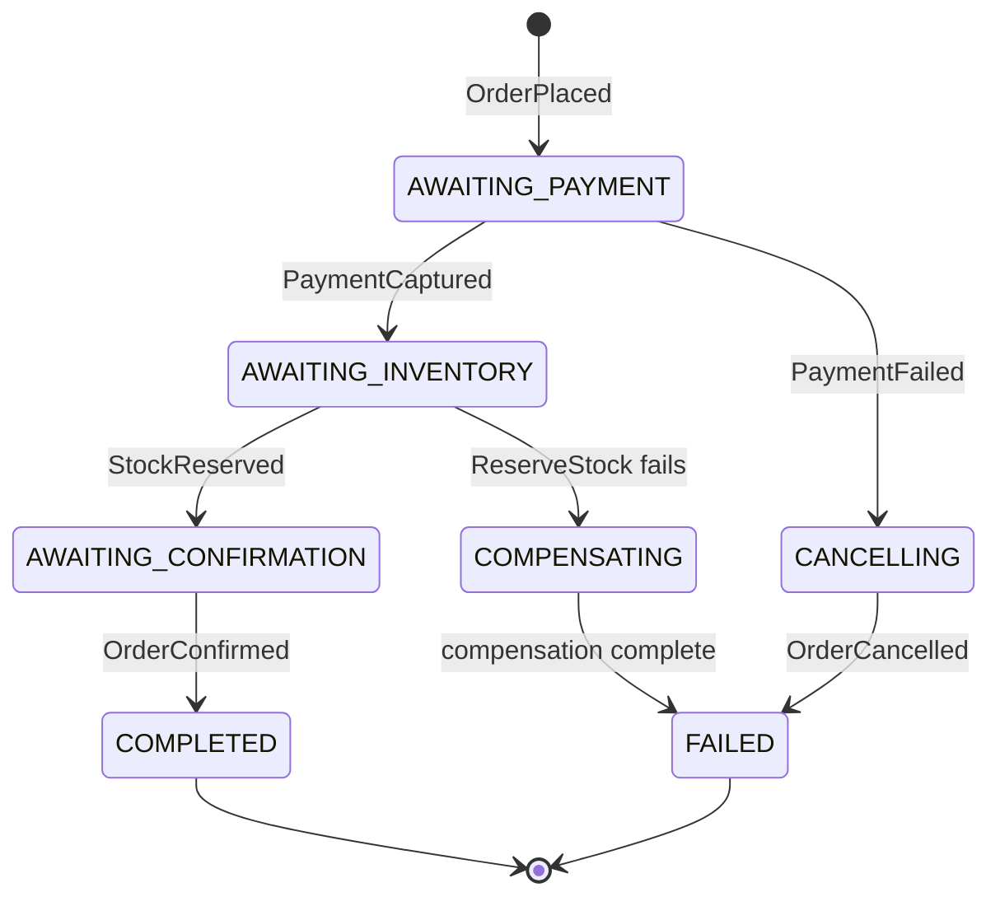

# Chapter 11 — Payment Aggregate & Saga

> **What you'll learn:**
> - What a saga is and why multi-aggregate coordination requires one
> - How to model a `Payment` aggregate with `PaymentCommand`, `PaymentEvent`, `PaymentState`, and `PaymentDecider`
> - How `SagaOrchestrator` separates business process logic from aggregate logic
> - How `OrderFulfillmentSaga` drives payment, inventory, and order confirmation in sequence
> - How `compensate()` issues step-appropriate refund, release, and cancel commands when a step fails
> - How `PostgresSagaStore`, `SagaRunner`, and `SagaStatus` wire the process into the running application
> - How the saga survives poison events, redelivered commands, and concurrent writers: `SagaDeadLetterStore`, the command inbox, and optimistic-concurrency CAS

---

## What We're Building and Why

Most domain operations touch a single aggregate: place an order, update a price, register a customer. A single command reaches a single stream, produces events, and the world moves on. Payment fulfillment is different. It coordinates three aggregates in order: the payment must be captured before stock is reserved, and stock must be reserved before the order is confirmed. If any step fails, all earlier steps must be undone. You cannot wrap this in a database transaction — each aggregate lives in its own stream, and the gateway is external.

This is the problem sagas solve.

A **saga** is a sequence of steps that span multiple aggregates, where each step is a command and each transition is triggered by an event. When a step fails, the saga issues compensating commands to undo whatever succeeded. The saga itself is stateful: it knows which step it is on and what information it needs to proceed or to compensate.

The order fulfillment flow the saga drives — what its `evolve()`/`handle()`/`compensate()` code reacts to, and what the assembled demo actually runs end-to-end — follows five steps:

1. `OrderPlaced` arrives — the saga starts, issues `InitiatePayment`
2. `PaymentCaptured` arrives — saga advances and issues `ReserveStock` against the inventory aggregate (Chapter 13)
3. `StockReserved` arrives — saga issues `ConfirmOrder`
4. `OrderConfirmed` arrives — saga completes (`COMPLETED`)
5. Any failure — on `PaymentFailed` the saga moves to a non-terminal `CANCELLING` step, dispatches `CancelOrder`, and `OrderCancelled` then closes it out to `FAILED` (a terminal `evolve()` would end the saga before `handle()` ever ran, so the cancel needs that intermediate step — see [Step 3](#step-3--implement-orderfulfillmentsaga)); if a later step's command throws, `compensate()` issues exactly the undo commands that step needs: cancel only before payment is captured, refund + cancel once payment is captured but stock isn't reserved, and release + refund + cancel once stock is held too



This chapter builds the `Payment` aggregate, the `OrderFulfillmentSaga`, and the `PaymentProcessManager` that drives the capture leg. The `Inventory` aggregate arrives in Chapter 13; the saga issues `ReserveStock` against it, and once that aggregate and its events are registered the inventory leg runs end-to-end too.

> **What makes the saga complete in the assembled demo.** When you place an order end-to-end, the saga does not stall — it runs all the way to `COMPLETED`. Two pieces make that work:
>
> - **The framework routes the saga's own replies; the saga routes two outside events.** With every event of a command a saga dispatched, the command bus stores that saga's *origin* (saga type, saga id, hop count) in the event's metadata, and `SagaRunner` hands such an event to the saga its origin names. `PaymentInitiated`, `StockReserved` and the saga's own `OrderConfirmed` come back this way, with no routing code in the saga. An `OrderConfirmed` or `OrderCancelled` that a request of the order's customer or an `ADMIN` causes carries no origin; for those `OrderFulfillmentSaga.correlateByEventData()` reads the `orderId` in the event and answers `fulfillment-<orderId>`, the saga of that order. No correlation id takes part (Step 3 says why).
> - **A `PaymentProcessManager` drives the capture leg.** It is an `EventListener` (fed by its own `PollingEventSubscription`) that reacts to `PaymentInitiated`, calls `PaymentGatewaySimulator.processPayment(...)`, and dispatches `CapturePayment` when the gateway succeeds or `FailPayment` when the gateway fails — inside `StreamRuneContext.continuing(event)`, so `PaymentCaptured`/`PaymentFailed` carry the origin of the saga that caused `PaymentInitiated` and reach that saga. A command it cannot dispatch is delivered again, never turned into a failed payment.
>
> You build the `PaymentProcessManager` in Step 5b and wire it in Step 6. Chapter 12 then wraps its gateway call in a circuit breaker.

---

## Domain Model: Payment Types

The payment domain is clean and focused. A payment moves through four statuses: `PENDING` after initiation, `CAPTURED` after the gateway confirms it, `REFUNDED` if a saga compensation refunds it, and `FAILED` if the gateway rejects it.

### PaymentStatus

Create `domain/src/main/java/org/streamrune/ecommerce/domain/payment/PaymentStatus.java`:

```java
package org.streamrune.ecommerce.domain.payment;

public enum PaymentStatus {
  PENDING,
  CAPTURED,
  REFUNDED,
  FAILED
}
```

### PaymentCommand

Create `domain/src/main/java/org/streamrune/ecommerce/domain/payment/PaymentCommand.java`:

```java
package org.streamrune.ecommerce.domain.payment;

import org.streamrune.core.Command;
import org.streamrune.ecommerce.domain.common.Money;

public sealed interface PaymentCommand extends Command {
  record InitiatePayment(String paymentId, String orderId, Money amount)
      implements PaymentCommand {}

  record CapturePayment(String paymentId) implements PaymentCommand {}

  record RefundPayment(String paymentId, String reason) implements PaymentCommand {}

  record FailPayment(String paymentId, String reason) implements PaymentCommand {}
}
```

`InitiatePayment` carries the full amount so the `PaymentDecider` can record it in state without needing to look up the order. `RefundPayment` and `FailPayment` both carry a `reason` so the event stream explains what happened — important for audit and projection consumers.

### PaymentEvent

Create `domain/src/main/java/org/streamrune/ecommerce/domain/payment/PaymentEvent.java`:

```java
package org.streamrune.ecommerce.domain.payment;

import org.streamrune.core.DomainEvent;
import org.streamrune.ecommerce.domain.common.Money;

public sealed interface PaymentEvent extends DomainEvent {
  record PaymentInitiated(String paymentId, String orderId, Money amount) implements PaymentEvent {}

  record PaymentCaptured(String paymentId, String orderId) implements PaymentEvent {}

  record PaymentRefunded(String paymentId, String reason) implements PaymentEvent {}

  record PaymentFailed(String paymentId, String reason) implements PaymentEvent {}
}
```

`PaymentCaptured` carries `orderId` so consumers can relate the event to its order without querying state; the saga compares it with the order id in its own state before it reacts (Step 3). `PaymentFailed` and `PaymentRefunded` carry the payment id only; the saga gives a fulfillment's payment the id `pay-<orderId>` and compares that.

### PaymentState

Create `domain/src/main/java/org/streamrune/ecommerce/domain/payment/PaymentState.java`:

```java
package org.streamrune.ecommerce.domain.payment;

import org.streamrune.core.AggregateState;
import org.streamrune.core.types.AggregateType;
import org.streamrune.ecommerce.domain.common.Money;

public record PaymentState(String paymentId, String orderId, Money amount, PaymentStatus status)
    implements AggregateState {
  /**
   * The aggregate type the payment decider is registered under: streams are payment:<paymentId>.
   */
  public static final AggregateType TYPE = AggregateType.of("payment");

  public PaymentState() {
    this(null, null, null, PaymentStatus.PENDING);
  }
}
```

The no-arg constructor initialises status to `PENDING`. StreamRune calls this constructor to create a blank state before replaying the event stream for an aggregate that has never been seen before. `TYPE` is the aggregate type the payment decider registers under (Step 6); a payment's stream is `payment:<paymentId>`.

---

## Step by Step

### Step 1 — Test and implement PaymentDecider

Start with the test. Create `commands/src/test/java/org/streamrune/ecommerce/commands/payment/PaymentDeciderTest.java`:

```java
package org.streamrune.ecommerce.commands.payment;

import static org.assertj.core.api.Assertions.assertThat;

import java.math.BigDecimal;
import org.junit.jupiter.api.Test;
import org.streamrune.core.DomainException;
import org.streamrune.ecommerce.domain.common.Money;
import org.streamrune.ecommerce.domain.payment.*;
import org.streamrune.test.DeciderFixture;

class PaymentDeciderTest {

  private final DeciderFixture<PaymentCommand, PaymentState, PaymentEvent> fixture =
      DeciderFixture.of(new PaymentDecider());

  private static final Money HUNDRED = new Money(BigDecimal.valueOf(100), "USD");

  private PaymentEvent.PaymentInitiated initiated() {
    return new PaymentEvent.PaymentInitiated("pay-1", "o-1", HUNDRED);
  }

  @Test
  void initiatePayment() {
    fixture
        .given()
        .when(new PaymentCommand.InitiatePayment("pay-1", "o-1", HUNDRED))
        .expectEvents(initiated())
        .expectState(s -> assertThat(s.status()).isEqualTo(PaymentStatus.PENDING));
  }

  @Test
  void capturePayment() {
    fixture
        .given(initiated())
        .when(new PaymentCommand.CapturePayment("pay-1"))
        .expectEvents(new PaymentEvent.PaymentCaptured("pay-1", "o-1"))
        .expectState(s -> assertThat(s.status()).isEqualTo(PaymentStatus.CAPTURED));
  }

  @Test
  void capturePayment_notPending_throws() {
    fixture
        .given(initiated(), new PaymentEvent.PaymentCaptured("pay-1", "o-1"))
        .when(new PaymentCommand.CapturePayment("pay-1"))
        .expectException(DomainException.class);
  }

  @Test
  void refundPayment_fromCaptured() {
    fixture
        .given(initiated(), new PaymentEvent.PaymentCaptured("pay-1", "o-1"))
        .when(new PaymentCommand.RefundPayment("pay-1", "Saga compensation"))
        .expectEvents(new PaymentEvent.PaymentRefunded("pay-1", "Saga compensation"))
        .expectState(s -> assertThat(s.status()).isEqualTo(PaymentStatus.REFUNDED));
  }

  @Test
  void failPayment() {
    fixture
        .given(initiated())
        .when(new PaymentCommand.FailPayment("pay-1", "Gateway timeout"))
        .expectEvents(new PaymentEvent.PaymentFailed("pay-1", "Gateway timeout"))
        .expectState(s -> assertThat(s.status()).isEqualTo(PaymentStatus.FAILED));
  }
}
```

Run the tests — they will fail. Now write the implementation. Create `commands/src/main/java/org/streamrune/ecommerce/commands/payment/PaymentDecider.java`:

```java
package org.streamrune.ecommerce.commands.payment;

import java.util.List;
import org.streamrune.core.Decider;
import org.streamrune.core.DomainException;
import org.streamrune.ecommerce.domain.payment.*;

public class PaymentDecider implements Decider<PaymentCommand, PaymentState, PaymentEvent> {

  @Override
  public PaymentState initialState() {
    return new PaymentState();
  }

  @Override
  public List<PaymentEvent> decide(PaymentCommand cmd, PaymentState state) {
    return switch (cmd) {
      case PaymentCommand.InitiatePayment c ->
          List.of(new PaymentEvent.PaymentInitiated(c.paymentId(), c.orderId(), c.amount()));

      case PaymentCommand.CapturePayment c -> {
        if (state.status() != PaymentStatus.PENDING)
          throw new DomainException("Can only capture PENDING payments");
        yield List.of(new PaymentEvent.PaymentCaptured(c.paymentId(), state.orderId()));
      }

      case PaymentCommand.RefundPayment c -> {
        if (state.status() != PaymentStatus.CAPTURED)
          throw new DomainException("Can only refund CAPTURED payments");
        yield List.of(new PaymentEvent.PaymentRefunded(c.paymentId(), c.reason()));
      }

      case PaymentCommand.FailPayment c -> {
        if (state.status() != PaymentStatus.PENDING)
          throw new DomainException("Can only fail PENDING payments");
        yield List.of(new PaymentEvent.PaymentFailed(c.paymentId(), c.reason()));
      }
    };
  }

  @Override
  public PaymentState evolve(PaymentState state, PaymentEvent evt) {
    return switch (evt) {
      case PaymentEvent.PaymentInitiated e ->
          new PaymentState(e.paymentId(), e.orderId(), e.amount(), PaymentStatus.PENDING);
      case PaymentEvent.PaymentCaptured e ->
          new PaymentState(
              state.paymentId(), state.orderId(), state.amount(), PaymentStatus.CAPTURED);
      case PaymentEvent.PaymentRefunded e ->
          new PaymentState(
              state.paymentId(), state.orderId(), state.amount(), PaymentStatus.REFUNDED);
      case PaymentEvent.PaymentFailed e ->
          new PaymentState(
              state.paymentId(), state.orderId(), state.amount(), PaymentStatus.FAILED);
    };
  }
}
```

The `decide()` method enforces state invariants: you cannot capture a payment that is already captured, you cannot refund one that was never captured, and you cannot fail one that has already moved on. The `evolve()` method is a pure function — no branches beyond the exhaustive sealed-interface pattern match.

Run the tests again: all five should pass.

### Step 2 — Saga state types

The saga needs its own status enum separate from `PaymentStatus`. Add `OrderFulfillmentStatus` to the domain module so both commands and domain code can reference it. Create `domain/src/main/java/org/streamrune/ecommerce/domain/saga/OrderFulfillmentStatus.java`:

```java
package org.streamrune.ecommerce.domain.saga;

public enum OrderFulfillmentStatus {
  AWAITING_PAYMENT,
  AWAITING_INVENTORY,
  AWAITING_CONFIRMATION,
  // Non-terminal intermediate: PaymentFailed evolves here (not directly to FAILED) so the
  // framework's SagaRunner still calls handle() — a terminal evolve short-circuits handle,
  // which would make the CancelOrder dispatch unreachable. See OrderFulfillmentSaga.
  CANCELLING,
  COMPLETED,
  COMPENSATING,
  FAILED
}
```

Now create the saga state record. Create `commands/src/main/java/org/streamrune/ecommerce/commands/saga/OrderFulfillmentState.java`:

```java
package org.streamrune.ecommerce.commands.saga;

import com.fasterxml.jackson.annotation.JsonCreator;
import com.fasterxml.jackson.annotation.JsonProperty;
import java.util.List;
import org.streamrune.core.saga.SagaId;
import org.streamrune.core.saga.SagaState;
import org.streamrune.core.saga.SagaStatus;
import org.streamrune.ecommerce.domain.common.Money;
import org.streamrune.ecommerce.domain.order.OrderEvent;
import org.streamrune.ecommerce.domain.saga.OrderFulfillmentStatus;

public record OrderFulfillmentState(
    SagaId sagaId,
    String orderId,
    String customerId,
    String paymentId,
    Money orderTotal,
    List<OrderEvent.OrderLine> lines,
    OrderFulfillmentStatus fulfillmentStatus)
    implements SagaState {

  @JsonCreator
  public OrderFulfillmentState(
      @JsonProperty("sagaId") SagaId sagaId,
      @JsonProperty("orderId") String orderId,
      @JsonProperty("customerId") String customerId,
      @JsonProperty("paymentId") String paymentId,
      @JsonProperty("orderTotal") Money orderTotal,
      @JsonProperty("lines") List<OrderEvent.OrderLine> lines,
      @JsonProperty("fulfillmentStatus") OrderFulfillmentStatus fulfillmentStatus) {
    this.sagaId = sagaId;
    this.orderId = orderId;
    this.customerId = customerId;
    this.paymentId = paymentId;
    this.orderTotal = orderTotal;
    this.lines = lines == null ? List.of() : List.copyOf(lines);
    this.fulfillmentStatus = fulfillmentStatus;
  }

  @Override
  public SagaStatus status() {
    return switch (fulfillmentStatus) {
      case COMPLETED -> SagaStatus.COMPLETED;
      case FAILED -> SagaStatus.FAILED;
      case COMPENSATING -> SagaStatus.COMPENSATING;
      case AWAITING_PAYMENT -> SagaStatus.STARTED;
      // CANCELLING is intentionally non-terminal (SagaStatus.RUNNING): the framework's
      // SagaRunner skips handle() once evolve() reaches a terminal status, so PaymentFailed
      // must land here first to let handle() dispatch CancelOrder before the saga ends.
      default -> SagaStatus.RUNNING;
    };
  }
}
```

The `@JsonCreator` / `@JsonProperty` annotations are required because `PostgresSagaStore` serialises saga state to JSON. Java records do not have a no-arg constructor, so Jackson needs explicit constructor mapping. The state carries the order `lines` so that when payment is captured the saga knows which product and quantity to reserve — it does not need to re-load the order aggregate. The constructor copies the list defensively and treats `null` as empty so a saga that has not yet seen `OrderPlaced` still has a usable (empty) line list. The `status()` method translates domain-specific `OrderFulfillmentStatus` values to the framework's `SagaStatus` enum on the forward path (a fresh, non-terminal `state.status()` is what gets persisted alongside a successful `handle()`); once a saga reaches a framework-classified outcome — `COMPENSATED`, `FAILED` via compensation, or `FAULTED` via poison-event quarantine — the *stored* status can diverge from what this method would compute, which is exactly why `SagaRunner` and `LoadedSaga` treat the store's persisted status, not this method, as authoritative (see [What We Learned](#what-we-learned)).

### Step 3 — Implement OrderFulfillmentSaga

Create `commands/src/main/java/org/streamrune/ecommerce/commands/saga/OrderFulfillmentSaga.java`:

```java
package org.streamrune.ecommerce.commands.saga;

import java.time.Duration;
import java.util.ArrayList;
import java.util.List;
import java.util.Objects;
import java.util.Optional;
import org.streamrune.core.DomainEvent;
import org.streamrune.core.EventEnvelope;
import org.streamrune.core.saga.SagaCommand;
import org.streamrune.core.saga.SagaDecider;
import org.streamrune.core.saga.SagaId;
import org.streamrune.core.saga.SagaOrchestrator;
import org.streamrune.core.types.AggregateId;
import org.streamrune.core.types.StreamId;
import org.streamrune.ecommerce.domain.inventory.InventoryCommand;
import org.streamrune.ecommerce.domain.inventory.InventoryEvent;
import org.streamrune.ecommerce.domain.order.OrderCommand;
import org.streamrune.ecommerce.domain.order.OrderEvent;
import org.streamrune.ecommerce.domain.payment.PaymentCommand;
import org.streamrune.ecommerce.domain.payment.PaymentEvent;
import org.streamrune.ecommerce.domain.saga.OrderFulfillmentStatus;

/**
 * OrderFulfillment saga: OrderPlaced → InitiatePayment → PaymentCaptured → ReserveStock →
 * StockReserved → ConfirmOrder → COMPLETED.
 *
 * <p>On PaymentFailed → CANCELLING → CancelOrder → OrderCancelled → FAILED. The CANCELLING step is
 * a non-terminal intermediate (not a direct evolve to FAILED): {@code SagaRunner} skips {@link
 * #handle} once {@code evolve} reaches a terminal {@code SagaStatus}, so a final command can only
 * be dispatched from a state that is still running. Compensation is step-appropriate: a pre-payment
 * failure → CancelOrder only; a post-payment, pre-reservation failure → RefundPayment +
 * CancelOrder; a post-reservation failure → ReleaseStock + RefundPayment + CancelOrder (see {@link
 * #compensate}).
 *
 * <p>Correlation: an event reaches this saga in one of two ways, and neither reads the event's
 * correlation id.
 *
 * <ul>
 *   <li><b>An event this saga caused.</b> The command bus stores, with every event of a command a
 *       saga dispatched, the saga's origin: the saga type, the saga id and a hop count ({@code
 *       EventMetadata.sagaOrigin()}). {@code SagaRunner} hands such an event to the saga its origin
 *       names and asks this class nothing. {@code PaymentInitiated}, {@code PaymentRefunded},
 *       {@code StockReserved}, {@code StockReleased} and the saga's own {@code OrderConfirmed} and
 *       {@code OrderCancelled} arrive this way; so do {@code PaymentCaptured} and {@code
 *       PaymentFailed}, which the payment process manager causes by continuing {@code
 *       PaymentInitiated} (one hop further from the saga, the same origin).
 *   <li><b>An event somebody else caused.</b> A request of the order's customer or an {@code ADMIN}
 *       confirms or cancels an order too. Its event carries no origin, so the runner asks {@link
 *       #correlateByEventData}, which answers from the order id in the event.
 * </ul>
 *
 * <p>A correlation id is tracing data. An HTTP request's is whatever the client put in {@code
 * X-Correlation-Id}; if it addressed a saga, a caller confirming their own order could have that
 * {@code OrderConfirmed} evolved by another order's saga. An origin has one writer, the command
 * bus, and no request header reaches it; {@link #correlateByEventData} receives the stream id and
 * the payload and nothing of the metadata. Saga dispatch binds a correlation id of its own, {@code
 * streamrune:saga:<sagaId>}, so one fulfillment reads as one flow in the log and in the audit
 * trail; a request that sends an id with the {@code streamrune:} prefix is answered {@code 400}.
 *
 * <p>{@link #evolve} and {@link #handle} check from the other side, against the order id and the
 * payment id the saga stores in its own state: an event that is not about this saga's order changes
 * nothing and dispatches nothing, whichever way it arrived.
 *
 * <p>A {@code SagaId} holds 255 characters at most, so {@code OrderCommand.PlaceOrder} refuses an
 * order id longer than 255 minus the prefix ({@code SAGA_ID_PREFIX}, which this class uses to build
 * the id) when the order is placed; an order id that got past it would make {@link #extractSagaId}
 * throw on {@code OrderPlaced}, and the order would stay {@code CREATED} with no saga. For a
 * confirmation or a cancellation of such an order {@link #correlateByEventData} answers "no saga",
 * which is the truth.
 *
 * <p>The capture leg is driven by a payment process manager (in the runtime app), which reacts to
 * {@code PaymentInitiated} by calling the payment gateway and dispatching {@code CapturePayment}
 * (success) or {@code FailPayment} (failure).
 *
 * <p>Command targets are built with the {@code AggregateId} constructor, never {@code
 * AggregateId.of}. Every target comes from the saga's stored state — the order, payment and product
 * ids recorded from {@code OrderPlaced} — so it is data already in the log, and the constructor is
 * the decode door for it. {@code AggregateId.of} is the ingress factory: it refuses a control
 * character or an id longer than 255 characters, so inside {@link #handle} or {@link #compensate}
 * it would make the framework quarantine the event as poison (payment captured, never refunded).
 * The order endpoints never record such a product id: {@code OrderCommand.OrderLine} refuses one
 * that carries a control character, or is longer than 255 characters, when the order is placed, so
 * the client gets a {@code 400} and nothing is written. Built with the constructor, the command
 * still reaches the bus, whose id extractor applies {@code AggregateId.of}: a product id that
 * reached the log without crossing that check (an {@code OrderPlaced} event an application appended
 * itself, say) is refused there with an {@code IllegalArgumentException}, and the framework
 * compensates the step (refund + cancel).
 *
 * <p>A saga command's target is only an id: the bus resolves the aggregate type from the command's
 * registration. {@code ReserveStock} and {@code ReleaseStock} are registered under {@code
 * inventory}, so the stock streams are {@code inventory:<productId>} — the product id is the
 * inventory id, with no hand-made prefix.
 *
 * <p><b>Deadline.</b> The saga is a {@link SagaDecider} as well as a {@link SagaOrchestrator}: the
 * two interfaces share {@code stateType}, {@code initialState}, {@code evolve}, {@code handle} and
 * {@code compensate}, and {@link #timeout()} exists only on the decider. A fulfillment that has not
 * reached {@code COMPLETED}, {@code COMPENSATED} or {@code FAILED} within its timeout, measured
 * from the saga's start, is compensated by the application's {@code SagaTimeoutRunner} with the
 * same {@link #compensate} the event path uses: a payment that never arrives cancels the order, a
 * reservation that never arrives refunds and cancels. The runner is built from the saga's {@code
 * SagaRunner}, whose forward fence is on: a forward command of a step still in flight when the
 * deadline claims the saga is stored before the claim, or is refused at its commit. A command
 * stored before the claim is one the compensation has to cover, and {@link #compensate} works from
 * the state the row holds, which does not include that step yet. Two cases stay open:
 *
 * <ul>
 *   <li>a {@code ReserveStock} stored before a claim made while the saga awaits its inventory gets
 *       a refund and a cancel and no {@code ReleaseStock}: the reservation is not released;
 *   <li>a {@code CapturePayment} of the payment process manager — a continuation of {@code
 *       PaymentInitiated}, not a command of this saga, so the fence does not refuse it — that
 *       commits after a claim made while the saga awaits its payment gets no refund: the order ends
 *       cancelled with its payment captured.
 * </ul>
 *
 * <p>The demo's planned refund and stock-release flow closes both. With the default deadline of
 * fifteen minutes neither occurs in normal use; a deadline of a second or two with saga commands
 * delayed on purpose (the two-backend run of the tutorial's chapter 17) produces them. The timeout
 * is {@link #DEFAULT_TIMEOUT} unless the application passes one ({@code
 * app.saga.fulfillment-timeout} in the three apps).
 */
public class OrderFulfillmentSaga
    implements SagaOrchestrator<OrderFulfillmentState>, SagaDecider<OrderFulfillmentState> {

  /** The deadline of a fulfillment when the application names none: fifteen minutes. */
  public static final Duration DEFAULT_TIMEOUT = Duration.ofMinutes(15);

  /** A fulfillment's payment id is this prefix and the order id. */
  private static final String PAYMENT_ID_PREFIX = "pay-";

  private final Duration timeout;

  /** A saga whose deadline is {@link #DEFAULT_TIMEOUT}. */
  public OrderFulfillmentSaga() {
    this(DEFAULT_TIMEOUT);
  }

  /**
   * A saga whose deadline is the given duration.
   *
   * @param timeout how long a fulfillment may stay non-terminal, measured from its start; positive
   * @throws NullPointerException when {@code timeout} is {@code null}
   * @throws IllegalArgumentException when {@code timeout} is zero or negative
   */
  public OrderFulfillmentSaga(Duration timeout) {
    Objects.requireNonNull(timeout, "timeout is required");
    if (timeout.isZero() || timeout.isNegative()) {
      throw new IllegalArgumentException("timeout must be positive, got " + timeout);
    }
    this.timeout = timeout;
  }

  /** The fulfillment's deadline, measured from the saga's start. */
  @Override
  public Optional<Duration> timeout() {
    return Optional.of(timeout);
  }

  @Override
  public Class<OrderFulfillmentState> stateType() {
    return OrderFulfillmentState.class;
  }

  @Override
  public OrderFulfillmentState initialState(SagaId sagaId) {
    return new OrderFulfillmentState(
        sagaId, null, null, null, null, List.of(), OrderFulfillmentStatus.AWAITING_PAYMENT);
  }

  @Override
  public boolean isStartEvent(EventEnvelope event) {
    return event.event() instanceof OrderEvent.OrderPlaced;
  }

  @Override
  public SagaId extractSagaId(EventEnvelope event) {
    if (event.event() instanceof OrderEvent.OrderPlaced placed) {
      return new SagaId(OrderCommand.PlaceOrder.SAGA_ID_PREFIX + placed.orderId());
    }
    throw new IllegalArgumentException("Not a start event: " + event.eventType().name());
  }

  /**
   * The saga of an event no fulfillment caused. A request can write two of the events this saga
   * reacts to: {@code OrderConfirmed} and {@code OrderCancelled}, by the order's customer or an
   * {@code ADMIN}. Each belongs to the saga of the order it names, and {@link #evolve} decides what
   * it means there. Every other event, and one whose order no saga id can hold, belongs to no saga.
   *
   * <p>The payment and inventory events are not listed: only this saga's commands and the payment
   * process manager's write them, and those events carry the saga's origin, by which {@code
   * SagaRunner} routes them without calling this method.
   */
  @Override
  public Optional<SagaId> correlateByEventData(StreamId streamId, DomainEvent event) {
    return switch (event) {
      case OrderEvent.OrderConfirmed e -> sagaOfOrder(e.orderId());
      case OrderEvent.OrderCancelled e -> sagaOfOrder(e.orderId());
      default -> Optional.empty();
    };
  }

  /** The saga that fulfils the given order, or none for an id no saga id can hold. */
  private static Optional<SagaId> sagaOfOrder(String orderId) {
    if (orderId == null
        || orderId.isEmpty()
        || orderId.length() > OrderCommand.PlaceOrder.MAX_ORDER_ID_LENGTH) {
      return Optional.empty();
    }
    return Optional.of(new SagaId(OrderCommand.PlaceOrder.SAGA_ID_PREFIX + orderId));
  }

  /**
   * Whether the event is about this saga's order, answered from what the saga itself stores and not
   * from how the event was routed: the {@code OrderPlaced} that starts this saga names the order
   * the saga id is built from, and every later event names the order id or the payment id the saga
   * recorded from that {@code OrderPlaced}. The answer holds whichever way the event arrived.
   */
  private static boolean isAboutThisSaga(OrderFulfillmentState state, EventEnvelope event) {
    return switch (event.event()) {
      case OrderEvent.OrderPlaced e ->
          sagaOfOrder(e.orderId()).filter(state.sagaId()::equals).isPresent();
      case OrderEvent.OrderConfirmed e -> isTheSagasOwn(state.orderId(), e.orderId());
      case OrderEvent.OrderCancelled e -> isTheSagasOwn(state.orderId(), e.orderId());
      case PaymentEvent.PaymentInitiated e -> isTheSagasOwn(state.orderId(), e.orderId());
      case PaymentEvent.PaymentCaptured e -> isTheSagasOwn(state.orderId(), e.orderId());
      case PaymentEvent.PaymentFailed e -> isTheSagasOwn(state.paymentId(), e.paymentId());
      case PaymentEvent.PaymentRefunded e -> isTheSagasOwn(state.paymentId(), e.paymentId());
      case InventoryEvent.StockReserved e -> isTheSagasOwn(state.orderId(), e.orderId());
      case InventoryEvent.StockReleased e -> isTheSagasOwn(state.orderId(), e.orderId());
      default -> false;
    };
  }

  /**
   * Whether an id an event carries is the id this saga recorded; a saga that recorded none has
   * none.
   */
  private static boolean isTheSagasOwn(String recorded, String inTheEvent) {
    return recorded != null && recorded.equals(inTheEvent);
  }

  @Override
  public OrderFulfillmentState evolve(OrderFulfillmentState state, EventEnvelope event) {
    if (!isAboutThisSaga(state, event)) {
      return state;
    }
    Object evt = event.event();
    return switch (evt) {
      case OrderEvent.OrderPlaced e ->
          new OrderFulfillmentState(
              state.sagaId(),
              e.orderId(),
              e.customerId(),
              PAYMENT_ID_PREFIX + e.orderId(),
              e.total(),
              e.lines(),
              OrderFulfillmentStatus.AWAITING_PAYMENT);

      case PaymentEvent.PaymentCaptured e ->
          new OrderFulfillmentState(
              state.sagaId(),
              state.orderId(),
              state.customerId(),
              state.paymentId(),
              state.orderTotal(),
              state.lines(),
              OrderFulfillmentStatus.AWAITING_INVENTORY);

      // PaymentFailed lands on the non-terminal CANCELLING (not directly on FAILED): the
      // framework's SagaRunner skips handle() once evolve() reaches a terminal SagaStatus, which
      // would make the CancelOrder dispatch below unreachable. CANCELLING keeps the saga RUNNING
      // long enough for handle() to emit CancelOrder; OrderCancelled then closes it out to FAILED.
      case PaymentEvent.PaymentFailed e ->
          new OrderFulfillmentState(
              state.sagaId(),
              state.orderId(),
              state.customerId(),
              state.paymentId(),
              state.orderTotal(),
              state.lines(),
              OrderFulfillmentStatus.CANCELLING);

      case OrderEvent.OrderCancelled e ->
          state.fulfillmentStatus() == OrderFulfillmentStatus.CANCELLING
              ? new OrderFulfillmentState(
                  state.sagaId(),
                  state.orderId(),
                  state.customerId(),
                  state.paymentId(),
                  state.orderTotal(),
                  state.lines(),
                  OrderFulfillmentStatus.FAILED)
              : state;

      case InventoryEvent.StockReserved e ->
          state.fulfillmentStatus() == OrderFulfillmentStatus.AWAITING_INVENTORY
              ? new OrderFulfillmentState(
                  state.sagaId(),
                  state.orderId(),
                  state.customerId(),
                  state.paymentId(),
                  state.orderTotal(),
                  state.lines(),
                  OrderFulfillmentStatus.AWAITING_CONFIRMATION)
              : state;

      // The confirmation this saga asked for, after the payment and the reservation. An order its
      // customer or an ADMIN confirms by hand earlier does not complete the saga: it goes on, and
      // its own ConfirmOrder is then refused and compensated.
      case OrderEvent.OrderConfirmed e ->
          state.fulfillmentStatus() == OrderFulfillmentStatus.AWAITING_CONFIRMATION
              ? new OrderFulfillmentState(
                  state.sagaId(),
                  state.orderId(),
                  state.customerId(),
                  state.paymentId(),
                  state.orderTotal(),
                  state.lines(),
                  OrderFulfillmentStatus.COMPLETED)
              : state;

      default -> state;
    };
  }

  @Override
  public List<SagaCommand> handle(OrderFulfillmentState state, EventEnvelope event) {
    if (!isAboutThisSaga(state, event)) {
      return List.of();
    }
    return switch (state.fulfillmentStatus()) {
      case AWAITING_PAYMENT -> {
        if (event.event() instanceof OrderEvent.OrderPlaced) {
          yield List.of(
              new SagaCommand(
                  new PaymentCommand.InitiatePayment(
                      state.paymentId(), state.orderId(), state.orderTotal()),
                  new AggregateId(state.paymentId())));
        }
        yield List.of();
      }

      // Reserve stock once the payment is captured. The demo's orders carry a single line; we
      // reserve that line, which drives one StockReserved → AWAITING_CONFIRMATION → ConfirmOrder.
      // (A multi-line order would need per-line reservation tracking before confirming; out of
      // scope for the demo.)
      case AWAITING_INVENTORY -> {
        if (!(event.event() instanceof PaymentEvent.PaymentCaptured) || state.lines().isEmpty()) {
          yield List.of();
        }
        var line = state.lines().get(0);
        yield List.of(
            new SagaCommand(
                new InventoryCommand.ReserveStock(
                    line.productId(), state.orderId(), line.quantity()),
                new AggregateId(line.productId())));
      }

      case AWAITING_CONFIRMATION -> {
        if (event.event() instanceof InventoryEvent.StockReserved) {
          yield List.of(
              new SagaCommand(
                  new OrderCommand.ConfirmOrder(state.orderId()),
                  new AggregateId(state.orderId())));
        }
        yield List.of();
      }

      case CANCELLING -> {
        if (event.event() instanceof PaymentEvent.PaymentFailed) {
          yield List.of(
              new SagaCommand(
                  new OrderCommand.CancelOrder(state.orderId(), "Payment failed"),
                  new AggregateId(state.orderId())));
        }
        yield List.of();
      }

      default -> List.of();
    };
  }

  @Override
  public List<SagaCommand> compensate(
      OrderFulfillmentState state, Throwable failure, SagaCommand failedCommand) {
    return switch (state.fulfillmentStatus()) {
      // Payment not yet captured — nothing to refund, just cancel.
      case AWAITING_PAYMENT ->
          List.of(
              new SagaCommand(
                  new OrderCommand.CancelOrder(state.orderId(), failure.getMessage()),
                  new AggregateId(state.orderId())));

      // Payment captured, stock not reserved — refund the payment and cancel.
      case AWAITING_INVENTORY ->
          List.of(
              new SagaCommand(
                  new PaymentCommand.RefundPayment(
                      state.paymentId(), "Inventory reservation failed"),
                  new AggregateId(state.paymentId())),
              new SagaCommand(
                  new OrderCommand.CancelOrder(state.orderId(), "Inventory reservation failed"),
                  new AggregateId(state.orderId())));

      // Payment captured AND stock reserved — release the reservation before refunding and
      // cancelling, so the held stock isn't stranded.
      case AWAITING_CONFIRMATION -> {
        var commands = new ArrayList<SagaCommand>();
        if (!state.lines().isEmpty()) {
          var line = state.lines().get(0);
          commands.add(
              new SagaCommand(
                  new InventoryCommand.ReleaseStock(
                      line.productId(), state.orderId(), line.quantity()),
                  new AggregateId(line.productId())));
        }
        commands.add(
            new SagaCommand(
                new PaymentCommand.RefundPayment(state.paymentId(), "Order confirmation failed"),
                new AggregateId(state.paymentId())));
        commands.add(
            new SagaCommand(
                new OrderCommand.CancelOrder(state.orderId(), "Order confirmation failed"),
                new AggregateId(state.orderId())));
        yield List.copyOf(commands);
      }

      // Terminal/other states (COMPLETED, FAILED, COMPENSATING, CANCELLING, ...) — nothing to
      // compensate; an empty list is classified by the framework as FAILED, which is correct for
      // an unexpected compensation request in a terminal (or already-cancelling) state.
      default -> List.of();
    };
  }
}
```

The methods that carry the weight here:

- `isStartEvent` tells `SagaRunner` which event creates a new saga instance. Only `OrderPlaced` qualifies.
- `extractSagaId` derives the saga's stable identity from the start event. The pattern `"fulfillment-" + orderId` is predictable and unique per order. The prefix is `OrderCommand.PlaceOrder.SAGA_ID_PREFIX`, the constant that also fixes the longest order id `PlaceOrder` accepts (243 characters, chapter 8), so the id this method builds always fits the 255 characters of a `SagaId`.
- `correlateByEventData` routes an event that no fulfillment caused. `SagaRunner` calls it only for a non-start event whose metadata carries no origin of this saga type, and hands it the stream id and the payload, nothing of the metadata. A request can write two of the events the saga reacts to — `OrderConfirmed` and `OrderCancelled`, by the order's customer or an `ADMIN` (Chapter 9) — and each belongs to the saga of the order it names. Every other event belongs to no saga, and so does an event whose order id no `SagaId` can hold: the method answers `Optional.empty()` for it and does not throw, because a routing method that throws turns the event into a poison event (Step 6). The payment and inventory events are not listed: only the saga's commands and the process manager's write them, and those events carry the saga's origin, by which `SagaRunner` routes them without calling this method.
- `handle` advances the process. `AWAITING_INVENTORY` is gated on `PaymentEvent.PaymentCaptured` — the same `instanceof` discipline as every other branch — before it reads the first order line out of `state.lines()` and dispatches `ReserveStock` (targeting the inventory stream `inventory:<productId>` — the bus resolves the `inventory` type from `ReserveStock`'s registration). Without that gate a redelivered or unrelated event of the same order (for example a replayed `OrderConfirmed`) would re-issue `ReserveStock` while the saga sat in `AWAITING_INVENTORY`. The demo's orders carry a single line, so one `ReserveStock` produces one `StockReserved`, which moves the saga to `AWAITING_CONFIRMATION`, where the next `handle` call issues `ConfirmOrder`. A multi-line order would need per-line reservation tracking before confirming — out of scope for the demo. `CANCELLING` mirrors that same gating discipline: it dispatches `CancelOrder` only for the `PaymentEvent.PaymentFailed` that put the saga there.
- `evolve` for `StockReserved` is guarded on `AWAITING_INVENTORY`, for `OrderEvent.OrderCancelled` on `CANCELLING` and for `OrderEvent.OrderConfirmed` on `AWAITING_CONFIRMATION`: an event of the order that arrives outside its step cannot push the saga past where it is. The order's customer or an `ADMIN` can cancel or confirm the order over HTTP at any time (Chapter 9); such an event reaches the saga of that order, and outside its step it changes nothing. A customer who confirms their own order while the saga still waits for the payment does not complete the saga: it goes on, its own `ConfirmOrder` is refused by the decider, and it compensates.
- `evolve` and `handle` both start with `isAboutThisSaga`: an event that is not about this saga's order changes nothing and dispatches nothing. It does not depend on how the event was routed. It compares the event with what the saga stores: the order id and the payment id recorded from `OrderPlaced`, and for `OrderPlaced` itself the order the saga id is built from. Routing answers another question. An origin says which saga's command caused an event, and that is not by itself a statement about which order the event names; `correlateByEventData` could answer wrongly. The check keeps the rule true in both cases, and for a caller that feeds the saga by another path, a dead-letter replay under an explicit saga id (Chapter 14) for one.
- `compensate` is called by `SagaRunner` when a dispatched `SagaCommand` throws. The compensation strategy is step-appropriate, not a blanket cancel: `AWAITING_PAYMENT` cancels only (nothing was ever captured); `AWAITING_INVENTORY` refunds the payment and cancels (captured but not reserved); `AWAITING_CONFIRMATION` releases the stock reservation *before* refunding and cancelling (captured **and** reserved — releasing first avoids stranding held stock). Every other state — including terminal ones — returns an empty list; the framework classifies an empty compensation list as `FAILED`, which is correct because there is nothing left to undo. `SagaCommand` pairs each command with an `AggregateId`, not a bare string — the type carries the routing target through `SagaRunner`'s dispatch. The saga builds it with `new AggregateId(...)`, not the `AggregateId.of(...)` your id extractors use. `of` is the factory for ids a client sends, and it refuses control characters and ids longer than 255 characters (chapter 2). Every id here comes from the saga's stored state instead: the order, payment and product ids it recorded from `OrderPlaced`. Inside `handle()` or `compensate()`, `of` would throw on such a value, and the framework would quarantine the event as poison, with the payment captured and never refunded. The order endpoints never record a product id that `of` would refuse here: the `OrderCommand.OrderLine` constructor (chapter 8) refuses one that carries a control character, or is longer than 255 characters, when the order is placed. The client gets a `400`, and no payment is taken. With the constructor, the command still reaches the bus, and the id extractor applies `AggregateId.of` there. A product id that reached the log without crossing the order-line check, such as one in an `OrderPlaced` event an application appended itself, is refused at that point with an `IllegalArgumentException`. The saga treats that like a business rejection: it compensates the step with a refund and a cancel.
- `timeout` is the saga's deadline. The class implements `SagaDecider` as well as `SagaOrchestrator`: the two interfaces share `stateType`, `initialState`, `evolve`, `handle` and `compensate`, and `timeout()` exists only on the decider, which is what a `SagaTimeoutRunner` takes (Step 6). A fulfillment that has not reached `COMPLETED`, `COMPENSATED` or `FAILED` within the timeout, measured from the saga's start and not reset by its later events, is compensated with the same `compensate()`: a payment that never arrives cancels the order, a reservation that never arrives refunds and cancels. That compensation works from the saga row; [Reliability under failure](#reliability-under-failure) names the two cases it leaves open when a deadline passes during a step. `new OrderFulfillmentSaga()` takes `DEFAULT_TIMEOUT`, fifteen minutes; `new OrderFulfillmentSaga(Duration)` takes another, and refuses `null` and a zero or negative duration. The three apps pass `app.saga.fulfillment-timeout`.

**Who routes what.** An event that is not a start event reaches a saga in one of two ways.

- **The framework routes the events a saga caused.** Every command a saga dispatches runs with the saga's origin bound, and the command bus copies it into the metadata of each event the command produces: `sagaOrigin`, holding the saga type, the saga id and a hop count (0 for the saga's own command). `SagaRunner` routes an event whose origin names its saga type to the saga the origin names, and asks the orchestrator nothing. An origin has two writers, both framework code: saga dispatch, and `StreamRuneContext.continuing(event)`, which carries the origin of an event onto the commands a listener dispatches in reaction to it (Step 5b). No request header, baggage entry or dead-letter row sets it.
- **The application routes the events somebody else caused**, in `correlateByEventData(streamId, event)`, from the event's own data. Whoever may write such an event may address the saga it names, so what protects the saga is the access rule of the command that writes the event: Chapter 9 lets only the order's customer or an `ADMIN` confirm or cancel an order, and the `orderId` in the event is the id of the stream the decider wrote to. A caller reaches the saga of an order they may act on and no other, and `evolve` decides by the saga's state what the event means there.

When both could apply, the origin decides and `correlateByEventData` is not called.

**What a correlation id is for.** It ties the commands and events of one flow together for whoever reads the log or the audit trail, and it is the client's to choose: the request filter binds whatever arrives in `X-Correlation-Id` and generates an id only when the header is missing or blank. Nothing routes by it, and the reason is what such routing would allow. A customer who confirms their own order with `X-Correlation-Id: fulfillment-<somebody else's order>` would have *their* `OrderConfirmed` handed to *that* saga. A saga that took it for the confirmation it asked for would complete while it still waits for its payment; the payment is captured a moment later all the same, and its `PaymentCaptured` finds a finished saga: the customer charged, no stock reserved, the order still `CREATED`, nothing left to refund the payment. `correlateByEventData` cannot make that mistake, because it never sees the metadata.

Saga dispatch binds a correlation id of its own, `streamrune:saga:<sagaId>` — `streamrune:saga:fulfillment-o-100` for order `o-100` — so one fulfillment reads as one flow: its events and the audit rows of its commands carry that id. The `streamrune:` prefix is reserved for ids the framework binds. A request that sends one is answered `400` by the request filter before any command runs (Chapter 9), and the command bus refuses a command that runs under a reserved id without the saga origin that belongs to it (`ReservedCorrelationIdException`). A client keeps `X-Correlation-Id` for tracing its own requests, under any id that does not start with `streamrune:`; it has no value that addresses a saga.

`FulfillmentSagaRoutingIT` in each of the three apps places two orders of two customers whose sagas wait for their payment. One customer confirms their own order with the other saga's id in `X-Correlation-Id`: the request succeeds, the stored event carries that correlation id and no origin, and the other saga's row is the row that was stored — still `AWAITING_PAYMENT`, at its first version, with no event applied to it — while the last event the caller's own saga applied is that `OrderConfirmed`. The same request with `X-Correlation-Id: streamrune:saga:fulfillment-<the other order>` is answered `400` with a plain-text body; no event is stored and both rows stay as they were.

### Step 4 — Saga tests

Create `commands/src/test/java/org/streamrune/ecommerce/commands/saga/OrderFulfillmentSagaTest.java`:

```java
package org.streamrune.ecommerce.commands.saga;

import static org.assertj.core.api.Assertions.assertThat;
import static org.assertj.core.api.Assertions.assertThatThrownBy;

import java.math.BigDecimal;
import java.time.Duration;
import java.time.Instant;
import java.util.LinkedHashMap;
import java.util.List;
import java.util.Map;
import java.util.Optional;
import java.util.UUID;
import org.junit.jupiter.api.Test;
import org.streamrune.core.DomainEvent;
import org.streamrune.core.EventEnvelope;
import org.streamrune.core.EventMetadata;
import org.streamrune.core.saga.SagaCommand;
import org.streamrune.core.saga.SagaId;
import org.streamrune.core.types.AggregateId;
import org.streamrune.core.types.AggregateType;
import org.streamrune.core.types.CommandId;
import org.streamrune.core.types.CorrelationId;
import org.streamrune.core.types.EventId;
import org.streamrune.core.types.EventType;
import org.streamrune.core.types.GlobalOffset;
import org.streamrune.core.types.StreamId;
import org.streamrune.core.types.Version;
import org.streamrune.ecommerce.domain.common.Money;
import org.streamrune.ecommerce.domain.inventory.InventoryCommand;
import org.streamrune.ecommerce.domain.inventory.InventoryEvent;
import org.streamrune.ecommerce.domain.inventory.InventoryState;
import org.streamrune.ecommerce.domain.order.OrderCommand;
import org.streamrune.ecommerce.domain.order.OrderEvent;
import org.streamrune.ecommerce.domain.order.OrderState;
import org.streamrune.ecommerce.domain.payment.PaymentCommand;
import org.streamrune.ecommerce.domain.payment.PaymentEvent;
import org.streamrune.ecommerce.domain.payment.PaymentState;
import org.streamrune.ecommerce.domain.saga.OrderFulfillmentStatus;
import org.streamrune.test.SagaEnvelopes;

class OrderFulfillmentSagaTest {

  private final OrderFulfillmentSaga saga = new OrderFulfillmentSaga();

  /**
   * An event a request caused: its metadata carries no saga origin, and its correlation id is
   * whatever the request carried.
   */
  private EventEnvelope envelope(
      DomainEvent event, AggregateType type, String id, String correlationId) {
    var metadata =
        new EventMetadata(
            new EventId(UUID.randomUUID().toString()),
            new CommandId(UUID.randomUUID().toString()),
            null,
            null,
            new CorrelationId(correlationId),
            null,
            null,
            Instant.now());
    return new EventEnvelope(
        GlobalOffset.initial(),
        StreamId.of(type, new AggregateId(id)),
        Version.initial(),
        new EventType(event.getClass().getSimpleName()),
        event,
        metadata);
  }

  /**
   * An event a command of the given order's saga caused: the command bus stores it with that saga's
   * origin, and {@code SagaRunner} hands it to that saga without asking the orchestrator.
   */
  private EventEnvelope causedBySagaOf(
      String orderId, DomainEvent event, AggregateType type, String id) {
    return SagaEnvelopes.causedBy(
        OrderFulfillmentState.class,
        new SagaId("fulfillment-" + orderId),
        StreamId.of(type, new AggregateId(id)),
        event);
  }

  // ---- Deadline: the saga is a SagaDecider too, and its timeout is the deadline a timeout runner
  // compensates it at. ----

  @Test
  void timeout_isTheConfiguredDeadline() {
    assertThat(saga.timeout()).contains(OrderFulfillmentSaga.DEFAULT_TIMEOUT);
    assertThat(OrderFulfillmentSaga.DEFAULT_TIMEOUT).isEqualTo(Duration.ofMinutes(15));
    assertThat(new OrderFulfillmentSaga(Duration.ofSeconds(2)).timeout())
        .contains(Duration.ofSeconds(2));
  }

  @Test
  void aNonPositiveTimeoutIsRefused() {
    assertThatThrownBy(() -> new OrderFulfillmentSaga(null))
        .isInstanceOf(NullPointerException.class)
        .hasMessage("timeout is required");
    assertThatThrownBy(() -> new OrderFulfillmentSaga(Duration.ZERO))
        .isInstanceOf(IllegalArgumentException.class)
        .hasMessageContaining("positive");
    assertThatThrownBy(() -> new OrderFulfillmentSaga(Duration.ofSeconds(-1)))
        .isInstanceOf(IllegalArgumentException.class)
        .hasMessageContaining("positive");
  }

  @Test
  void isStartEvent_orderPlaced() {
    var evt =
        envelope(
            new OrderEvent.OrderPlaced("o-1", "c-1", List.of(), new Money(BigDecimal.TEN, "USD")),
            OrderState.TYPE,
            "o-1",
            "corr-1");
    assertThat(saga.isStartEvent(evt)).isTrue();
  }

  @Test
  void isStartEvent_otherEvent_false() {
    var evt = envelope(new OrderEvent.OrderConfirmed("o-1"), OrderState.TYPE, "o-1", "corr-1");
    assertThat(saga.isStartEvent(evt)).isFalse();
  }

  @Test
  void extractSagaId() {
    var evt =
        envelope(
            new OrderEvent.OrderPlaced("o-1", "c-1", List.of(), new Money(BigDecimal.TEN, "USD")),
            OrderState.TYPE,
            "o-1",
            "corr-1");
    assertThat(saga.extractSagaId(evt)).isEqualTo(new SagaId("fulfillment-o-1"));
  }

  // ---- PlaceOrder refuses an order id longer than MAX_ORDER_ID_LENGTH, so that the saga id the
  // order starts always fits the 255 characters a SagaId holds. The bound is the saga's own: ----

  @Test
  void extractSagaId_orderIdAtThePlaceOrderBound_buildsTheSagaId() {
    var orderId = "o".repeat(OrderCommand.PlaceOrder.MAX_ORDER_ID_LENGTH);
    var evt =
        envelope(
            new OrderEvent.OrderPlaced(orderId, "c-1", List.of(), new Money(BigDecimal.TEN, "USD")),
            OrderState.TYPE,
            orderId,
            "corr-1");

    var sagaId = saga.extractSagaId(evt);

    assertThat(sagaId.value()).isEqualTo("fulfillment-" + orderId).hasSize(255);
  }

  @Test
  void extractSagaId_orderIdOneOverThePlaceOrderBound_isRefusedByTheSagaId() {
    var orderId = "o".repeat(OrderCommand.PlaceOrder.MAX_ORDER_ID_LENGTH + 1);
    var evt =
        envelope(
            new OrderEvent.OrderPlaced(orderId, "c-1", List.of(), new Money(BigDecimal.TEN, "USD")),
            OrderState.TYPE,
            orderId,
            "corr-1");

    assertThatThrownBy(() -> saga.extractSagaId(evt))
        .isInstanceOf(IllegalArgumentException.class)
        .hasMessageContaining("at most 255 characters");
  }

  @Test
  void happyPath_orderPlaced_initiatesPayment() {
    var placed =
        envelope(
            new OrderEvent.OrderPlaced("o-1", "c-1", List.of(), new Money(BigDecimal.TEN, "USD")),
            OrderState.TYPE,
            "o-1",
            "corr-1");
    var state = saga.initialState(new SagaId("fulfillment-o-1"));
    state = saga.evolve(state, placed);
    var commands = saga.handle(state, placed);

    assertThat(state.fulfillmentStatus()).isEqualTo(OrderFulfillmentStatus.AWAITING_PAYMENT);
    assertThat(commands).hasSize(1);
    assertThat(commands.get(0).command()).isInstanceOf(PaymentCommand.InitiatePayment.class);
  }

  @Test
  void happyPath_paymentCaptured_reservesStock() {
    var line = new OrderEvent.OrderLine("prod-1", 2, new Money(BigDecimal.TEN, "USD"));
    var state =
        new OrderFulfillmentState(
            new SagaId("fulfillment-o-1"),
            "o-1",
            "c-1",
            "pay-o-1",
            new Money(BigDecimal.TEN, "USD"),
            List.of(line),
            OrderFulfillmentStatus.AWAITING_PAYMENT);
    var captured =
        causedBySagaOf(
            "o-1",
            new PaymentEvent.PaymentCaptured("pay-o-1", "o-1"),
            PaymentState.TYPE,
            "pay-o-1");

    state = saga.evolve(state, captured);
    var commands = saga.handle(state, captured);

    assertThat(state.fulfillmentStatus()).isEqualTo(OrderFulfillmentStatus.AWAITING_INVENTORY);
    assertThat(commands).hasSize(1);
    assertThat(commands.get(0).command()).isInstanceOf(InventoryCommand.ReserveStock.class);
    var reserve = (InventoryCommand.ReserveStock) commands.get(0).command();
    assertThat(reserve.productId()).isEqualTo("prod-1");
    assertThat(reserve.quantity()).isEqualTo(2);
  }

  // ---- SagaRunner routes the reply to a saga's own command by the origin the command bus stores
  // with the event, and asks the saga only about an event no fulfillment caused. A request can
  // write two of the events this saga reacts to, OrderConfirmed and OrderCancelled; each belongs
  // to the saga of the order it names. The method receives the stream id and the payload, so
  // nothing a request header carries can take part in the answer. ----

  @Test
  void correlateByEventData_routesAConfirmationAndACancellationToTheSagaOfTheirOrder() {
    var orderStream = StreamId.of(OrderState.TYPE, new AggregateId("o-1"));

    assertThat(saga.correlateByEventData(orderStream, new OrderEvent.OrderConfirmed("o-1")))
        .contains(new SagaId("fulfillment-o-1"));
    assertThat(
            saga.correlateByEventData(
                orderStream, new OrderEvent.OrderCancelled("o-1", "changed my mind")))
        .contains(new SagaId("fulfillment-o-1"));
  }

  @Test
  void correlateByEventData_anOrderIdNoSagaIdCanHold_belongsToNoSaga() {
    // PlaceOrder refuses such an id, so no saga exists for it; the answer is "no saga", not a
    // throw, which the framework would quarantine as a poison event.
    var orderId = "o".repeat(OrderCommand.PlaceOrder.MAX_ORDER_ID_LENGTH + 1);
    var orderStream = StreamId.of(OrderState.TYPE, new AggregateId(orderId));

    assertThat(
            saga.correlateByEventData(orderStream, new OrderEvent.OrderCancelled(orderId, "why")))
        .isEmpty();
    assertThat(saga.correlateByEventData(orderStream, new OrderEvent.OrderConfirmed(orderId)))
        .isEmpty();
    assertThat(saga.correlateByEventData(orderStream, new OrderEvent.OrderConfirmed(""))).isEmpty();
    assertThat(saga.correlateByEventData(orderStream, new OrderEvent.OrderConfirmed(null)))
        .isEmpty();
  }

  @Test
  void correlateByEventData_everyOtherEvent_belongsToNoSaga() {
    // The payment and inventory events of a fulfillment are written by the saga's commands and by
    // the payment process manager's, and reach the saga through their origin. One that carries no
    // origin was caused by no fulfillment. The rest are events the saga does not react to.
    var money = new Money(BigDecimal.TEN, "USD");
    var order = StreamId.of(OrderState.TYPE, new AggregateId("o-1"));
    var payment = StreamId.of(PaymentState.TYPE, new AggregateId("pay-o-1"));
    var stock = StreamId.of(InventoryState.TYPE, new AggregateId("prod-1"));
    Map<DomainEvent, StreamId> others = new LinkedHashMap<>();
    others.put(new OrderEvent.OrderPlaced("o-1", "c-1", List.of(), money), order);
    others.put(new OrderEvent.OrderShipped("o-1"), order);
    others.put(new OrderEvent.OrderDelivered("o-1"), order);
    others.put(new PaymentEvent.PaymentInitiated("pay-o-1", "o-1", money), payment);
    others.put(new PaymentEvent.PaymentCaptured("pay-o-1", "o-1"), payment);
    others.put(new PaymentEvent.PaymentFailed("pay-o-1", "declined"), payment);
    others.put(new PaymentEvent.PaymentRefunded("pay-o-1", "why"), payment);
    others.put(new InventoryEvent.StockReserved("prod-1", "o-1", 2, 8), stock);
    others.put(new InventoryEvent.StockReleased("prod-1", "o-1", 2, 10), stock);
    others.put(new InventoryEvent.ReservationConfirmed("prod-1", "o-1", 2), stock);
    others.put(new InventoryEvent.ShipmentReceived("prod-1", 5, 5), stock);

    others.forEach(
        (event, stream) ->
            assertThat(saga.correlateByEventData(stream, event))
                .as(event.getClass().getSimpleName())
                .isEmpty());
  }

  // ---- A saga that is handed an event of another order neither evolves nor dispatches. Routing
  // says which saga's command caused an event (its origin) or which saga an outside event names;
  // evolve and handle compare the event with the order id and the payment id in the saga's own
  // state, so the answer holds whichever of the two ways handed the event over. ----

  @Test
  void evolve_anotherOrdersConfirmation_leavesTheSagaWhereItIs() {
    // AWAITING_CONFIRMATION is the one state in which a confirmation completes the saga.
    var state = stateOfOrderTwo(OrderFulfillmentStatus.AWAITING_CONFIRMATION);
    var foreign =
        envelope(new OrderEvent.OrderConfirmed("o-1"), OrderState.TYPE, "o-1", "fulfillment-o-2");

    assertThat(saga.evolve(state, foreign)).isEqualTo(state);
    assertThat(saga.handle(state, foreign)).isEmpty();
  }

  @Test
  void evolve_anotherOrdersEvent_isIgnoredWhateverRoutedItHere() {
    // A saga that names the saga of order o-2 for every outside event: evolve and handle compare
    // the event with the ids the saga stores, so they do not depend on the routing being right.
    var misrouting =
        new OrderFulfillmentSaga() {
          @Override
          public Optional<SagaId> correlateByEventData(StreamId streamId, DomainEvent event) {
            return Optional.of(new SagaId("fulfillment-o-2"));
          }
        };
    var awaitingConfirmation = stateOfOrderTwo(OrderFulfillmentStatus.AWAITING_CONFIRMATION);
    var foreignConfirmation =
        envelope(new OrderEvent.OrderConfirmed("o-1"), OrderState.TYPE, "o-1", "fulfillment-o-2");
    assertThat(misrouting.evolve(awaitingConfirmation, foreignConfirmation))
        .isEqualTo(awaitingConfirmation);

    // An event that carries the origin of order o-2's saga is handed to that saga by the runner,
    // whatever order it names.
    var awaitingPayment = stateOfOrderTwo(OrderFulfillmentStatus.AWAITING_PAYMENT);
    var foreignFailure =
        causedBySagaOf(
            "o-2",
            new PaymentEvent.PaymentFailed("pay-o-1", "declined"),
            PaymentState.TYPE,
            "pay-o-1");
    assertThat(misrouting.evolve(awaitingPayment, foreignFailure)).isEqualTo(awaitingPayment);
    assertThat(misrouting.handle(awaitingPayment, foreignFailure)).isEmpty();
  }

  @Test
  void evolve_anotherOrdersPaymentAndStock_leaveTheSagaWhereItIs() {
    // Each event below carries the origin of order o-2's saga and names order o-1.
    var awaitingPayment = stateOfOrderTwo(OrderFulfillmentStatus.AWAITING_PAYMENT);
    var foreignCapture =
        causedBySagaOf(
            "o-2",
            new PaymentEvent.PaymentCaptured("pay-o-1", "o-1"),
            PaymentState.TYPE,
            "pay-o-1");
    var foreignFailure =
        causedBySagaOf(
            "o-2",
            new PaymentEvent.PaymentFailed("pay-o-1", "declined"),
            PaymentState.TYPE,
            "pay-o-1");
    assertThat(saga.evolve(awaitingPayment, foreignCapture)).isEqualTo(awaitingPayment);
    assertThat(saga.evolve(awaitingPayment, foreignFailure)).isEqualTo(awaitingPayment);

    // A capture of another order must not reserve this order's stock either.
    var awaitingInventory = stateOfOrderTwo(OrderFulfillmentStatus.AWAITING_INVENTORY);
    assertThat(saga.handle(awaitingInventory, foreignCapture)).isEmpty();

    var foreignReservation =
        causedBySagaOf(
            "o-2",
            new InventoryEvent.StockReserved("prod-1", "o-1", 2, 8),
            InventoryState.TYPE,
            "prod-1");
    assertThat(saga.evolve(awaitingInventory, foreignReservation)).isEqualTo(awaitingInventory);

    var cancelling = stateOfOrderTwo(OrderFulfillmentStatus.CANCELLING);
    var foreignCancel =
        envelope(
            new OrderEvent.OrderCancelled("o-1", "changed my mind"),
            OrderState.TYPE,
            "o-1",
            "fulfillment-o-2");
    assertThat(saga.evolve(cancelling, foreignCancel)).isEqualTo(cancelling);
  }

  @Test
  void evolve_anotherOrdersStartEvent_leavesTheSagaWhereItIs() {
    var state = saga.initialState(new SagaId("fulfillment-o-2"));
    var foreign =
        envelope(
            new OrderEvent.OrderPlaced("o-1", "c-1", List.of(), new Money(BigDecimal.TEN, "USD")),
            OrderState.TYPE,
            "o-1",
            "corr-1");

    assertThat(saga.evolve(state, foreign)).isEqualTo(state);
    assertThat(saga.handle(state, foreign)).isEmpty();
  }

  // ---- The order's own confirmation completes the saga only where the saga asked for it. A
  // caller who confirms their own order by hand while the saga still waits for the payment does
  // not complete the saga: it goes on, and its ConfirmOrder is refused later. ----

  @Test
  void evolve_theOrdersOwnConfirmation_completesTheSagaOnlyWhileItAwaitsConfirmation() {
    var confirmed =
        envelope(new OrderEvent.OrderConfirmed("o-2"), OrderState.TYPE, "o-2", "corr-by-hand");

    var awaitingPayment = stateOfOrderTwo(OrderFulfillmentStatus.AWAITING_PAYMENT);
    assertThat(saga.evolve(awaitingPayment, confirmed)).isEqualTo(awaitingPayment);

    var awaitingConfirmation = stateOfOrderTwo(OrderFulfillmentStatus.AWAITING_CONFIRMATION);
    assertThat(saga.evolve(awaitingConfirmation, confirmed).fulfillmentStatus())
        .isEqualTo(OrderFulfillmentStatus.COMPLETED);
  }

  private static OrderFulfillmentState stateOfOrderTwo(OrderFulfillmentStatus status) {
    var line = new OrderEvent.OrderLine("prod-2", 1, new Money(BigDecimal.TEN, "USD"));
    return new OrderFulfillmentState(
        new SagaId("fulfillment-o-2"),
        "o-2",
        "c-2",
        "pay-o-2",
        new Money(BigDecimal.TEN, "USD"),
        List.of(line),
        status);
  }

  // ---- AWAITING_INVENTORY must gate on PaymentCaptured, like its sibling branches ----

  @Test
  void awaitingInventory_unrelatedEvent_noCommands() {
    var line = new OrderEvent.OrderLine("prod-1", 2, new Money(BigDecimal.TEN, "USD"));
    var state =
        new OrderFulfillmentState(
            new SagaId("fulfillment-o-1"),
            "o-1",
            "c-1",
            "pay-o-1",
            new Money(BigDecimal.TEN, "USD"),
            List.of(line),
            OrderFulfillmentStatus.AWAITING_INVENTORY);
    // A redelivered/unrelated event arrives while the saga sits in AWAITING_INVENTORY — must not
    // re-issue ReserveStock for anything other than the PaymentCaptured that drives this step.
    var unrelated =
        envelope(new OrderEvent.OrderConfirmed("o-1"), OrderState.TYPE, "o-1", "corr-by-hand");

    var commands = saga.handle(state, unrelated);

    assertThat(commands).isEmpty();
  }

  @Test
  void awaitingInventory_paymentCaptured_reservesStock() {
    var line = new OrderEvent.OrderLine("prod-1", 2, new Money(BigDecimal.TEN, "USD"));
    var state =
        new OrderFulfillmentState(
            new SagaId("fulfillment-o-1"),
            "o-1",
            "c-1",
            "pay-o-1",
            new Money(BigDecimal.TEN, "USD"),
            List.of(line),
            OrderFulfillmentStatus.AWAITING_INVENTORY);
    var captured =
        causedBySagaOf(
            "o-1",
            new PaymentEvent.PaymentCaptured("pay-o-1", "o-1"),
            PaymentState.TYPE,
            "pay-o-1");

    var commands = saga.handle(state, captured);

    assertThat(commands).hasSize(1);
    assertThat(commands.get(0).command()).isInstanceOf(InventoryCommand.ReserveStock.class);
    var reserve = (InventoryCommand.ReserveStock) commands.get(0).command();
    assertThat(reserve.productId()).isEqualTo("prod-1");
    assertThat(reserve.quantity()).isEqualTo(2);
  }

  // ---- PaymentFailed must actually cancel the order. An evolve straight to FAILED would make
  // the CancelOrder dispatch unreachable, because SagaRunner skips handle() once evolve() lands
  // on a terminal SagaStatus. Hence the non-terminal CANCELLING intermediate:
  // evolve(PaymentFailed) -> CANCELLING (RUNNING), handle() dispatches CancelOrder, then
  // evolve(OrderCancelled) while CANCELLING -> FAILED (terminal, saga ends). ----

  @Test
  void paymentFailed_evolvesToCancelling_andHandleEmitsCancelOrder() {
    var state =
        new OrderFulfillmentState(
            new SagaId("fulfillment-o-1"),
            "o-1",
            "c-1",
            "pay-o-1",
            new Money(BigDecimal.TEN, "USD"),
            List.of(),
            OrderFulfillmentStatus.AWAITING_PAYMENT);
    var failed =
        causedBySagaOf(
            "o-1",
            new PaymentEvent.PaymentFailed("pay-o-1", "insufficient funds"),
            PaymentState.TYPE,
            "pay-o-1");

    state = saga.evolve(state, failed);
    assertThat(state.fulfillmentStatus()).isEqualTo(OrderFulfillmentStatus.CANCELLING);

    var commands = saga.handle(state, failed);

    assertThat(commands).hasSize(1);
    assertThat(commands.get(0).command()).isInstanceOf(OrderCommand.CancelOrder.class);
    var cancel = (OrderCommand.CancelOrder) commands.get(0).command();
    assertThat(cancel.orderId()).isEqualTo("o-1");
  }

  @Test
  void orderCancelled_whileCancelling_terminatesFailed() {
    var state =
        new OrderFulfillmentState(
            new SagaId("fulfillment-o-1"),
            "o-1",
            "c-1",
            "pay-o-1",
            new Money(BigDecimal.TEN, "USD"),
            List.of(),
            OrderFulfillmentStatus.CANCELLING);
    var cancelled =
        causedBySagaOf(
            "o-1", new OrderEvent.OrderCancelled("o-1", "Payment failed"), OrderState.TYPE, "o-1");

    state = saga.evolve(state, cancelled);

    assertThat(state.fulfillmentStatus()).isEqualTo(OrderFulfillmentStatus.FAILED);
  }

  // ---- Compensation must be step-appropriate, not a blanket cancel ----

  @Test
  void compensate_awaitingPayment_cancelOnly_noRefund() {
    var state =
        new OrderFulfillmentState(
            new SagaId("fulfillment-o-1"),
            "o-1",
            "c-1",
            "pay-o-1",
            new Money(BigDecimal.TEN, "USD"),
            List.of(),
            OrderFulfillmentStatus.AWAITING_PAYMENT);
    var failure = new RuntimeException("payment initiation failed");
    var failedCommand =
        new SagaCommand(
            new PaymentCommand.InitiatePayment("pay-o-1", "o-1", state.orderTotal()),
            org.streamrune.core.types.AggregateId.of("pay-o-1"));

    var commands = saga.compensate(state, failure, failedCommand);

    // Payment was never captured — nothing to refund.
    assertThat(commands).hasSize(1);
    assertThat(commands.get(0).command()).isInstanceOf(OrderCommand.CancelOrder.class);
    var cancel = (OrderCommand.CancelOrder) commands.get(0).command();
    assertThat(cancel.orderId()).isEqualTo("o-1");
  }

  @Test
  void compensate_awaitingInventory_refundAndCancel() {
    var line = new OrderEvent.OrderLine("prod-1", 2, new Money(BigDecimal.TEN, "USD"));
    var state =
        new OrderFulfillmentState(
            new SagaId("fulfillment-o-1"),
            "o-1",
            "c-1",
            "pay-o-1",
            new Money(BigDecimal.TEN, "USD"),
            List.of(line),
            OrderFulfillmentStatus.AWAITING_INVENTORY);
    var failure = new RuntimeException("reservation failed");
    var failedCommand =
        new SagaCommand(
            new InventoryCommand.ReserveStock("prod-1", "o-1", 2), AggregateId.of("prod-1"));

    var commands = saga.compensate(state, failure, failedCommand);

    // Payment WAS captured, stock was not reserved — refund + cancel (existing behavior, kept).
    assertThat(commands).hasSize(2);
    assertThat(commands.get(0).command()).isInstanceOf(PaymentCommand.RefundPayment.class);
    assertThat(commands.get(1).command()).isInstanceOf(OrderCommand.CancelOrder.class);
    var refund = (PaymentCommand.RefundPayment) commands.get(0).command();
    var cancel = (OrderCommand.CancelOrder) commands.get(1).command();
    assertThat(refund.paymentId()).isEqualTo("pay-o-1");
    assertThat(cancel.orderId()).isEqualTo("o-1");
  }

  @Test
  void compensate_awaitingConfirmation_releasesStockRefundsAndCancels() {
    var line = new OrderEvent.OrderLine("prod-1", 2, new Money(BigDecimal.TEN, "USD"));
    var state =
        new OrderFulfillmentState(
            new SagaId("fulfillment-o-1"),
            "o-1",
            "c-1",
            "pay-o-1",
            new Money(BigDecimal.TEN, "USD"),
            List.of(line),
            OrderFulfillmentStatus.AWAITING_CONFIRMATION);
    var failure = new RuntimeException("order confirmation failed");
    var failedCommand =
        new SagaCommand(
            new OrderCommand.ConfirmOrder("o-1"), org.streamrune.core.types.AggregateId.of("o-1"));

    var commands = saga.compensate(state, failure, failedCommand);

    // Payment WAS captured AND stock WAS reserved — release the reservation, refund, cancel.
    assertThat(commands).hasSize(3);
    assertThat(commands.get(0).command()).isInstanceOf(InventoryCommand.ReleaseStock.class);
    assertThat(commands.get(1).command()).isInstanceOf(PaymentCommand.RefundPayment.class);
    assertThat(commands.get(2).command()).isInstanceOf(OrderCommand.CancelOrder.class);
    var release = (InventoryCommand.ReleaseStock) commands.get(0).command();
    var refund = (PaymentCommand.RefundPayment) commands.get(1).command();
    var cancel = (OrderCommand.CancelOrder) commands.get(2).command();
    assertThat(release.productId()).isEqualTo("prod-1");
    assertThat(release.orderId()).isEqualTo("o-1");
    assertThat(release.quantity()).isEqualTo(2);
    assertThat(refund.paymentId()).isEqualTo("pay-o-1");
    assertThat(cancel.orderId()).isEqualTo("o-1");
  }

  @Test
  void compensate_terminalState_returnsEmpty() {
    var state =
        new OrderFulfillmentState(
            new SagaId("fulfillment-o-1"),
            "o-1",
            "c-1",
            "pay-o-1",
            new Money(BigDecimal.TEN, "USD"),
            List.of(),
            OrderFulfillmentStatus.COMPLETED);
    var failure = new RuntimeException("unexpected compensation request");
    var failedCommand =
        new SagaCommand(
            new OrderCommand.ConfirmOrder("o-1"), org.streamrune.core.types.AggregateId.of("o-1"));

    var commands = saga.compensate(state, failure, failedCommand);

    // Nothing to compensate in a terminal state — the framework classifies empty as FAILED.
    assertThat(commands).isEmpty();
  }

  // ---- AggregateId.of is the INGRESS factory and refuses control characters
  // and ids longer than 255 characters. Every target this saga builds comes from its stored state
  // (the OrderPlaced lines it recorded) — data already in the log — so it uses the AggregateId
  // constructor, the decode door. Through of(), a product id carrying a control character, or one
  // longer than 255 characters, would throw inside handle(), and the framework
  // would quarantine the PaymentCaptured event as poison with the payment captured and never
  // refunded. With the constructor the ReserveStock reaches the bus, whose id extractor
  // (AggregateId.of) refuses it with an IllegalArgumentException, and the framework compensates the
  // forward step: refund + cancel. ----

  @Test
  void awaitingInventory_storedProductIdWithAControlCharacter_stillYieldsReserveStock() {
    var raw = "prod\r\n-1";
    var line = new OrderEvent.OrderLine(raw, 2, new Money(BigDecimal.TEN, "USD"));
    var state =
        new OrderFulfillmentState(
            new SagaId("fulfillment-o-1"),
            "o-1",
            "c-1",
            "pay-o-1",
            new Money(BigDecimal.TEN, "USD"),
            List.of(line),
            OrderFulfillmentStatus.AWAITING_INVENTORY);
    var captured =
        causedBySagaOf(
            "o-1",
            new PaymentEvent.PaymentCaptured("pay-o-1", "o-1"),
            PaymentState.TYPE,
            "pay-o-1");

    var commands = saga.handle(state, captured);

    assertThat(commands).hasSize(1);
    assertThat(commands.get(0).command()).isInstanceOf(InventoryCommand.ReserveStock.class);
    assertThat(commands.get(0).aggregateId().value()).isEqualTo(raw);
  }

  @Test
  void awaitingInventory_storedProductIdTooLongForTheIngressBound_stillYieldsReserveStock() {
    var raw = "p".repeat(256); // one over the 255-character bound
    var line = new OrderEvent.OrderLine(raw, 2, new Money(BigDecimal.TEN, "USD"));
    var state =
        new OrderFulfillmentState(
            new SagaId("fulfillment-o-1"),
            "o-1",
            "c-1",
            "pay-o-1",
            new Money(BigDecimal.TEN, "USD"),
            List.of(line),
            OrderFulfillmentStatus.AWAITING_INVENTORY);
    var captured =
        causedBySagaOf(
            "o-1",
            new PaymentEvent.PaymentCaptured("pay-o-1", "o-1"),
            PaymentState.TYPE,
            "pay-o-1");

    var commands = saga.handle(state, captured);

    assertThat(commands).hasSize(1);
    assertThat(commands.get(0).command()).isInstanceOf(InventoryCommand.ReserveStock.class);
    assertThat(commands.get(0).aggregateId().value()).isEqualTo(raw);
  }

  @Test
  void compensate_storedProductIdWithAControlCharacter_stillBuildsTheUndo() {
    var raw = "prod\u0085-1";
    var line = new OrderEvent.OrderLine(raw, 2, new Money(BigDecimal.TEN, "USD"));
    var state =
        new OrderFulfillmentState(
            new SagaId("fulfillment-o-1"),
            "o-1",
            "c-1",
            "pay-o-1",
            new Money(BigDecimal.TEN, "USD"),
            List.of(line),
            OrderFulfillmentStatus.AWAITING_CONFIRMATION);
    var failedCommand =
        new SagaCommand(new OrderCommand.ConfirmOrder("o-1"), new AggregateId("o-1"));

    var commands =
        saga.compensate(state, new RuntimeException("order confirmation failed"), failedCommand);

    assertThat(commands).hasSize(3);
    assertThat(commands.get(0).command()).isInstanceOf(InventoryCommand.ReleaseStock.class);
    assertThat(commands.get(0).aggregateId().value()).isEqualTo(raw);
  }
}
```

Two test scenarios are worth highlighting, plus three regression tests for the cancel, event-gate and compensation rules:

**Happy path:** `OrderPlaced` is consumed, `evolve()` populates the state with order data (including a derived `paymentId` of `"pay-" + orderId` and the order `lines`), and `handle()` returns a single `InitiatePayment` command. After `PaymentCaptured`, the saga transitions to `AWAITING_INVENTORY` and `handle()` returns a `ReserveStock` command for the first order line. When the resulting `StockReserved` arrives, the saga moves to `AWAITING_CONFIRMATION` and `handle()` returns `ConfirmOrder`; `OrderConfirmed` then drives it to `COMPLETED`.

**Compensation path:** When `PaymentFailed` arrives, `evolve()` moves status to the non-terminal `CANCELLING` (not directly to `FAILED`) and `handle()` emits `CancelOrder`; `OrderCancelled` then drives `evolve()` to the terminal `FAILED`. The two-step detour matters: `SagaRunner` skips `handle()` entirely once `evolve()` reaches a terminal `SagaStatus`, so a direct `PaymentFailed` → `FAILED` evolve would make the `CancelOrder` dispatch unreachable — `CANCELLING` keeps the saga running long enough to actually dispatch the cancel. When a saga command throws mid-flight (for example the `ReserveStock` command fails), `compensate()` is called with the state at the point of failure. The `AWAITING_INVENTORY` branch issues both `RefundPayment` and `CancelOrder` because payment had already been captured.

**`PaymentFailed` must actually cancel the order:** `paymentFailed_evolvesToCancelling_andHandleEmitsCancelOrder` proves the full two-step flow — `evolve()` lands on `CANCELLING`, then `handle()` on that same state dispatches exactly one `CancelOrder`. `orderCancelled_whileCancelling_terminatesFailed` proves the closing transition: `OrderCancelled` while `CANCELLING` evolves to `FAILED`. Before this fix `evolve(PaymentFailed)` set the status directly to `FAILED` (terminal), so `SagaRunner.persistStatusFor` returned before ever calling `handle()` — the `handle()` branch for a payment failure was dead code, and a failed payment never actually cancelled the order.

**`AWAITING_INVENTORY` event gate:** `awaitingInventory_unrelatedEvent_noCommands` proves `handle()` returns nothing for an event other than `PaymentEvent.PaymentCaptured` while the saga sits in `AWAITING_INVENTORY`. Before this fix the branch dispatched `ReserveStock` for *any* correlated event reaching that state — including a redelivered or unrelated event — which could re-reserve stock. `awaitingInventory_paymentCaptured_reservesStock` is the companion positive case: the gate does not break the legitimate transition.

**Step-appropriate compensation:** the four `compensate_*` tests each seed the saga at a different `fulfillmentStatus` and assert the *exact* compensation command list for that step: `AWAITING_PAYMENT` cancels only, `AWAITING_INVENTORY` refunds and cancels, `AWAITING_CONFIRMATION` releases the stock reservation before refunding and cancelling, and any terminal state returns an empty list (which `SagaRunner` classifies as `FAILED` — see [Step 6](#step-6--wire-everything-into-streamruneconfig)). Before this fix every non-`AWAITING_INVENTORY` failure fell into a single `default` branch that only cancelled the order — so a failure after stock was already reserved would strand that reservation instead of releasing it.

**Routing:** `correlateByEventData_routesAConfirmationAndACancellationToTheSagaOfTheirOrder` pins the two events a request can write to the saga of the order they name; `correlateByEventData_anOrderIdNoSagaIdCanHold_belongsToNoSaga` shows that an order id too long for a `SagaId`, an empty one and a missing one get "no saga" rather than an exception; `correlateByEventData_everyOtherEvent_belongsToNoSaga` runs the payment and inventory events through the method and gets "no saga" for each, since those reach the saga through their origin. The test builds two kinds of envelope. `envelope(...)` is an event a request caused: no origin, and whatever correlation id the request carried. `causedBySagaOf(...)` is the reply to a saga's own command, built with `SagaEnvelopes.causedBy` from `streamrune-test`, which gives it the metadata the command bus stores: the saga's origin at hop 0 and the saga's `streamrune:saga:` correlation id. The `evolve_anotherOrders*` tests hand the saga of order `o-2` events that name order `o-1` — some with `o-2`'s origin, as the runner would route them, some from a request — and the saga neither evolves nor dispatches.

**The saga id fits every order id `PlaceOrder` accepts:** `extractSagaId_orderIdAtThePlaceOrderBound_buildsTheSagaId` builds the saga id from an order id of `OrderCommand.PlaceOrder.MAX_ORDER_ID_LENGTH` characters (243) and gets a `fulfillment-` id of exactly 255, and `extractSagaId_orderIdOneOverThePlaceOrderBound_isRefusedByTheSagaId` shows that one character more is refused by `SagaId`. Together they pin the bound chapter 8 puts on `PlaceOrder` to the saga that depends on it: if the prefix or the bound ever changed on one side only, one of the two would fail. Before the check existed, an order id of 244 to 255 characters was placed, `extractSagaId` threw when the saga runner read `OrderPlaced`, the runner quarantined that event as poison, and the order stayed `CREATED` with no payment and no confirmation.

**Targets from stored state use the constructor:** `awaitingInventory_storedProductIdWithAControlCharacter_stillYieldsReserveStock` and `compensate_storedProductIdWithAControlCharacter_stillBuildsTheUndo` seed the saga with an order line whose product id carries a control character, a value already in the log, and assert that `handle()` and `compensate()` still return their commands, targeting that id verbatim. With `AggregateId.of` both methods threw `IllegalArgumentException`, and the framework would have quarantined the event as poison. The refusal belongs to the bus's id extractor, which turns it into an ordinary failed dispatch that the saga compensates. `awaitingInventory_storedProductIdTooLongForTheIngressBound_stillYieldsReserveStock` does the same for a stored product id of 256 characters, one over the 255-character bound: `handle()` still returns `ReserveStock` for that target, built with the constructor, and the refusal is again left to the bus's extractor.

**Deadline:** `timeout_isTheConfiguredDeadline` reads the timeout of a saga built without one (`DEFAULT_TIMEOUT`, fifteen minutes) and of one built with two seconds; `aNonPositiveTimeoutIsRefused` shows that `null`, zero and a negative duration are refused when the saga is built, so an app with a mistyped `app.saga.fulfillment-timeout` fails at startup instead of compensating every order on the first poll.

### Step 5 — PaymentGatewaySimulator

The demo uses a simple simulator rather than a real payment gateway. It has an injectable failure flag so you can demonstrate the failure/compensation path via a REST call. Create `spring-app/src/main/java/org/streamrune/ecommerce/spring/config/PaymentGatewaySimulator.java`:

```java
package org.streamrune.ecommerce.spring.config;

import java.util.Set;
import java.util.concurrent.ConcurrentHashMap;
import java.util.concurrent.atomic.AtomicBoolean;

/**
 * Stands in for an external payment gateway. {@link #processPayment} captures a payment, or throws
 * the way a failing gateway call would while failure injection is on.
 *
 * <p>The payment id is the call's idempotency key, as it would be in the idempotency-key header of
 * a real gateway's API: a second call for a payment the gateway already captured returns without
 * charging again. The {@link PaymentProcessManager} relies on this when the same {@code
 * PaymentInitiated} reaches it twice — after a capture the app could not record, the gateway has
 * already taken the money. A real gateway keeps its keys for a limited time; this simulator keeps
 * them in memory until the app stops.
 */
public class PaymentGatewaySimulator {

  private final AtomicBoolean failureInjected = new AtomicBoolean(false);
  private final Set<String> capturedPayments = ConcurrentHashMap.newKeySet();

  public boolean isFailureInjected() {
    return failureInjected.get();
  }

  public void setFailureInjected(boolean inject) {
    failureInjected.set(inject);
  }

  /**
   * Captures the payment, or throws while failure injection is on. A call for a payment this
   * gateway already captured returns without charging again, whether or not failure injection is
   * on.
   */
  public void processPayment(String paymentId) {
    if (capturedPayments.contains(paymentId)) {
      return;
    }
    if (failureInjected.get()) {
      throw new RuntimeException("Simulated payment gateway failure for payment " + paymentId);
    }
    capturedPayments.add(paymentId);
  }

  /** Whether this gateway has captured the payment. */
  public boolean hasCaptured(String paymentId) {
    return capturedPayments.contains(paymentId);
  }
}
```

The `AtomicBoolean` makes the flag thread-safe for concurrent requests. This `processPayment(paymentId)` method is the gateway call the `PaymentProcessManager` makes when it reacts to `PaymentInitiated` (Step 5b). When the failure flag is on, the call throws — that drives the `FailPayment` branch and lets you watch the saga compensate. Chapter 12 (Circuit Breaker) wraps this same call in a breaker so repeated gateway failures stop hammering the gateway.

The payment id doubles as the call's **idempotency key**, the way a real gateway's API takes an idempotency-key header: a second call for a payment the gateway already captured returns without charging again. Step 5b explains why the process manager needs that — it may call the gateway twice for the same payment.

### Step 5b — PaymentProcessManager: drive the capture leg

`InitiatePayment` only records that a payment is `PENDING`. Something has to actually talk to the gateway and turn the outcome into a `CapturePayment` or `FailPayment` command — that is the **payment process manager**. It is an `EventListener` that reacts to `PaymentInitiated`, calls the gateway, and dispatches the follow-up command as a *continuation of that event*, inside `StreamRuneContext.continuing(event)`. The resulting `PaymentCaptured`/`PaymentFailed` then carries the origin of the saga that caused `PaymentInitiated`, and `SagaRunner` hands it to that saga.

Create `spring-app/src/main/java/org/streamrune/ecommerce/spring/config/PaymentProcessManager.java`:

```java
package org.streamrune.ecommerce.spring.config;

import java.util.List;
import org.slf4j.Logger;
import org.slf4j.LoggerFactory;
import org.streamrune.core.CommandBus;
import org.streamrune.core.DomainException;
import org.streamrune.core.EventEnvelope;
import org.streamrune.core.EventStore;
import org.streamrune.core.StreamRuneContext;
import org.streamrune.core.subscription.EventListener;
import org.streamrune.core.types.IdempotencyKey;
import org.streamrune.core.types.LogSanitizer;
import org.streamrune.ecommerce.domain.payment.PaymentCommand;
import org.streamrune.ecommerce.domain.payment.PaymentEvent;

/**
 * Payment process manager: reacts to {@code PaymentInitiated} by calling the payment gateway and
 * turning the gateway's answer into a command, so the order-fulfillment saga can advance or
 * compensate.
 *
 * <ul>
 *   <li>gateway succeeds → {@code CapturePayment} → {@code PaymentCaptured} → saga reserves stock;
 *   <li>gateway fails → {@code FailPayment} → {@code PaymentFailed} → saga cancels the order.
 * </ul>
 *
 * <p>The gateway call is guarded by a {@link PaymentGatewayCircuitBreaker}: after a few consecutive
 * gateway failures the breaker opens and the manager fails the payment (dispatches {@code
 * FailPayment} without calling the gateway) until the cooldown lets a probe through.
 *
 * <p><b>The command continues the event.</b> Each command is dispatched inside {@link
 * StreamRuneContext#continuing(EventEnvelope) StreamRuneContext.continuing(initiated)}. The command
 * bus then stores {@code PaymentCaptured}/{@code PaymentFailed} with what the helper takes from
 * {@code PaymentInitiated}: its correlation id and trace id, its id as the causation id, and its
 * saga origin one hop further. The fulfillment saga caused {@code PaymentInitiated}, so the reply
 * names that saga as its origin and {@code SagaRunner} hands it to that saga; neither this class
 * nor the saga routes it. The command runs with no user and no authority: the customer who placed
 * the order did not issue it.
 *
 * <p><b>Only the gateway decides the payment.</b> A gateway failure is counted by the breaker and
 * becomes {@code FailPayment}. A failure to dispatch either command — the event store unreachable,
 * the command bus's own circuit breaker open, the bus shutting down — says nothing about the
 * payment, so it propagates out of {@link #onEvents}: the subscription keeps its checkpoint before
 * the event and delivers it again after a backoff. Treating it as a gateway failure would cancel an
 * order whose money the gateway had already taken; swallowing it would leave the payment {@code
 * PENDING} with the event already consumed. That redelivery is the command's only second attempt:
 * the bus publishes a failed command that was dispatched inside {@code continuing} to no dead
 * letter queue, whether or not a saga caused the event. An entry has no place for the causing event
 * or for a saga origin, so its replay would store the reply without them. A capture that keeps
 * failing therefore shows on the subscription and nowhere else: its poll loop logs every failed
 * attempt at {@code ERROR}.
 *
 * <p><b>Safe to deliver twice.</b> The subscription delivers at least once, and after a dispatch
 * failure it delivers the whole batch again:
 *
 * <ul>
 *   <li>A payment whose stream already holds a later event (an earlier delivery captured or failed
 *       it) is skipped before the gateway is called, so a failed payment is never charged later.
 *   <li>The gateway call carries the payment id as its idempotency key: calling it again for a
 *       payment it already captured — the capture could not be recorded — charges nothing.
 *   <li>Each command is dispatched under a key derived from the payment id, the same on every
 *       delivery: a delivery after the command committed is answered from the command inbox and
 *       stores no second event.
 *   <li>A command the payment rejects because an earlier delivery settled it ({@code
 *       DomainException}, payment no longer {@code PENDING}) is logged and skipped. Any other
 *       rejection propagates.
 * </ul>
 */
public class PaymentProcessManager implements EventListener {

  private static final Logger LOG = LoggerFactory.getLogger(PaymentProcessManager.class);

  private final PaymentGatewaySimulator gateway;
  private final PaymentGatewayCircuitBreaker breaker;
  private final CommandBus commandBus;
  private final EventStore eventStore;

  public PaymentProcessManager(
      PaymentGatewaySimulator gateway,
      PaymentGatewayCircuitBreaker breaker,
      CommandBus commandBus,
      EventStore eventStore) {
    this.gateway = gateway;
    this.breaker = breaker;
    this.commandBus = commandBus;
    this.eventStore = eventStore;
  }

  @Override
  public void onEvents(List<EventEnvelope> events) {
    for (EventEnvelope envelope : events) {
      if (envelope.event() instanceof PaymentEvent.PaymentInitiated initiated
          && !alreadySettled(envelope)) {
        capture(initiated.paymentId(), envelope);
      }
    }
  }

  private void capture(String paymentId, EventEnvelope initiated) {
    if (!breaker.allowRequest()) {
      LOG.warn(
          "Payment gateway circuit OPEN — failing payment {}",
          LogSanitizer.sanitizeForLog(paymentId));
      settle(
          new PaymentCommand.FailPayment(paymentId, "payment gateway circuit open"),
          failKey(paymentId),
          initiated);
      return;
    }
    try {
      gateway.processPayment(paymentId);
    } catch (RuntimeException gatewayFailure) {
      breaker.recordFailure();
      LOG.warn(
          "Payment gateway failed for {}: {}",
          LogSanitizer.sanitizeForLog(paymentId),
          LogSanitizer.sanitizeForLog(gatewayFailure.getMessage()));
      settle(
          new PaymentCommand.FailPayment(paymentId, gatewayFailure.getMessage()),
          failKey(paymentId),
          initiated);
      return;
    }
    breaker.recordSuccess();
    settle(new PaymentCommand.CapturePayment(paymentId), captureKey(paymentId), initiated);
  }

  /**
   * Dispatches the payment's settling command. Only a rejection of a payment that is in fact no
   * longer {@code PENDING} is swallowed; every other failure propagates, so the subscription
   * delivers the event again.
   */
  private void settle(PaymentCommand command, IdempotencyKey key, EventEnvelope initiated) {
    try {
      dispatch(command, key, initiated);
    } catch (DomainException rejected) {
      if (!alreadySettled(initiated)) {
        throw rejected;
      }
      LOG.info(
          "{} skipped: payment {} was settled by an earlier delivery",
          command.getClass().getSimpleName(),
          LogSanitizer.sanitizeForLog(initiated.streamId().value()));
    }
  }

  /**
   * Whether the payment was settled by an earlier delivery: its stream holds an event after this
   * {@code PaymentInitiated}. Read from the event store, which every committed command reaches, not
   * from a read model that may lag.
   */
  private boolean alreadySettled(EventEnvelope initiated) {
    return !eventStore.readStream(initiated.streamId(), initiated.version(), 1).isEmpty();
  }

  /** The capture's idempotency key: one per payment, the same on every delivery. */
  private static IdempotencyKey captureKey(String paymentId) {
    return new IdempotencyKey("payment-capture:" + paymentId);
  }

  /** The failure's idempotency key: one per payment, the same on every delivery. */
  private static IdempotencyKey failKey(String paymentId) {
    return new IdempotencyKey("payment-fail:" + paymentId);
  }

  /**
   * Dispatches the command as a continuation of {@code PaymentInitiated}: the events it produces
   * carry that event's correlation id, its id as their causation id, and its saga origin.
   */
  private void dispatch(PaymentCommand command, IdempotencyKey key, EventEnvelope initiated) {
    StreamRuneContext.continuing(initiated).run(() -> commandBus.execute(command, key));
  }
}
```

Four details earn their keep:

- **The command continues the event.** `dispatch()` runs the command inside `StreamRuneContext.continuing(initiated)`. The helper binds, for the commands dispatched inside it, what the command bus writes into their events: the correlation id and the trace id of `PaymentInitiated`, its event id as the causation id, and its saga origin one hop further (hop 1: the saga's command caused `PaymentInitiated`, the process manager's command continues it). That origin is how `PaymentCaptured` and `PaymentFailed` reach the saga; neither the process manager nor the saga routes them. The command inherits no user, no authority and no baggage: the customer who placed the order did not issue it, and it runs like any command a background thread dispatches. A listener that instead builds a `RequestContext` by hand around the event's correlation id has its command refused with a `ReservedCorrelationIdException`: that id is the saga's reserved `streamrune:saga:...` id, and the bus accepts it only together with the saga's origin (Step 3). The exception is neither a `DomainException` nor an `IllegalArgumentException`, so a listener that treats a domain rejection as an answer does not swallow it.
- **Only the gateway decides the payment.** The `try` block holds the gateway call and nothing else. A gateway failure is counted by the breaker and becomes `FailPayment`. A failure to *dispatch* a command — the event store unreachable, the command bus's own circuit breaker open (Chapter 12), the bus shutting down during a restart — says nothing about the payment, so `settle()` lets it propagate out of `onEvents`. The polling subscription then keeps its checkpoint before the event and delivers it again after a backoff. Catching it as a gateway failure would dispatch `FailPayment` for money the gateway had already taken, and the saga would cancel an order the customer paid for. Swallowing it would leave the payment `PENDING` forever, with the event already consumed and nothing to bring it back. Redelivery is this command's only second attempt: the bus publishes a failed command that was dispatched inside `continuing` to no dead letter queue, whether or not a saga caused the event. An entry has no place for the causing event or for a saga origin, so its replay would store the reply without them, and here the saga would never receive it. A capture that keeps failing shows on the subscription and nowhere else: the poll loop logs `Poll loop 'subscription 'payment-process-manager'' failed (N consecutive failure(s)); retrying in M ms` at `ERROR` for every attempt, with the failure's stack trace. The health endpoint does not show it, because the demo does not register this subscription there (Chapter 15).
- **Safe to deliver twice.** The subscription delivers at least once, and after a failure it delivers the whole batch again. `alreadySettled()` reads the payment's own stream from the event store: a later event there means an earlier delivery captured or failed the payment, so the manager does nothing — in particular it never calls the gateway for a payment that already failed. A payment that is still `PENDING` may have been charged by an attempt whose capture could not be recorded; calling the gateway again is safe because the payment id is the gateway's idempotency key (Step 5). Each command goes out under a key derived from the payment id — `payment-capture:<paymentId>`, `payment-fail:<paymentId>` — which the command inbox wired in Step 6 records with the resulting event. A delivery that arrives after the command committed is an inbox hit, not a second capture.
- **A rejection means "already settled" only when it is true.** The decider rejects `CapturePayment`/`FailPayment` with a `DomainException` once the payment is no longer `PENDING`. `settle()` swallows that rejection only after re-reading the stream and finding the payment settled; any other rejection propagates.

> If you are working through the tutorial strictly in order and have not built `PaymentGatewayCircuitBreaker` yet (Chapter 12), you can drop the `breaker` field and the `allowRequest()`/`recordSuccess()`/`recordFailure()` calls for now and call the gateway directly — the saga still completes. The finished demo includes the breaker, so this chapter shows the final shape.

The demo pins this behaviour in `PaymentProcessManagerTest`: a failed capture or `FailPayment` dispatch makes `onEvents` throw and is applied on the next delivery, a settled payment is never sent to the gateway again, every delivery uses the same keys. `theCommandContinuesThePaymentInitiatedEvent` reads the context the command ran under: the saga's origin at hop 1, the id of `PaymentInitiated` as the causation id, the saga's correlation id, no user. `aFailedDispatchPropagatesAndLeavesNoDeadLetter` runs the framework's own command bus over an event store that refuses one append: `onEvents` throws, the dead letter queue stays empty, and the next delivery stores `PaymentCaptured` with that origin. `aFailedDispatchForAnEventNoSagaCausedLeavesNoDeadLetterEither` repeats it for a `PaymentInitiated` without an origin, because the rule belongs to `continuing` and not to sagas: no entry, and a later delivery stores the capture once, with `PaymentInitiated` as its cause. `theSameFailureOutsideAContinuationIsDeadLettered` shows what both rest on: the bus does dead-letter that failure for a command with no continuation around it. `PaymentCaptureRetryIT` does the same against the running app and PostgreSQL. It makes the event store refuse one payment's `PaymentCaptured` after the gateway has charged it: the payment is not failed, no capture is dead-lettered, and once the store accepts the event the capture is recorded with the saga's origin and the saga confirms the order.

### Step 6 — Wire everything into StreamRuneConfig

Open `spring-app/src/main/java/org/streamrune/ecommerce/spring/config/StreamRuneConfig.java` and add the saga beans and the Payment aggregate registration.

**PostgresSagaStore bean** — persists saga state to the `saga_state` table:

```java
@Bean
public PostgresSagaStore sagaStore(DataSource ds, ObjectMapper objectMapper) {
  return new PostgresSagaStore(ds, objectMapper);
}
```

`PostgresSagaStore` requires Jackson's `ObjectMapper` because saga state is serialised as JSON. The `saga_state` table (columns: `saga_id`, `saga_type`, `status`, `state_json`, `version`, `created_at`, `updated_at`, plus `episode_version` and `episode_claimed_at` — internal bookkeeping the framework uses to give a durable compensation-episode identity across fault→replay cycles, not something this tutorial's code touches) is part of the framework's `V001__streamrune_baseline.sql`, which the event store factory applied on the application's first start (`streamrune.event-store.schema.auto-initialize: true`, Chapter 1).

**PostgresSagaDeadLetterStore bean** — quarantines poison saga events instead of wedging the subscription:

```java
/**
 * Quarantine store for poison saga events (a routing method that throws — {@code extractSagaId},
 * {@code correlateByEventData} — or an exception in the saga's own logic). Required by {@link
 * SagaRunner.Builder#sagaDeadLetterStore} below — without it the saga runner cannot be built.
 * Mirrors {@link #sagaStore}.
 */
@Bean
public PostgresSagaDeadLetterStore sagaDeadLetterStore(DataSource ds) {
  return new PostgresSagaDeadLetterStore(ds);
}
```

A saga orchestrator's pure-logic methods (`evolve`, `handle`, `correlateByEventData`, `extractSagaId`, `compensate`) are not supposed to throw — but if one does (a bug, or a payload that fails deserialization), `SagaRunner` treats the exception as a **poison event**: it records the event's offset, event type, error, and the saga id (when known) in `saga_dead_letters`, marks the saga `FAULTED`, and moves on to the next event in the batch. This is metadata only — the offending event's payload is deliberately **not** copied into `saga_dead_letters`. `event_stream` is the framework's single crypto-governed, shreddable source of truth for event payloads (per-subject key deletion / `@Encrypted` fields); copying an already-decrypted payload into the quarantine table would create an unshreddable, plaintext copy of personal data, undermining GDPR erasure. To inspect a quarantined event, read `event_stream` at the recorded `event_offset`. Without a `SagaDeadLetterStore` wired in, `SagaRunner.builder().build()` throws `NullPointerException("sagaDeadLetterStore is required")` — the field is required, not optional, because the alternative (letting a poison event propagate) would stall the whole `order-fulfillment-saga` subscription: every order behind the poisoned one would wait forever. The `saga_dead_letters` table comes from the same baseline, `V001__streamrune_baseline.sql`.

**PostgresCommandInbox bean** — makes saga command dispatch effectively-once under redelivery:

```java
/**
 * Records commands processed under a caller-supplied {@code IdempotencyKey} so a redelivered
 * saga command (broker at-least-once redelivery) applies its events effectively once. Picked up
 * automatically by the framework's auto-configured {@code postgresEventStoreFactory} (for the
 * atomic keyed append) and wired explicitly into {@link #commandBus} below (saga command dispatch
 * requires a command bus with an inbox — see {@code SagaCommandDispatch}).
 */
@Bean
public PostgresCommandInbox commandInbox(DataSource ds) {
  return new PostgresCommandInbox(ds);
}
```

Every command `SagaRunner` dispatches carries a deterministic idempotency key derived from the triggering event's global offset and the command's position in the dispatch list. If the `order-fulfillment-saga` subscription redelivers an event it already processed — a batch retry after a transient failure, for example — the saga re-evaluates `handle()`/`compensate()` and tries to dispatch the same commands again. The `command_inbox` table (created by the framework's `V001__streamrune_baseline.sql`) is where the event store's `appendWithKey` records the idempotency key alongside the command's events in the *same* transaction: key insert and event append commit atomically, so a redelivered command finds its key already claimed and returns the previously recorded result instead of re-running the decider and re-appending events. The inbox pre-check runs inside the interceptor chain, not before it — so a redelivered/idempotent replay still runs `AuditCommandInterceptor`, `AnnotationAuthorizationInterceptor`, and `BeanValidationInterceptor` before the inbox short-circuits the decider; authorization and audit logging apply on every attempt, not only the first. Without a command inbox wired into the bus, saga command dispatch throws `IllegalStateException("execute(command, key) requires a CommandInbox; none was configured on this bus")` — `VirtualThreadCommandBus.execute(command, IdempotencyKey)` requires one.

**PaymentGatewaySimulator bean:**

```java
@Bean
public PaymentGatewaySimulator paymentGateway() {
  return new PaymentGatewaySimulator();
}
```

**Register Payment in the CommandBus, and wire the command inbox** — add a `.register()` call inside the `VirtualThreadCommandBus.builder()` chain alongside the existing Order, Product, and Customer registrations, and add the `commandInbox` bean as a new constructor parameter with a `.commandInbox(...)` call on the builder:

```java
@Bean
public VirtualThreadCommandBus commandBus(
    EventStore store,
    BeanValidationInterceptor validation,
    AnnotationAuthorizationInterceptor auth,
    AuditCommandInterceptor audit,
    CircuitBreakerCommandInterceptor circuitBreaker,
    PostgresCommandInbox commandInbox) {
  return VirtualThreadCommandBus.builder()
      .eventStore(store)
      // Required for saga command dispatch: SagaCommandDispatch calls
      // commandBus.execute(command, IdempotencyKey), which throws IllegalStateException unless
      // the bus has a commandInbox wired in.
      .commandInbox(commandInbox)
      .interceptors(audit, auth, validation, circuitBreaker)
      .snapshotPolicy(SnapshotPolicy.everyNEvents(5))
      // ... existing .register(...) calls for Product, Order, Customer ...
      .register(
          PaymentState.TYPE,
          PaymentCommand.class,
          cmd ->
              AggregateId.of(
                  switch (cmd) {
                    case PaymentCommand.InitiatePayment c -> c.paymentId();
                    case PaymentCommand.CapturePayment c -> c.paymentId();
                    case PaymentCommand.RefundPayment c -> c.paymentId();
                    case PaymentCommand.FailPayment c -> c.paymentId();
                  }),
          new PaymentDecider())
      .build();
}
```

The stream id extractor returns `paymentId` for every command variant, wrapped in `AggregateId.of(...)` (the strict-typed form the bus builder expects). This means all events for a given payment are appended to the stream `payment:<paymentId>` (for example `payment:pay-o-100`): the stream is the registered type, `PaymentState.TYPE`, paired with the id the extractor returns, unchanged.

**OrderFulfillmentSaga bean** — the saga with its deadline. It is a bean because two runners use it, the saga runner below and the timeout runner after the subscription:

```java
@Bean
public OrderFulfillmentSaga orderFulfillmentSaga(
    @Value("${app.saga.fulfillment-timeout:15m}") Duration fulfillmentTimeout) {
  return new OrderFulfillmentSaga(fulfillmentTimeout);
}
```

Add the deadline to `spring-app/src/main/resources/application.yml`, with the poll interval of the timeout runner below:

```yaml
app:
  saga:
    fulfillment-timeout: 15m
    timeout-poll-interval: 10s
```

**SagaRunner bean** — the runner drives the saga when fed events. Make it a bean, not a local variable inside the subscription bean: the Spring integration looks for `SagaRunner` beans. For each one it starts a compensation retry sweeper (a compensation that failed transiently is re-driven, see [What We Learned](#what-we-learned)), it applies `streamrune.inbox.retention-max-age` to the runner's key-age guard, which stops a live event from resuming a compensation so old that its deduplication keys may already be pruned, and it applies `streamrune.saga.forward-fence` to the runner's forward fence (see [Reliability under failure](#reliability-under-failure)). A runner the integration cannot see gets none of them. `metrics` is the `StreamRuneMetrics` bean the integration registers when Micrometer is on the classpath (Chapter 15); the runner counts its saga meters there, `streamrune.saga.forward_commands_fenced` among them.

```java
@Bean
public SagaRunner<?> orderFulfillmentSagaRunner(
    OrderFulfillmentSaga orderFulfillmentSaga,
    PostgresSagaStore sagaStore,
    VirtualThreadCommandBus commandBus,
    PostgresSagaDeadLetterStore sagaDeadLetterStore,
    ObjectProvider<StreamRuneMetrics> metrics) {
  return SagaRunner.<OrderFulfillmentState>builder()
      .orchestrator(orderFulfillmentSaga)
      .sagaStore(sagaStore)
      .commandBus(commandBus)
      // Required: poison events (routing/decider failures) are quarantined here instead of
      // blocking the subscription.
      .sagaDeadLetterStore(sagaDeadLetterStore)
      .metrics(metrics.getIfAvailable(() -> StreamRuneMetrics.NOOP))
      .build();
}
```

`SagaRunner` processes events fed to it. For each event it receives, it calls `isStartEvent()` on the orchestrator. If true, it evolves the event from `initialState()` and writes the saga's row with `sagaStore.createGenesisPending(...)` before it dispatches anything (an atomic insert — a concurrent duplicate throws `OptimisticLockException`, and the runner then goes by the row it finds), dispatches the commands `handle()` returns, and records the start with `sagaStore.applyEvent(...)`. For every other event it finds the saga first: the one the event's origin names when the event carries an origin of this saga type, otherwise the one `correlateByEventData()` answers (no answer means the event belongs to no saga, and nothing is loaded or written for it). It then loads the state and its `version` via `sagaStore.load(...)`, calls `evolve()` then `handle()`, dispatches the resulting commands, and persists the updated state with `sagaStore.applyEvent(..., expectedVersion, ...)` — a compare-and-swap write that only succeeds if the stored version still matches what was loaded, and that records the event's global offset as the last one the row applied, so a redelivery of the event is skipped. This cycle is not wrapped in a single atomic transaction, and it does not need to be: a concurrent writer that raced ahead (another subscription batch, or the saga's own timeout sweep) is caught by the version CAS, which throws `OptimisticLockException` on conflict; the subscription retries the batch against fresh state, and any command already dispatched by the losing attempt is deduplicated by the command inbox above rather than re-applied.

**PollingEventSubscription bean** — the subscription feeds events from the store to the runner:

```java
@Bean(destroyMethod = "close")
public PollingEventSubscription orderFulfillmentSagaSubscription(
    EventStore eventStore, OffsetStore offsetStore, SagaRunner<?> orderFulfillmentSagaRunner) {
  var subscription =
      PollingEventSubscription.builder()
          .subscriptionName("order-fulfillment-saga")
          .eventStore(eventStore)
          .offsetStore(offsetStore)
          .config(SubscriptionConfig.pollingOnly(Duration.ofMillis(500)))
          .listener(orderFulfillmentSagaRunner.asEventListener())
          .build();
  subscription.start();
  return subscription;
}
```

> **This bean is required.** `SagaRunner` does not subscribe to the event store itself — it only processes events when explicitly called. Without `PollingEventSubscription`, the saga is never triggered: `OrderPlaced` events land in the event store but the runner never sees them. The subscription polls the event store on its own virtual thread every 500 ms, passes new events to the runner's `asEventListener()`, and persists the offset to `PostgresOffsetStore` under the name `"order-fulfillment-saga"`.

**SagaTimeoutRunner bean** — compensates a fulfillment that has not ended by its deadline. It polls the saga store on a virtual thread of its own, independent of the event stream:

```java
@Bean(destroyMethod = "stop")
public SagaTimeoutRunner<OrderFulfillmentState> orderFulfillmentTimeoutRunner(
    OrderFulfillmentSaga orderFulfillmentSaga,
    PostgresSagaStore sagaStore,
    VirtualThreadCommandBus commandBus,
    SagaRunner<?> orderFulfillmentSagaRunner,
    StreamRuneProperties properties,
    ObjectProvider<StreamRuneMetrics> metrics,
    @Value("${app.saga.timeout-poll-interval:10s}") Duration pollInterval) {
  var runner =
      SagaTimeoutRunner.<OrderFulfillmentState>builder()
          .decider(orderFulfillmentSaga)
          .sagaStore(sagaStore)
          .commandBus(commandBus)
          // The saga runner stores its rows under the state class; the sweep selects by it.
          .sagaType(SagaType.fromClass(OrderFulfillmentState.class))
          .sagaRunner(orderFulfillmentSagaRunner)
          .pollInterval(pollInterval)
          .metrics(metrics.getIfAvailable(() -> StreamRuneMetrics.NOOP))
          .inboxRetentionMaxAge(properties.inbox().retentionMaxAge())
          .build();
  runner.start();
  return runner;
}
```

Every `app.saga.timeout-poll-interval` the runner looks for fulfillments past their deadline and claims each one: it writes the row to `COMPENSATING` before it dispatches anything, then calls the saga's `compensate()` and dispatches what it returns. `sagaRunner(orderFulfillmentSagaRunner)` is required — `build()` refuses a timeout runner that names neither `sagaRunner(...)` nor `stepLock(...)` — and binds the runner to the saga runner's step lock ([Reliability under failure](#reliability-under-failure) says what that buys). `inboxRetentionMaxAge` is the deployment's `streamrune.inbox.retention-max-age`: a compensation the runner resumes after its keys may have been pruned is faulted instead of dispatched again (Chapter 14). The integration does not start an application's timeout runner, so the bean method starts it, as the subscription beans start theirs, and `destroyMethod = "stop"` stops it with the context. The integration does register it for liveness: the health component gains a `relay.saga-timeout:` block (Chapter 15).

**PaymentGatewayCircuitBreaker bean** — the breaker the process manager wraps around the gateway call (you build the class itself in Chapter 12). Three consecutive gateway failures open it; a 30-second cooldown then admits one probe:

```java
@Bean
public PaymentGatewayCircuitBreaker paymentGatewayCircuitBreaker() {
  return new PaymentGatewayCircuitBreaker(3, Duration.ofSeconds(30));
}
```

**PaymentProcessManager bean + its subscription** — the manager reacts to `PaymentInitiated`; its own polling subscription feeds it the event stream. Without the subscription nothing drives the capture leg and the saga would stall in `AWAITING_PAYMENT`. The manager gets the `VirtualThreadCommandBus` — the one with the command inbox wired above, which its keyed `execute(command, key)` calls require — and the `EventStore` it reads a payment's stream from:

```java
@Bean
public PaymentProcessManager paymentProcessManager(
    PaymentGatewaySimulator paymentGateway,
    PaymentGatewayCircuitBreaker paymentGatewayCircuitBreaker,
    VirtualThreadCommandBus commandBus,
    EventStore eventStore) {
  return new PaymentProcessManager(
      paymentGateway, paymentGatewayCircuitBreaker, commandBus, eventStore);
}

@Bean(destroyMethod = "close")
public PollingEventSubscription paymentProcessSubscription(
    EventStore eventStore, OffsetStore offsetStore, PaymentProcessManager paymentProcessManager) {
  var subscription =
      PollingEventSubscription.builder()
          .subscriptionName("payment-process-manager")
          .eventStore(eventStore)
          .offsetStore(offsetStore)
          .config(SubscriptionConfig.pollingOnly(Duration.ofMillis(500)))
          .listener(paymentProcessManager)
          .build();
  subscription.start();
  return subscription;
}
```

These two beans are what let an order run all the way to `COMPLETED` end-to-end: `OrderPlaced` → (saga) `InitiatePayment` → `PaymentInitiated` → (manager) `CapturePayment` → `PaymentCaptured` → (saga) `ReserveStock` → `StockReserved` → (saga) `ConfirmOrder` → `OrderConfirmed` → `COMPLETED`.

Add the import:

```java
import org.streamrune.runtime.PollingEventSubscription;
```

Add the necessary imports:

```java
import java.time.Duration;
import org.springframework.beans.factory.ObjectProvider;
import org.springframework.beans.factory.annotation.Value;
import org.streamrune.core.StreamRuneMetrics;
import org.streamrune.core.subscription.SubscriptionConfig;
import org.streamrune.core.types.AggregateId;
import org.streamrune.core.types.SagaType;
import org.streamrune.ecommerce.commands.payment.PaymentDecider;
import org.streamrune.ecommerce.commands.saga.OrderFulfillmentSaga;
import org.streamrune.ecommerce.commands.saga.OrderFulfillmentState;
import org.streamrune.ecommerce.domain.payment.PaymentCommand;
import org.streamrune.postgres.PostgresCommandInbox;
import org.streamrune.postgres.PostgresSagaDeadLetterStore;
import org.streamrune.postgres.PostgresSagaStore;
import org.streamrune.runtime.SagaRunner;
import org.streamrune.runtime.SagaTimeoutRunner;
import org.streamrune.spring.StreamRuneProperties;
```

(`PaymentProcessManager`, `PaymentGatewaySimulator`, and `PaymentGatewayCircuitBreaker` live in the same `config` package as `StreamRuneConfig`, so they need no import. The shipped `StreamRuneConfig.java` uses wildcard imports — `org.streamrune.core.*`, `org.streamrune.postgres.*`, `org.streamrune.runtime.*` — so in the real file these individual imports collapse into the wildcards already present from earlier chapters.)

### Step 7 — Verify

Register payment events in the `SimpleEventTypeRegistry` inside the `eventTypeRegistry` bean:

```java
.registerEvent(
    "PaymentInitiated",
    org.streamrune.ecommerce.domain.payment.PaymentEvent.PaymentInitiated.class)
.registerEvent(
    "PaymentCaptured",
    org.streamrune.ecommerce.domain.payment.PaymentEvent.PaymentCaptured.class)
.registerEvent(
    "PaymentRefunded",
    org.streamrune.ecommerce.domain.payment.PaymentEvent.PaymentRefunded.class)
.registerEvent(
    "PaymentFailed",
    org.streamrune.ecommerce.domain.payment.PaymentEvent.PaymentFailed.class)
```

Start the application and place an order:

```bash
curl -s -X POST http://localhost:8080/api/orders \
  -H "Content-Type: application/json" \
  -H "X-User-Id: c-1" \
  -H "X-User-Role: CUSTOMER" \
  -d '{"orderId":"o-100","customerId":"c-1","lines":[{"productId":"p-1","quantity":1,"unitPrice":49.99}]}'
```

The order lands in the event store as `OrderPlaced`, the saga's polling subscription feeds it to the runner, and the runner starts the saga and dispatches `InitiatePayment`. That records `PaymentInitiated` on the `payment:pay-o-100` stream; the `PaymentProcessManager`'s subscription picks that up, calls the gateway (the failure flag is off, so it succeeds), and dispatches `CapturePayment`. `PaymentCaptured` flows back to the saga, which reserves stock, confirms the order, and reaches `COMPLETED`. Because each leg goes through a separate polling subscription, the round-trip takes a moment — give it a second or two, then query the saga store (the `SagaController` you build in Step 8):

```bash
curl -s -H "X-User-Id: admin-1" -H "X-User-Role: ADMIN" http://localhost:8080/api/saga/fulfillments/fulfillment-o-100 | jq .fulfillmentStatus
# "COMPLETED"
```

The order itself ends up `CONFIRMED` (the saga's final `ConfirmOrder`), which you can confirm with `curl -s -H "X-User-Id: c-1" -H "X-User-Role: CUSTOMER" http://localhost:8080/api/orders/o-100 | jq .status` — the order's own customer asks, as Chapter 9 requires.

**See who caused what.** The metadata of the stored events shows the routing of Step 3 at work:

```bash
docker exec -it streamrune-pg psql -U postgres -d streamrune_ecommerce -c "
  SELECT event_type,
         metadata->>'correlationId'        AS correlation_id,
         metadata->'sagaOrigin'->>'sagaId' AS origin_saga,
         metadata->'sagaOrigin'->>'hop'    AS hop
  FROM event_stream
  WHERE aggregate_id IN ('o-100', 'pay-o-100')
     OR metadata->'sagaOrigin'->>'sagaId' = 'fulfillment-o-100'
  ORDER BY global_offset"
```

```
    event_type    |            correlation_id            |    origin_saga    | hop
------------------+--------------------------------------+-------------------+-----
 OrderPlaced      | 4cfc7d9b-4889-479e-94b3-5dcd90eb37fc |                   |
 PaymentInitiated | streamrune:saga:fulfillment-o-100    | fulfillment-o-100 | 0
 PaymentCaptured  | streamrune:saga:fulfillment-o-100    | fulfillment-o-100 | 1
 StockReserved    | streamrune:saga:fulfillment-o-100    | fulfillment-o-100 | 0
 OrderConfirmed   | streamrune:saga:fulfillment-o-100    | fulfillment-o-100 | 0
```

`OrderPlaced` is the event of your request: it has no origin, and its correlation id is the one the filter generated because the `curl` sent none. The saga caused the four events after it: three through its own commands (hop 0), and `PaymentCaptured` through the process manager's continuation of `PaymentInitiated` (hop 1). They share the correlation id saga dispatch binds. A request cannot borrow it:

```bash
curl -i -X POST http://localhost:8080/api/orders/o-100/confirm \
  -H "X-User-Id: c-1" -H "X-User-Role: CUSTOMER" \
  -H "X-Correlation-Id: streamrune:saga:fulfillment-o-100"
# HTTP/1.1 400
# Content-Type: text/plain;charset=UTF-8
#
# The request's correlation id, trace id or user id is not acceptable
```

> The above assumes the `Inventory` aggregate and its events are wired in. If you are reading this before Chapter 13 — where `InventoryDecider` is registered on the command bus and `StockReserved`/`ReservationConfirmed`/etc. are added to the event-type registry — the saga will reach `AWAITING_INVENTORY` and the `ReserveStock` command will fail because no decider is registered for it, tripping `compensate()`. With Chapter 13 in place the inventory leg runs end-to-end and the saga reaches `COMPLETED`.

**What a cancel after the confirmation leaves behind.** The saga compensates while it runs. Once it is `COMPLETED` it is done with the order and ignores every later event. An order that its customer or an `ADMIN` cancels after that (`POST /api/orders/{id}/cancel`, which the decider accepts for any order that is not delivered, because `CancelOrder` is also the last step of every compensation) is cancelled as it is: the order's stream gets `OrderCancelled`, the payment's stream still ends with `PaymentCaptured`, and the inventory still holds the reservation. Nothing dispatches `RefundPayment` or `ReleaseStock`. The demo stops there on purpose: undoing a fulfilled order is a process of its own, a return with a refund and a restock, and a real shop either builds that or has the decider refuse the cancel of a confirmed order. The frontend of Chapter 16 offers the cancel on a confirmed order and says in its dialog what it leaves behind, and its end-to-end test asserts these three streams.

To watch the failure/compensation path instead, flip the gateway failure flag on before placing the order (see the toggle below). The manager then calls `processPayment`, the gateway throws, the manager dispatches `FailPayment`, and the saga moves to `FAILED` and cancels the order:

```bash
curl -s -H "X-User-Id: admin-1" -H "X-User-Role: ADMIN" http://localhost:8080/api/saga/fulfillments/fulfillment-<orderId> | jq .fulfillmentStatus
# "FAILED"
```

There is an admin endpoint that flips the gateway's failure flag, which Chapter 12 uses to demonstrate the circuit breaker:

```bash
curl -s -X POST -H "X-User-Id: admin-1" -H "X-User-Role: ADMIN" http://localhost:8080/api/admin/payment-failure/toggle
# {"failureInjected":true}
```

The toggle is an admin endpoint, so the call carries an `ADMIN`'s two headers, the identity and the role: the demo's `AdminController` answers `403` without either. The check is `OwnerOrAdminAccess.requireAdmin` from Chapter 9, the first line of every route of that controller but `/health` (Chapters 12 and 14) — a stand-in for the gateway that would authenticate the caller in a real deployment. The saga reads above carry an `ADMIN`'s two headers too; the order's own customer may read the saga of their order as well (Step 8).

### Step 8 — SagaController: inspect sagas and inject failures via REST

The demo includes a `SagaController` (`spring-app/src/main/java/org/streamrune/ecommerce/spring/controller/SagaController.java`) that exposes three endpoints for interacting with running sagas. The two reads follow the rule of Chapter 9, because a saga's state names the order, the customer, the payment and the total of one purchase: **an `ADMIN` reads every fulfillment saga, a customer the sagas of their own orders, and everyone else is refused with `403`**. The third endpoint, the payment-failure switch, is an `ADMIN`'s.

**Whose saga is it?** A fulfillment saga belongs to its order. `OrderFulfillmentSaga.extractSagaId` (Step 3) derives the saga id from `OrderPlaced` as `"fulfillment-" + orderId`, so the order is known from the saga id, and Chapter 9 already says who owns an order: the customer its read-model row names. The saga reads therefore ask the question the order reads ask, with the same answer in every case:

- The saga of another customer's order is a `403`, and so is the saga of an order without a read-model row, a saga id that names no order (`o-100` without the prefix, say) and any request without an identity. The refusal is the one `GET /api/orders/{id}` gives, so it does not tell a caller whether a saga or an order exists.
- For a moment after `POST /api/orders` the order has no row yet (the projection's polling interval, Chapter 9), and its own customer is answered `403` for the saga exactly as for the order. The saga appears for them when the order does.
- `404` is an answer for the two callers who may know: an `ADMIN`, and the order's customer when the order has its row and the saga's row is not written yet.

The rule goes where the order's rule lives. Add the import `org.streamrune.ecommerce.domain.order.OrderCommand` and two methods to `OwnerOrAdminQueries` (Chapter 9):

```java
/** Refuses a caller who may not read the fulfillment saga with the given id. */
public void requireFulfillmentAccess(StreamRuneContext.RequestContext caller, String sagaId) {
  OwnerOrAdminAccess.requireIdentity(caller);
  if (OwnerOrAdminAccess.isAdmin(caller)) {
    return;
  }
  String orderId = orderIdOf(sagaId);
  OwnerOrAdminAccess.requireOrderAccess(caller, orderId == null ? null : orders.get(orderId));
}

/** The id of the order a fulfillment saga id names, or null when it names none. */
private static String orderIdOf(String sagaId) {
  String prefix = OrderCommand.PlaceOrder.SAGA_ID_PREFIX;
  if (sagaId == null || !sagaId.startsWith(prefix)) {
    return null;
  }
  String orderId = sagaId.substring(prefix.length());
  return orderId.isBlank() ? null : orderId;
}

/** Which fulfillment sagas the caller may list. */
public FulfillmentScope fulfillments(StreamRuneContext.RequestContext caller) {
  String identity = OwnerOrAdminAccess.requireIdentity(caller);
  if (OwnerOrAdminAccess.isAdmin(caller)) {
    return FulfillmentScope.all();
  }
  return FulfillmentScope.only(
      orders.listByCustomer(identity).stream()
          .map(order -> OrderCommand.PlaceOrder.SAGA_ID_PREFIX + order.orderId())
          .toList());
}
```

`requireOrderAccess(caller, null)` is Chapter 9's refusal for an order without a known owner; an `ADMIN` returned before it. A list, as in Chapter 9, is scoped where it is read, so `fulfillments` does not return rows. It returns what the read may select. Create `projections/src/main/java/org/streamrune/ecommerce/projections/access/FulfillmentScope.java`:

```java
package org.streamrune.ecommerce.projections.access;

import java.util.List;

/**
 * Which fulfillment sagas one caller may list: {@link OwnerOrAdminQueries#fulfillments} decides it
 * and {@link FulfillmentSagaRows} reads exactly that.
 *
 * @param everySaga {@code true} for an {@code ADMIN}: every fulfillment saga, the list is not
 *     narrowed by id
 * @param sagaIds for any other caller, the ids of the fulfillment sagas of the caller's own orders,
 *     and the only rows the list may hold; empty when {@code everySaga} is {@code true}
 */
public record FulfillmentScope(boolean everySaga, List<String> sagaIds) {

  public FulfillmentScope {
    if (sagaIds == null) {
      throw new IllegalArgumentException("sagaIds is required");
    }
    if (everySaga && !sagaIds.isEmpty()) {
      throw new IllegalArgumentException("a scope of every saga names no saga");
    }
    sagaIds = List.copyOf(sagaIds);
  }

  /** An {@code ADMIN}'s scope: every fulfillment saga. */
  public static FulfillmentScope all() {
    return new FulfillmentScope(true, List.of());
  }

  /** Any other caller's scope: the sagas with the given ids and no other. */
  public static FulfillmentScope only(List<String> sagaIds) {
    return new FulfillmentScope(false, sagaIds);
  }
}
```

and the read that applies it, `FulfillmentSagaRows.java` in the same package:

```java
package org.streamrune.ecommerce.projections.access;

import java.sql.SQLException;
import java.util.ArrayList;
import java.util.LinkedHashMap;
import java.util.List;
import java.util.Map;
import javax.sql.DataSource;
import org.streamrune.core.types.SagaType;

/**
 * The saga list of {@code GET /api/saga/fulfillments}, read from the framework's {@code saga_state}
 * table for one saga type and one {@link FulfillmentScope}. The three applications answer the list
 * from here, so a caller gets the same rows from each of them.
 *
 * <p>The type and the scope are applied in the statement. Every caller gets rows of the one saga
 * type the endpoint is named for, whatever other sagas the table holds; a caller who is not an
 * {@code ADMIN} gets, of those, the rows whose id is one of the scope's saga ids. The database
 * selects them, and no other row is read.
 *
 * <p>A row is the saga's id, its type, the framework's {@code SagaStatus} and the saga's state as
 * the JSON the store holds. For a fulfillment saga that state names the order, its customer, the
 * payment id derived from the order id, the order's lines and total and the fulfillment status:
 * everything in it describes one order of one customer, the customer who may read the row.
 */
public final class FulfillmentSagaRows {

  private static final String EVERY_SAGA =
      "SELECT saga_id, saga_type, status, state_json FROM saga_state"
          + " WHERE saga_type = ? ORDER BY saga_id DESC LIMIT ?";

  private static final String SAGAS_WITH_IDS =
      "SELECT saga_id, saga_type, status, state_json FROM saga_state"
          + " WHERE saga_type = ? AND saga_id = ANY (?) ORDER BY saga_id DESC LIMIT ?";

  private FulfillmentSagaRows() {}

  /**
   * The rows of the scope, the highest saga id first.
   *
   * @param sagaType the type of the fulfillment saga, as the saga store records it
   * @param limit the most rows to return
   * @throws IllegalArgumentException for a negative {@code limit}
   */
  public static List<Map<String, Object>> read(
      DataSource dataSource, SagaType sagaType, FulfillmentScope scope, int limit) {
    if (limit < 0) {
      throw new IllegalArgumentException("limit must not be negative");
    }
    List<Map<String, Object>> rows = new ArrayList<>();
    try (var connection = dataSource.getConnection();
        var statement =
            connection.prepareStatement(scope.everySaga() ? EVERY_SAGA : SAGAS_WITH_IDS)) {
      statement.setString(1, sagaType.value());
      if (scope.everySaga()) {
        statement.setInt(2, limit);
      } else {
        statement.setArray(2, connection.createArrayOf("varchar", scope.sagaIds().toArray()));
        statement.setInt(3, limit);
      }
      try (var result = statement.executeQuery()) {
        while (result.next()) {
          String state = result.getString("state_json");
          Map<String, Object> row = new LinkedHashMap<>();
          row.put("sagaId", result.getString("saga_id"));
          row.put("sagaType", result.getString("saga_type"));
          row.put("status", result.getString("status"));
          row.put("state", state != null ? state : "");
          rows.add(row);
        }
      }
    } catch (SQLException e) {
      throw new IllegalStateException("Failed to query saga state", e);
    }
    return rows;
  }
}
```

The framework has no "list sagas" query — `SagaStore` loads one saga by id — so the list reads the `saga_state` table directly. The table holds the sagas of every type an application runs, so both statements select by `saga_type` first: the endpoint is the fulfillment saga's, and a row of another saga type is not its to show, to an `ADMIN` or to a customer. For a caller who is not an `ADMIN` the statement then selects by `saga_id = ANY (?)`: no row of another customer leaves the database. A scope that is neither "every saga" nor holds an id selects nothing, which is what a customer without orders gets.

The controller takes `OwnerOrAdminQueries` and the `DataSource` in its constructor, and its two reads are the rule followed by the read:

```java
@GetMapping
public List<Map<String, Object>> listSagas(@RequestParam(defaultValue = "50") int limit) {
  FulfillmentScope scope = queries.fulfillments(RequestCaller.current());
  return FulfillmentSagaRows.read(dataSource, FULFILLMENT, scope, limit);
}
```

`FULFILLMENT` is a constant of the controller, `SagaType.fromClass(OrderFulfillmentState.class)`: the type the saga store records the saga under, and the one the single read passes to `sagaStore.load`.

**What a customer reads.** The same row and the same state an `ADMIN` reads, for their own orders: the order id, their own customer id, the payment id (`"pay-" + orderId`, derived, not a card or account number), the lines and the total they ordered, and the fulfillment status. Nothing in a fulfillment saga's state belongs to anybody else, so nothing is cut from it. What stays with the `ADMIN` is everything that is not one order's saga: the dead letters, the faulted sagas and the recovery operations of Chapter 14, and the failure switch below.

**List the fulfillment sagas** (reads directly from the `saga_state` table). As an `ADMIN`, every fulfillment saga:

```bash
curl -s -H "X-User-Id: admin-1" -H "X-User-Role: ADMIN" http://localhost:8080/api/saga/fulfillments | jq .
```

As the customer who placed `o-100` in Step 7, the sagas of their own orders, in the same shape:

```bash
curl -s -H "X-User-Id: c-1" -H "X-User-Role: CUSTOMER" http://localhost:8080/api/saga/fulfillments | jq .
```

Example response:

```json
[
  {
    "sagaId": "fulfillment-o-100",
    "sagaType": "org.streamrune.ecommerce.commands.saga.OrderFulfillmentState",
    "status": "COMPLETED",
    "state": "{\"sagaId\": \"fulfillment-o-100\", \"orderId\": \"o-100\", ...}"
  }
]
```

The `sagaType` field is the saga state class's fully-qualified name, the value `SagaType.fromClass` derives and the `saga_state.saga_type` column holds. The `state` field is the raw `state_json` column from the `saga_state` row, and `status` is the framework `SagaStatus` value persisted alongside it (`STARTED` while `AWAITING_PAYMENT`, `RUNNING` mid-flight, then `COMPLETED`, `COMPENSATED`, `FAILED`, or — if a poison event quarantined the saga — `FAULTED`). This list endpoint reads `status` directly off the row with a raw SQL query, so it always reflects the framework-owned value.

**Fetch a single saga by id**, as an `ADMIN` or as the order's customer (`-H "X-User-Id: c-1" -H "X-User-Role: CUSTOMER"` returns the same body; any other customer gets `403`):

```bash
curl -s -H "X-User-Id: admin-1" -H "X-User-Role: ADMIN" http://localhost:8080/api/saga/fulfillments/fulfillment-o-100 | jq .
```

```java
@GetMapping("/{id}")
public ResponseEntity<OrderFulfillmentState> getSaga(@PathVariable String id) {
  queries.requireFulfillmentAccess(RequestCaller.current(), id);
  return sagaStore
      .load(new SagaId(id), FULFILLMENT, OrderFulfillmentState.class)
      .map(LoadedSaga::state)
      .map(ResponseEntity::ok)
      .orElse(ResponseEntity.notFound().build());
}
```

The load is type-scoped: it names the saga type the row must belong to (`FULFILLMENT`, that is `SagaType.fromClass(OrderFulfillmentState.class)`, the same value `SagaRunner` stamps on every row it creates) and returns empty both when no row exists and when the id belongs to a different saga type, so the endpoint answers `404` instead of deserializing another saga's state. `sagaStore.load(...)` returns `Optional<LoadedSaga<OrderFulfillmentState>>` — a `LoadedSaga` bundles the deserialized `state`, the framework-owned `status`, and the `version` CAS token together (see [What We Learned](#what-we-learned) below). This endpoint only cares about `state`, so it maps `LoadedSaga::state` straight through: the JSON response is the bare `OrderFulfillmentState` record — `fulfillmentStatus`, `orderId`, `paymentId`, `orderTotal`, and the order `lines` — with no wrapper. If you need the framework's `status` or `version` (for example to spot a `FAULTED` saga that the domain state's own `fulfillmentStatus` doesn't reflect), use the list endpoint above instead, which surfaces the `saga_state.status` column directly.

**Inject a payment failure** (toggles `PaymentGatewaySimulator.failureInjected`):

```bash
curl -s -X POST -H "X-User-Id: admin-1" -H "X-User-Role: ADMIN" http://localhost:8080/api/saga/fulfillments/fulfillment-o-100/inject-failure | jq .
# {"failureInjected":true}
```

The `{id}` path variable is accepted but not used — the endpoint flips the single shared `PaymentGatewaySimulator` flag rather than scoping the failure to one saga. Calling it a second time toggles the flag back off. This is a convenient shorthand for the `/api/admin/payment-failure/toggle` endpoint exposed by `AdminController` — both toggle the same `PaymentGatewaySimulator` bean, so both need the ADMIN role header (Step 7). The saga route applies the check the admin endpoint applies, `OwnerOrAdminAccess.requireAdmin`:

```java
@PostMapping("/{id}/inject-failure")
public Map<String, Boolean> injectFailure(@PathVariable String id) {
  OwnerOrAdminAccess.requireAdmin(RequestCaller.current());
  boolean current = paymentGateway.isFailureInjected();
  paymentGateway.setFailureInjected(!current);
  return Map.of("failureInjected", !current);
}
```

Without the header the route answers `403` and the flag stays as it was; a second route to the same switch must not be a way around the admin endpoint's check.

---

## What We Learned

This chapter introduced six collaborating types from the saga subsystem:

**`SagaOrchestrator`** is the interface you implement. It defines `isStartEvent`, `extractSagaId`, `correlateByEventData`, `evolve`, `handle`, and `compensate`. Like `Decider`, it is a pure function holder — no infrastructure dependencies, easy to test. Routing is shared with the framework: `SagaRunner` routes the events a saga caused by the origin the command bus stores with them, and `correlateByEventData` routes the events somebody else caused by their data. A listener that reacts to a saga's event with a command, like the `PaymentProcessManager`, dispatches it inside `StreamRuneContext.continuing(event)` so the reply keeps that origin.

**`SagaState`** is the interface your state record implements. The single required method is `status()`, which maps your domain-specific status enum to the framework's `SagaStatus`: `STARTED`, `RUNNING`, `COMPENSATING`, `COMPLETED`, `COMPENSATED`, `FAILED`, or `FAULTED`. `OrderFulfillmentState.status()` only ever returns a subset of these (it has no domain concept of `FAULTED`) — but `SagaRunner` does not rely on `state.status()` alone. See `LoadedSaga` below.

**`SagaStore`** is the persistence interface for saga state. `PostgresSagaStore` implements it using a single `saga_state` table, with an explicit **create / CAS-update split** rather than a single save method: `create(sagaId, sagaType, state, status)` atomically inserts a new saga at `version = 1` and throws `OptimisticLockException` if one already exists; `update(sagaId, sagaType, state, status, expectedVersion)` is a compare-and-swap write that only succeeds when the stored version matches `expectedVersion` **and** the stored status is not terminal (`COMPLETED`, `COMPENSATED`, `FAILED`) — any other condition throws `OptimisticLockException`. Both `create` and `update` persist an explicit `SagaStatus` argument; the store does not derive it from `state.status()`. This is what protects against the lost-update race where one writer (the event path) and another (the saga's own timeout runner, Step 6) race on the same saga: whichever writes second with a stale `expectedVersion` gets a CAS failure and retries on fresh state instead of silently overwriting.

**`LoadedSaga`** is what `sagaStore.load(sagaId, sagaType, stateType)` returns, wrapped in `Optional`: a record of `(state, status, version)`. `status` is the framework-owned, authoritative lifecycle value from the store row — not derived from `state.status()` — because the framework can persist a status the domain state never reflects (for example `FAULTED` after a poison event the orchestrator's own `evolve` never saw, or `COMPENSATED`/`FAILED` set by `SagaRunner` itself after classifying a compensation outcome). `version` is the CAS token to pass back into `update`.

**`SagaRunner`** is the runtime that connects all the pieces — but it does not subscribe to anything itself (see Step 6): it is fed events by a `PollingEventSubscription` calling its `asEventListener()`, identifies which sagas are interested in each event, and coordinates the load → evolve → handle → persist → dispatch cycle. `SagaCommand` is the value it dispatches: a pair of `(command, aggregateId)` where `aggregateId` (an `AggregateId`, not a bare string) identifies the target aggregate stream. Each dispatched command carries a deterministic `IdempotencyKey` so a redelivered event does not re-apply it (see the command inbox in Step 6). A `SagaDeadLetterStore` is a required builder field: an orchestrator method that throws is treated as a poison event, quarantined, and the saga marked `FAULTED` instead of wedging the whole subscription.

**Compensation** is where saga logic earns its complexity budget. `compensate()` receives the current state, the failure, and the command that failed, and returns the compensation commands to dispatch. `SagaRunner` then classifies the outcome for you: `COMPENSATED` if every compensation command succeeded, `FAILED` if one of them was rejected for a business reason (a `DomainException`, which no retry can change) **or** the list was empty. A compensation command that fails *transiently* — a store blip, an open circuit breaker — decides nothing: the saga stays `COMPENSATING`, and the compensation retry sweeper the Spring integration starts for the `orderFulfillmentSagaRunner` bean re-drives it under the same idempotency keys, so a refund that already went through is not repeated. If the compensation still has not finished after `streamrune.saga.compensation-retry-give-up-after` (1 hour by default), the sweeper faults the saga for an operator; Chapter 14's `POST /api/admin/sagas/faulted/resume` runs it again. The compensation commands must undo exactly the steps that already succeeded — which means the implementation must be aware of which step failed. `OrderFulfillmentSaga.compensate()` (Step 3) has one branch per step: `AWAITING_PAYMENT` cancels only, `AWAITING_INVENTORY` refunds and cancels, `AWAITING_CONFIRMATION` releases the stock reservation before refunding and cancelling, and every other (terminal) state returns an empty list. A `compensate()` call that itself throws is treated the same as any other poison event: the triggering event is quarantined and the saga is marked `FAULTED`.

---

## Reliability under failure

Everything above gets an order from `OrderPlaced` to `COMPLETED` on the happy path. Four properties, all wired in Step 6, keep the saga correct when things go wrong — a fuller treatment lives in the framework's `CHANGELOG.md` under **Reliability**; this section covers only what the demo exercises.

**Poison events don't wedge the subscription.** If an orchestrator method throws — a decider bug, a payload that fails to deserialize — `SagaRunner` quarantines the offending event in `saga_dead_letters` (via the `sagaDeadLetterStore` bean) and marks that one saga `FAULTED`, then keeps processing the rest of the batch. Every other order behind the poisoned one keeps moving. The quarantine row stores metadata only — event offset, event type, error — never the event payload: `event_stream` remains the framework's single crypto-governed, shreddable source of truth for payloads, so a GDPR erasure never has to chase a plaintext copy left behind in `saga_dead_letters`. To inspect what was quarantined, read `event_stream` at the recorded offset.

**A `FAULTED` saga can be diagnosed through the reference app.** Looking up a `FAULTED` saga or its quarantine reason takes no `psql` query against `saga_state`/`saga_dead_letters`: `AdminController` (Chapter 14) exposes both as HTTP endpoints — `GET /api/admin/sagas/faulted` enumerates `FAULTED` saga ids, and `GET /api/admin/saga-dead-letters` lists quarantine entries with their error details — and once the cause of the poison is corrected and redeployed, `POST /api/admin/saga-dead-letters/replay-all` drives the framework's `SagaDeadLetterReplayer` to feed the saga's quarantined events back through the saga runner, oldest first, and reports one outcome per event. The replayer never un-faults a saga itself: the fault is cleared by the fed step's own successful write, so `REPLAYED` means the saga moved on and `STILL_POISON` means the fix did not resolve the failure. A compensation the retry sweeper gave up on is `FAULTED` without a quarantined event; `POST /api/admin/sagas/faulted/resume` runs it again. `DELETE /api/admin/saga-dead-letters` discards an entry without replaying it. See Chapter 14's dead-letter section for the endpoints, all of their outcomes, and the refusals that keep a late replay from charging a customer twice.

**Saga command dispatch is effectively-once.** Every command `SagaRunner` dispatches carries a deterministic `IdempotencyKey`. The `commandInbox` bean records each key in `command_inbox` inside the same transaction as the command's resulting events, so if the `order-fulfillment-saga` subscription redelivers an event — a batch retry after a transient failure — the saga re-evaluates `handle()`/`compensate()` but the bus recognizes the repeated key and returns the prior result instead of re-dispatching. A redelivered event cannot double-reserve stock or double-refund a payment. The inbox check happens inside the interceptor chain, not ahead of it, so authorization and audit interceptors still run on every replay — only the decider/event-append step is skipped.

**Saga writes are optimistic-concurrency safe.** `sagaStore.create`/`update` are CAS-protected on the `version` column, so two writers racing on the same saga (for example the event path and a timeout sweep) cannot silently lose an update — the loser gets `OptimisticLockException` and retries on fresh state. Start-event dedup is atomic too: two listeners racing on the same `OrderPlaced` resolve to one `create` winner and one no-op.

**Timeout-driven compensation is claim-first, so it can't double-compensate.** Each app runs a timeout runner for the fulfillment saga (`SagaTimeoutRunner`, Step 6). It sweeps the sagas past their deadline — `OrderFulfillmentSaga.timeout()`, which the apps set from `app.saga.fulfillment-timeout`, fifteen minutes unless configured — and compensates them. Before dispatching anything, the timeout runner first claims the saga with a CAS write to `COMPENSATING`; only the writer that wins that claim goes on to compute and dispatch compensation commands. A saga that completes normally right as the timeout sweep fires cannot be double-compensated — but not merely because "whichever writer is second loses the CAS on the terminal write": the claim happens *before* any compensation is computed, so losing it means no compensation commands were ever dispatched by that attempt in the first place, not that a second wave of commands was silently discarded after being sent.

**The timeout runner in the three apps.** Spring builds it in `StreamRuneConfig#orderFulfillmentTimeoutRunner` (Step 6). Quarkus produces the same runner in `StreamRuneProducer#orderFulfillmentTimeoutRunner`, and Micronaut in `StreamRuneFactory#orderFulfillmentTimeoutRunner`; in both, `EcommerceSubscriptionLifecycle` starts it after the saga subscription and stops it before that subscription on shutdown, since neither integration starts a timeout runner an application declares. The Quarkus producer:

```java
@Produces
@Singleton
public SagaTimeoutRunner<OrderFulfillmentState> orderFulfillmentTimeoutRunner(
    OrderFulfillmentSaga orderFulfillmentSaga,
    SagaStore sagaStore,
    CommandBus commandBus,
    SagaRunner<OrderFulfillmentState> orderFulfillmentSagaRunner,
    StreamRuneQuarkusProperties properties,
    Instance<StreamRuneMetrics> metrics,
    @ConfigProperty(name = "app.saga.timeout-poll-interval", defaultValue = "PT10S")
        Duration pollInterval) {
  return SagaTimeoutRunner.<OrderFulfillmentState>builder()
      .decider(orderFulfillmentSaga)
      .sagaStore(sagaStore)
      .commandBus(commandBus)
      // The saga runner stores its rows under the state class; the sweep selects by it.
      .sagaType(SagaType.fromClass(OrderFulfillmentState.class))
      .sagaRunner(orderFulfillmentSagaRunner)
      .pollInterval(pollInterval)
      .metrics(metrics.isResolvable() ? metrics.get() : null)
      .inboxRetentionMaxAge(properties.inbox().retentionMaxAge())
      .build();
}
```

Each app reads the two keys from its own configuration file: Quarkus in ISO-8601 form (`app.saga.fulfillment-timeout=PT15M`, `app.saga.timeout-poll-interval=PT10S` in `application.properties`), Spring and Micronaut as `15m` and `10s` in `application.yml`. Each app's saga runner shares the same `OrderFulfillmentSaga` bean with its timeout runner. `SagaTimeoutE2EIT` (in `spring-app/src/test`) drives a second runner of its own against the app's saga store, built from `new OrderFulfillmentSaga(TIMEOUT)` with a fixed clock, and asserts the exact compensation a timed-out `AWAITING_INVENTORY` saga gets.

**A deadline that passes during a step.** A saga's deadline can pass while a delivery is dispatching that saga's forward commands — the `StockReserved` that arrives at the deadline, say, whose step dispatches `ConfirmOrder`. A claim made at that moment compensates from the state the row holds, which does not include that step. Two mechanisms keep the step's forward commands on the right side of the compensation:

- *In one process, the step lock.* `sagaRunner(orderFulfillmentSagaRunner)` binds the timeout runner to the saga runner's in-memory step lock; `build()` refuses a timeout runner that names neither `sagaRunner(...)` nor `stepLock(...)`. While a delivery is dispatching a saga's forward commands, the claim at that saga's deadline is not made: the next poll comes back to the saga and claims a row that includes the step. After three polls that passed the saga over, the claim waits for the step, at most 5 seconds; a claim that waited that long is made underneath a step still in flight, and the forward fence takes over.
- *Across processes, the forward fence.* The lock is memory and reaches no other process: with two backends on one database (Chapter 17), the timeout runner of one claims underneath a step in flight on the other. What keeps the order there is the saga runner's forward fence. Every forward command the runner dispatches names its saga, and the event store reads the saga row inside the transaction that would store the command's events. That read first takes a lock that every write which stamps a compensation episode, ends the saga or deletes its row also takes, and the command's transaction holds it until it commits. Each forward command is therefore stored wholly before the claim, or it reads the claimed row and is refused at its commit with `SagaForwardFencedException`: nothing of it is stored, no event and no inbox key. The step then resumes the compensation episode instead of going on, or stops at a saga its compensation has already ended. The refusal is a fact about the saga, not a failure of the command, so it is not retried, not dead-lettered and not counted by the circuit breaker. Each one logs an `INFO` line naming the saga and counts one `streamrune.saga.forward_commands_fenced` sample (Chapter 15).

So no forward command of a fulfillment is stored after its compensation, on any number of backends, and the demo's deciders carry no rule whose only job is to refuse a forward command that arrives after its order was cancelled. A forward command stored *before* the claim is one the compensation has to cover: the claim compensates from the row, and the step that stored the command had not written the row yet. The shipped `compensate()` works from the row's state and leaves two cases open:

- **A reservation stored before the claim is not released.** A `ReserveStock` that committed before a claim made while the row still says `AWAITING_INVENTORY` gets `RefundPayment` and `CancelOrder`, and no `ReleaseStock`: the stock stays reserved for a cancelled order.
- **A capture after the claim is not refunded.** The fence covers the saga's own forward commands only. The payment process manager's `CapturePayment` is a continuation of `PaymentInitiated` (Step 5b), not a command of the saga: a capture that commits after a claim made while the saga still waited for its payment is not refused, the saga has compensated with `CancelOrder` alone, and the order ends cancelled with its payment captured.

The demo's planned refund and stock-release flow closes both: a compensation that reads what the streams hold, not only the row. With the fifteen-minute deadline neither case occurs in normal use; the two-backend run of Chapter 17, with a deadline of a second and a half and saga commands delayed on purpose, produces both.

**`streamrune.saga.forward-fence`** sets the fence of every `SagaRunner` bean that does not name it itself (`SagaRunner.Builder.forwardFence`), on all three frameworks: `auto` (the default), `on` or `off`. `auto` is on while `streamrune.subscription.single-active-consumer.enabled` is `true`, its default, and off when it is `false`. The demo keeps `auto` and leadership on, so the fence is on in all three apps; the startup log says so (`saga forward fence on on 1 SagaRunner bean(s) that name none themselves`). The property governs the integration's own subscriptions; the demo's saga subscription is built by hand (`SubscriptionConfig.pollingOnly`, Step 6) and takes no lease. With two backends, both deliver every event to their saga runner and race on each saga row: the fence and the compare-and-swap writes of the saga store keep the outcome correct, and the delivery that loses a write is retried by its poll loop (Chapter 17 shows what that looks like in the log). Leadership is on because more than one backend can run against the demo's database — the Compose profile of Chapter 17, or two versions side by side during a rolling restart — and the fence then follows the same switch: a deployment that turns leadership off declares that one backend runs, and with it the fence. It costs one lock and one read of the saga row per forward command, inside the command's transaction, and no write. The fence needs the event store and the saga store over the same `DataSource`, which the three integrations provide; `SagaRunner.Builder.build()` refuses a runner whose command bus cannot fence against its saga rows unless the runner says `forwardFence(false)` itself.

---

## Next Up

The saga now runs end-to-end — initiate payment, capture it through the `PaymentProcessManager`, reserve stock, confirm the order — and you have a `PaymentGatewaySimulator` whose failure flag you can flip to drive the compensation path. But what happens when the payment gateway goes down mid-order — not one clean failure but a string of them? You do not want the process manager calling a dead gateway on every order. Next: circuit breaker and retry. Chapter 12 wraps the manager's `processPayment` call in the `PaymentGatewayCircuitBreaker` you registered here, so repeated gateway failures open the breaker and the manager fast-fails instead of hammering a failing service.
