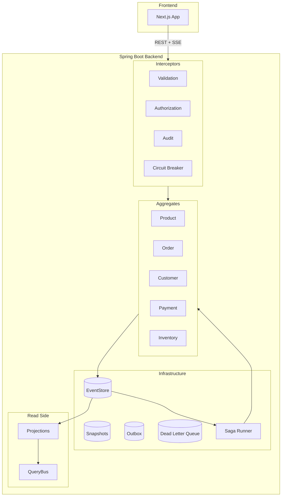

# Chapter 17: Putting It All Together

> **What you'll learn:** How every feature built across Chapters 1–16 connects into a single running system — the complete request lifecycle from browser click to event store and back, verified against a real end-to-end walkthrough scenario.

---

## What We're Building

There is almost no new code in this chapter: a seed runner, and one demo-only interceptor for the two-backend run at its end. You already built the rest. This chapter is a guided end-to-end walkthrough of the complete ecommerce demo — from the Next.js frontend through the Spring Boot backend, across all five aggregates, through the saga, and back to the read model.

The goal is to see every feature work together at the same time, understand where each piece lives, and confirm that the system behaves correctly: encrypted PII at rest, an order-fulfillment saga that runs end-to-end (payment captured by the process manager, stock reserved, order confirmed), a payment-gateway circuit breaker that trips when the gateway stops answering, the dead letter queue wired into the command bus, and a GDPR forget request that crypto-shreds the key and purges the read model. The last section runs two backends on one database and checks that the saga's forward fence (Chapter 11) keeps every forward command of a fulfillment ahead of its compensation, with one backend killed halfway.

By the end of this chapter you will have run the entire application, exercised every major feature, and have a checklist to verify that nothing was missed.

---

## Full System Diagram

The diagram below shows how all components connect. The five aggregates share a single `EventStore`. The `CommandBus` sits in front of the aggregates, gated by four interceptors that run in sequence on every command. The `SagaRunner` orchestrates multi-aggregate workflows by reacting to events and dispatching further commands. Projections consume events and maintain read models that the `QueryBus` serves. The `OutboxPoller` drains the transactional outbox to external subscribers. The `DeadLetterRetryRunner` replays failed commands that carry an idempotency key and leaves the others to an operator. The Next.js frontend talks to the backend over REST and a persistent SSE connection.



---

## Create `SeedDataRunner`

So far you have created demo data manually via `curl`. `SeedDataRunner` automates this at startup so the frontend has data immediately and you can skip the manual setup commands.

Create `spring-app/src/main/java/org/streamrune/ecommerce/spring/config/SeedDataRunner.java`:

```java
package org.streamrune.ecommerce.spring.config;

import java.math.BigDecimal;
import java.util.List;
import org.slf4j.Logger;
import org.slf4j.LoggerFactory;
import org.springframework.boot.ApplicationArguments;
import org.springframework.boot.ApplicationRunner;
import org.springframework.stereotype.Component;
import org.streamrune.core.Command;
import org.streamrune.core.DomainException;
import org.streamrune.core.EventStore;
import org.streamrune.core.types.AggregateId;
import org.streamrune.core.types.StreamId;
import org.streamrune.ecommerce.domain.common.Money;
import org.streamrune.ecommerce.domain.customer.CustomerCommand;
import org.streamrune.ecommerce.domain.inventory.InventoryCommand;
import org.streamrune.ecommerce.domain.inventory.InventoryState;
import org.streamrune.ecommerce.domain.order.OrderCommand;
import org.streamrune.ecommerce.domain.product.ProductCommand;
import org.streamrune.runtime.VirtualThreadCommandBus;

/**
 * Seeds the demo data at startup: three products with their opening stock, two customers and one
 * order.
 *
 * <p>Seeding is idempotent, one command at a time. A product, a customer and an order are each
 * created by a command its decider refuses when the aggregate already exists, so on a later start
 * those commands are skipped. The opening stock is received only while the product's inventory
 * stream is empty. A start that was interrupted halfway is therefore completed by the next one, and
 * a complete seed is never applied twice.
 */
@Component
public class SeedDataRunner implements ApplicationRunner {

  private static final Logger LOG = LoggerFactory.getLogger(SeedDataRunner.class);

  private final VirtualThreadCommandBus commandBus;
  private final EventStore eventStore;

  public SeedDataRunner(VirtualThreadCommandBus commandBus, EventStore eventStore) {
    this.commandBus = commandBus;
    this.eventStore = eventStore;
  }

  @Override
  public void run(ApplicationArguments args) {
    int applied = seed();
    if (applied == 0) {
      LOG.info("Seed data skipped (already exists)");
    } else {
      LOG.info("Demo data seeded ({} commands)", applied);
    }
  }

  /**
   * Dispatches every seed command that has not been applied yet.
   *
   * @return the number of commands applied; 0 when the data was already there
   */
  public int seed() {
    int applied = 0;

    // Products
    applied +=
        dispatch(
            new ProductCommand.CreateProduct(
                "prod-widget",
                "Widget",
                "A versatile widget for all occasions",
                "Electronics",
                new Money(BigDecimal.valueOf(19.99), "USD"),
                100));
    applied +=
        dispatch(
            new ProductCommand.CreateProduct(
                "prod-gadget",
                "Gadget",
                "The latest and greatest gadget",
                "Electronics",
                new Money(BigDecimal.valueOf(49.99), "USD"),
                50));
    applied +=
        dispatch(
            new ProductCommand.CreateProduct(
                "prod-doohickey",
                "Doohickey",
                "Nobody knows what it does, but everybody wants one",
                "Accessories",
                new Money(BigDecimal.valueOf(9.99), "USD"),
                200));

    // Inventory (opening stock, before the seed order so the saga's ReserveStock succeeds)
    applied += receiveOpeningStock("prod-widget", 100);
    applied += receiveOpeningStock("prod-gadget", 50);
    applied += receiveOpeningStock("prod-doohickey", 200);

    // Customers (encrypted PII)
    applied +=
        dispatch(
            new CustomerCommand.RegisterCustomer(
                "cust-alice", "Alice Johnson", "alice@example.com", "123 Main St", "+1-555-0101"));
    applied +=
        dispatch(
            new CustomerCommand.RegisterCustomer(
                "cust-bob", "Bob Smith", "bob@example.com", "456 Oak Ave", "+1-555-0102"));

    // One seed order; the fulfillment saga confirms it
    applied +=
        dispatch(
            new OrderCommand.PlaceOrder(
                "order-seed-1",
                "cust-alice",
                List.of(
                    new OrderCommand.OrderLine(
                        "prod-widget", 2, new Money(BigDecimal.valueOf(19.99), "USD")),
                    new OrderCommand.OrderLine(
                        "prod-gadget", 1, new Money(BigDecimal.valueOf(49.99), "USD")))));

    return applied;
  }

  /**
   * Dispatches one creation command. The decider refuses it with a {@link DomainException} when the
   * aggregate already exists, which is how a later start finds the data seeded.
   */
  private int dispatch(Command command) {
    try {
      commandBus.execute(command);
      return 1;
    } catch (DomainException e) {
      LOG.info("Seed data skipped: {}", e.getMessage());
      return 0;
    } catch (RuntimeException e) {
      LOG.warn("Seed command {} failed: {}", command.getClass().getSimpleName(), e.toString());
      return 0;
    }
  }

  /**
   * Receives a product's opening stock once. {@code ReceiveShipment} adds to the stock every time
   * it runs and no decider rule can tell the opening shipment from a later one, so the runner
   * dispatches it only while the product's inventory stream is still empty.
   */
  private int receiveOpeningStock(String productId, int quantity) {
    try {
      StreamId stream = StreamId.of(InventoryState.TYPE, AggregateId.of(productId));
      if (!eventStore.load(stream).events().isEmpty()) {
        LOG.info("Seed data skipped: inventory already stocked: {}", productId);
        return 0;
      }
      commandBus.execute(new InventoryCommand.ReceiveShipment(productId, quantity));
      return 1;
    } catch (RuntimeException e) {
      LOG.warn("Seed shipment for {} failed: {}", productId, e.toString());
      return 0;
    }
  }
}
```

`SeedDataRunner` implements `ApplicationRunner` and is annotated `@Component` so Spring picks it up automatically. On the first boot it dispatches nine commands through the full interceptor chain (audit, authorization, validation; `CreateProduct` carries no `@RequireRole`, and the `ADMIN` guard of the product routes sits in the controller, which the seed does not pass through), so all seed data appears in the audit log and produces events visible in the Event Explorer.

The runner must not seed twice: the database outlives the application (the `pgdata` volume in `docker-compose.yml`), and every later start runs it again. It relies on two things, one command at a time:

- **Products, customers and the order** are created by commands whose deciders refuse an id that already exists (the creation guards from chapters 2, 6 and 8). On a later start `dispatch` catches that `DomainException`, logs `Seed data skipped: Product already exists: prod-widget`, and moves on. The refused command went through the same bus as any other, so the audit log gains a `FAILURE` row for it on every restart — an honest record of a command that was sent and refused.
- **The opening stock** has no such guard. `ReceiveShipment` is a command that is supposed to succeed every time — that is how a shop restocks — so a second run would add another 100 widgets. `receiveOpeningStock` therefore looks at the product's inventory stream first and dispatches the shipment only while that stream is empty.

Because each command is skipped on its own evidence, a start that was interrupted halfway (say, after the products but before the customers) is completed by the next one, and a complete seed is never applied twice. When nothing was left to do, the runner logs `Seed data skipped (already exists)`; otherwise `Demo data seeded (9 commands)` with the number it applied. A command that fails for any other reason is logged as a warning and does not stop the application.

---

## End-to-End Walkthrough

### Step 1: Start Everything with Docker Compose

Build the Spring Boot and notifications-service JARs, then start all services:

```bash
./gradlew :spring-app:bootJar :notifications-service:bootJar
docker compose up
```

Docker Compose starts five services: PostgreSQL (with the data of the earlier chapters, in the `pgdata` volume; on a new volume the database is empty, and the backend creates the schema when it starts), RabbitMQ (ports 5672/15672), the Spring Boot backend (port 8080), the notifications-service outbox consumer (port 8090), and the Next.js frontend (port 3000). Wait for the backend to log `Started SpringEcommerceApplication`.

Verify that the application is healthy:

```bash
curl -s http://localhost:8080/actuator/health | jq .status
```

Expected output: `"UP"`

> **Alternative (backend and frontend outside Docker):** Start only the database and the broker with `docker compose up -d postgres rabbitmq` — the backend needs the database to start; the broker receives the outbox's integration events, which wait in the database until it answers (Chapter 13, Step 4) — then `./gradlew :spring-app:bootRun`, then `cd frontend && npm install && npm run dev`. See the README for details.

### Step 2: Open the Frontend

Open `http://localhost:3000` in your browser. The Dashboard page loads with four stat cards and a live event feed. The feed panel is empty at first: it shows what happens while the page is open, and the events of the seed data are history by then (an `ADMIN` finds them in the Event Explorer's Historical Browser). The green dot on the Event Explorer item in the sidebar confirms that the SSE connection to `/api/events/sse` is established. Seed data is loaded automatically on first startup — see the note below.

> **Where does the seed data come from?**
>
> `SeedDataRunner` (`spring-app/src/main/java/org/streamrune/ecommerce/spring/config/SeedDataRunner.java`) is a Spring `ApplicationRunner` that runs once during startup. It dispatches commands through the `VirtualThreadCommandBus` to create three products (`prod-widget` Widget $19.99, `prod-gadget` Gadget $49.99, `prod-doohickey` Doohickey $9.99), their initial inventory shipments (100 / 50 / 200 units), two customers (`cust-alice` Alice Johnson and `cust-bob` Bob Smith), and one seed order (`order-seed-1`) for Alice containing two widgets and one gadget.
>
> On subsequent startups the deciders refuse the creation commands (`DomainException`, e.g. `Product already exists: prod-widget`), the runner finds the inventory streams already stocked, and it logs `Seed data skipped (already exists)` without appending anything. All seed data flows through the full interceptor chain — audit, authorization, validation, and circuit breaker — so it appears in the audit log and produces events visible in the Event Explorer.

If you are running the demo manually (not via Docker Compose), seed data is created on the first `./gradlew :spring-app:bootRun` against a database that does not hold it yet.

### Step 3: Register a Customer — Observe Encrypted PII

Register a new customer as an `ADMIN`. The walkthrough sends the request with `curl` and an id of its own, `cust-walkthrough`, so that the later steps can name the customer and it does not collide with the `cust-alice` seed account from `SeedDataRunner`. The **Register Customer** dialog of the Customers page sends the same request with an id it generates (`cust-` and eight hex digits, shown in the toast and in the table's ID column):

```bash
curl -s -X POST http://localhost:8080/api/customers \
  -H "Content-Type: application/json" \
  -H "X-User-Id: admin-1" \
  -H "X-User-Role: ADMIN" \
  -d '{
    "customerId": "cust-walkthrough",
    "name": "Alice Smith",
    "email": "alice@example.com",
    "address": "123 Main St"
  }' | jq .
```

> **About the two headers.** They are what the frontend's `ADMIN` role sends. The backend takes `X-User-Id` as the identity because it runs in the trusted-gateway mode, and the role from `X-User-Role` through the demo's `HeaderUserRoleResolver` — stand-ins for a gateway and a real role source that a production deployment must not copy (Chapter 9 explains why). Every `curl` in this walkthrough plays the gateway's part.

Now read the event back through the Event Explorer (Chapter 15). It returns event payloads, so it answers only to the ADMIN role — the same two headers:

```bash
curl -s -H "X-User-Id: admin-1" -H "X-User-Role: ADMIN" \
  "http://localhost:8080/api/events/customer/cust-walkthrough" | jq '.[0].payload'
```

The stream id is `customer:cust-walkthrough` — the `CustomerCommand` registration in `StreamRuneConfig.java` names the aggregate type `customer` (`CustomerState.TYPE`) and its id extractor returns `c.customerId()`, so the URL carries the type and the id as two path segments.

The payload shows `Alice Smith`, `alice@example.com` and `123 Main St` **in plain text**. That is not a leak in the storage: the explorer reads through the event store, and the store decrypts `@Encrypted` fields for whoever reads an event, just as it does for the `CustomerProjection` that fills the Customers page. What is encrypted is the row. Look at it where it rests:

```bash
docker compose exec postgres psql -U postgres -d streamrune_ecommerce \
  -c "SELECT payload FROM event_stream WHERE aggregate_type = 'customer' AND aggregate_id = 'cust-walkthrough';"
```

There the `name`, `email`, and `address` fields are AES-GCM ciphertext blobs, not plaintext — the field encryption from Chapter 6. The database never holds the personal data in the clear; anyone who can call the explorer as an admin sees it decrypted, until the customer's key is erased in Step 8.

> **Demo shortcut — protect this in production.** The explorer's ADMIN check trusts the `X-User-Id` and `X-User-Role` headers, like every access check in this demo (see the note on the two headers above). Without them the same request answers `403`; with them, anyone gets decrypted personal data. An endpoint that returns raw event payloads needs real authentication and a role derived from the authenticated identity, or it should not be deployed. Chapter 15 has the details.

### Step 4: Create Products — Events, Projection, Query

The seed already created `prod-widget`, `prod-gadget` and `prod-doohickey`. Create two more products:

```bash
curl -s -X POST http://localhost:8080/api/products \
  -H "Content-Type: application/json" \
  -H "X-User-Id: admin-1" \
  -H "X-User-Role: ADMIN" \
  -d '{
    "productId": "prod-sprocket",
    "name": "Sprocket",
    "description": "A reliable sprocket",
    "category": "General",
    "price": 29.99,
    "initialStock": 100
  }' | jq .

curl -s -X POST http://localhost:8080/api/products \
  -H "Content-Type: application/json" \
  -H "X-User-Id: admin-1" \
  -H "X-User-Role: ADMIN" \
  -d '{
    "productId": "prod-gizmo",
    "name": "Gizmo",
    "description": "A handy gizmo",
    "category": "General",
    "price": 49.99,
    "initialStock": 50
  }' | jq .
```

A product id can be created once. Send the first request again, with `-i` instead of `-s` and without `| jq .`, and it answers `400 Bad Request` with the body `Product already exists: prod-sprocket` — the creation guard in `ProductDecider` (Chapter 2). The same request for a seeded id such as `prod-widget` is refused the same way, which is what keeps `SeedDataRunner` from seeding twice.

Read the events directly to see what was appended:

```bash
curl -s -H "X-User-Id: admin-1" -H "X-User-Role: ADMIN" \
  "http://localhost:8080/api/events/product/prod-sprocket" | jq .
```

As with the customer stream, the product stream id is `product:prod-sprocket` — `ProductCommand` registers under `ProductState.TYPE` with `c.productId()` as the id.

You should see a single `ProductCreated` event, with its `category` — the refused request appended nothing. Because `ProductCreatedUpcaster` (Chapter 4) is registered, the event was stored with schema version 2 and loads without an upcast; only rows stamped version 1 — like the hand-inserted `p-legacy` — pass through the upcaster.

Query the read model built by `ProductProjection`:

```bash
curl -s "http://localhost:8080/api/products" | jq .
```

The response comes from the `QueryBus` (with caching from Chapter 5). The first call executes the query against the projection. A second call within the cache TTL is served entirely from memory — no SQL executed.

Switch to the Products page in the frontend. Both products are listed next to the three seeded ones. The SSE live feed on the Dashboard already shows two `ProductCreated` events. The page's **Add Product** dialog sends the same request with a generated id (`prod-` and eight hex digits); a product created either way has no inventory until a shipment is received for it (**Receive Shipment** in the row's menu, `POST /api/inventory/{id}/receive`), and the saga cancels an order for it until then.

### Step 5: Place an Order — Watch the Saga

Place an order for Alice:

```bash
curl -s -X POST http://localhost:8080/api/orders \
  -H "Content-Type: application/json" \
  -H "X-User-Role: CUSTOMER" \
  -H "X-User-Id: cust-walkthrough" \
  -d '{
    "orderId": "ord-1",
    "customerId": "cust-walkthrough",
    "lines": [
      {"productId": "prod-widget", "quantity": 2}
    ]
  }' | jq .
```

A line names a product and a quantity; the price is the catalogue's. `OrderPricing` (Chapter 8) reads `product:prod-widget` from the event store and prices the line at `19.99`, the seeded widget's price, so the order's total is `39.98`. A product nobody created, or a discontinued one, answers `400`. The Orders page's **Place Order** dialog sends the same request for the persona it acts as: it generates the `orderId` (`order-` and eight hex digits) and sends each product picked with its quantity.

The `OrderDecider` appends `OrderPlaced`. From there the order-fulfillment saga (Chapter 11) runs all the way to completion, driven by three polling subscriptions, each reacting to the events of the one before:

1. `SagaRunner` reacts to `OrderPlaced`, starts the `OrderFulfillmentSaga`, and dispatches `InitiatePayment` (correlation id `streamrune:saga:fulfillment-ord-1`). `PaymentDecider` appends `PaymentInitiated`, and the command bus stores the saga's origin with it.
2. The `PaymentProcessManager` reacts to `PaymentInitiated`, calls `PaymentGatewaySimulator.processPayment(...)` (the failure flag is off, so it succeeds), and dispatches `CapturePayment` as a continuation of that event. `PaymentCaptured` carries the saga's origin and flows back to the saga, which moves to `AWAITING_INVENTORY` and dispatches `ReserveStock`.
3. `StockReserved` returns the saga to `AWAITING_CONFIRMATION`; it dispatches `ConfirmOrder`; `OrderConfirmed` drives the saga to `COMPLETED`.

The saga's full design (see the Javadoc on `OrderFulfillmentSaga`) is `OrderPlaced → InitiatePayment → PaymentCaptured → ReserveStock → StockReserved → ConfirmOrder → COMPLETED`. The link that makes this work end-to-end is the saga origin: the command bus stores it with every event a saga's command produces, the `PaymentProcessManager` carries it onto its capture command with `StreamRuneContext.continuing(event)`, and `SagaRunner` routes each of those events to the saga its origin names, `fulfillment-ord-1`. Saga dispatch also binds the correlation id `streamrune:saga:fulfillment-ord-1`, and the continuation keeps it, so the audit trail shows the whole fulfillment under one correlation id. Nothing routes by a correlation id, because a client chooses the one of its own requests; a request that sends an id with the `streamrune:` prefix is answered `400`.

Because each leg hops through a separate polling subscription, give it a second or two, then inspect the saga state:

```bash
curl -s -H "X-User-Id: admin-1" -H "X-User-Role: ADMIN" \
  http://localhost:8080/api/saga/fulfillments/fulfillment-ord-1 | jq .fulfillmentStatus
```

Expected output: `"COMPLETED"`

A fulfillment saga is read by whoever may read its order (Chapter 11): an `ADMIN`, or the order's customer. `cust-walkthrough` gets the same answer with `-H "X-User-Id: cust-walkthrough" -H "X-User-Role: CUSTOMER"`; any other customer, and a caller without an identity, gets `403`. In the browser, switch to `ADMIN` and open the Fulfillment page. The card `fulfillment-ord-1` moves from Started through In Progress to Completed; the tracker updates via SSE — no page refresh needed. As a `CUSTOMER` the same page lists the sagas of that persona's own orders (the role switcher offers the two seeded customers, so `cust-walkthrough`'s saga is not among them).

Check the order state — the saga's final `ConfirmOrder` emitted `OrderConfirmed`, and the saga is the only sender of that command (the order decider's guard refuses it from anybody else, and there is no endpoint for it), so the projection reports:

```bash
curl -s -H "X-User-Id: cust-walkthrough" -H "X-User-Role: CUSTOMER" \
  http://localhost:8080/api/orders/ord-1 | jq '{status, paymentStatus, total}'
```

Expected output: `"status": "CONFIRMED"`, `"paymentStatus": "CAPTURED"` and a total of `39.98`. The Orders page shows the payment status as a second badge beside the order's.

The order is read by the customer it belongs to. Leave the two headers out, or send another customer's id, and the answer is `403`: an order is for its customer or an `ADMIN` (Chapter 9), and so is the list — `GET /api/orders` with these headers returns the walkthrough customer's orders and nobody else's.

#### Cancel a confirmed order and watch the refund and the release

Place a second order and cancel it as its customer once the saga has confirmed it:

```bash
curl -s -X POST http://localhost:8080/api/orders \
  -H "Content-Type: application/json" \
  -H "X-User-Role: CUSTOMER" \
  -H "X-User-Id: cust-walkthrough" \
  -d '{"orderId": "ord-2", "customerId": "cust-walkthrough", "lines": [{"productId": "prod-widget", "quantity": 1}]}'

# a few seconds later, once GET /api/orders/ord-2 reads CONFIRMED
curl -s -X POST http://localhost:8080/api/orders/ord-2/cancel \
  -H "Content-Type: application/json" \
  -H "X-User-Role: CUSTOMER" \
  -H "X-User-Id: cust-walkthrough" \
  -d '{"reason": "changed my mind"}'
```

The cancellation is one `OrderCancelled`, and every `OrderCancelled` is undone by the order cancellation process manager (Chapter 11): it releases the stock of each line and cancels the payment, which refunds a captured payment in full. Watch both in the payment stream and in the inventory stream (the Event Explorer page shows the same streams):

```bash
curl -s -H "X-User-Id: admin-1" -H "X-User-Role: ADMIN" \
  http://localhost:8080/api/events/payment/pay-ord-2 | jq '[.[].eventType]'
# ["PaymentInitiated", "PaymentCaptured", "PaymentRefunded"]

curl -s -H "X-User-Id: admin-1" -H "X-User-Role: ADMIN" \
  http://localhost:8080/api/events/inventory/prod-widget \
  | jq '[.[] | select(.payload.orderId == "ord-2") | .eventType]'
# ["StockReserved", "StockReleased"]

curl -s -H "X-User-Id: cust-walkthrough" -H "X-User-Role: CUSTOMER" \
  http://localhost:8080/api/orders/ord-2 | jq '{status, paymentStatus}'
# {"status": "CANCELLED", "paymentStatus": "REFUNDED"}
```

The saga of `ord-2` completed before the cancel and stays `COMPLETED`; the undo runs through the cancellation's event, not through the saga. A shipped order is not cancelled: ship `ord-1` as an `ADMIN` (`POST /api/orders/ord-1/ship`), and a cancel of it afterwards answers `400 Cannot cancel SHIPPED orders`. Shipping commits the order's reservation instead (`ReservationConfirmed` in the inventory stream).

The bus snapshots a stream after every 5 of its events (`SnapshotPolicy.everyNEvents(5)` from Chapter 8). The count is per stream, so more orders never snapshot an order: an order stream reaches five events only by being cancelled again, as Chapter 8's `order-5` was. A product's stream gets there with stock and price changes, and an inventory stream with its reservations: `SELECT aggregate_type, aggregate_id, version FROM snapshot_store WHERE state_payload IS NOT NULL` lists the streams that have one, and the next load of such a stream starts from the snapshot rather than from its first event.

### Step 6: Check the Audit Log — Verify All Commands Were Tracked

Every command that passed through `AuditCommandInterceptor` (Chapter 10) is recorded:

```bash
curl -s -H "X-User-Id: admin-1" -H "X-User-Role: ADMIN" \
  "http://localhost:8080/api/audit/commands?limit=20" | jq '.[] | {commandType, aggregateId, userId, occurredAt, outcome}'
```

You should see entries for `RegisterCustomer`, `CreateProduct` (twice, and a third with outcome `FAILURE` if you sent the duplicate request in Step 4), and `PlaceOrder` — plus the commands the saga dispatched while fulfilling `ord-1` in Step 5 (`InitiatePayment`, `CapturePayment`, `ReserveStock`, `ConfirmOrder`), and for `ord-2` the customer's `CancelOrder` and the process manager's `ReleaseStock` and `CancelPayment`, since every command goes through the same audited bus. The audit log stores the `user_id` taken from the `X-User-Id` request header (trusted-gateway mode, Chapter 9), so the customer and product commands from Steps 3 and 4 carry `admin-1` and the order command (Step 5 sent `X-User-Id: cust-walkthrough`) carries `cust-walkthrough`; the saga-dispatched commands and the process manager's `CapturePayment` run under the saga's correlation id (`streamrune:saga:fulfillment-ord-1`) rather than for a user, so their `userId` is empty. The role itself is used by the authorization interceptor but is not persisted in the audit row. Open the Audit page in the frontend to browse the log; a **Show** selector at the top chooses how many rows to load (25 / 50 / 100).

### Step 7: Trip the Payment-Gateway Circuit Breaker

The demo runs **two** breakers (Chapter 12), and `/api/admin/circuit-breaker` reports both:

```bash
curl -s -H "X-User-Id: admin-1" -H "X-User-Role: ADMIN" http://localhost:8080/api/admin/circuit-breaker
# {"state":"CLOSED","paymentGateway":"CLOSED"}
```

- `state` is the command-bus `CircuitBreakerCommandInterceptor` (`new CircuitBreakerCommandInterceptor(3, Duration.ofSeconds(30))`). It counts genuine infrastructure failures on the command bus and opens after 3 in a row.
- `paymentGateway` is the `PaymentGatewayCircuitBreaker` (also `3` / `30s`) wrapped around the gateway call the `PaymentProcessManager` makes.

Now exercise the gateway breaker. A decline does not open it: the payment-failure switch makes the gateway decline, the manager fails the payment at once, and the saga cancels the order, while `paymentGateway` stays `CLOSED` — a decline is the answer of a gateway that works. What opens it is a gateway that gives no answer. Switch the outage on (an admin endpoint, so the call carries an `ADMIN`'s two headers, as the reads of this step do — Chapter 12) and place a few orders:

```bash
curl -s -X POST -H "X-User-Id: admin-1" -H "X-User-Role: ADMIN" http://localhost:8080/api/admin/payment-outage/toggle
# {"outage":true}

for i in 1 2 3; do
  curl -s -X POST http://localhost:8080/api/orders \
    -H "Content-Type: application/json" -H "X-User-Role: CUSTOMER" -H "X-User-Id: cust-walkthrough" \
    -d "{\"orderId\":\"walk-cb-$i\",\"customerId\":\"cust-walkthrough\",\"lines\":[{\"productId\":\"prod-widget\",\"quantity\":1}]}"
done
```

Each order's `PaymentProcessManager` calls the gateway, which gives no answer. The gateway may have taken the money, so the manager does not fail the payment: it asks the gateway for a capture of it, finds none, and lets the subscription deliver `PaymentInitiated` again, while the other orders' payments, and any refund, wait behind it. After three calls without an answer the gateway breaker opens, and the manager stops calling the gateway:

```bash
curl -s -H "X-User-Id: admin-1" -H "X-User-Role: ADMIN" http://localhost:8080/api/admin/circuit-breaker
# {"state":"CLOSED","paymentGateway":"OPEN"}

curl -s -H "X-User-Id: admin-1" -H "X-User-Role: ADMIN" http://localhost:8080/api/saga/fulfillments/fulfillment-walk-cb-1 | jq .fulfillmentStatus
# "AWAITING_PAYMENT"
```

Notice the command-bus breaker (`state`) stays `CLOSED`: a call without an answer dispatches no command, and a decline becomes *successful* `FailPayment`/`CancelOrder` commands, so the command bus never sees a gateway failure — and even if it did, its counter resets on every successful command. This is exactly why the demo puts a dedicated breaker around the gateway (Chapter 12 walks through the reasoning). Switch the outage off: within about a minute and a half (the subscription's backoff, up to a minute, plus the cooldown), the next delivery is the breaker's probe, the gateway answers, the breaker closes, and the three payments are captured, so the orders are confirmed. An outage that outlasts the saga's deadline cancels its orders and voids their payments instead.

```bash
curl -s -X POST -H "X-User-Id: admin-1" -H "X-User-Role: ADMIN" http://localhost:8080/api/admin/payment-outage/toggle
# {"outage":false}
```

Both switches are each backend's own: they flip the simulator of the backend that answers the request, and with two backends (below) the payment process manager may lead on the other one.

### Step 8: Forget the Customer — Verify GDPR Crypto Shredding

Forget the walkthrough customer using the GDPR right-to-erasure feature from Chapter 7:

```bash
curl -s -X POST http://localhost:8080/api/customers/cust-walkthrough/forget \
  -H "X-User-Id: admin-1" \
  -H "X-User-Role: ADMIN" | jq .
```

```json
{
  "keyDeleted": true,
  "fullyErased": true,
  "failedPurgers": []
}
```

Only an `ADMIN` or the customer themself may send this (Chapter 9); anyone else gets `403` and nothing is written. The `CustomerDecider` appends a `CustomerForgotten` event. The endpoint then calls `ForgetSubjectService.forget(...)`, which (1) crypto-shreds the subject's encryption key in the key store and (2) runs the registered `CustomerSubjectDataPurger` to delete the customer's read-model row. The answer is `200` only because `fullyErased` is `true`. Had the key deletion failed, or a purger, it would be `500` with `keyDeleted` or `failedPurgers` saying what is left, and you would send the same request again: the decider records nothing for a customer already forgotten, `deleteKey` is a no-op on a deleted key and each purger is idempotent, so the repeat finishes the erasure from wherever the last attempt stopped (Chapter 7, Step 2). Now read the raw events:

```bash
curl -s -H "X-User-Id: admin-1" -H "X-User-Role: ADMIN" \
  "http://localhost:8080/api/events/customer/cust-walkthrough" | jq '.[].payload | .name // .email // empty'
```

Where Step 3 showed `Alice Smith`, the same request now prints `"[REDACTED]"`. The `CustomerRegistered` event still exists in the append-only event store — it cannot be deleted — but its encrypted fields cannot be decrypted because the key is gone, for an admin as for anyone else. The read model is handled separately: both the `CustomerProjection` (on the `CustomerForgotten` event) and the `CustomerSubjectDataPurger` **delete the `customers_view` row entirely** rather than leaving a redacted shell. In the frontend, switch to the Customers page; Alice's walkthrough row is gone — `GET /api/customers/cust-walkthrough` now returns `404 Not Found`.

The event history is intact and auditable, but the personal data is irrecoverably gone — the ciphertext can never be decrypted and the read-model row is gone. Both GDPR requirements are satisfied simultaneously.

### Step 9: Check the Dead Letter Queue

The DLQ (Chapter 14) collects commands that exhausted their retries. Check it:

```bash
curl -s -H "X-User-Id: admin-1" -H "X-User-Role: ADMIN" "http://localhost:8080/api/admin/dead-letters" | jq .
```

In this walkthrough nothing lands in the DLQ: the outage of Step 7 holds payments without failing a command, and a declined payment's `FailPayment`/`CancelOrder` commands succeed, so no command exhausts its retries. The endpoint returns an empty array `[]`. When a command *does* land in the DLQ, each entry exposes the failed `commandType`, the `errorType`/`errorMessage`, and the attempt counts (`attempts` / `dlqAttempts`). The `commandPayload` of a dead-lettered `RegisterCustomer` or `UpdateProfile` shows the customer's personal data as ciphertext: those commands carry `@Encrypted` (Chapter 6), so the queued copy is erased with the customer (Chapter 7). From the Admin page in the frontend you can re-run individual entries with the **Retry** button. `POST /api/admin/dead-letters/{id}/retry` calls `deadLetterRetryRunner.retry(new CommandId(id), force)`, which **re-dispatches the dead-lettered command through the bus** under a `DLQ_REPLAY` marker and the entry's original request context — discarding the entry on success, bumping its DLQ attempt count on failure, and returning `404` if no entry exists for that id. Without `force` it replays only an entry the command inbox can deduplicate — one whose command carried an idempotency key, such as a stock adjustment sent with `Idempotency-Key` (Chapter 14, Step 3b). For any other it answers `409` with the reason; the Admin page then asks you to check the command's effect, and either resends the retry with `?force=true` (the effect is absent) or discards the entry with `DELETE /api/admin/dead-letters/{id}` (the effect is present). The backend writes either decision to the audit log under your id before it acts on it. Like every mutating admin endpoint it requires the ADMIN role header and answers `403` without it; the Admin page sends it for the ADMIN persona. The `DeadLetterRetryRunner` bean replays keyed entries on its own schedule; an unkeyed entry waits for an operator, because its caller may already have retried it.

Verify the outbox as well — the listing is read-only (`findByStatus(PENDING)`), so it never stalls delivery:

```bash
curl -s -H "X-User-Id: admin-1" -H "X-User-Role: ADMIN" "http://localhost:8080/api/admin/outbox" | jq .
curl -s -H "X-User-Id: admin-1" -H "X-User-Role: ADMIN" "http://localhost:8080/api/admin/outbox/failed" | jq .
```

The `OutboxPoller` drains entries every 5 seconds (the default `streamrune.outbox.flush-interval-ms`, not overridden in the demo's `application.yml`), so the first list is usually empty or shows the last few seconds of entries. The second list is empty in a healthy run: on the demo's `STRICT_PER_AGGREGATE` channel a `FAILED` entry would block its order, payment or product until replayed or skipped from the admin API (Chapter 14).

### Step 10: Browse Events in the Event Explorer

The Event Explorer page in the frontend provides a paginated view of the global event stream when the role switcher is on `ADMIN`; for any other role its history panel says that it requires the ADMIN role. You can also query it directly, with the ADMIN headers:

```bash
curl -s -H "X-User-Id: admin-1" -H "X-User-Role: ADMIN" \
  "http://localhost:8080/api/events?offset=0&limit=10" | \
  jq '.[] | "\(.globalOffset)  \(.eventType)  \(.aggregateType):\(.aggregateId)"'
```

The output shows every event appended during this walkthrough, in global order. This is the complete audit trail of everything that happened in the system — immutable, append-only, and queryable at any offset.

Open a persistent SSE connection in a separate terminal to watch new events arrive in real time:

```bash
curl -N http://localhost:8080/api/events/sse
```

The terminal prints `: connected` within a second and nothing of the events above: the feed starts at the head of the store. Every command you dispatch from this point forward produces SSE frames here within one second. The feed needs no header and is what the frontend's live feed shows to every role: each frame holds the event's global offset, the aggregate type, the event type and the timestamp. It names no stream and carries no payload, so the terminal shows that an order was placed, not which one.

### Two Backends on One Database

Everything so far ran one backend. A production service runs several against one database — replicas, or two versions side by side during a rolling restart — and each of them runs the order-fulfillment saga's subscription and its timeout runner (Chapter 11, Step 6). They do not all deliver: the saga runner carries a lease, `"saga:" + saga type`, and the saga subscription built with `.sagaRunner(...)` takes it. One backend holds it, delivers the saga's events, claims its deadlines and retries its compensations; the others read nothing and ask for the lease every polling interval, and take over when the leader stops (within one interval) or dies (within the lease's 15 seconds plus one interval). The three process managers' subscriptions have a lease each — `payment-process-manager`, `order-cancellation` and `order-shipment` — so each of the four leases sits on one backend, and not necessarily the same one: after a restart the saga may lead on one backend and the cancellation process manager on the other. The step lock that keeps a deadline claim from compensating underneath a step in flight is memory and holds within one backend, which is where the steps and the claims run. Around a handover two backends overlap for a moment — a dead backend's last transaction stays open until the database ends it (a killed process usually closes its connections at once; a backend cut off by the network keeps them until the idle-in-transaction bound), and a deposed leader may finish the page it was delivering — and there the saga runner's forward fence keeps a forward command and its saga's compensation in order. The Compose file has a profile to watch it work.

**The aggregate lock holds across the backends.** Both backends write the same aggregates: an order placed on either, the stock its saga reserves wherever the saga leads, a shipment received on whichever backend a client reaches. The lock the command bus takes around a command decides what two such commands do. An in-process lock — the framework's default, `LocalStripedLocker` — serializes the commands of one aggregate within one backend and nothing across them: two backends writing one inventory both load it, the second append fails its version check, the bus reloads and tries again, and after three conflicts in a row the command is refused with `AGGREGATE_VERSION_CONFLICT` and dead-lettered (Chapter 12, Step 2b; Chapter 14). Nothing is lost or written twice either way — the version check holds — but under load a client meets refusals that one backend never gives. The demo therefore takes the lock in PostgreSQL (`aggregateLocker`, `PgAdvisoryLocker`, Chapter 12): every backend asks the database for the same advisory lock per stream, so a command on one backend waits for a command on the same aggregate on the other, up to `streamrune.lock-timeout`, and runs once it is free; when every connection of its lock pool is taken, it first waits up to ten seconds for one of them (Chapter 12), a wait the pool's meters show (`hikaricp.connections.pending`, tagged `pool=streamrune-advisory-lock`, Chapter 15). What it costs: each command holds a connection of the locker's own pool from the lock to its end, besides the connection of the application's pool it borrows for its load and its append, plus the round trip that takes the lock. Each backend opens two pools of ten, so two backends hold up to forty pooled connections, besides one for each of the framework's listeners (`LISTEN`), which keeps a connection of its own; together they stay well below PostgreSQL's default `max_connections` of 100. Size the two pools and the listeners of every replica together below it. `TwoInstanceSagaIT` shows the lock across two Spring contexts on one database: a stock adjustment on one waits for the lock a price change on the other holds, and 200 shipments received through both at once are all applied, without a version conflict or a dead-lettered command.

**The profile.** The Compose file gets a second backend, `backend-2`, under the profile `two-backends`: the same image with the same environment, on port 8091 (8090 is the notifications service). Both backends also take four settings from the environment, with defaults that change nothing:

| Variable | Property | Default | Effect |
|---|---|---|---|
| `APP_SAGA_FULFILLMENT_TIMEOUT` | `app.saga.fulfillment-timeout` | `15m` | The fulfillment saga's deadline |
| `APP_SAGA_TIMEOUT_POLL_INTERVAL` | `app.saga.timeout-poll-interval` | `10s` | How often each backend's timeout runner looks for sagas past their deadline |
| `APP_CHAOS_SAGA_COMMAND_DELAY_MAX` | `app.chaos.saga-command-delay-max` | `0ms` | A random delay of 0 to this long before every command a saga dispatches |
| `MANAGEMENT_ENDPOINT_HEALTH_SHOW_DETAILS` | `management.endpoint.health.show-details` | `never` | With `always`, `/actuator/health` lists each subscription with its `role`: `LEADING` or `STANDBY` (Chapter 15) |

Replace `docker-compose.yml` with the demo's file, the last version of it:

```yaml
services:
  postgres:
    image: postgres:17
    environment:
      POSTGRES_DB: streamrune_ecommerce
      POSTGRES_USER: postgres
      POSTGRES_PASSWORD: postgres
    ports:
      - "5432:5432"
    volumes:
      - pgdata:/var/lib/postgresql/data
    healthcheck:
      test: ["CMD-SHELL", "pg_isready -U postgres"]
      interval: 2s
      timeout: 5s
      retries: 10

  rabbitmq:
    image: rabbitmq:3-management
    ports:
      - "5672:5672"
      - "15672:15672"
    healthcheck:
      # check_port_connectivity, not ping: ping answers as soon as the Erlang node runs, seconds
      # before the AMQP listener accepts connections, and the backend and the notifications
      # service connect the moment this check passes.
      test: ["CMD", "rabbitmq-diagnostics", "-q", "check_port_connectivity"]
      interval: 5s
      timeout: 10s
      retries: 10

  backend:
    build:
      context: .
      dockerfile: Dockerfile.backend
    ports:
      - "8080:8080"
    environment:
      SPRING_DATASOURCE_URL: jdbc:postgresql://postgres:5432/streamrune_ecommerce
      SPRING_DATASOURCE_USERNAME: postgres
      SPRING_DATASOURCE_PASSWORD: postgres
      RABBITMQ_HOST: rabbitmq
      RABBITMQ_USERNAME: guest
      RABBITMQ_PASSWORD: guest
      # The order-fulfillment saga's deadline (app.saga.fulfillment-timeout), how often the timeout
      # runner looks for sagas past it (app.saga.timeout-poll-interval) and the demo-only delay
      # before each saga command (app.chaos.saga-command-delay-max). Defaults: 15m, 10s and 0ms.
      APP_SAGA_FULFILLMENT_TIMEOUT: ${APP_SAGA_FULFILLMENT_TIMEOUT:-15m}
      APP_SAGA_TIMEOUT_POLL_INTERVAL: ${APP_SAGA_TIMEOUT_POLL_INTERVAL:-10s}
      APP_CHAOS_SAGA_COMMAND_DELAY_MAX: ${APP_CHAOS_SAGA_COMMAND_DELAY_MAX:-0ms}
      # The details of /actuator/health (never unless set): with always, they list each
      # subscription with its role under its lease — LEADING or STANDBY.
      MANAGEMENT_ENDPOINT_HEALTH_SHOW_DETAILS: ${MANAGEMENT_ENDPOINT_HEALTH_SHOW_DETAILS:-never}
    # The backend starts without the broker: its outbox publisher connects on the first publish.
    # Waiting for the broker lets the first integration events go out at once.
    depends_on:
      postgres:
        condition: service_healthy
      rabbitmq:
        condition: service_healthy

  # A second backend on the same database, started only with the two-backends profile:
  #   docker compose --profile two-backends up -d --build
  # Same image, same environment, port 8091 (8090 is the notifications service). Both serve every
  # request; one of them leads the order-fulfillment saga (its events, its deadlines, its
  # compensation retries) and the payment process manager, and the other stands by and takes over
  # when the leader stops or dies. scripts/two-backends-invariant.sh places orders on both, kills
  # the leader with SIGKILL halfway and checks that no forward command of a saga was stored after
  # that saga's compensation.
  backend-2:
    profiles: ["two-backends"]
    build:
      context: .
      dockerfile: Dockerfile.backend
    ports:
      - "8091:8080"
    environment:
      SPRING_DATASOURCE_URL: jdbc:postgresql://postgres:5432/streamrune_ecommerce
      SPRING_DATASOURCE_USERNAME: postgres
      SPRING_DATASOURCE_PASSWORD: postgres
      RABBITMQ_HOST: rabbitmq
      RABBITMQ_USERNAME: guest
      RABBITMQ_PASSWORD: guest
      APP_SAGA_FULFILLMENT_TIMEOUT: ${APP_SAGA_FULFILLMENT_TIMEOUT:-15m}
      APP_SAGA_TIMEOUT_POLL_INTERVAL: ${APP_SAGA_TIMEOUT_POLL_INTERVAL:-10s}
      APP_CHAOS_SAGA_COMMAND_DELAY_MAX: ${APP_CHAOS_SAGA_COMMAND_DELAY_MAX:-0ms}
      MANAGEMENT_ENDPOINT_HEALTH_SHOW_DETAILS: ${MANAGEMENT_ENDPOINT_HEALTH_SHOW_DETAILS:-never}
    depends_on:
      postgres:
        condition: service_healthy
      rabbitmq:
        condition: service_healthy

  notifications-service:
    build:
      context: .
      dockerfile: notifications-service/Dockerfile
    ports:
      - "8090:8090"
    environment:
      RABBITMQ_HOST: rabbitmq
      RABBITMQ_USERNAME: guest
      RABBITMQ_PASSWORD: guest
    depends_on:
      rabbitmq:
        condition: service_healthy

  frontend:
    build:
      context: frontend
      dockerfile: Dockerfile
      args:
        NEXT_PUBLIC_API_URL: http://localhost:8080
    ports:
      - "3000:3000"
    depends_on:
      - backend

volumes:
  pgdata:
```

A deadline of one and a half seconds, timeout runners that look every 200 ms and saga commands delayed by up to 300 ms make a fulfillment take about as long as its deadline: some complete, some are compensated at their deadline, and some deadlines pass while a forward command is on its way to the event store. Start both backends that way, with the health details on (build the JARs first, as in Step 1):

```bash
./gradlew :spring-app:bootJar :notifications-service:bootJar
MANAGEMENT_ENDPOINT_HEALTH_SHOW_DETAILS=always APP_SAGA_FULFILLMENT_TIMEOUT=1500ms \
  APP_SAGA_TIMEOUT_POLL_INTERVAL=200ms APP_CHAOS_SAGA_COMMAND_DELAY_MAX=300ms \
  docker compose --profile two-backends up -d --build
```

Which backend leads shows in each one's health:

```bash
curl -s http://localhost:8080/actuator/health | jq '.components.streamRune.details["subscription.order-fulfillment-saga"].role'
curl -s http://localhost:8091/actuator/health | jq '.components.streamRune.details["subscription.order-fulfillment-saga"].role'
```

**Keep the four variables on every later `docker compose up` of this stack.** Compose interpolates them when it starts a service and recreates a service whose configuration changed: a later `docker compose --profile two-backends up -d <service>` from a shell without them — to restart the frontend, say, which depends on `backend` — recreates `backend` with the defaults (a fifteen-minute deadline, no health details), and `backend-2` too when the command names it, and `scripts/two-backends-invariant.sh` then stops at its first check, the health details. Export the four in the shell you work in, or put them in an `.env` file next to `docker-compose.yml`, which Compose reads on every run.

One answers `"LEADING"`, the other `"STANDBY"` — usually the backend that started first. Both serve every request: an order placed on the standby is stored by it, and the leader's saga subscription picks up its `OrderPlaced` from the shared event store.

The delay is a demo-only knob, `SagaCommandDelayInterceptor` in `spring-app/src/main/java/org/streamrune/ecommerce/spring/config/`:

```java
package org.streamrune.ecommerce.spring.config;

import java.time.Duration;
import java.util.Objects;
import java.util.concurrent.ThreadLocalRandom;
import org.streamrune.core.CommandInterceptor;
import org.streamrune.core.StreamRuneContext;

/**
 * A demo-only knob that widens the window between a saga's deadline and its forward commands: it
 * sleeps a random time between zero and {@code max} before every command a saga dispatches ({@link
 * StreamRuneContext#isSagaDispatch()}), and lets every other command through at once.
 *
 * <p>With it, a saga's deadline can pass while one of its forward commands is on the way to the
 * event store, which is the moment the saga runner's forward fence is for: the command is stored
 * before the compensation claim, or refused at its commit. {@link StreamRuneConfig#commandBus}
 * registers it only when {@code app.chaos.saga-command-delay-max} is above zero (the default is
 * {@code 0ms}); the two-backend Compose profile and {@code TwoInstanceSagaIT} turn it on. Do not
 * copy it into an application: it slows every saga down on purpose.
 */
public final class SagaCommandDelayInterceptor implements CommandInterceptor {

  private final long maxNanos;

  /**
   * An interceptor that delays each saga command by up to {@code max}.
   *
   * @param max the longest delay; positive
   */
  public SagaCommandDelayInterceptor(Duration max) {
    Objects.requireNonNull(max, "max is required");
    if (max.isZero() || max.isNegative()) {
      throw new IllegalArgumentException("max must be positive, got " + max);
    }
    this.maxNanos = max.toNanos();
  }

  /** Sleeps a random 0..{@code max} when a saga dispatched the command; never refuses one. */
  @Override
  public boolean before(CommandContext ctx) {
    if (StreamRuneContext.isSagaDispatch()) {
      try {
        Thread.sleep(Duration.ofNanos(ThreadLocalRandom.current().nextLong(maxNanos + 1)));
      } catch (InterruptedException e) {
        // Shutting down: keep the interrupt for the code after this interceptor and go on.
        Thread.currentThread().interrupt();
      }
    }
    return true;
  }
}
```

`StreamRuneConfig#commandBus` adds it as the innermost interceptor, and only when the property is above zero. The bean takes a parameter for the property and keeps the builder in a variable, so the interceptor can be added before `build()`:

```java
@Bean
public VirtualThreadCommandBus commandBus(
    EventStore store,
    BeanValidationInterceptor validation,
    AnnotationAuthorizationInterceptor auth,
    AuditCommandInterceptor audit,
    CircuitBreakerCommandInterceptor circuitBreaker,
    PostgresCommandInbox commandInbox,
    PostgresDeadLetterQueue deadLetterQueue,
    PostgresCryptoEngine cryptoEngine,
    AggregateLocker locker,
    StreamRuneProperties properties,
    @Value("${app.chaos.saga-command-delay-max:0ms}") Duration sagaCommandDelayMax) {
  var bus =
      VirtualThreadCommandBus.builder()
          .eventStore(store)
          .locker(locker)
          .lockTimeout(properties.lockTimeout())
          // Required for saga command dispatch: SagaCommandDispatch calls
          // commandBus.execute(command, IdempotencyKey), which throws IllegalStateException
          // unless the bus has a commandInbox wired in.
          .commandInbox(commandInbox)
          .interceptors(audit, auth, validation, circuitBreaker)
          .deadLetterQueue(deadLetterQueue)
          .objectMapper(DeadLetterRetryRunner.createObjectMapper(cryptoEngine))
          // The rules deadLetterRetryRunner replays by: a keyed command that fails again under
          // its key is told whether the entry stored for the key is still replayed.
          .deadLetterRetryPolicy(DeadLetterRetryPolicy.DEFAULT)
          .inboxRetentionMaxAge(properties.inbox().retentionMaxAge())
          .snapshotPolicy(SnapshotPolicy.everyNEvents(5))
          .register(
              ProductState.TYPE,
              ProductCommand.class,
              cmd ->
                  AggregateId.of(
                      switch (cmd) {
                        case ProductCommand.CreateProduct c -> c.productId();
                        case ProductCommand.UpdatePrice c -> c.productId();
                        case ProductCommand.AdjustStock c -> c.productId();
                        case ProductCommand.DiscontinueProduct c -> c.productId();
                      }),
              new ProductDecider())
          .register(
              OrderState.TYPE,
              OrderCommand.class,
              cmd ->
                  AggregateId.of(
                      switch (cmd) {
                        case OrderCommand.PlaceOrder c -> c.orderId();
                        case OrderCommand.ConfirmOrder c -> c.orderId();
                        case OrderCommand.ShipOrder c -> c.orderId();
                        case OrderCommand.DeliverOrder c -> c.orderId();
                        case OrderCommand.CancelOrder c -> c.orderId();
                      }),
              new OrderDecider())
          .register(
              CustomerState.TYPE,
              CustomerCommand.class,
              cmd ->
                  AggregateId.of(
                      switch (cmd) {
                        case CustomerCommand.RegisterCustomer c -> c.customerId();
                        case CustomerCommand.UpdateProfile c -> c.customerId();
                        case CustomerCommand.RequestDataExport c -> c.customerId();
                        case CustomerCommand.ForgetCustomer c -> c.customerId();
                      }),
              new CustomerDecider())
          .register(
              PaymentState.TYPE,
              PaymentCommand.class,
              cmd ->
                  AggregateId.of(
                      switch (cmd) {
                        case PaymentCommand.InitiatePayment c -> c.paymentId();
                        case PaymentCommand.CapturePayment c -> c.paymentId();
                        case PaymentCommand.FailPayment c -> c.paymentId();
                        case PaymentCommand.CancelPayment c -> c.paymentId();
                      }),
              new PaymentDecider())
          .register(
              InventoryState.TYPE,
              InventoryCommand.class,
              cmd ->
                  AggregateId.of(
                      switch (cmd) {
                        case InventoryCommand.ReserveStock c -> c.productId();
                        case InventoryCommand.ReleaseStock c -> c.productId();
                        case InventoryCommand.ConfirmReservation c -> c.productId();
                        case InventoryCommand.ReceiveShipment c -> c.productId();
                      }),
              new InventoryDecider());
  if (sagaCommandDelayMax.isPositive()) {
    var sagaCommandDelay = new SagaCommandDelayInterceptor(sagaCommandDelayMax);
    bus.interceptors(sagaCommandDelay);
  }
  return bus.build();
}
```

The property is off unless a run sets it: `APP_CHAOS_SAGA_COMMAND_DELAY_MAX` of the Compose file is read as this key. Give it its default in `spring-app/src/main/resources/application.yml`, under the `app` block:

```yaml
app:
  chaos:
    saga-command-delay-max: 0ms
```

This is the last change to `StreamRuneConfig`, and the class is now the demo's file:

<details>
<summary><code>StreamRuneConfig.java</code> at the end of Chapter 17</summary>

```java
package org.streamrune.ecommerce.spring.config;

import com.fasterxml.jackson.databind.ObjectMapper;
import com.fasterxml.jackson.databind.json.JsonMapper;
import com.zaxxer.hikari.metrics.micrometer.MicrometerMetricsTrackerFactory;
import io.micrometer.core.instrument.MeterRegistry;
import java.time.Duration;
import java.util.List;
import javax.sql.DataSource;
import org.springframework.beans.factory.ObjectProvider;
import org.springframework.beans.factory.annotation.Value;
import org.springframework.context.annotation.Bean;
import org.springframework.context.annotation.Configuration;
import org.springframework.context.annotation.DependsOn;
import org.springframework.context.annotation.ImportRuntimeHints;
import org.streamrune.core.*;
import org.streamrune.core.outbox.OutboxEventMapper;
import org.streamrune.core.outbox.OutboxOrderingMode;
import org.streamrune.core.projection.OffsetStore;
import org.streamrune.core.projection.ProjectionDeliveryMode;
import org.streamrune.core.projection.ProjectionRepository;
import org.streamrune.core.subscription.SubscriptionConfig;
import org.streamrune.core.subscription.SubscriptionLeadership;
import org.streamrune.core.types.AggregateId;
import org.streamrune.core.types.SagaType;
import org.streamrune.core.types.StreamId;
import org.streamrune.core.upcasting.EventUpcaster;
import org.streamrune.crypto.postgres.PostgresCryptoEngine;
import org.streamrune.ecommerce.commands.customer.CustomerDecider;
import org.streamrune.ecommerce.commands.integration.EcommerceIntegrationEventMapper;
import org.streamrune.ecommerce.commands.inventory.InventoryDecider;
import org.streamrune.ecommerce.commands.order.OrderCancellationProcessManager;
import org.streamrune.ecommerce.commands.order.OrderDecider;
import org.streamrune.ecommerce.commands.order.OrderPricing;
import org.streamrune.ecommerce.commands.order.OrderShipmentProcessManager;
import org.streamrune.ecommerce.commands.payment.PaymentDecider;
import org.streamrune.ecommerce.commands.product.ProductDecider;
import org.streamrune.ecommerce.commands.saga.OrderFulfillmentSaga;
import org.streamrune.ecommerce.commands.saga.OrderFulfillmentState;
import org.streamrune.ecommerce.commands.upcaster.ProductCreatedUpcaster;
import org.streamrune.ecommerce.domain.customer.CustomerCommand;
import org.streamrune.ecommerce.domain.customer.CustomerState;
import org.streamrune.ecommerce.domain.inventory.InventoryCommand;
import org.streamrune.ecommerce.domain.inventory.InventoryState;
import org.streamrune.ecommerce.domain.order.OrderCommand;
import org.streamrune.ecommerce.domain.order.OrderState;
import org.streamrune.ecommerce.domain.payment.PaymentCommand;
import org.streamrune.ecommerce.domain.payment.PaymentState;
import org.streamrune.ecommerce.domain.product.ProductCommand;
import org.streamrune.ecommerce.domain.product.ProductState;
import org.streamrune.ecommerce.projections.*;
import org.streamrune.ecommerce.projections.access.OwnerOrAdminQueries;
import org.streamrune.ecommerce.queries.access.OwnerOrAdminStreamAccess;
import org.streamrune.ecommerce.queries.query.ListProducts;
import org.streamrune.integration.SseAuthorizer;
import org.streamrune.postgres.*;
import org.streamrune.runtime.*;
import org.streamrune.runtime.gdpr.ForgetSubjectService;
import org.streamrune.spring.StreamRuneProperties;

@Configuration(proxyBeanMethods = false)
@ImportRuntimeHints(EcommerceNativeHints.class)
public class StreamRuneConfig {

  // Spring Boot 4.0 auto-configures Jackson 3.x (tools.jackson.databind.ObjectMapper).
  // StreamRune framework still uses Jackson 2.x — provide the legacy ObjectMapper explicitly.
  @Bean
  public ObjectMapper legacyObjectMapper() {
    return JsonMapper.builder().build();
  }

  /**
   * Per-subject AES-256 crypto engine backing the {@code @Encrypted} fields on {@code
   * CustomerEvent}. Wired into the event store below so PII is encrypted at rest in {@code
   * event_stream.payload}; deleting a subject's key (the forget flow) crypto-shreds that subject.
   * Its {@code encryption_keys}, {@code forgotten_subjects} and {@code erased_key_generations}
   * tables come from the framework's crypto migration series, which the event store factory applies
   * at startup next to its own ({@code streamrune.event-store.schema.auto-initialize}).
   */
  @Bean
  public PostgresCryptoEngine cryptoEngine(DataSource ds) {
    return PostgresCryptoEngine.builder().dataSource(ds).build();
  }

  /**
   * Exposes the event registry for the auto-configured {@code postgresEventStoreFactory} to pick up
   * via {@code ObjectProvider<EventTypeRegistry>}.
   */
  @Bean
  public EventTypeRegistry eventTypeRegistry() {
    return SimpleEventTypeRegistry.builder()
        // Product events
        .registerEvent(
            "ProductCreated",
            org.streamrune.ecommerce.domain.product.ProductEvent.ProductCreated.class)
        .registerEvent(
            "PriceUpdated", org.streamrune.ecommerce.domain.product.ProductEvent.PriceUpdated.class)
        .registerEvent(
            "StockAdjusted",
            org.streamrune.ecommerce.domain.product.ProductEvent.StockAdjusted.class)
        .registerEvent(
            "ProductDiscontinued",
            org.streamrune.ecommerce.domain.product.ProductEvent.ProductDiscontinued.class)
        // Order events
        .registerEvent(
            "OrderPlaced", org.streamrune.ecommerce.domain.order.OrderEvent.OrderPlaced.class)
        .registerEvent(
            "OrderConfirmed", org.streamrune.ecommerce.domain.order.OrderEvent.OrderConfirmed.class)
        .registerEvent(
            "OrderShipped", org.streamrune.ecommerce.domain.order.OrderEvent.OrderShipped.class)
        .registerEvent(
            "OrderDelivered", org.streamrune.ecommerce.domain.order.OrderEvent.OrderDelivered.class)
        .registerEvent(
            "OrderCancelled", org.streamrune.ecommerce.domain.order.OrderEvent.OrderCancelled.class)
        // Customer events
        .registerEvent(
            "CustomerRegistered",
            org.streamrune.ecommerce.domain.customer.CustomerEvent.CustomerRegistered.class)
        .registerEvent(
            "ProfileUpdated",
            org.streamrune.ecommerce.domain.customer.CustomerEvent.ProfileUpdated.class)
        .registerEvent(
            "DataExportRequested",
            org.streamrune.ecommerce.domain.customer.CustomerEvent.DataExportRequested.class)
        .registerEvent(
            "CustomerForgotten",
            org.streamrune.ecommerce.domain.customer.CustomerEvent.CustomerForgotten.class)
        // Payment events
        .registerEvent(
            "PaymentInitiated",
            org.streamrune.ecommerce.domain.payment.PaymentEvent.PaymentInitiated.class)
        .registerEvent(
            "PaymentCaptured",
            org.streamrune.ecommerce.domain.payment.PaymentEvent.PaymentCaptured.class)
        .registerEvent(
            "PaymentRefunded",
            org.streamrune.ecommerce.domain.payment.PaymentEvent.PaymentRefunded.class)
        .registerEvent(
            "PaymentFailed",
            org.streamrune.ecommerce.domain.payment.PaymentEvent.PaymentFailed.class)
        .registerEvent(
            "PaymentVoided",
            org.streamrune.ecommerce.domain.payment.PaymentEvent.PaymentVoided.class)
        // Inventory events
        .registerEvent(
            "StockReserved",
            org.streamrune.ecommerce.domain.inventory.InventoryEvent.StockReserved.class)
        .registerEvent(
            "StockReleased",
            org.streamrune.ecommerce.domain.inventory.InventoryEvent.StockReleased.class)
        .registerEvent(
            "ReservationConfirmed",
            org.streamrune.ecommerce.domain.inventory.InventoryEvent.ReservationConfirmed.class)
        .registerEvent(
            "ShipmentReceived",
            org.streamrune.ecommerce.domain.inventory.InventoryEvent.ShipmentReceived.class)
        // Aggregate states, by simple class name: the bus snapshots a state under that name and
        // refuses to write a snapshot for a state the registry does not resolve.
        .registerState("ProductState", ProductState.class)
        .registerState("OrderState", OrderState.class)
        .registerState("CustomerState", CustomerState.class)
        .registerState("PaymentState", PaymentState.class)
        .registerState("InventoryState", InventoryState.class)
        .build();
  }

  /**
   * Exposes the product-created upcaster so the auto-configured {@code postgresEventStoreFactory}
   * can collect it via {@code ObjectProvider<EventUpcaster>}.
   */
  @Bean
  public EventUpcaster productCreatedUpcaster() {
    return new ProductCreatedUpcaster();
  }

  /**
   * Outbox store bean: needed by both the auto-configured {@code postgresEventStoreFactory} (so
   * outbox entries are written inside the same append transaction) and the auto-configured {@code
   * OutboxPoller} (so it can poll + claim pending entries).
   *
   * <p>The claim lease (2 minutes) must strictly exceed the {@link
   * org.streamrune.rabbitmq.RabbitMqOutboxPublisher}'s in-flight horizon: {@link
   * RabbitMqConfig#outboxPublisher} uses the default 30s {@code publishBlockBudget} plus its own
   * 30s {@code confirmTimeout}, for a 60s horizon, plus the framework's recommended 30s margin —
   * 90s minimum. {@code OutboxPoller.Builder.build()} refuses to boot (fails fast rather than
   * risking a duplicate-and-reorder publish) when the lease does not exceed the horizon.
   *
   * <p>STRICT_PER_AGGREGATE (the default, stated here so the choice is visible): the demo's outbox
   * carries order lifecycle, payment outcomes and stock changes — consumers that must not see n+1
   * before n. A terminal FAILED entry therefore blocks its aggregate until an operator replays or
   * skips it from the admin API (tutorial ch. 14). The mapper sets aggregateId on every entry,
   * which strict mode requires.
   */
  @Bean
  public PostgresOutboxStore outboxStore(DataSource ds) {
    return new PostgresOutboxStore(
        ds, Duration.ofMinutes(2), OutboxOrderingMode.STRICT_PER_AGGREGATE);
  }

  /**
   * Curated, PII-safe integration event mapper. Consumed by the auto-configured {@code
   * postgresEventStoreFactory} alongside {@link #outboxStore} to enable transactional outbox
   * emission. Only allowlisted, non-PII events are forwarded to the broker.
   */
  @Bean
  public OutboxEventMapper outboxEventMapper() {
    return new EcommerceIntegrationEventMapper();
  }

  // Declared as the CONCRETE type: it is both the ProjectionRepository every projection writes
  // through and the AtomicBatchProcessor the runner commits with. Startup verifies the pairing:
  // every TRANSACTIONAL_LOCAL projection below must write to THIS object, and each one does.
  @Bean
  public JdbcProjectionRepository projectionRepository(DataSource ds) {
    return new JdbcProjectionRepository(ds);
  }

  @Bean
  public PostgresAuditStore auditStore(DataSource ds) {
    return new PostgresAuditStore(ds);
  }

  @Bean
  public PostgresSagaStore sagaStore(DataSource ds, ObjectMapper objectMapper) {
    return new PostgresSagaStore(ds, objectMapper);
  }

  /**
   * Quarantine store for poison saga events (a routing method that throws — {@code extractSagaId},
   * {@code correlateByEventData} — or an exception in the saga's own logic). Required by {@link
   * SagaRunner.Builder#sagaDeadLetterStore} below — without it the saga runner cannot be built.
   * Mirrors {@link #sagaStore}.
   */
  @Bean
  public PostgresSagaDeadLetterStore sagaDeadLetterStore(DataSource ds) {
    return new PostgresSagaDeadLetterStore(ds);
  }

  /**
   * Records commands processed under a caller-supplied {@code IdempotencyKey} so a redelivered saga
   * command (broker at-least-once redelivery) applies its events effectively once. Picked up
   * automatically by the framework's auto-configured {@code postgresEventStoreFactory} (for the
   * atomic keyed append) and wired explicitly into {@link #commandBus} below (saga command dispatch
   * requires a command bus with an inbox — see {@code SagaCommandDispatch}).
   */
  @Bean
  public PostgresCommandInbox commandInbox(DataSource ds) {
    return new PostgresCommandInbox(ds);
  }

  @Bean
  public HeaderUserRoleResolver userRoleResolver() {
    return new HeaderUserRoleResolver();
  }

  @Bean
  public PaymentGatewaySimulator paymentGateway() {
    return new PaymentGatewaySimulator();
  }

  // Interceptors
  @Bean
  public BeanValidationInterceptor validationInterceptor() {
    var factory = jakarta.validation.Validation.buildDefaultValidatorFactory();
    return new BeanValidationInterceptor(factory.getValidator());
  }

  @Bean
  public AnnotationAuthorizationInterceptor authInterceptor(HeaderUserRoleResolver resolver) {
    return new AnnotationAuthorizationInterceptor(resolver);
  }

  @Bean
  public AuditCommandInterceptor auditInterceptor(PostgresAuditStore store) {
    return new AuditCommandInterceptor(store);
  }

  @Bean
  public CircuitBreakerCommandInterceptor circuitBreaker() {
    return new CircuitBreakerCommandInterceptor(3, Duration.ofSeconds(30));
  }

  /**
   * Circuit breaker around the payment gateway call (used by {@link PaymentProcessManager}). Opens
   * after 3 consecutive gateway calls without an answer, then half-opens after a 30s cooldown so a
   * probe can recover. Distinct from {@code circuitBreaker} above, which guards the command bus
   * generally.
   */
  @Bean
  public PaymentGatewayCircuitBreaker paymentGatewayCircuitBreaker() {
    return new PaymentGatewayCircuitBreaker(3, Duration.ofSeconds(30));
  }

  /**
   * The aggregate lock, taken in PostgreSQL: an advisory lock per stream ({@code
   * pg_advisory_xact_lock}), held on a connection of the locker's own pool for the whole command.
   * Every backend on the database takes the same lock, so a command waits for a command on the same
   * aggregate on any backend; an in-process lock serializes the commands of one process only, and
   * two backends writing one aggregate would meet in version conflicts, retried and in the end
   * dead-lettered. A command holds its lock connection for its whole run and borrows a connection
   * of the application's pool for its load and its append, so the lock pool has the application
   * pool's size, ten (Hikari's default, as the demo sets none): as many commands as the application
   * pool serves at once. Each backend opens both pools, which together stay below PostgreSQL's
   * {@code max_connections}. A command waits for its lock up to {@code streamrune.lock-timeout},
   * and before that, when every connection of the lock pool is taken, up to ten seconds for one of
   * them (the pool's connection timeout); either wait that runs out is a {@code LockException}.
   *
   * <p>The framework's in-process locker steps aside for this bean
   * ({@code @ConditionalOnMissingBean(AggregateLocker.class)}). The locker owns its pool, which
   * Spring closes with it. The pool reports to the app's {@code MeterRegistry} through Hikari's
   * Micrometer tracker: {@code hikaricp.connections.*}, tagged {@code
   * pool=streamrune-advisory-lock}, show how many of its connections the commands hold and how many
   * commands wait for one ({@code
   * /actuator/metrics/hikaricp.connections.active?tag=pool:streamrune-advisory-lock}).
   */
  @Bean(destroyMethod = "close")
  public PgAdvisoryLocker aggregateLocker(
      @Value("${spring.datasource.url}") String url,
      @Value("${spring.datasource.username}") String username,
      @Value("${spring.datasource.password}") String password,
      MeterRegistry meterRegistry) {
    return PgAdvisoryLocker.withDedicatedPool(
        url, username, password, 10, new MicrometerMetricsTrackerFactory(meterRegistry));
  }

  /**
   * The command bus, with all interceptors, listed in the framework's canonical order ({@link
   * org.streamrune.runtime.CommandInterceptorOrdering}), the order the Quarkus and Micronaut
   * integrations give the chains they assemble. The bus runs {@code before()} in the listed order
   * and {@code after()}/{@code onError()} in reverse, and only on interceptors whose {@code
   * before()} completed. Audit comes first, so a command the authorization interceptor refuses
   * still reaches {@code audit.onError()} and is recorded as a {@code FAILURE}; authorization comes
   * before validation, so a caller without the role learns nothing about the validation rules; the
   * circuit breaker comes last, so it counts only execution failures.
   *
   * <p>A command that fails on infrastructure (a store or network error, not a business rejection)
   * is recorded in {@link #deadLetterQueue} before the error reaches the caller, and {@link
   * #deadLetterRetryRunner} replays it later. The bus writes the command as JSON with {@link
   * DeadLetterRetryRunner#createObjectMapper(org.streamrune.core.crypto.CryptoEngine)}, which
   * encrypts the {@code @Encrypted} fields of {@code RegisterCustomer} and {@code UpdateProfile}
   * under the customer's key: the queued copy of the customer's personal data is ciphertext and is
   * erased with the customer. {@link #legacyObjectMapper} has no crypto module and would store it
   * in plaintext. The queue keeps one entry for a keyed command: one that fails again under its key
   * is answered from the entry its earlier send stored, queued for replay or awaiting an operator
   * by the policy and the inbox window the runner replays by, which the bus takes too.
   *
   * <p>The bus takes the {@link AggregateLocker} bean, {@link #aggregateLocker}, and {@code
   * streamrune.lock-timeout} (5 s by default), as the bus the framework builds does: a command
   * waits that long for its aggregate's lock on each attempt before the bus gives up with a {@link
   * LockException}, which the app answers {@code 503} ({@link GlobalExceptionHandler}).
   *
   * <p>{@code app.chaos.saga-command-delay-max} (default {@code 0ms}) adds a {@link
   * SagaCommandDelayInterceptor} innermost when it is above zero: a demo-only knob that delays
   * every command a saga dispatches, so that a saga's deadline can pass while its forward command
   * is in flight. The two-backend Compose profile and {@code TwoInstanceSagaIT} turn it on.
   */
  @Bean
  public VirtualThreadCommandBus commandBus(
      EventStore store,
      BeanValidationInterceptor validation,
      AnnotationAuthorizationInterceptor auth,
      AuditCommandInterceptor audit,
      CircuitBreakerCommandInterceptor circuitBreaker,
      PostgresCommandInbox commandInbox,
      PostgresDeadLetterQueue deadLetterQueue,
      PostgresCryptoEngine cryptoEngine,
      AggregateLocker locker,
      StreamRuneProperties properties,
      @Value("${app.chaos.saga-command-delay-max:0ms}") Duration sagaCommandDelayMax) {
    var bus =
        VirtualThreadCommandBus.builder()
            .eventStore(store)
            .locker(locker)
            .lockTimeout(properties.lockTimeout())
            // Required for saga command dispatch: SagaCommandDispatch calls
            // commandBus.execute(command, IdempotencyKey), which throws IllegalStateException
            // unless the bus has a commandInbox wired in.
            .commandInbox(commandInbox)
            .interceptors(audit, auth, validation, circuitBreaker)
            .deadLetterQueue(deadLetterQueue)
            .objectMapper(DeadLetterRetryRunner.createObjectMapper(cryptoEngine))
            // The rules deadLetterRetryRunner replays by: a keyed command that fails again under
            // its key is told whether the entry stored for the key is still replayed.
            .deadLetterRetryPolicy(DeadLetterRetryPolicy.DEFAULT)
            .inboxRetentionMaxAge(properties.inbox().retentionMaxAge())
            .snapshotPolicy(SnapshotPolicy.everyNEvents(5))
            .register(
                ProductState.TYPE,
                ProductCommand.class,
                cmd ->
                    AggregateId.of(
                        switch (cmd) {
                          case ProductCommand.CreateProduct c -> c.productId();
                          case ProductCommand.UpdatePrice c -> c.productId();
                          case ProductCommand.AdjustStock c -> c.productId();
                          case ProductCommand.DiscontinueProduct c -> c.productId();
                        }),
                new ProductDecider())
            .register(
                OrderState.TYPE,
                OrderCommand.class,
                cmd ->
                    AggregateId.of(
                        switch (cmd) {
                          case OrderCommand.PlaceOrder c -> c.orderId();
                          case OrderCommand.ConfirmOrder c -> c.orderId();
                          case OrderCommand.ShipOrder c -> c.orderId();
                          case OrderCommand.DeliverOrder c -> c.orderId();
                          case OrderCommand.CancelOrder c -> c.orderId();
                        }),
                new OrderDecider())
            .register(
                CustomerState.TYPE,
                CustomerCommand.class,
                cmd ->
                    AggregateId.of(
                        switch (cmd) {
                          case CustomerCommand.RegisterCustomer c -> c.customerId();
                          case CustomerCommand.UpdateProfile c -> c.customerId();
                          case CustomerCommand.RequestDataExport c -> c.customerId();
                          case CustomerCommand.ForgetCustomer c -> c.customerId();
                        }),
                new CustomerDecider())
            .register(
                PaymentState.TYPE,
                PaymentCommand.class,
                cmd ->
                    AggregateId.of(
                        switch (cmd) {
                          case PaymentCommand.InitiatePayment c -> c.paymentId();
                          case PaymentCommand.CapturePayment c -> c.paymentId();
                          case PaymentCommand.FailPayment c -> c.paymentId();
                          case PaymentCommand.CancelPayment c -> c.paymentId();
                        }),
                new PaymentDecider())
            .register(
                InventoryState.TYPE,
                InventoryCommand.class,
                cmd ->
                    AggregateId.of(
                        switch (cmd) {
                          case InventoryCommand.ReserveStock c -> c.productId();
                          case InventoryCommand.ReleaseStock c -> c.productId();
                          case InventoryCommand.ConfirmReservation c -> c.productId();
                          case InventoryCommand.ReceiveShipment c -> c.productId();
                        }),
                new InventoryDecider());
    if (sagaCommandDelayMax.isPositive()) {
      var sagaCommandDelay = new SagaCommandDelayInterceptor(sagaCommandDelayMax);
      bus.interceptors(sagaCommandDelay);
    }
    return bus.build();
  }

  // Projections
  @Bean
  public ProductProjection productProjection(ProjectionRepository repo) {
    return new ProductProjection(repo);
  }

  @Bean
  public OrderProjection orderProjection(ProjectionRepository repo) {
    return new OrderProjection(repo);
  }

  @Bean
  public CustomerProjection customerProjection(ProjectionRepository repo) {
    return new CustomerProjection(repo);
  }

  /**
   * Read-model purger for the customer subject. {@link ForgetSubjectService} runs it after the
   * encryption key is shredded, deleting the {@code customers_view} row so the forget removes the
   * plaintext PII the projection captured (crypto-shredding alone only kills the ciphertext).
   */
  @Bean
  public CustomerSubjectDataPurger customerSubjectDataPurger(ProjectionRepository repo) {
    return new CustomerSubjectDataPurger(repo);
  }

  /**
   * GDPR Article 17 orchestrator. {@link CustomerCommandController}'s forget endpoint calls {@code
   * forget(customerId, requester)} after emitting {@code ForgetCustomer}: step 1 deletes the
   * subject's key (crypto-shred + terminal-erasure tombstone), step 2 runs every registered purger
   * to remove the subject's read-model rows, step 3 evicts the {@link CachingQueryBus}, so no
   * cached query answer taken before the erasure is served after it. The audit store records each
   * outcome in {@code audit_log} (command_type {@code GDPR_FORGET}).
   */
  @Bean
  public ForgetSubjectService forgetSubjectService(
      PostgresCryptoEngine cryptoEngine,
      PostgresAuditStore auditStore,
      CustomerSubjectDataPurger customerPurger,
      DataSource dataSource,
      CachingQueryBus cachingQueryBus) {
    return ForgetSubjectService.builder()
        .cryptoEngine(cryptoEngine)
        .auditStore(auditStore)
        .purgers(List.of(customerPurger, customerSnapshotPurger(dataSource)))
        .queryCache(cachingQueryBus)
        .build();
  }

  /**
   * Purges the snapshots of a forgotten customer. A snapshot holds the aggregate's state as plain
   * JSON, and {@code CustomerState} carries the customer's name, email, address and phone in the
   * clear (the encryption lives on the events), so the key shred alone leaves them readable in
   * {@code snapshot_store}. The purger empties the state of the customer stream's snapshot row and
   * raises its purge generation, so a command that loaded the customer before the forget cannot
   * store its snapshot again. The customer's stream is {@code customer:<subject id>}.
   */
  static PostgresSnapshotStorePurger customerSnapshotPurger(DataSource dataSource) {
    return new PostgresSnapshotStorePurger(
        dataSource,
        subject -> List.of(StreamId.of(CustomerState.TYPE, AggregateId.of(subject.value()))));
  }

  @Bean
  public InventoryProjection inventoryProjection(ProjectionRepository repo) {
    return new InventoryProjection(repo);
  }

  @Bean
  public OffsetStore offsetStore(DataSource ds) {
    return new PostgresOffsetStore(ds);
  }

  /**
   * How often each projection reads the event store for new events: {@code
   * streamrune.polling-interval-ms} plus up to {@code streamrune.polling-jitter-ms} of jitter, five
   * seconds and one second unless configured. They are the two properties the framework's own
   * projection runner reads in the Quarkus and Micronaut apps; this app builds its runner itself,
   * so it hands them over itself. The integration tests set a shorter interval.
   */
  private static SubscriptionConfig projectionPolling(StreamRuneProperties properties) {
    return new SubscriptionConfig(
        true,
        Duration.ofMillis(properties.pollingIntervalMs()),
        Duration.ofMillis(properties.pollingJitterMs()));
  }

  @Bean(destroyMethod = "close")
  public MultiProjectionRunner projectionRunner(
      EventStore eventStore,
      OffsetStore offsetStore,
      JdbcProjectionRepository projectionRepository,
      StreamRuneProperties properties,
      ProductProjection productProjection,
      OrderProjection orderProjection,
      CustomerProjection customerProjection,
      InventoryProjection inventoryProjection,
      CacheInvalidator cacheInvalidator) {
    var runner =
        MultiProjectionRunner.builder()
            .eventStore(eventStore)
            .offsetStore(offsetStore)
            .subscriptionConfig(projectionPolling(properties))
            // Every TRANSACTIONAL_LOCAL registration below commits its read-model write and its
            // checkpoint in ONE transaction — the inventory counter can never double-reserve.
            .atomicProcessor(projectionRepository)
            .register(
                "products",
                new CacheAwareProjection(productProjection, cacheInvalidator),
                ProjectionDeliveryMode.TRANSACTIONAL_LOCAL)
            .register(
                "orders",
                new CacheAwareProjection(orderProjection, cacheInvalidator),
                ProjectionDeliveryMode.TRANSACTIONAL_LOCAL)
            .register(
                "customers",
                new CacheAwareProjection(customerProjection, cacheInvalidator),
                ProjectionDeliveryMode.TRANSACTIONAL_LOCAL)
            .register(
                "inventory",
                new CacheAwareProjection(inventoryProjection, cacheInvalidator),
                ProjectionDeliveryMode.TRANSACTIONAL_LOCAL)
            .build();
    runner.start();
    return runner;
  }

  // Dead Letter Queue
  @Bean
  public PostgresDeadLetterQueue deadLetterQueue(DataSource ds) {
    return new PostgresDeadLetterQueue(ds);
  }

  /**
   * Replays dead-lettered commands. Registers the same five sealed command roots the command bus
   * routes to deciders, so any command of the five aggregates resolves: a dead-letter entry names
   * the CONCRETE command class, and {@code registerCommand} expands a sealed root into every
   * command it permits. In a GraalVM native image that expansion reads {@code
   * getPermittedSubclasses()}, which works only for a root registered for reflection — {@link
   * EcommerceNativeHints} registers the roots through {@code
   * StreamRuneRuntimeHints.registerDomainPackages}. A root the image cannot expand makes {@code
   * registerCommand} refuse to start the app instead of registering the root alone.
   *
   * <p>The runner reads the entries with the same kind of mapper the {@link #commandBus} writes
   * them with, so the {@code @Encrypted} fields decrypt to the original values. A plain mapper
   * would read the ciphertext into the command and replay it as the customer's data. If the
   * customer was forgotten while the entry waited, the fields decrypt to {@code [REDACTED]} and the
   * runner does not replay the command.
   *
   * <p>This bean replaces the framework's runner, so the framework does not register it for
   * liveness; the method does, with the framework's {@link BackgroundRelayHealthContributor}. The
   * {@code streamRune} health component then reports it as {@code relay.dead-letter-retry} and
   * turns {@code DOWN} if the runner's poll thread dies, instead of reporting {@code UP} while
   * dead-letter entries stop being replayed.
   *
   * <p>The runner takes the default policy, which {@link #commandBus} takes as well, with the same
   * inbox window, so that the bus answers a keyed command that fails again under its key by the
   * rules this runner replays by; the framework warns at startup when the two differ. The policy
   * replays on its schedule only the entries the command inbox can deduplicate: those of commands
   * that ran under an idempotency key. An entry of an unkeyed command waits for an operator ({@code
   * POST /api/admin/dead-letters/{id}/retry}), because its caller may already have retried it
   * successfully. {@code metrics} counts those entries ({@code streamrune.dlq.awaiting_operator})
   * and the operator retries refused as older than the inbox window ({@code
   * streamrune.dlq.stale_replay_blocked}). It looks for due entries every {@code
   * app.dead-letter.poll-interval} (60 seconds unless configured).
   */
  @Bean
  public DeadLetterRetryRunner deadLetterRetryRunner(
      PostgresDeadLetterQueue dlq,
      VirtualThreadCommandBus commandBus,
      PostgresCryptoEngine cryptoEngine,
      BackgroundRelayHealthContributor relayHealth,
      org.streamrune.spring.StreamRuneProperties properties,
      ObjectProvider<StreamRuneMetrics> metrics,
      @Value("${app.dead-letter.poll-interval:60s}") Duration pollInterval) {
    var runner =
        DeadLetterRetryRunner.builder()
            .deadLetterQueue(dlq)
            .commandBus(commandBus)
            .objectMapper(DeadLetterRetryRunner.createObjectMapper(cryptoEngine))
            .registerCommand(ProductCommand.class)
            .registerCommand(OrderCommand.class)
            .registerCommand(CustomerCommand.class)
            .registerCommand(PaymentCommand.class)
            .registerCommand(InventoryCommand.class)
            // The policy and the window the command bus answers a keyed re-send by.
            .policy(DeadLetterRetryPolicy.DEFAULT)
            // The window the inbox sweeper prunes with: a keyed entry older than it is refused.
            .inboxRetentionMaxAge(properties.inbox().retentionMaxAge())
            .metrics(metrics.getIfAvailable(() -> StreamRuneMetrics.NOOP))
            .pollInterval(pollInterval)
            .build();
    relayHealth.registerDlqRetryRunner(runner);
    runner.start();
    return runner;
  }

  // Query Bus with caching + auditing
  @Bean
  public CachingQueryBus cachingQueryBus(ProductProjection productProjection) {
    var simpleQueryBus = new SimpleQueryBus();
    var cachingBus = CachingQueryBus.builder().delegate(simpleQueryBus).build();
    cachingBus.register(ListProducts.class, (ListProducts q) -> productProjection.listAll());
    return cachingBus;
  }

  @Bean
  public QueryBus queryBus(CachingQueryBus cachingBus, PostgresAuditStore auditStore) {
    return new AuditingQueryBus(cachingBus, auditStore);
  }

  @Bean
  public CacheInvalidator cacheInvalidator(CachingQueryBus cachingBus) {
    return cachingBus.cacheInvalidator();
  }

  /**
   * Decides who may open {@code GET /api/sse/{aggregateType}/{aggregateId}}: an authenticated
   * {@code ADMIN}, or the customer the stream belongs to (see {@link OwnerOrAdminStreamAccess} for
   * the rule per aggregate type). With {@code streamrune.sse.enabled=true} the framework serves the
   * endpoint and feeds it; a frame carries the event with {@code @Encrypted} fields decrypted, so
   * the application's part is this decision. Without an {@link SseAuthorizer} bean the framework
   * installs one that refuses every stream.
   *
   * <p>The framework's SSE controller hands the rule the request context its {@code
   * ScopedValueFilter} built for the subscribing request: the caller's id and the {@code role}
   * entry the rule decides by are both in it, so the wiring is the rule and the order read model.
   */
  @Bean
  public SseAuthorizer sseAuthorizer(OrderProjection orderProjection) {
    return new OwnerOrAdminStreamAccess(orderProjection::get)::isAuthorized;
  }

  /**
   * The customer and order read models as one caller may see them: an authenticated {@code ADMIN}
   * or the owner, the rule of {@code OwnerOrAdminAccess} that the SSE endpoint above applies too.
   * The customer and order controllers answer every read from it.
   */
  @Bean
  public OwnerOrAdminQueries ownerOrAdminQueries(
      CustomerProjection customerProjection, OrderProjection orderProjection) {
    return new OwnerOrAdminQueries(customerProjection, orderProjection);
  }

  /**
   * The order-fulfillment saga, with its deadline: {@code app.saga.fulfillment-timeout} (15 minutes
   * unless configured). The saga runner and the timeout runner below share this one instance.
   */
  @Bean
  public OrderFulfillmentSaga orderFulfillmentSaga(
      @Value("${app.saga.fulfillment-timeout:15m}") Duration fulfillmentTimeout) {
    return new OrderFulfillmentSaga(fulfillmentTimeout);
  }

  /**
   * The order-fulfillment saga runner. It is a bean so that the Spring integration finds it: for
   * every {@code SagaRunner} bean it starts a compensation retry sweeper, which re-drives a
   * compensation that failed transiently and faults it once {@code
   * streamrune.saga.compensation-retry-give-up-after} (1 hour by default) has passed — {@code POST
   * /api/admin/sagas/faulted/resume} resumes such a saga — it applies {@code
   * streamrune.inbox.retention-max-age} to the runner's key-age guard for compensations resumed by
   * a live event, and it applies {@code streamrune.saga.forward-fence} ({@code auto} unless
   * configured, which is on while single-active-consumer leadership is on) to the runner's forward
   * fence. {@code metrics} counts, among the saga meters, the forward commands the fence refuses
   * ({@code streamrune.saga.forward_commands_fenced}) and the steps run again in place after a lost
   * write of the saga row ({@code streamrune.saga.delivery_retried}).
   *
   * <p>{@code leadership} is the integration's single-active-consumer leadership ({@code
   * streamrune.subscription.single-active-consumer.enabled}, on unless configured). The runner
   * carries a lease over it, {@code "saga:" + saga type}: with more than one backend on the
   * database, one of them delivers the saga's events, claims its deadlines and retries its
   * compensations, and the others stand by and take over when it stops or dies. The lease is taken
   * by the subscription built with {@code sagaRunner(...)} below; without leadership ({@link
   * SubscriptionLeadership#NOOP}) every backend delivers.
   */
  @Bean
  public SagaRunner<?> orderFulfillmentSagaRunner(
      OrderFulfillmentSaga orderFulfillmentSaga,
      PostgresSagaStore sagaStore,
      VirtualThreadCommandBus commandBus,
      PostgresSagaDeadLetterStore sagaDeadLetterStore,
      ObjectProvider<StreamRuneMetrics> metrics,
      ObjectProvider<SubscriptionLeadership> leadership) {
    return SagaRunner.<OrderFulfillmentState>builder()
        .orchestrator(orderFulfillmentSaga)
        .sagaStore(sagaStore)
        .commandBus(commandBus)
        // Required: poison events (routing/decider failures) are quarantined here instead of
        // blocking the subscription.
        .sagaDeadLetterStore(sagaDeadLetterStore)
        .metrics(metrics.getIfAvailable(() -> StreamRuneMetrics.NOOP))
        // One backend delivers this saga type; the others stand by.
        .leadership(leadership.getIfAvailable(() -> SubscriptionLeadership.NOOP))
        .build();
  }

  /**
   * Compensates a fulfillment that has not ended by its deadline ({@link
   * OrderFulfillmentSaga#timeout()}): every {@code app.saga.timeout-poll-interval} (10 seconds
   * unless configured) it claims each saga past its deadline and dispatches its compensation, which
   * is the order's cancellation whatever the state.
   *
   * <p>It is built from {@link #orderFulfillmentSagaRunner}, shares that runner's step lock and
   * follows its lease: it claims deadlines only while this backend leads the saga type through
   * {@link #orderFulfillmentSagaSubscription}, so it claims where the saga's steps run, and in this
   * process a claim at a saga's deadline waits for a delivery that is dispatching the saga's
   * forward commands. Around a handover two backends can overlap for a moment — a backend that dies
   * keeps its lease until the lease expires, and a deposed one may finish its page; there the saga
   * runner's forward fence keeps the order: a forward command is stored before the claim, and its
   * compensation has to cover it, or it is refused at its commit. {@code inboxRetentionMaxAge} is
   * the deployment's {@code streamrune.inbox.retention-max-age}: a compensation this runner resumes
   * after its keys may have been pruned is faulted instead of dispatched again. Started here, as
   * the subscriptions below are, and stopped with the context, after the saga subscription.
   */
  @Bean(destroyMethod = "stop")
  public SagaTimeoutRunner<OrderFulfillmentState> orderFulfillmentTimeoutRunner(
      OrderFulfillmentSaga orderFulfillmentSaga,
      PostgresSagaStore sagaStore,
      VirtualThreadCommandBus commandBus,
      SagaRunner<?> orderFulfillmentSagaRunner,
      StreamRuneProperties properties,
      ObjectProvider<StreamRuneMetrics> metrics,
      @Value("${app.saga.timeout-poll-interval:10s}") Duration pollInterval) {
    var runner =
        SagaTimeoutRunner.<OrderFulfillmentState>builder()
            .decider(orderFulfillmentSaga)
            .sagaStore(sagaStore)
            .commandBus(commandBus)
            // The saga runner stores its rows under the state class; the sweep selects by it.
            .sagaType(SagaType.fromClass(OrderFulfillmentState.class))
            .sagaRunner(orderFulfillmentSagaRunner)
            .pollInterval(pollInterval)
            .metrics(metrics.getIfAvailable(() -> StreamRuneMetrics.NOOP))
            .inboxRetentionMaxAge(properties.inbox().retentionMaxAge())
            .build();
    runner.start();
    return runner;
  }

  /**
   * Operator-triggered recovery of FAULTED order-fulfillment sagas, behind {@link
   * AdminController}'s saga endpoints. It drains a saga's quarantined events ({@code replayAll},
   * {@code replay}), resumes a compensation the auto-configured compensation retry sweeper gave up
   * on ({@code resumeFaulted}) and abandons an entry ({@code discard}). Nothing runs it on a
   * schedule: a poison event is a deterministic orchestrator bug that resolves only once a fix is
   * deployed. It feeds events through the same {@code orderFulfillmentSagaRunner} the live
   * subscription uses, so a replayed event takes the identical path, poison guard included.
   *
   * <p>{@code inboxRetentionMaxAge} is the deployment's {@code streamrune.inbox.retention-max-age}
   * (7 days unless configured). It arms the replayer's two key-age refusals: once a replay's first
   * attempt, or a faulted compensation's episode, is older than that window, the command-inbox keys
   * that deduplicate its commands may already be pruned, and re-running it could charge or refund a
   * customer twice. Such a replay answers {@code STALE_REDRIVE_BLOCKED} or {@code
   * STALE_COMPENSATION_BLOCKED} instead, until an operator who has reconciled what already executed
   * repeats it with {@code force}. Without the window both refusals are inert, and the forward path
   * has no other key-age guard. {@code metrics} records every outcome ({@code
   * streamrune.saga.replayed}, {@code streamrune.saga.resume_faulted}).
   */
  @Bean
  public SagaDeadLetterReplayer orderFulfillmentSagaDeadLetterReplayer(
      PostgresSagaDeadLetterStore sagaDeadLetterStore,
      PostgresSagaStore sagaStore,
      EventStore eventStore,
      SagaRunner<?> orderFulfillmentSagaRunner,
      StreamRuneProperties properties,
      ObjectProvider<StreamRuneMetrics> metrics) {
    return SagaDeadLetterReplayer.builder()
        .sagaDeadLetterStore(sagaDeadLetterStore)
        .sagaStore(sagaStore)
        .eventStore(eventStore)
        .sagaRunner(orderFulfillmentSagaRunner)
        .inboxRetentionMaxAge(properties.inbox().retentionMaxAge())
        .metrics(metrics.getIfAvailable(() -> StreamRuneMetrics.NOOP))
        .build();
  }

  /**
   * Subscribes the saga runner to the global event stream. Without this bean the saga would persist
   * nothing because no event listener is wired to feed the {@code SagaRunner}.
   *
   * <p>{@code sagaRunner(...)} delivers to the runner under the runner's lease: this subscription
   * takes the lease and holds it while it runs. On the backend that holds it, it delivers, and the
   * timeout runner and the compensation retry sweeper of the runner act; on every other backend it
   * reads nothing and asks for the lease again every polling interval. Closing it gives the lease
   * back after the page in flight. {@code healthContributor(...)} lists it in the health details as
   * {@code subscription.order-fulfillment-saga}, with its {@code role}: {@code LEADING} or {@code
   * STANDBY}.
   *
   * <p>Uses a 500 ms polling interval (matching the Quarkus/Micronaut wiring) so that the
   * multi-step saga chain (OrderPlaced → payment → stock → ConfirmOrder) completes well within the
   * 15-second window that integration tests await for {@code CONFIRMED}; the interval also spaces a
   * standby's attempts to take the lease. It depends on {@link #orderFulfillmentTimeoutRunner}, so
   * it is closed before that runner stops: a runner that stops while this backend leads logs a
   * warning, and closing the subscription first ends the lead.
   */
  @Bean(destroyMethod = "close")
  @DependsOn("orderFulfillmentTimeoutRunner")
  public PollingEventSubscription orderFulfillmentSagaSubscription(
      EventStore eventStore,
      OffsetStore offsetStore,
      SagaRunner<?> orderFulfillmentSagaRunner,
      ObjectProvider<SubscriptionHealthContributor> health) {
    var subscription =
        PollingEventSubscription.builder()
            .subscriptionName("order-fulfillment-saga")
            .eventStore(eventStore)
            .offsetStore(offsetStore)
            .config(SubscriptionConfig.pollingOnly(Duration.ofMillis(500)))
            .sagaRunner(orderFulfillmentSagaRunner)
            .healthContributor(health.getIfAvailable())
            .build();
    subscription.start();
    return subscription;
  }

  // Payment process manager: reacts to PaymentInitiated by capturing (or failing) the payment.
  @Bean
  public PaymentProcessManager paymentProcessManager(
      PaymentGatewaySimulator paymentGateway,
      PaymentGatewayCircuitBreaker paymentGatewayCircuitBreaker,
      VirtualThreadCommandBus commandBus,
      EventStore eventStore) {
    return new PaymentProcessManager(
        paymentGateway, paymentGatewayCircuitBreaker, commandBus, eventStore);
  }

  /**
   * Feeds the global event stream to the {@link PaymentProcessManager}. Without this subscription
   * nothing reacts to {@code PaymentInitiated}, so the saga would stall in {@code
   * AWAITING_PAYMENT}.
   *
   * <p>{@code leadership(...)} delivers under a lease named after the subscription, {@code
   * payment-process-manager}: with more than one backend on the database one of them captures the
   * payments, and the others stand by. {@code healthContributor(...)} lists it in the health
   * details with its {@code role}.
   *
   * <p>Uses a 500 ms polling interval (matching the Quarkus/Micronaut wiring) so that the payment
   * capture leg of the saga completes promptly.
   */
  @Bean(destroyMethod = "close")
  public PollingEventSubscription paymentProcessSubscription(
      EventStore eventStore,
      OffsetStore offsetStore,
      PaymentProcessManager paymentProcessManager,
      ObjectProvider<SubscriptionLeadership> leadership,
      ObjectProvider<SubscriptionHealthContributor> health) {
    var subscription =
        PollingEventSubscription.builder()
            .subscriptionName("payment-process-manager")
            .eventStore(eventStore)
            .offsetStore(offsetStore)
            .config(SubscriptionConfig.pollingOnly(Duration.ofMillis(500)))
            .listener(paymentProcessManager)
            .leadership(leadership.getIfAvailable(() -> SubscriptionLeadership.NOOP))
            .healthContributor(health.getIfAvailable())
            .build();
    subscription.start();
    return subscription;
  }

  /** Prices every order from the product catalogue, as the product streams hold it. */
  @Bean
  public OrderPricing orderPricing(EventStore eventStore) {
    return new OrderPricing(eventStore);
  }

  /** Undoes the money and stock of every cancelled order (OrderCancellationProcessManager). */
  @Bean
  public OrderCancellationProcessManager orderCancellationProcessManager(
      VirtualThreadCommandBus commandBus) {
    return new OrderCancellationProcessManager(commandBus);
  }

  /**
   * Feeds the global event stream to {@link #orderCancellationProcessManager}: with more than one
   * backend on the database, the one that holds the lease {@code order-cancellation} delivers.
   * Listed in the health details with its role.
   */
  @Bean(destroyMethod = "close")
  public PollingEventSubscription orderCancellationSubscription(
      EventStore eventStore,
      OffsetStore offsetStore,
      OrderCancellationProcessManager orderCancellationProcessManager,
      ObjectProvider<SubscriptionLeadership> leadership,
      ObjectProvider<SubscriptionHealthContributor> health) {
    var subscription =
        PollingEventSubscription.builder()
            .subscriptionName(OrderCancellationProcessManager.SUBSCRIPTION_NAME)
            .eventStore(eventStore)
            .offsetStore(offsetStore)
            .config(SubscriptionConfig.pollingOnly(Duration.ofMillis(500)))
            .listener(orderCancellationProcessManager)
            .leadership(leadership.getIfAvailable(() -> SubscriptionLeadership.NOOP))
            .healthContributor(health.getIfAvailable())
            .build();
    subscription.start();
    return subscription;
  }

  /** Commits the stock of every shipped order (OrderShipmentProcessManager). */
  @Bean
  public OrderShipmentProcessManager orderShipmentProcessManager(
      VirtualThreadCommandBus commandBus) {
    return new OrderShipmentProcessManager(commandBus);
  }

  /**
   * Feeds the global event stream to {@link #orderShipmentProcessManager}: with more than one
   * backend on the database, the one that holds the lease {@code order-shipment} delivers. Listed
   * in the health details with its role.
   */
  @Bean(destroyMethod = "close")
  public PollingEventSubscription orderShipmentSubscription(
      EventStore eventStore,
      OffsetStore offsetStore,
      OrderShipmentProcessManager orderShipmentProcessManager,
      ObjectProvider<SubscriptionLeadership> leadership,
      ObjectProvider<SubscriptionHealthContributor> health) {
    var subscription =
        PollingEventSubscription.builder()
            .subscriptionName(OrderShipmentProcessManager.SUBSCRIPTION_NAME)
            .eventStore(eventStore)
            .offsetStore(offsetStore)
            .config(SubscriptionConfig.pollingOnly(Duration.ofMillis(500)))
            .listener(orderShipmentProcessManager)
            .leadership(leadership.getIfAvailable(() -> SubscriptionLeadership.NOOP))
            .healthContributor(health.getIfAvailable())
            .build();
    subscription.start();
    return subscription;
  }
}
```

</details>

The interceptor sleeps on the thread that dispatches the saga's command, after the step read the saga row and before the command's transaction opens: exactly the window in which a deadline passes during a step — and in which, around a handover, the new leader's timeout runner can claim a saga whose step the old leader still has in flight. Keep the property at `0ms` anywhere but in such a run; it slows every saga down on purpose.

**The script.** `scripts/two-backends-invariant.sh` drives the run against the two backends:

1. It waits until both answer `/actuator/health` and checks that both health answers show the saga subscription's role; without `MANAGEMENT_ENDPOINT_HEALTH_SHOW_DETAILS=always` it stops there and says so. Then it creates two products of its own with stock for three times as many units as there are orders.
2. It places `ORDERS` orders (60 by default), one a second, alternating `http://localhost:8080` and `http://localhost:8091` — the `POST /api/orders` of Step 5. Every third order has two lines, one of each product, the second of two units. Right after placing it, the script starts a follow-up in the background for some of the orders: one in four is cancelled by its customer as soon as the order's read model has a row (the order answers `403` for a moment before that, and the script asks again for up to ten seconds); of the others, one in five is cancelled once it reads `CONFIRMED`, and one in seven is shipped by `admin-1` once it reads `CONFIRMED`, after which its customer's cancellation must answer `400`. A follow-up goes to whichever backend answers, because the leader may be dead at that moment. An order whose deadline cancelled it first needs no follow-up, and a shipment answered `400` means that happened between the read and the shipment.
3. Halfway it reads both roles, exits `1` unless exactly one backend reads `LEADING`, and kills that one with `docker compose kill -s SIGKILL`. Whatever the leader had in flight — a saga step between two forward commands, a claim, a compensation — stops without a shutdown, and it does not give its lease back. The script waits until the other backend reads `LEADING` (at most 60 seconds; the lease expires 15 seconds after its last renewal), prints how long that took, starts the killed container again with `docker compose start` (so it keeps the settings above) and waits until it answers; it comes back as the standby.
4. After the last order it waits for the follow-ups and exits `1` if any request was answered with a status other than the one expected. Then it waits until the run is quiet (at most five minutes): no `saga_state` row of this run's fulfillment sagas is outside `COMPLETED`, `COMPENSATED` and `FAILED` (a `FAULTED` saga counts as not ended), and the checkpoints of the four subscriptions that react to orders — `order-fulfillment-saga`, `payment-process-manager`, `order-cancellation` and `order-shipment` — are at or past the last global offset of the event store. One statement reads the sagas, the four checkpoints and the head together, so a subscription that saves its checkpoint after its page, and the appends of that page, cannot slip between two reads. On a timeout it prints the open sagas and the four checkpoints against the head and exits `1`.
5. It prints this run's sagas by status, the number compensated at their deadline (an episode with no cause event), how many orders were cancelled and shipped and how many payments were refunded and voided, and each backend's count of fenced forward commands, then runs `scripts/money-and-stock-invariants.sql` (below) and exits `1` if it returns a row for this run's orders.

```bash
scripts/two-backends-invariant.sh
```

A run printed:

```text
Waiting for http://localhost:8080/actuator/health (180s) …
  ✓ answered after 1s.
Waiting for http://localhost:8091/actuator/health (180s) …
  ✓ answered after 1s.
Placing 60 orders, alternating http://localhost:8080 and http://localhost:8091 …
Killing the leader, backend-2 (http://localhost:8091), with SIGKILL after 30 orders …
 Container streamrune-ecommerce-demo-backend-2-1 Killing 
 Container streamrune-ecommerce-demo-backend-2-1 Killed 
  ✓ http://localhost:8080 leads the saga 14 s after the kill.
 Container streamrune-ecommerce-demo-rabbitmq-1 Waiting 
 Container streamrune-ecommerce-demo-postgres-1 Waiting 
 Container streamrune-ecommerce-demo-postgres-1 Healthy 
 Container streamrune-ecommerce-demo-rabbitmq-1 Healthy 
 Container streamrune-ecommerce-demo-backend-2-1 Starting 
 Container streamrune-ecommerce-demo-backend-2-1 Started 
Waiting for http://localhost:8091/actuator/health (180s) …
  ✓ answered after 4s.
  ✓ backend-2 is back, as standby: STANDBY.
Waiting until every order-fulfillment saga has ended and the order-flow subscriptions are at the head of the event store (at most 5 minutes) …
Order-fulfillment sagas of this run by status:
COMPENSATED|8
COMPLETED|52
Compensated at their deadline (an episode with no cause event):
4
Orders of this run cancelled, shipped, with their payment refunded and with their payment voided:
26 | 5 | 26 | 0
Forward commands refused at their commit on http://localhost:8080 since it started: 0
Forward commands refused at their commit on http://localhost:8091 since it started: 0
Checking money and stock (scripts/money-and-stock-invariants.sql) …
✓ Money and stock end consistent with every order, and no forward command came after its saga's compensation.
```

The counts differ from run to run — which backend leads, how long the takeover takes (the dead leader's lease runs out 15 seconds after its last renewal, renewed every 5), how many sagas meet their deadline, how many orders end cancelled, how many forward commands a claim catches in flight — the last line does not. (Sixty orders a second apart leave the leader time to confirm most of them; with `PAUSE_SECONDS=0 ORDERS=120` the leader falls behind its deadline, nearly every saga is compensated and every one of those orders is cancelled, with its payment refunded or voided and its stock released, which is the heavier test of the undo.)

**What the invariant queries check.** `scripts/money-and-stock-invariants.sql` holds eight `SELECT` statements. Each returns one row per inconsistency — the columns `violation` (what it checks, in words), `order_id` and `detail` — and none once the run is quiet. The script pipes the file to `psql`, and the three apps' integration tests and `TwoInstanceSagaIT` run the same file over their databases, keeping the rows whose `order_id` starts with the test's own prefix, because a shared test database also holds orders other test classes left inconsistent on purpose. Each statement reads the event log (`event_stream`) and, for the last, the command inbox:

1. **A cancelled order with its payment captured and not refunded.** It counts the `PaymentCaptured` and the `PaymentRefunded` events of the order's payment, `pay-<orderId>`, for every order with an `OrderCancelled`. It is empty because every `OrderCancelled` — a customer's, an `ADMIN`'s or the saga's compensation — starts the undo of the order (Chapter 11, Step 5c), whose `CancelPayment` refunds a captured payment, and a capture that is recorded after a void or a failure is refunded in the same append.
2. **A cancelled order still holding stock.** For every order with an `OrderCancelled` it adds up, per product, what the inventory stream reserved for the order and subtracts what it released or committed; a sum other than zero is a row. It is empty because the undo sends `ReleaseStock` for every line, and a reservation stored after an earlier cancellation's undo ran is released by the undo of the next `OrderCancelled`, which the saga's compensation always produces.
3. **Stock reserved twice for one order at one product, or released or committed beyond its reservation.** It groups the order's stock events per product. It is empty because the inventory aggregate holds one reservation per order and product, and a release or a confirmation acts only on that reservation and stores nothing when it is not there — a second release, or a release after the shipment, changes nothing.
4. **A payment captured twice, or refunded beyond its capture.** It groups a payment's events. It is empty because of what `PaymentDecider` does with each command in each status (Chapter 11, Step 1): a capture is recorded once, `CancelPayment` voids a pending payment, refunds a captured one and stores nothing for a payment that is already refunded, voided or failed.
5. **An order both shipped and cancelled.** It is empty because the order aggregate refuses a cancellation of a shipped or delivered order, and a shipment of a cancelled one.
6. **A confirmed order with a line that was never reserved in the line's quantity, or a shipped order with a line whose reservation was never committed in the line's quantity.** The first half compares the lines of `OrderPlaced` with the `StockReserved` events of the order, product and quantity; the second compares the lines of `OrderShipped` with its `ReservationConfirmed` events. A reservation of 1 for a line of 3 is a row. It is empty because the saga confirms an order only after every line is reserved, and the order shipment process manager (Chapter 11, Step 5c) sends `ConfirmReservation` for every line of `OrderShipped`.
7. **A confirmed order that is not cancelled and whose payment is not captured, or is refunded or voided.** It is empty because the saga confirms after the capture, and a payment is voided or refunded only by a cancellation of its order.
8. **A forward command stored after its saga's compensation.** Every command a saga dispatches is recorded in `command_inbox` under its idempotency key, together with the global offsets of the events it stored (`global_offsets`). A forward command's key is `saga:<sagaId>:<offset>:<index>`, a compensation command's `saga:<sagaId>:episode:<version>:comp:<index>`, and a fulfillment's saga id starts with `fulfillment-` and holds no `:`. The statement joins the two kinds on the saga id, for the fulfillment saga only, and returns a forward command whose last event comes after the first event of a compensation command of the same saga:

```sql
SELECT 'forward command stored after its saga''s compensation' AS violation,
       substr(split_part(f.idempotency_key, ':', 2), 13) AS order_id,
       f.idempotency_key || ' after ' || c.idempotency_key AS detail
  FROM command_inbox f
  JOIN command_inbox c
    ON split_part(c.idempotency_key, ':', 2) = split_part(f.idempotency_key, ':', 2)
 WHERE c.idempotency_key LIKE 'saga:fulfillment-%:episode:%:comp:%'
   AND f.idempotency_key LIKE 'saga:fulfillment-%'
   AND f.idempotency_key NOT LIKE 'saga:%:episode:%'
   AND (SELECT max(o) FROM unnest(f.global_offsets) o)
     > (SELECT min(o) FROM unnest(c.global_offsets) o);
```

   Such a row is a forward command — `InitiatePayment`, `ReserveStock` or `ConfirmOrder` — stored after the saga began to undo the order: a payment initiated, stock reserved or an order confirmed after the compensation that was to cancel it. The statement is proven on crafted histories only: a saga whose compensation episode has begun is resumed, never advanced, so a forward command can reach the log after the compensation only when it was held at its commit while the claim landed, which the framework's own fence tests hold deterministically and the demo has no seam to reproduce. The fence makes the statement return nothing: a forward command that reaches its commit after the claim is refused there, and stores no event and no inbox row. A command that stored no event has no offset, and the statement cannot place it; every command of the fulfillment saga stores one.

"Once the run is quiet" matters: while a saga is open, or while the cancellation process manager has not yet delivered an `OrderCancelled`, an order is legitimately between two steps, and checks 1, 2 and 6 would report it. That is why the script, and the tests, wait for the sagas to end and for the four subscriptions to reach the head of the event store before they run the file. Each statement was run against crafted histories that contain the one inconsistency it names (`MoneyAndStockInvariantsQueriesIT` in `spring-app/src/test`), so a statement that returns nothing is a statement that found nothing. Run the file by hand against the Compose stack when you want to look at the database yourself:

```bash
docker compose exec -T postgres psql -U postgres -d streamrune_ecommerce \
  -v ON_ERROR_STOP=1 -tA -F ' | ' < scripts/money-and-stock-invariants.sql
```

An empty answer means every check holds for every order in the database; a row names the check, the order and, for stock, the product. `-tA -F ' | '` prints one line per row; do not add `-e` or `-a`, which echo the statements.

**The meter.** Each refused forward command counts one `streamrune.saga.forward_commands_fenced` sample on the backend whose step dispatched it (Chapter 15):

```bash
curl -s http://localhost:8080/actuator/metrics/streamrune.saga.forward_commands_fenced | jq '.measurements[0].value'
curl -s http://localhost:8091/actuator/metrics/streamrune.saga.forward_commands_fenced | jq '.measurements[0].value'
```

A backend that has refused none answers `404`: the counter is registered on its first sample. The count of the killed backend starts again at its restart.

**What a handover logs.** Little. The saga subscription of the standby asks for the lease every polling interval and gets nothing while the dead leader's lease is live; once it has expired, the next attempt takes it, and the subscription starts to deliver from the shared checkpoint: the lease logs `Lease '…': this process now leads it` at `INFO`, and `role` turns `LEADING` in that backend's health; a backend that loses a lease logs `Lease '…': this process has lost it …` the same way. A leader stopped cleanly gives the lease back first, and the other backend takes over within one polling interval. The timeout runner of a backend logs one `INFO` line, `Saga type …OrderFulfillmentState: no subscription of this saga type is anchored in this process; …`, only when the saga subscription of its process has not started by the runner's second poll; on Spring the subscription bean starts right after the runner bean, so a normal start logs nothing. The pages the dead leader had delivered but not yet checkpointed are delivered again by the new leader: whatever the dead leader had already applied is skipped on the row's last applied offset, and whatever it had dispatched is answered from the command inbox. A write of a saga row the new leader loses — to a deadline claim, or to the dead leader's last transaction if the database committed it — is run again in place and logged at `DEBUG` only, counted by `streamrune.saga.delivery_retried` (Chapter 15); only a third conflict in a row would reach the subscription and log a `Poll loop 'subscription 'order-fulfillment-saga'' failed` `ERROR`. A deadline claim on a saga whose forward command the dead leader left open in the database waits for that transaction to end, at most the event store's statement timeout. The `ERROR` lines `Snapshot save failed after commit on stream inventory:…` that both backends log with this profile are the inventory aggregate's snapshot, not the saga: the events are committed, and the next command on the stream snapshots again. Each refusal of a forward command logs an `INFO` line naming the saga, the refused command and the event's offset (`docker compose logs backend backend-2`).

`TwoInstanceSagaIT` in `spring-app/src/test` runs the same checks in the test suite: two contexts of the app in one JVM on a database of their own, 100 orders from eight client threads, a deadline of two seconds, timeout runners polling every 200 ms, the same delay, and a lease of 3 seconds (`streamrune.subscription.single-active-consumer.lease-ttl=3s`). After 50 orders it reads each context's role in-process (`leaseRole()` of the `orderFulfillmentSagaSubscription` bean), closes the context that leads, waits for the other to lead and starts a new context in the closed one's place. A closed context gives its leases back, so the survivor takes over within a polling interval of the close. Every third order has two lines (the second of two units), and a second set of threads follows up some of the orders as the script does — one in four cancelled at once (a `403` is asked again for up to twenty seconds), one in five cancelled once it reads `CONFIRMED`, one in seven shipped once it reads `CONFIRMED` and then refused its customer's cancellation with `400` — each request to whichever backend answers, under the same read lock the placing requests hold, so that the restart waits for them. It asserts that exactly one context leads before the restart, that the survivor leads after it and that exactly one leads once the new context is up; that every saga ends; that, once the four subscriptions have caught up with the event store, the file of checks returns no row for the test's orders; and that the run compensated at least one saga at its deadline, completed at least one, refunded the payment of at least one confirmed order and shipped at least one.

Each app's own suite has a `MoneyAndStockInvariantsIT` with a mix of its own on a single backend: 24 orders from eight threads — every third with two lines (the second of two units), every fourth cancelled at once, every fifth cancelled once confirmed, every seventh shipped and refused its cancellation — and one order placed while the payment-failure switch of Step 7 is on. It waits until the test's sagas have ended and the four subscriptions are at the head, then runs the file over the test's orders, checks that each product's stock equals what was received less the open reservations and the committed quantity, and, in the Spring app, that the simulated gateway refunded every payment the event store shows refunded.

Stop the stack and remove its volume when you are done:

```bash
docker compose --profile two-backends down -v
```

---

## Feature Checklist

| Feature | Chapter | Status |
|---------|---------|--------|
| EventStore (PostgreSQL) | 1 | ✅ |
| Decider pattern | 2 | ✅ |
| Bean validation | 3 | ✅ |
| Event upcasting | 4 | ✅ |
| Projections (TRANSACTIONAL_LOCAL ×4, AT_LEAST_ONCE_IDEMPOTENT audit) | 5, 10 | ✅ |
| QueryBus + Caching | 5 | ✅ |
| Field encryption | 6 | ✅ |
| Crypto shredding (GDPR) | 7 | ✅ |
| Snapshots | 8 | ✅ |
| Authorization | 9 | ✅ |
| Audit logging | 10 | ✅ |
| Saga orchestration | 11 | ✅ |
| Saga deadline (timeout runner) and forward fence across two backends | 11, 17 | ✅ |
| Circuit breaker | 12 | ✅ |
| Transactional outbox | 13 | ✅ |
| Outbox ordering modes (strict default, audited skip) | 13, 14 | ✅ |
| Type-qualified streams — `<type>:<id>`, two key columns (all three apps) | 2, 4, 15 | ✅ |
| Dead letter queue | 14 | ✅ |
| Projection lifecycle (MultiProjectionRunner) | 5, 14 | ✅ |
| Observability (metrics) | 15 | ✅ |
| SSE live events | 15 | ✅ |
| Next.js frontend | 16 | ✅ |

---

## Next Steps

You have built a production-grade event-sourced application from scratch. Here are directions to take it further.

**Explore Quarkus and Micronaut variants.** The same domain model, deciders, and projections work with StreamRune's Quarkus and Micronaut starters. The `streamrune-integration` module contains `streamrune-quarkus` and `streamrune-micronaut` starters with auto-configuration equivalent to the Spring Boot starter. Swap the starter dependency and the `StreamRuneConfig` equivalent, and the application runs on a different runtime with no domain code changes. A runner you define yourself (the demo's `quarkus-app` and `micronaut-app` each define their own dead-letter retry runner) replaces the framework's, and you start it yourself — the demo does it in `EcommerceSubscriptionLifecycle` (Chapter 14). The same goes for the saga's timeout runner, which the framework never builds: the same `EcommerceSubscriptionLifecycle` starts it after the saga subscription and stops it on shutdown (Chapter 11). Carry the request-identity setting over too: on Quarkus, `streamrune.security.trust-user-id-header=true` goes in `application.properties` (as in the demo's `quarkus-app`), and on Micronaut `streamrune.security.trust-user-id-header: true` goes in `application.yml` (as in the demo's `micronaut-app`) — without it `X-User-Id` is ignored and, with annotation authorization configured, the application refuses to start (see Chapter 9). For a Quarkus native image, register your records with `@RegisterForReflection` (the demo's `EcommerceDomainReflectionConfig`), but list every sealed command and event interface as a `{"type": "…"}` entry in `src/main/resources/META-INF/native-image/<groupId>/<artifactId>/reachability-metadata.json`: `@RegisterForReflection` on a sealed interface does not make the image list its permitted subclasses, and the framework then refuses to start with *"Sealed type … reports no permitted subclasses"* rather than letting the dead-letter runner and the startup checks see only the root. The Quarkus starter ships the HikariCP metadata for the framework's own connection pools. `scripts/native-image-smoke-test.sh quarkus` builds the Quarkus binary and runs the same checks as for Spring. For a Micronaut native image, list your records in your own `src/main/resources/META-INF/native-image/<groupId>/<artifactId>/reflect-config.json` (the demo's `micronaut-app` has one; include the outbox mapper's DTO records, which Jackson serialises when an event is appended) and the sealed interfaces in a `reachability-metadata.json` beside it, exactly as for Quarkus: a Micronaut `@TypeHint` or `@ReflectiveAccess` on a sealed interface registers the type without its permitted subclasses, and the application refuses to start. Keep a `logback.xml` at INFO (the demo ships one): without it Logback logs at DEBUG, and at DEBUG HikariCP reads its pool settings reflectively, which fails in the image. Build the Micronaut image with `-H:+SharedArenaSupport`. The option is experimental, so wrap it in `-H:+UnlockExperimentalVMOptions` / `-H:-UnlockExperimentalVMOptions`, as `micronaut-app/build.gradle.kts` does in `graalvmNative.binaries.main.buildArgs`. Micronaut's HTTP server runs on Netty 4.2, which on Java 25 frees each direct buffer above 1 MiB, and every pooled chunk when an event loop exits, through `Arena.ofShared().close()`, and a GraalVM 25 image supports that only with this option. Without it a binary answers a request with a 1.5 MiB body with 500, throws `UnsupportedFeatureError: Support for Arena.ofShared is not active` from the event-loop threads at shutdown, and never frees those buffers. `scripts/native-image-smoke-test.sh micronaut` builds the Micronaut binary and runs the same checks on port 8081.

**Add your own aggregate.** Pick a domain concept not in this demo — a `Review`, a `Voucher`, a `Supplier` — and build it from scratch following the pattern in Chapters 2–5. Define the sealed command and event interfaces, write a `DeciderFixture` test, implement the decider, add a projection, and wire it into the command bus. The process is the same every time.

**Implement windowed projections.** The projections in this tutorial are simple append-only views. StreamRune projections can also maintain time-windowed aggregations — for example, "total revenue in the last 24 hours" or "orders per customer per week." Explore `WindowedProjection` in the reference documentation.

**Set up a CI/CD pipeline.** The tutorial test suite runs entirely with `./gradlew test`. Add a GitHub Actions workflow that runs the full test suite on every pull request, builds a Docker image with `./gradlew bootBuildImage`, and pushes it to a container registry on merge to main.

**Deploy to production.** The application runs on any JVM with a PostgreSQL database. The `application.yml` file holds the primary runtime config (datasource, `streamrune.*`, management endpoints); `application.properties` carries the AOT-time datasource defaults. In Docker Compose, connection details are overridden at runtime via the `SPRING_DATASOURCE_URL` / `SPRING_DATASOURCE_USERNAME` / `SPRING_DATASOURCE_PASSWORD` environment variables. For GraalVM native images, the Spring starter registers StreamRune's own types for reflection and the application registers its own: the demo's `EcommerceNativeHints` (wired with `@ImportRuntimeHints` on `StreamRuneConfig`) calls `StreamRuneRuntimeHints.registerDomainPackages` for the four domain modules, which registers every record, enum and value object, and every sealed command and event interface. The sealed interfaces matter: a native image lists a sealed type's permitted subclasses only when the sealed type itself is registered, and the dead-letter runner's `registerCommand(InventoryCommand.class)` (Chapter 14) depends on that list — without it the application refuses to start. Build with `./gradlew :spring-app:nativeCompile` for a self-contained binary with sub-second startup (on a GraalVM without `lib/svm/schemas/reachability-metadata-schema.json`, such as GraalVM CE 25.0.1, native-build-tools refuses its metadata repository: the README's *GraalVM Native Image* section shows how to point `-PgraalvmMetadataRepository` at a copy without the schema); `scripts/native-image-smoke-test.sh spring` runs it against PostgreSQL and RabbitMQ and checks health, a command-to-read-model round trip, the replay of a dead-lettered `InventoryCommand$ReceiveShipment` through its sealed root, and a product with a 1.5 MiB description written and read back. It then stops the binary with SIGTERM, waits for it to exit, and fails if the binary's output (startup, requests and shutdown) holds a GraalVM `UnsupportedFeatureError`.
